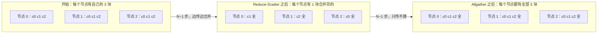
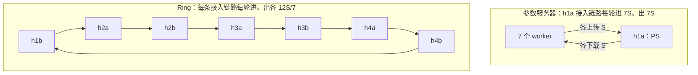
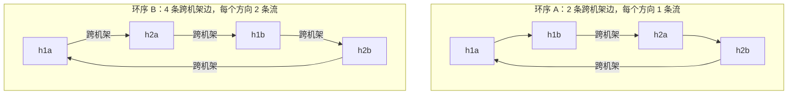
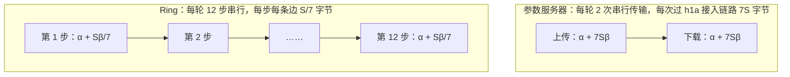

# 第 09 讲 集合通信与 AI 训练网络：多发一些，为什么反而更快

> **课程导读**：第 08 讲的参数服务器把所有梯度汇到一台机器。7 个 worker、模型 1 MB 时，每一轮有 14 MB 要挤过 h1a 的一条接入链路，通信占了一轮的八成以上。本讲把参数服务器拿掉，让 worker 之间直接合并：大家排成一个环，每人只和左右邻居交换数据。你会看到一个反直觉的结果：**每个 worker 发出的字节变成原来的 1.71 倍，作业却快了 3.5 倍。** 决定快慢的不是每人发了多少，而是最忙的那条链路要传多少。学完后，你应能手工推演 Ring AllReduce，用 α-β 模型算出它的时间，判断环序怎样决定跨机架流量，并按模型大小在参数服务器和 Ring 之间做出选择；也能说清 Tree、RDMA/RoCE 和在网聚合各自解决什么问题、付出什么代价。

---

## 学习目标

1. 说出 Broadcast、Reduce、AllReduce、Reduce-Scatter、Allgather 的输入与输出，说明 AllReduce 可以拆成 Reduce-Scatter 加 Allgather。
2. 手工推演 N=3 的 Ring AllReduce，算出每个节点每轮发送 $2(N-1)S/N$ 字节，写出它的 α-β 时间，并用“最忙链路要传多少”解释它为什么比参数服务器快。
3. 用每步用时和上联字节计数判断环上的瓶颈在哪条链路，说明环序如何决定跨机架边的数目，以及 ECMP 撞车何时会发生。
4. 用 α-β 模型比较参数服务器、Ring 和 Tree 的延迟项与带宽项，算出交叉点，并用实测找出模型漏掉的开销。
5. 说出 RDMA/RoCE 为什么需要无损网络、PFC 与 DCQCN 各起什么作用，以及在网聚合要付出的代价。

| 时间 | 内容 | 课堂产出 |
| --- | --- | --- |
| 0–10 分钟 | 模块一：从参数服务器到集合通信 | 写出五种集合操作的输入与输出；读出参数服务器作业里最忙的主机 |
| 10–32 分钟 | 模块二：Ring AllReduce | 手工推演 N=3；算出发送量和时间；实测对照 |
| 32–50 分钟 | 模块三：环序与机架上联 | 数跨机架边并预测；用上联字节解释两种环序的差别 |
| 50–62 分钟 | 模块四：AI 训练网络里的其他做法 | 笔算 Ring 与 Tree 的交叉点；说清 RoCE 为什么要无损网络 |
| 62–87 分钟 | 模块五：综合动手——小模型用 PS 还是 Ring | 预测表、实测、找出 Ring 的额外开销、一条选择规则 |
| 87–90 分钟 | 模块六：课后思考与拓展 | 三道短题；Lab 6 B 段说明 |

**课前准备（不计入上述 90 分钟）**：学生自行准备 Ubuntu Linux，工具与第 08 讲相同。不同小组各用独立主机或虚拟机，同一台机器由一人操作。本讲的脚本以压缩包分发，解压后得到 `lecture09_prep` 目录，完整实验床就是其中的 `lab4_topo.sh`，Lab 3 没有做完也不影响。本讲标为“实测样例”的输出来自 2026-11-11 的备课虚拟机（Ubuntu 26.04.1、Linux `7.0.0-43-generic`、x86_64、2 核 2.8 GB），单次读数以自己的测量为准。

```bash
# 1. 进入本讲目录（lecture09_prep 压缩包解压后的目录，路径换成你自己的）；本讲所有命令都在这里执行
cd ~/lecture09_prep

# 2. 清理第 05 讲课堂网络与 Lab 3 网络（节点重名，不能同时存在）
sudo bash lab3_classroom.sh down
sudo bash lab3_topo.sh down

# 3. 准备路由守护进程的 Python 环境
uv sync --frozen

# 4. 搭建完整实验床（默认加载 Lab 2 参考路由），并自检
sudo bash lab4_topo.sh up
sudo bash lab4_topo.sh check
```

准备完成应出现 `[OK] 8 条上联往返、8 台 host 网关可达、跨机架往返。`。本讲用到的脚本、Lab 2 参考路由和 Python 环境配置都在 `lecture09_prep` 目录里，脚本按自己所在的目录找其他文件，**以下所有命令都在这个目录里执行**（新开终端时先 `cd` 进去）。这些文件是 Lab 2–4 与 Lab 6 中相应文件的副本，只有一处例外：**`jobkit/ring.py` 是课堂用的 Ring 流量替身**。它的步数、每步发送的字节数和合并次数都与真正的 Ring AllReduce 相同，所以时间和流量可以拿来观察；但它不按块号记账，算出的结果是错的。`jobrun.py` 的副本因此不核对结果，每次运行 Ring 都会打印一行 `[替身]` 提示。真正的实现是 Lab 6 B 段的 TODO 5，在 Lab 6 的目录里完成。本讲的工具只用 Python 标准库，直接用系统 `python3` 运行。**中途不要拆拓扑；提前结束或中断时，执行 5.7 节的清理命令。**

---

## 模块一：从参数服务器到集合通信

### 1.1 参数服务器的问题出在哪

回顾第 08 讲：参数服务器（PS）作业的每一轮，N 个 worker 各上传一份 $S$ 字节的梯度，PS 聚合后再把 $S$ 字节的模型发回每个 worker。于是 PS 的接入链路每轮要进 $NS$ 字节、出 $NS$ 字节。N=7、$S=1$ MB 时，这条 100 Mbit/s 的链路一轮要忙约 1.17 s，而一轮的计算只有 200 ms。

同一时刻，另外 7 台 worker 的接入链路每轮只传 1 MB，大部分时间闲着。**网络的总容量并不缺，缺的是流量都挤在一条链路上。** 要让作业变快，就得把合并的工作分散开。

### 1.2 集合操作

分布式计算里，“一组进程一起完成的通信”叫**集合操作**（collective operation）。MPI 和 NVIDIA 的 NCCL 都把它们做成库函数，如 `MPI_Allreduce`、`ncclAllReduce`。常用的几种：

| 操作 | 开始时 | 结束时 | 例子 |
| --- | --- | --- | --- |
| Broadcast（广播） | 一个节点有数据 $x$ | 所有节点都有 $x$ | 分发初始模型 |
| Reduce（归约） | 每个节点 $i$ 有 $x_i$ | 一个节点有 $\sum x_i$ | PS 收齐并聚合梯度 |
| AllReduce（全归约） | 每个节点 $i$ 有 $x_i$ | 每个节点都有 $\sum x_i$ | 同步训练里合并梯度 |
| Reduce-Scatter（归约散发） | 每个节点有 $x_i$，切成 N 块 | 节点 $j$ 有某一块的 $\sum$ | Ring AllReduce 的前半段 |
| Allgather（全收集） | 节点 $j$ 有一块 | 每个节点都有全部 N 块 | Ring AllReduce 的后半段 |
| AllToAll（全交换） | 节点 $i$ 有给每个节点 $j$ 的一份 | 节点 $j$ 收到每个 $i$ 给它的那份 | 第 08 讲的 shuffle |

这里的 $\sum$ 泛指满足交换律和结合律的合并操作：训练里是梯度相加，本讲的作业用按位异或。

参数服务器的一轮，其实就是 Reduce（汇到 PS）加 Broadcast（从 PS 发出）。AllReduce 还有另一种拆法：**Reduce-Scatter 加 Allgather**。先让每个节点各负责合并一块，再把合并好的块互相传开，全程没有中心节点。



*图示说明：N=3 的教学示意。开始时三个节点的 c0 内容各不相同（各自的梯度）；“全”表示这一块已经合并了全部 3 个节点的贡献。哪个节点最后负责哪一块，取决于 2.1 节的发送规则。*

### 1.3 短观察：参数服务器的一轮里谁最忙

**问题与预测**：7 个 worker，模型 1 MB，10 轮。每个 worker 每轮发出多少字节？8 台 host 里哪台发得最多，10 轮一共多少 MB？**运行前先写下你的预测。**

**工具与观察点**：`compare.py` 只读 `jobrun.py` 写下的结果文件，把一次作业排成一行。本讲主要看三列：

| 列 | 含义 | 来源 |
| --- | --- | --- |
| 通信ms | 平均每个 worker 每轮从算完到同步结束的时间（PS 含等 barrier） | 作业进程的时间戳 |
| 发送/S | 平均每个 worker 每轮在应用层发出的字节数，以模型大小 $S$ 为单位 | 作业进程自己计数 |
| 最忙发送MB | 8 台 host 中 `eth0` 发送字节最多的一台，含报文头和 ACK | 作业前后读 `/sys/class/net/eth0/statistics/tx_bytes` 相减 |

```bash
# 1. 参数服务器基线：7 个 worker，模型 1 MB，每轮计算 200 ms，10 轮，约 14 秒
sudo python3 jobrun.py --label ps7

# 2. 排成表：每个 worker 每轮发多少，哪台 host 发得最多
python3 compare.py ps7
```

**实测样例**：

```output
[ps7] ps N=7 模型 1 MB 10 轮 cubic：JCT = 13.725 s，结果 /tmp/lab06-results/ps7.json
标签              算法    N 环序    跨机架     JCT s   计算ms   通信ms  发送/S最忙发送MB
ps7               ps      7 -           -    13.725    200.3   1171.4   1.000     74.8 h1a
```

**读数据**：

1. **每个 worker 每轮发 1 份**：“发送/S”是 1.000，即每轮上传一份 1 MB 的梯度。
2. **最忙的是 PS 所在的 h1a**：10 轮共发 74.8 MB。逐项核对：应用数据是 10 轮 × 7 份 × 1 MB = 70 MB；每个 1514 字节的帧只带 1448 字节负载，加上报文头后放大约 4.6%，得到 73.2 MB；剩下的约 1.6 MB 大致是 h1a 为 70 MB 上传数据回的 ACK（按每两个报文一个 66 字节的 ACK 估算）。
3. **通信占了一轮的 85%**：每轮通信 1171.4 ms，计算 200.3 ms。

**边界**：`eth0` 计数的是这台 host 在作业期间发出的全部字节，分不清哪些是数据、哪些是 ACK，上面的拆分是估算。它说明 h1a 发得最多，但单凭这一列，还不能断定瓶颈一定在 h1a 的接入链路。第 08 讲 2.2 节用 PS 一侧的时间戳给出过直接证据。

---

## 模块二：Ring AllReduce

### 2.1 排成一个环

N 个节点排成一个环，节点 $r$ 只向右邻居 $r+1$ 发送，只从左邻居 $r-1$ 接收（下标对 N 取模）。每个节点把自己的向量切成 N 块，编号 0 到 $N-1$，然后分两个阶段，每个阶段 $N-1$ 步，每一步所有节点**同时**发一块、收一块：

- **Reduce-Scatter**，第 $s$ 步（从 0 数）：发出块 $(r-s)\bmod N$；收到块 $(r-1-s)\bmod N$，把它合并进自己的同号块。$N-1$ 步之后，块 $(r+1)\bmod N$ 已经合并了全部节点的贡献。
- **Allgather**，第 $s$ 步：发出块 $(r+1-s)\bmod N$（已经合并完）；收到块 $(r-s)\bmod N$，直接覆盖自己的那块。$N-1$ 步之后，每个节点都有完整结果。

这个算法在高性能计算领域早已有之，2017 年前后经百度的开源实现和 Uber 的 Horovod 推广到深度学习训练里。

### 2.2 动手推演：N=3（5 分钟）

用 2.1 节的规则把下表填完。$c_j$ 是第 $j$ 块，方括号里是已经合并进来的节点，“全”表示合并了全部 3 个节点。第一行已经填好。

| 阶段与步 | 节点 0 发 → 收 | 节点 1 发 → 收 | 节点 2 发 → 收 |
| :--- | :--- | :--- | :--- |
| Reduce-Scatter 第 0 步 | $c_0$ → $c_2$，得 $c_2[0,2]$ | $c_1$ → $c_0$，得 $c_0[0,1]$ | $c_2$ → $c_1$，得 $c_1[1,2]$ |
| Reduce-Scatter 第 1 步 | | | |
| Allgather 第 0 步 | | | |
| Allgather 第 1 步 | | | |

*思考提示*：Reduce-Scatter 第 1 步，节点 0 发出的是 $(0-1)\bmod 3=2$ 号块，也就是上一步刚合并好的 $c_2[0,2]$；它收到节点 2 发来的 $c_1[1,2]$，合并后得到 $c_1$ 全。按同样的方法填完其余格子，然后对照下表。

| 阶段与步 | 节点 0 发 → 收 | 节点 1 发 → 收 | 节点 2 发 → 收 |
| :--- | :--- | :--- | :--- |
| Reduce-Scatter 第 1 步 | $c_2[0,2]$ → $c_1[1,2]$，得 $c_1$ 全 | $c_0[0,1]$ → $c_2[0,2]$，得 $c_2$ 全 | $c_1[1,2]$ → $c_0[0,1]$，得 $c_0$ 全 |
| Allgather 第 0 步 | $c_1$ 全 → $c_0$ 全 | $c_2$ 全 → $c_1$ 全 | $c_0$ 全 → $c_2$ 全 |
| Allgather 第 1 步 | $c_0$ 全 → $c_2$ 全 | $c_1$ 全 → $c_0$ 全 | $c_2$ 全 → $c_1$ 全 |

每个节点在每一步都恰好发一块、收一块，没有谁比别人更忙。这就是去掉中心的意义。

### 2.3 算一算：发多少、要多久

**发送量**：每个节点每轮发送 $2(N-1)$ 次，每次 $S/N$ 字节：

$$\text{每个节点每轮发送}=\frac{2(N-1)}{N}\,S$$

N=7 时是 $12/7\approx1.714$ 倍的 $S$，**比参数服务器里的 worker 还多**（那里是 1 倍）。

**最忙的链路**：参数服务器的 h1a 接入链路每轮要进、出各 $NS=7$ MB；Ring 里每条接入链路每轮进、出各 $1.714$ MB，而且所有链路同时工作。最忙链路上的数据量差了 $7/1.714\approx4.1$ 倍。



*图示说明：同一组 7 台 worker 的两种通信方式，节点位置相同。箭头是逻辑上的收发关系，实际报文都经过 leaf，跨机架的还要经过 spine。Ring 按机架顺序排列，有 4 条跨机架边：h1b→h2a、h2b→h3a、h3b→h4a、h4b→h1b。Ring 不需要 h1a。*

**时间**：假设每一步所有边同时传、互不争用，一步的时间是 $\alpha+\beta S/N$，一轮共 $2(N-1)$ 步：

$$T_{\text{ring}}=2(N-1)\left(\alpha+\beta\frac{S}{N}\right),\qquad T_{\text{ps}}=2(\alpha+\beta NS)$$

代入第 08 讲 3.2 节的 $\alpha=0.41$ ms、$\beta=83.67$ ns/字节，N=7、$S=1$ MB：

$$T_{\text{ring}}=12\times(0.41+11.95)\ \text{ms}=148.4\ \text{ms},\qquad T_{\text{ps}}=2\times(0.41+585.7)\ \text{ms}=1172.2\ \text{ms}$$

两个公式的结构值得记住：

| | 延迟项（付几次 $\alpha$） | 带宽项 |
| --- | --- | --- |
| 参数服务器 | $2\alpha$，与 N 无关 | $2\beta NS$，随 N 线性增长 |
| Ring | $2(N-1)\alpha$，随 N 线性增长 | $2\beta S(N-1)/N$，N 大时趋近 $2\beta S$，几乎与 N 无关 |

Ring 用更多的步数，换来了几乎不随 N 增长的带宽项。Patarasuk 与 Yuan（2009）证明，在他们的模型下 Ring 的带宽项已经达到下界，所以它被称为**带宽最优**（bandwidth optimal）。代价是延迟项，模块四、五会回到这一点。

### 2.4 短观察：只换通信方式

**问题与预测**：同样的 7 台 worker、同样的计算，只把参数服务器换成 Ring，环按机架顺序排列。“发送/S”是多少？最忙的 host 发多少 MB？JCT 变成多少？按 2.3 节的公式，每一步应该用多久？**先写下预测。**

**工具与观察点**：`compare.py --steps` 把 Ring 一轮的 12 步分开：第 $i$ 步的用时是相邻两次交换完成的时间差，第 1 步从本轮计算结束算起，再对全部 worker 和全部轮次取平均。前 6 步是 Reduce-Scatter，后 6 步是 Allgather。

```bash
# 1. 同样 7 台 worker，按机架顺序排成环，只换通信方式，约 5 秒
RACK=h1b,h2a,h2b,h3a,h3b,h4a,h4b
sudo python3 jobrun.py --algo ring --label ring7 --workers "$RACK"

# 2. 和参数服务器放在一起比，再看环上每一步的用时
python3 compare.py ps7 ring7
python3 compare.py --steps ring7
```

**实测样例**：

```output
[替身] 课上的 Ring 只复现流量与合并开销，不核对结果；Lab 6 的 TODO 5 在 Lab 6 的目录里完成。
[ring7] ring N=7 模型 1 MB 10 轮 cubic：JCT = 3.902 s，结果 /tmp/lab06-results/ring7.json
标签              算法    N 环序    跨机架     JCT s   计算ms   通信ms  发送/S最忙发送MB
ps7               ps      7 -           -    13.725    200.3   1171.4   1.000     74.8 h1a
ring7             ring    7 given       4     3.902    200.5    189.1   1.714     18.2 h4b
ring7：N=7，每步传 142857 字节，跨机架边 4，共 12 步，平均每步用时（ms）
  15.4 17.7 16.6 16.7 16.4 16.5 16.4 14.3 14.8 14.6 14.7 14.6
```

**读数据**：

1. **发得更多**：“发送/S”从 1.000 变成 1.714，与 $12/7$ 吻合。
2. **最忙的链路轻了**：最忙的 host 从 h1a 的 74.8 MB 降到 18.2 MB，比值 4.1，与 2.3 节最忙链路的数据量之比 $7/1.714\approx4.1$ 一致。最忙的那台现在是哪台已经不重要，各台都差不多。
3. **快了多少**：每轮通信从 1171.4 ms 降到 189.1 ms，约 6.2 倍；JCT 从 13.725 s 降到 3.902 s，约 3.5 倍。JCT 的倍数小一些，是因为每轮 200 ms 的计算没有变。
4. **比预测慢 27%**：预测每步 $0.41+83.67\times10^{-6}\times142857\approx12.4$ ms，实测每一步都在 14.3–17.7 ms 之间，12 步合计 189.1 ms，比预测的 148.4 ms 多 27%。
5. **两个阶段不一样快**：前 6 步平均 16.6 ms，后 6 步平均 14.9 ms，相差约 1.7 ms。Reduce-Scatter 每一步都要把收到的 143 KB 和自己的块做一次异或，Allgather 只传不算。备课时单独测过，一次 143 KB 的异或约 1.3 ms；这里 7 个进程挤在 2 个 CPU 核上，所以会更慢一些。

**边界**：替身保证了每步的块大小、步数和合并次数与真正的 Ring 相同，结果是错的不影响时间。Lab 6 用你自己实现的 Ring 测得的数字会与这里接近，但不会完全相同。这里 leaf–spine 上联也是 100 Mbit/s，4 条跨机架边各走一条上联时不会成为瓶颈；上联收窄后会怎样，是模块三的问题。预测偏低的那 27% 到底花在哪里，留到 5.5 节用更多数据回答。

---

## 模块三：环序与机架上联

### 3.1 一步的时间由最慢的边决定

Ring 的每一步，所有边同时传一块；下一步要发的块（Reduce-Scatter 里）就是上一步刚收到并合并好的块，所以**一步的时间由环上最慢的那条边决定**，一条慢边会拖住所有人。

一条边有多快，取决于它的路径：

- **同机架的边**：host → leaf → host，只经过 100 Mbit/s 的接入链路。
- **跨机架的边**：host → leaf → spine → leaf → host，还要经过 leaf 的上联。每个 leaf 有两条上联（分别连 r5、r6），去往其他机架的流量由 ECMP 按流选一条。本实验床的哈希策略是 `fib_multipath_hash_policy=1`（四层哈希，第 05 讲 3.2 节），作业每次运行都新建连接，所以同一对 host 每次运行都可能走不同的 spine。

两条同方向的跨机架流，如果被哈希到同一条上联，就要平分它的带宽。这就是第 05 讲 3.4 节的大象流碰撞，本讲简称 **ECMP 撞车**。

### 3.2 数跨机架边，先做预测

上联降到 50 Mbit/s，只用机架 1、2 的 4 台 host，比较两种环序：

| 环序 | 环 | 跨机架边 | r1→r2 方向的流 | r2→r1 方向的流 |
| --- | --- | --- | --- | --- |
| A：同机架相邻 | h1a → h1b → h2a → h2b → h1a | 2 | h1b→h2a | h2b→h1a |
| B：交错 | h1a → h2a → h1b → h2b → h1a | 4 | h1a→h2a、h1b→h2b | h2a→h1b、h2b→h1a |



*图示说明：两次实验，节点位置与链路相同：r1、r2 各有两条 50 Mbit/s 上联，分别连到 r5、r6；host 接入仍是 100 Mbit/s。箭头是环上的逻辑收发关系。A 中每个方向只有 1 条跨机架流，最多占用一条上联；B 中每个方向有 2 条，ECMP 各自选上联，可能落在同一条上。图中省略了 r3、r4 和其他 host，它们不参加这次作业。*

**先算一步要多久**。每步每条边传 $S/N=250$ KB：

- 同机架的边：$250\,000\times83.67\ \text{ns}\approx20.9$ ms。
- 跨机架的边独占一条 50 Mbit/s 上联：有效速率约 47.8 Mbit/s（第 08 讲 4.2 节），$250\,000\times8/(47.8\times10^6)\approx41.8$ ms。
- 两条跨机架流挤在同一条上联：各分一半，约 83.7 ms。

**运行前填写预测**：A 每步约多少？B 不撞车时呢？撞车时呢？一个方向上两条流撞车的概率是 $1/2$，两个方向都不撞的概率是多少？

| 环序 | 每步预测（ms） | 6 步预测（ms） | 实测通信（ms） |
| --- | --- | --- | --- |
| A | | | |
| B，两个方向都不撞 | | | |
| B，至少一个方向撞车 | | | |

### 3.3 动手实践：只换环序

本节每人动手，约 4 分钟，6 次运行共约 40 秒。读计数器的方法与第 08 讲 4.2 节相同：每次运行前后读 r1、r2 四条上联发送方向的累计字节，相减就是这次作业在每条上联上走过的数据量。

```bash
# 1. 全部上联降到 50 Mbit/s，host 接入仍是 100 Mbit/s
sudo bash lab4_topo.sh rate 50

# 2. 定义函数：读端口累计发送字节；跑一次环，打印 r1、r2 四条上联各多发了多少 MB
sent() { sudo ip netns exec "$1" tc -s class show dev "$2" classid 1:10 | awk '/Sent/{print $2; exit}'; }
uplinks() { echo "$(sent r1 r1-r5) $(sent r1 r1-r6) $(sent r2 r2-r5) $(sent r2 r2-r6)"; }
run4() {
  local a b
  a=($(uplinks))
  sudo python3 jobrun.py --algo ring --label "$1" --workers "$2" | grep JCT
  b=($(uplinks))
  echo "  上联（MB）：r1→r5 $(( (b[0]-a[0])/1000000 ))，r1→r6 $(( (b[1]-a[1])/1000000 ))；r2→r5 $(( (b[2]-a[2])/1000000 ))，r2→r6 $(( (b[3]-a[3])/1000000 ))"
}

# 3. 环序 A（同机架相邻）跑 2 次，环序 B（交错）跑 4 次，共约 40 秒
for i in 1 2; do run4 ordA-"$i" h1a,h1b,h2a,h2b; done
for i in 1 2 3 4; do run4 ordB-"$i" h1a,h2a,h1b,h2b; done
```

**实测样例**：

```output
[*] 全部 leaf–spine 链路两端 egress = 50 Mbit/s；host 接入口保持 100 Mbit/s。
[ordA-1] ring N=4 模型 1 MB 10 轮 cubic：JCT = 4.400 s，结果 /tmp/lab06-results/ordA-1.json
  上联（MB）：r1→r5 0，r1→r6 16；r2→r5 0，r2→r6 15
[ordA-2] ring N=4 模型 1 MB 10 轮 cubic：JCT = 4.429 s，结果 /tmp/lab06-results/ordA-2.json
  上联（MB）：r1→r5 16，r1→r6 0；r2→r5 15，r2→r6 0
[ordB-1] ring N=4 模型 1 MB 10 轮 cubic：JCT = 4.766 s，结果 /tmp/lab06-results/ordB-1.json
  上联（MB）：r1→r5 16，r1→r6 15；r2→r5 15，r2→r6 16
[ordB-2] ring N=4 模型 1 MB 10 轮 cubic：JCT = 6.675 s，结果 /tmp/lab06-results/ordB-2.json
  上联（MB）：r1→r5 0，r1→r6 31；r2→r5 16，r2→r6 16
[ordB-3] ring N=4 模型 1 MB 10 轮 cubic：JCT = 4.746 s，结果 /tmp/lab06-results/ordB-3.json
  上联（MB）：r1→r5 16，r1→r6 16；r2→r5 16，r2→r6 16
[ordB-4] ring N=4 模型 1 MB 10 轮 cubic：JCT = 6.648 s，结果 /tmp/lab06-results/ordB-4.json
  上联（MB）：r1→r5 0，r1→r6 31；r2→r5 16，r2→r6 16
```

`run4` 用管道只留下 `jobrun.py` 打印 JCT 的那一行，所以这里看不到 `[替身]` 提示。哈希结果每次运行都不同，你的上联分配不会和这里一样。

### 3.4 读数据：撞车写在计数器里

```bash
# 1. 排成表，再看每一步的用时
python3 compare.py ordA-1 ordA-2 ordB-1 ordB-2 ordB-3 ordB-4
python3 compare.py --steps ordA-1 ordB-1 ordB-2 ordB-3 ordB-4

# 2. 恢复 100 Mbit/s，并核对基线
sudo bash lab4_topo.sh rate 100
sudo bash lab4_topo.sh status
```

**实测样例**：

```output
标签              算法    N 环序    跨机架     JCT s   计算ms   通信ms  发送/S最忙发送MB
ordA-1            ring    4 given       2     4.400    200.2    238.7   1.500     16.0 h2b
ordA-2            ring    4 given       2     4.429    200.3    241.3   1.500     16.0 h1b
ordB-1            ring    4 given       4     4.766    200.5    275.9   1.500     16.1 h2b
ordB-2            ring    4 given       4     6.675    200.2    464.8   1.500     16.1 h2b
ordB-3            ring    4 given       4     4.746    200.2    274.2   1.500     16.1 h2b
ordB-4            ring    4 given       4     6.648    200.1    462.5   1.500     16.1 h2b
ordA-1：N=4，每步传 250000 字节，跨机架边 2，共 6 步，平均每步用时（ms）
  33.5 36.2 42.8 42.3 41.5 42.3
ordB-1：N=4，每步传 250000 字节，跨机架边 4，共 6 步，平均每步用时（ms）
  44.3 47.6 47.2 46.8 45.2 44.6
ordB-2：N=4，每步传 250000 字节，跨机架边 4，共 6 步，平均每步用时（ms）
  61.6 67.2 84.3 84.5 83.5 83.2
ordB-3：N=4，每步传 250000 字节，跨机架边 4，共 6 步，平均每步用时（ms）
  44.1 48.6 46.2 46.2 44.1 44.8
ordB-4：N=4，每步传 250000 字节，跨机架边 4，共 6 步，平均每步用时（ms）
  61.1 67.8 84.5 83.4 83.0 82.6
[*] 全部 leaf–spine 链路两端 egress = 100 Mbit/s；host 接入口保持 100 Mbit/s。
[档位] leaf–spine 100 Mbit/s；host 接入 100 Mbit/s。场景：无。
[基线] 32 个限速端口均为 HTB + fq，速率与 burst 为基线值。
[基线] r1–r4 没有额外策略路由（自然 ECMP）。
```

把计数器和用时整理成一张表。每条跨机架流每轮传 $6\times250$ KB $=1.5$ MB，10 轮 15 MB，加上报文头约 15.7 MB，所以计数器上的 15、16 MB 对应 1 条流，31 MB 对应 2 条流：

| 次 | r1 上联（r5 : r6，MB） | r2 上联（r5 : r6，MB） | 撞车 | 第 3–6 步（ms） | 通信（ms） | JCT（s） |
| --- | --- | --- | --- | --- | --- | --- |
| A-1 | 0 : 16 | 0 : 15 | 不可能 | 41.5–42.8 | 238.7 | 4.400 |
| A-2 | 16 : 0 | 15 : 0 | 不可能 | — | 241.3 | 4.429 |
| B-1 | 16 : 15 | 15 : 16 | 无 | 44.6–47.2 | 275.9 | 4.766 |
| B-2 | 0 : 31 | 16 : 16 | r1→r2 方向 | 83.2–84.5 | 464.8 | 6.675 |
| B-3 | 16 : 16 | 16 : 16 | 无 | 44.1–46.2 | 274.2 | 4.746 |
| B-4 | 0 : 31 | 16 : 16 | r1→r2 方向 | 82.6–84.5 | 462.5 | 6.648 |

1. **A 的每个方向只有一条流**：每个 leaf 只有一条上联有字节（走 r5 还是 r6 由哈希决定，两次不同），不可能撞车。第 3–6 步约 42 ms，与独占一条上联的预测 41.8 ms 一致；6 步预测约 253 ms，实测 239–241 ms，接近。
2. **B 撞车的两次**：r1→r6 上联走了 31 MB，r1→r5 是 0，说明 r1→r2 方向的两条流都被哈希到了 r6。第 3–6 步稳定在 83–84.5 ms，正好是两条流平分一条上联的 83.7 ms。只要一个方向撞车，每一步都被它拖住，JCT 从约 4.4 s 变成约 6.65 s。
3. **B 不撞车的两次**：四条上联各走约 16 MB，每步 44–49 ms，JCT 约 4.75 s，只比 A 慢约 8%。**多出 2 条跨机架边本身代价不大，代价主要来自撞车。**
4. **第 1、2 步比后面短**：每步用时是全部 worker 的平均。头两步里，不在撞车上联后面的 worker 收得快；环上一环扣一环，过一两步后，慢边的节奏就传到了每个节点。

备课时另一组 4 次运行里，B 每次都至少有一个方向撞车，JCT 为 6.71–7.16 s，其中两个方向都撞车的那次最慢（7.156 s）。

**结论**：按机架排列的环序，每个机架只有一条边出去、一条边进来，所以每个方向最多一条跨机架流，**ECMP 撞车根本不会发生**。交错的环序每次运行都可能撞车：两个方向都不撞的概率只有 $1/4$，备课时的 8 次运行里有 6 次撞车，结果取决于运气。这就是 Lab 6 任务 7 要实现的**拓扑感知环序**。

**边界**：每种环序只跑了几次，撞车的比例不能当作概率的估计。B 不撞车时仍比 A 慢约 8%，可能的来源包括反向的 ACK 也要过上联、各节点的起步不同步，这份数据不足以区分；要进一步分辨，可以在作业期间抓上联上的报文，按方向统计数据与 ACK 的字节。A 的实测比预测略短，一个可能的原因是“通信ms”按各 worker 自己的起点计时，而各节点的起止并不完全对齐，这里没有单独验证。

---

## 模块四：AI 训练网络里的其他做法

本模块只讲不测，约 12 分钟。

### 4.1 节点多了，Ring 的步数成了负担

Ring 的延迟项是 $2(N-1)\alpha$。N=1024 时一轮要走 2046 步，$\alpha$ 再小，乘上 2046 也不小。大规模训练里常见的另一类算法是**树**（tree）：沿一棵二叉树逐层归约到根，再逐层广播回来，步数只有 $2\log_2N$ 量级。

单棵二叉树有个问题：叶子只收发一次，内部节点要收两个孩子的数据，带宽用得不均匀。**双二叉树**（double binary tree，Sanders、Speck、Träff，2009）用两棵树各承担一半数据，并让一个节点在一棵树里是内部节点、在另一棵里是叶子，于是两棵树合起来，每个节点的负担接近均匀。NVIDIA 在 NCCL 2.4（2019 年）中加入了双二叉树，并按消息大小和节点数在 Ring 与 Tree 之间自动选择。

为了比较量级，把双二叉树的时间简化为（**教学简化模型**，忽略流水线分段等实现细节）：

$$T_{\text{tree}}\approx2\log_2N\cdot\alpha+2\beta S$$

### 4.2 笔算：Ring 与 Tree 的交叉点（3 分钟）

N=8，$\alpha=0.41$ ms，$\beta=83.67$ ns/字节。按上面的简化模型，模型多大时 Tree 比 Ring 快？N=64 时呢？

*思考提示*：N=8 时，Ring 是 $14\alpha+1.75\beta S$，Tree 是 $6\alpha+2\beta S$。Tree 快的条件是 $8\alpha>0.25\beta S$，即 $S<32\alpha/\beta\approx157$ KB。N=64 时，Ring 是 $126\alpha+(63/32)\beta S$，Tree 是 $12\alpha+2\beta S$，交叉点 $S=114\alpha/(\beta/32)=3648\alpha/\beta\approx17.9$ MB。节点越多，Tree 占优的范围越大。

另一种思路是**分层**（hierarchical）：先在机架内合并，再只让每个机架的代表跨机架做 AllReduce，最后在机架内广播。它和模块三的拓扑感知环序是同一个想法：让跨机架的流量尽量少。

### 4.3 让网卡来搬：RDMA 与 RoCE

第 08 讲 3.3 节看到，我们测到的 $\alpha$ 里包含内核协议栈、系统调用和 Python 的开销；5.5 节还会看到每一步额外的拷贝开销。**RDMA**（Remote Direct Memory Access）让网卡直接读写对端内存，传输层在网卡里实现，绕过内核和 CPU 拷贝，每条消息的固定开销可以降到微秒级。

RDMA 起源于 InfiniBand 网络。**RoCEv2**（RDMA over Converged Ethernet version 2）把 InfiniBand 的传输层报文装进 UDP/IP，UDP 目的端口是 4791，所以能在普通的三层以太网数据中心里路由，ECMP 也能按 UDP 源端口分流。它的规范是 InfiniBand 架构规范 1.2.1 的附录 A17（RoCEv1 是附录 A16，直接用以太网类型 0x8915，只能在二层内使用）。一个 RoCEv2 报文的结构（字段宽度不按比例）：

```
 以太网头   IPv4 头    UDP 头                  IB BTH    RDMA 载荷     ICRC   FCS
+--------+---------+-----------------------+--------+-------------+------+-----+
|  14 B  |  20 B   | 8 B，目的端口 4791     |  12 B  | 按 IB MTU 分段 |  4 B | 4 B |
+--------+---------+-----------------------+--------+-------------+------+-----+
```

BTH（Base Transport Header）里有操作码、目的队列对（QP）编号和报文序号；RDMA Write 等操作在 BTH 之后还有扩展头。ICRC 是覆盖不变字段的校验和。

**为什么要无损网络**：常见的 RoCE 网卡丢包恢复很简单，收到乱序报文就丢弃并通知发送端，发送端从丢失的那个报文起全部重发（go-back-N）。丢一个包要重传一串，吞吐会急剧下降，所以 RoCE 部署通常要求网络不丢包：

- **PFC**（Priority Flow Control，IEEE 802.1Qbb）：交换机某个优先级的队列快满时，向上游发暂停帧，让上游停止发送这个优先级的报文。代价是暂停会一级级向上游扩散，造成队头阻塞、不公平，甚至循环等待导致的死锁。
- **DCQCN**（Zhu 等，SIGCOMM 2015）：交换机按队列长度给报文打 ECN 标记，接收端网卡发回拥塞通知报文（CNP），发送端网卡降低速率。它让队列在触发 PFC 之前就降下来，思路和第 07 讲的 DCTCP 一样。

也有研究认为应该反过来改进网卡：IRN（Mittal 等，SIGCOMM 2018）在网卡里改用选择性重传，不依赖 PFC。

### 4.4 让交换机来算：在网聚合

既然所有梯度都要经过交换机，能不能让交换机直接把它们加起来？**在网聚合**（in-network aggregation）就是这个思路：每个 worker 把梯度分片发给交换机，交换机累加后把结果发回所有 worker。

- **SHArP**（Graham 等，2016）：Mellanox 在 InfiniBand 交换机芯片里加入了聚合单元。
- **SwitchML**（Sapio 等，NSDI 2021）：用可编程以太网交换机做聚合。论文报告在多个真实模型上训练提速最高 5.5 倍。

它的好处是每个 worker 只发出一份 $S$、收回一份 $S$，数据量约为 Ring 的一半，步数也不随 N 增长。代价同样明显：交换机的片上内存很小，梯度只能分批流过；交换机只做整数运算，浮点梯度要先按比例转成定点数；丢包要由主机侧协议恢复；跨多个机架时还要分层聚合。

### 4.5 小结：四种做法比一比

| 方式 | 每个 worker 每轮发送 | 延迟项 | 带宽项 | 主要代价 |
| --- | --- | --- | --- | --- |
| 参数服务器 | $S$（PS 发 $NS$） | $2\alpha$ | $2\beta NS$ | PS 的接入链路成为瓶颈 |
| Ring | $2(N-1)S/N$ | $2(N-1)\alpha$ | $2\beta S(N-1)/N$ | 步数随 N 线性增长 |
| 双二叉树（简化） | 约 $2S$ | 约 $2\log_2N\cdot\alpha$ | 约 $2\beta S$ | 实现复杂 |
| 在网聚合 | $S$ | 与 N 无关 | 约 $\beta S$ | 需要交换机支持；定点数；内存有限 |

表中的延迟项与带宽项都是忽略实现细节的量级比较，不是精确的时间。

---

## 模块五：综合动手——小模型用 PS 还是 Ring

### 5.1 任务与条件

**你的角色**：你在给训练框架写一条“自动选择同步方式”的规则：给定一次同步的数据量 $S$，选参数服务器还是 Ring。用数据回答：分界点在哪里？由什么决定？模型漏掉了什么？

**固定条件**：7 个 worker（h1b、h2a、h2b、h3a、h3b、h4a、h4b）；参数服务器在 h1a；Ring 按机架顺序（与 2.4 节相同，4 条跨机架边）；每轮计算 200 ms；10 轮；CUBIC；100 Mbit/s 档位。

**改变的因素**：只改 $S$ 和同步方式。

| 组 | 同步方式 | $S$ | 每轮串行传输次数 | 每次经过最忙链路的数据 |
| --- | --- | --- | --- | --- |
| PS | 参数服务器 | 1 KB、3 KB、10 KB、30 KB、100 KB、1 MB | 2（上传、下载） | $7S$ |
| Ring | Ring（替身） | 同上 | 12 | $S/7$ |

1 MB 这一档直接用模块一、二的 `ps7`、`ring7`。`ps7` 的 worker 用的是默认列表，成员相同、顺序不同，参数服务器不受顺序影响。

**指标**：`compare.py` 的“通信ms”，即平均每个 worker 每轮从算完到同步结束的时间。两组的计算时间相同，模型小时 JCT 的差别只有几十毫秒，所以主要比较“通信ms”，JCT 作为参考。



*图示说明：一轮通信的教学示意，长度不按比例。两组只有同步方式不同，计算、worker 与链路都相同。模型小时，每一段里 α 占主导，Ring 要付 12 次 α，参数服务器只付 2 次；模型大时 β 项占主导，参数服务器每次要传 7S，Ring 每步只传 S/7。*

### 5.2 先填预测（4 分钟）

令两个公式相等，解出交叉点：

$$2(\alpha+\beta NS)=2(N-1)\left(\alpha+\beta\frac{S}{N}\right)\ \Rightarrow\ S^*=\frac{(N-2)\,\alpha}{\beta\left(N-\frac{N-1}{N}\right)}$$

用你在第 08 讲 3.2 节算出的 $\alpha$、$\beta$ 运行下面的脚本（样例里是备课时的值，要换成自己的），先把预测抄进下表。

```bash
# 1. 预测：把 alpha、beta 换成你在第 08 讲 3.2 节算出的值
python3 -c "
alpha, beta, N = 0.00041, 83.67e-9, 7   # 换成你自己的 α、β
for S in (1e3, 3e3, 1e4, 3e4, 1e5, 1e6):
    ps = 2 * (alpha + beta * N * S)
    ring = 2 * (N - 1) * (alpha + beta * S / N)
    print(f'{S / 1e6:g} MB   PS {ps * 1e3:7.1f} ms   Ring {ring * 1e3:6.1f} ms')
print('交叉点约', round((N - 2) * alpha / (beta * (N - (N - 1) / N))), '字节')"
```

**样例结果**：

```output
0.001 MB   PS     2.0 ms   Ring    5.1 ms
0.003 MB   PS     4.3 ms   Ring    5.4 ms
0.01 MB   PS    12.5 ms   Ring    6.4 ms
0.03 MB   PS    36.0 ms   Ring    9.2 ms
0.1 MB   PS   118.0 ms   Ring   19.3 ms
1 MB   PS  1172.2 ms   Ring  148.4 ms
交叉点约 3989 字节
```

| $S$ | PS 预测（ms） | Ring 预测（ms） | PS 实测（ms） | Ring 实测（ms） | 实测谁快 |
| --- | --- | --- | --- | --- | --- |
| 1 KB | | | | | |
| 3 KB | | | | | |
| 10 KB | | | | | |
| 30 KB | | | | | |
| 100 KB | | | | | |
| 1 MB | | | | | |

### 5.3 实测（4 分钟）

```bash
# 1. 5 个模型大小 × 2 种方式，共约 25 秒；1 MB 直接用模块一、二的 ps7、ring7
RACK=h1b,h2a,h2b,h3a,h3b,h4a,h4b
for s in 0.001 0.003 0.01 0.03 0.1; do
  sudo python3 jobrun.py --label p-"$s" --workers "$RACK" --model-mb "$s" | grep JCT
  sudo python3 jobrun.py --algo ring --label r-"$s" --workers "$RACK" --model-mb "$s" | grep JCT
done

# 2. 排成一张表
python3 compare.py p-0.001 r-0.001 p-0.003 r-0.003 p-0.01 r-0.01 p-0.03 r-0.03 p-0.1 r-0.1 ps7 ring7
```

**实测样例**：

```output
[p-0.001] ps N=7 模型 0.001 MB 10 轮 cubic：JCT = 2.034 s，结果 /tmp/lab06-results/p-0.001.json
[r-0.001] ring N=7 模型 0.001 MB 10 轮 cubic：JCT = 2.093 s，结果 /tmp/lab06-results/r-0.001.json
[p-0.003] ps N=7 模型 0.003 MB 10 轮 cubic：JCT = 2.040 s，结果 /tmp/lab06-results/p-0.003.json
[r-0.003] ring N=7 模型 0.003 MB 10 轮 cubic：JCT = 2.084 s，结果 /tmp/lab06-results/r-0.003.json
[p-0.01] ps N=7 模型 0.01 MB 10 轮 cubic：JCT = 2.099 s，结果 /tmp/lab06-results/p-0.01.json
[r-0.01] ring N=7 模型 0.01 MB 10 轮 cubic：JCT = 2.114 s，结果 /tmp/lab06-results/r-0.01.json
[p-0.03] ps N=7 模型 0.03 MB 10 轮 cubic：JCT = 2.315 s，结果 /tmp/lab06-results/p-0.03.json
[r-0.03] ring N=7 模型 0.03 MB 10 轮 cubic：JCT = 2.154 s，结果 /tmp/lab06-results/r-0.03.json
[p-0.1] ps N=7 模型 0.1 MB 10 轮 cubic：JCT = 3.157 s，结果 /tmp/lab06-results/p-0.1.json
[r-0.1] ring N=7 模型 0.1 MB 10 轮 cubic：JCT = 2.281 s，结果 /tmp/lab06-results/r-0.1.json
标签              算法    N 环序    跨机架     JCT s   计算ms   通信ms  发送/S最忙发送MB
p-0.001           ps      7 -           -     2.034    200.4      2.3   1.000      0.1 h1a
r-0.001           ring    7 given       4     2.093    200.3      8.5   1.716      0.0 h4b
p-0.003           ps      7 -           -     2.040    200.4      3.2   1.000      0.2 h1a
r-0.003           ring    7 given       4     2.084    200.3      7.7   1.716      0.1 h3b
p-0.01            ps      7 -           -     2.099    200.3      9.2   1.000      0.8 h1a
r-0.01            ring    7 given       4     2.114    200.4     10.4   1.715      0.2 h3b
p-0.03            ps      7 -           -     2.315    200.3     30.8   1.000      2.3 h1a
r-0.03            ring    7 given       4     2.154    200.4     14.4   1.714      0.6 h4b
p-0.1             ps      7 -           -     3.157    200.4    114.9   1.000      7.5 h1a
r-0.1             ring    7 given       4     2.281    200.3     27.5   1.714      1.9 h2b
ps7               ps      7 -           -    13.725    200.3   1171.4   1.000     74.8 h1a
ring7             ring    7 given       4     3.902    200.5    189.1   1.714     18.2 h4b
```

小模型的 Ring 行里“发送/S”是 1.716，比 $12/7\approx1.714$ 略高：1000 字节分不成 7 等份，替身每一步都发最大的那块（143 字节）。真正的 Ring 每步发的块大小不一，平均正好是 $12/7$。

### 5.4 读结果（5 分钟）

| $S$ | PS 预测 | PS 实测 | Ring 预测 | Ring 实测 | 实测谁快 |
| --- | --- | --- | --- | --- | --- |
| 1 KB | 2.0 | 2.3 | 5.1 | 8.5 | PS |
| 3 KB | 4.3 | 3.2 | 5.4 | 7.7 | PS |
| 10 KB | 12.5 | 9.2 | 6.4 | 10.4 | PS（只差 1.2 ms） |
| 30 KB | 36.0 | 30.8 | 9.2 | 14.4 | Ring |
| 100 KB | 118.0 | 114.9 | 19.3 | 27.5 | Ring |
| 1 MB | 1172.2 | 1171.4 | 148.4 | 189.1 | Ring |

（单位 ms，每轮通信时间）

1. **方向对了**：模型小时参数服务器快，模型大时 Ring 快。1 KB 时 PS 是 Ring 的 1/3.7，1 MB 时 Ring 是 PS 的 1/6.2。
2. **分界点比预测靠右**：预测约 4 KB，实测在 10 KB 到 30 KB 之间。10 KB 这一档两者只差 1.2 ms，备课时另外两次运行在 10 KB 都是 Ring 稍快（8.6 对 9.5 ms，9.2 对 9.7 ms）。**分界点就在 10 KB 附近，在它旁边单次读数分不出胜负。**
3. **PS 的预测在大模型时很准，在 3 KB、10 KB 时偏高**：这两档的实测都比预测快约 26%（1 KB 时两者都只有 2 ms 左右，差别在读数波动之内）。原因见第 08 讲 3.3 节：$\alpha$ 是用要等回执的 `curve.py` 测的，包含一个完整的往返，而作业里的上传和下载都是单向的。
4. **Ring 的预测每一档都偏低**：1 KB 时多 3.4 ms，1 MB 时多 40.7 ms。平均到 12 步，每步分别多约 0.28 ms 和 3.4 ms。**多出来的部分随块变大而变大。**

第 3、4 两点都把分界点往右推：PS 实际比模型更快，Ring 实际比模型更慢。

**换一台机器，分界点会移动**：备课时在一个 4 vCPU 的 Ubuntu 24.04 容器里原样复跑了本节命令。参数服务器的读数与这里几乎相同（10 KB 时 9.3 对 9.2 ms），Ring 却快了很多：1 KB 时每轮通信 3.4 ms（这里是 8.5 ms），10 KB 时 3.8 ms，已经明显快于参数服务器。那里的分界点落在 3 KB 到 10 KB 之间，与预测的约 4 KB 接近。差别几乎都在 Ring 一侧，原因见 5.5 节。

### 5.5 找出 Ring 多花在哪（5 分钟）

把 Reduce-Scatter（要合并）和 Allgather（不合并）分开看，就能把额外开销拆成两部分。

```bash
# 1. 三个模型大小下，Ring 每一步的用时
python3 compare.py --steps r-0.001 r-0.1 ring7
```

**实测样例**：

```output
r-0.001：N=7，每步传 142 字节，跨机架边 4，共 12 步，平均每步用时（ms）
  0.9 0.8 0.8 0.7 0.7 0.7 0.7 0.6 0.6 0.7 0.6 0.7
r-0.1：N=7，每步传 14285 字节，跨机架边 4，共 12 步，平均每步用时（ms）
  2.4 2.9 2.5 2.4 2.4 2.3 2.2 2.0 2.0 2.2 2.1 2.2
ring7：N=7，每步传 142857 字节，跨机架边 4，共 12 步，平均每步用时（ms）
  15.4 17.7 16.6 16.7 16.4 16.5 16.4 14.3 14.8 14.6 14.7 14.6
```

**一起算一行**：每步的预测是 $\alpha+\beta S/N$；Allgather 只传不算，它比预测多出的是“传输以外”的开销；Reduce-Scatter 比 Allgather 多出的，就是合并的开销。

| 每块大小 | 每步预测（ms） | Allgather 平均（ms） | Reduce-Scatter 平均（ms） | Allgather 多出（ms） | 合并（ms） |
| --- | --- | --- | --- | --- | --- |
| 142 B | 0.42 | 0.65 | 0.77 | 0.23 | 0.12 |
| 14.3 KB | 1.61 | 2.12 | 2.48 | 0.51 | 0.36 |
| 143 KB | 12.36 | 14.90 | 16.55 | 2.54 | 1.65 |

1. **有一部分固定开销**：块只有 142 字节时，每步仍比预测多约 0.23 ms。每一步都要经过一次线程交接、一次系统调用和 Python 的处理，Ring 每轮付 12 次，参数服务器只付 2 次。
2. **有一部分随块大小增长**：块变成 143 KB 时，Allgather 每步多出 2.54 ms，合并又多 1.65 ms。拷贝与合并都由 CPU 完成，块越大越慢。

这些开销 $\alpha$-$\beta$ 模型都没有算进去，而 Ring 恰好每一步都要付。

**边界**：这些数字来自一台 2 核虚拟机，7 个进程共用 CPU。在 5.4 节提到的 4 vCPU 容器里，142 字节的块每步只要约 0.3 ms，`ring7` 的 Allgather 平均每步约 13.3 ms，只比预测多约 0.9 ms，合并也只占约 0.9 ms。CPU 一宽裕，两部分额外开销都小了很多，说明它们主要花在 CPU 上，而不是网络里。这份数据把开销分成了“与大小无关”和“与大小成正比”两部分，但分不清后者里拷贝、调度各占多少；要进一步区分，可以用 `top` 看作业期间的 CPU 占用。真实的训练框架用 GPU 做合并、用 RDMA 搬数据，正是在压缩这些每步开销（4.3 节）。

### 5.6 小组交付（3 分钟）

把下面的结论写完整，用你自己的数字。

> 在 N=7、本实验床（100 Mbit/s）上，同步数据量小于约＿＿KB 时用参数服务器，大于约＿＿KB 时用 Ring。α-β 模型预测的分界点是＿＿字节，实测在＿＿到＿＿之间，比预测偏＿＿，因为＿＿（引用 5.4、5.5 节的数字）。如果节点数增加到 64，分界点会往＿＿移动，因为＿＿；如果每步的固定开销降到 RDMA 的量级，它会往＿＿移动。

**这份证据还不能证明**：只测了一种拓扑、一个 N 和一组 $\alpha$、$\beta$；课上的 Ring 是替身，真实实现的拷贝方式可能稍有不同；每个大小只跑了一次，分界点附近的胜负要多跑几次才能判断。

### 5.7 恢复与清理（2 分钟）

```bash
# 1. 核对全部端口已恢复基线
sudo bash lab4_topo.sh status

# 2. 需要保留结果就先复制；同名标签再次运行会被覆盖
mkdir -p "$HOME/lab09-lecture-results" && cp -r /tmp/lab06-results/. "$HOME/lab09-lecture-results/"

# 3. 不接着做 Lab 6 的话，拆实验床（幂等）
sudo bash lab4_topo.sh down
```

**实测样例**：

```output
[档位] leaf–spine 100 Mbit/s；host 接入 100 Mbit/s。场景：无。
[基线] 32 个限速端口均为 HTB + fq，速率与 burst 为基线值。
[基线] r1–r4 没有额外策略路由（自然 ECMP）。
[*] 实验床已拆除；路由日志保留在 /tmp/lab04-results。
```

作业进程运行完就退出，不留后台进程。如果中途异常退出，执行第 3 步即可，`lab4_topo.sh down` 会结束所有 namespace 里的进程。如果 3.3 节之后没有恢复 100 Mbit/s，第 1 步会列出偏离基线的上联，执行 `sudo bash lab4_topo.sh rate 100` 后再核对。

### 5.8 从课堂走向 Lab 6

| 层次 | 从本讲带走什么 | Lab 6 B 段再向前一步 |
| --- | --- | --- |
| 基础 | 手工推演 Ring；用公式算发送量与时间；用替身看到发送量、最忙链路与每步用时 | 实现真正的 Ring AllReduce（TODO 5），通过结果核对；写出 Ring 的预测（TODO 6），在多个 N、$S$ 上对账 |
| 进阶 | 用上联字节计数看到 ECMP 撞车；知道按机架排列的环序不会撞车 | 实现拓扑感知环序（TODO 7），在 8 个节点上和随机环序对比；比较节点放在几个机架上 |
| 挑战 | 知道每一步都要等最慢的边 | 注入固定与随机的 straggler，比较参数服务器和 Ring 谁更怕慢节点 |

---

## 模块六：课后思考与拓展

### 6.1 离堂检查（2 分钟）

1. N=5，$S=10$ MB 的 Ring AllReduce：每个节点每轮发送多少？一轮几步？每步每条边传多少？
2. 8 台机器分在 4 个机架、每个机架 2 台。按机架顺序排环，有几条跨机架边？交错排列最多有几条？
3. $\alpha=0.41$ ms，$\beta=83.67$ ns/字节，N=7，$S=2$ KB：按 α-β 模型选参数服务器还是 Ring？

*思考提示*：第 1 题每个节点发 $2\times4/5\times10=16$ MB，共 8 步，每步 2 MB；第 2 题按机架排列 4 条，交错排列最多 8 条，也就是每条边都跨机架；第 3 题 PS 约 $2\times(0.41+1.17)=3.2$ ms，Ring 约 $12\times(0.41+0.02)=5.2$ ms，选参数服务器。

### 6.2 思考题

1. **一个节点挂了**：Ring 里一个节点停止响应，会发生什么？参数服务器里一个 worker 停止响应呢？PS 自己停止响应呢？

   *思考提示*：Ring 的每一步都依赖所有边，一个节点停下，整个环就卡住；参数服务器里少一个 worker 可以先丢掉它的梯度继续，但 PS 本身是单点。容错和性能往往要一起权衡。

2. **谁更怕慢节点**：同样让一个 worker 每轮多算 600 ms，参数服务器和 Ring 的 JCT 各增加多少？先预测，再到 Lab 6 任务 8 验证。

   *思考提示*：回想第 08 讲 4.3 节：参数服务器里，慢节点多算的时间可以和别人的上传重叠。Ring 的每一步都要等它，有没有可以重叠的空间？

3. **NCCL 为什么按大小换算法**：用 5.4 节和 4.2 节的结果解释，一个通信库为什么不只实现一种 AllReduce。

   *思考提示*：延迟项和带宽项的相对大小随 $S$ 和 N 变化，没有一种算法在所有区间都最快。

4. **在网聚合的数值问题**：交换机只做整数加法，浮点梯度怎么办？缩放比例取大了、取小了各有什么风险？

   *思考提示*：比例大，求和可能溢出；比例小，小梯度会被截成 0。SwitchML 的做法是按块自适应选择比例。

### 6.3 拓展资料与 RFC 列表

| 资料 | 范围 | 用途 |
| --- | --- | --- |
| [Patarasuk & Yuan，Bandwidth Optimal All-reduce Algorithms for Clusters of Workstations（JPDC 2009）](https://doi.org/10.1016/j.jpdc.2008.09.002) | §1–§3 | Ring AllReduce 与带宽最优 |
| [Thakur et al.，Optimization of Collective Communication Operations in MPICH（IJHPCA 2005）](https://doi.org/10.1177/1094342005051521) | 代价模型与 AllReduce 部分 | 用 α-β 类模型比较集合通信算法 |
| [Sergeev & Del Balso，Horovod（arXiv:1802.05799，2018）](https://arxiv.org/abs/1802.05799) | 全文 | 把 Ring AllReduce 带进深度学习训练 |
| [Sanders, Speck & Träff，Two-tree Algorithms for Full Bandwidth Broadcast, Reduction and Scan（Parallel Computing 2009）](https://doi.org/10.1016/j.parco.2009.09.001) | §1–§3 | 双二叉树 |
| [NVIDIA，Massively Scale Your Deep Learning Training with NCCL 2.4（2019）](https://developer.nvidia.com/blog/massively-scale-deep-learning-training-nccl-2-4/) | 全文 | NCCL 的双二叉树与算法选择 |
| [Zhu et al.，Congestion Control for Large-Scale RDMA Deployments（SIGCOMM 2015）](https://www.microsoft.com/en-us/research/publication/congestion-control-for-large-scale-rdma-deployments/) | §1–§4 | PFC 的问题与 DCQCN |
| [Mittal et al.，Revisiting Network Support for RDMA（SIGCOMM 2018）](https://arxiv.org/abs/1806.08159) | §1–§3 | go-back-N、PFC 与不依赖 PFC 的 IRN |
| [Graham et al.，Scalable Hierarchical Aggregation Protocol (SHArP)（COMHPC 2016）](https://doi.org/10.1109/COMHPC.2016.006) | 全文 | 交换机芯片中的聚合 |
| [Sapio et al.，Scaling Distributed Machine Learning with In-Network Aggregation（NSDI 2021）](https://www.usenix.org/conference/nsdi21/presentation/sapio) | §1–§4 | 可编程交换机上的在网聚合 |
| [RFC 3168：The Addition of Explicit Congestion Notification (ECN) to IP](https://www.rfc-editor.org/rfc/rfc3168) | §5 | DCQCN 所用的 ECN 标记 |
| InfiniBand Architecture Specification Release 1.2.1，Annex A17：RoCEv2 | 报文格式 | RoCEv2 的权威定义（IBTA 发布，需注册获取） |
| IEEE 802.1Qbb：Priority-based Flow Control | 全文 | PFC 的标准（IEEE 发布） |

拓展阅读不作为本周必须实现的任务。

### 6.4 后续衔接实验

- 上游：[第 05 讲](datacenter_network.md)的 ECMP 与收敛比；[第 08 讲](communication_cost.md)的参数服务器与 α-β 模型；本讲目录的 `lab4_topo.sh`。
- 本讲：[Lab 6 指导书](../experiments/06/README.md)的 B 段，实现真正的 Ring AllReduce、预测与拓扑感知环序，截止 2026-12-07。
- 下一讲：第 10 讲讨论拓扑感知调度：不只是排好环序，而是决定作业的哪些部分放到哪些机器上，让计算“看见”网络。
