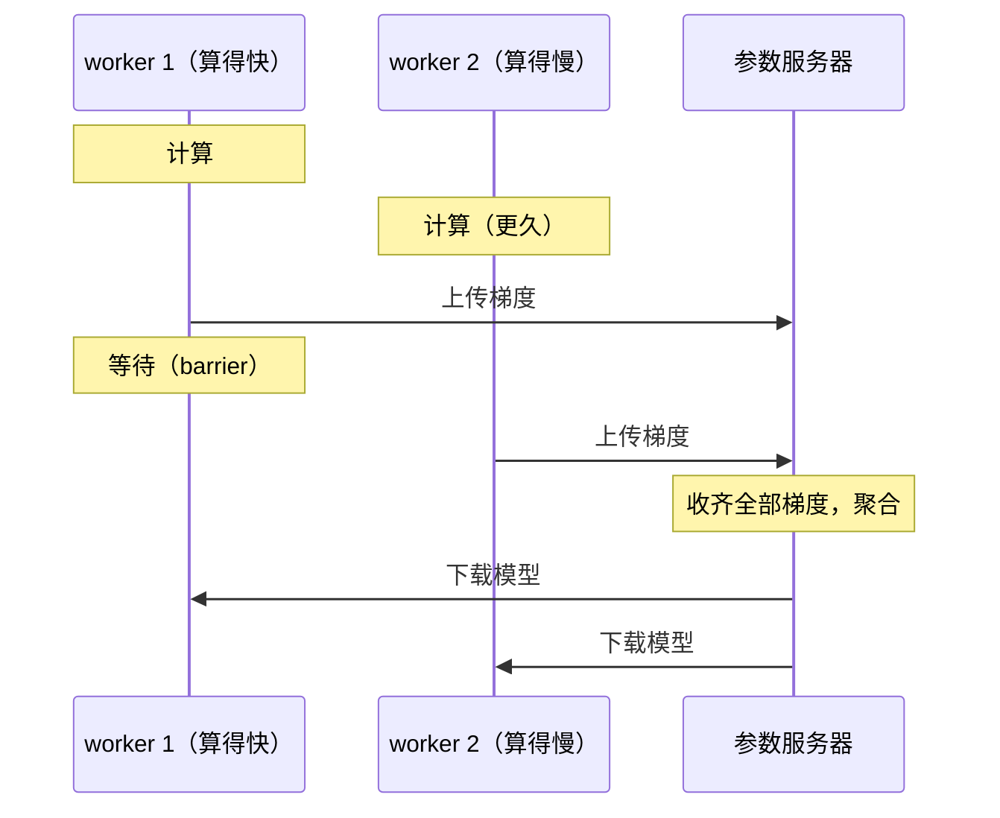
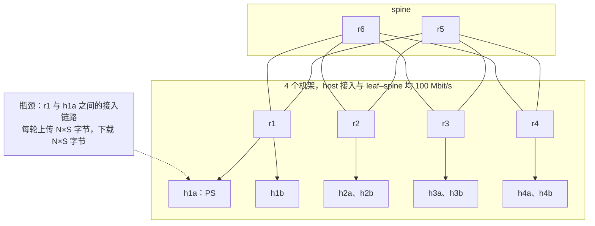
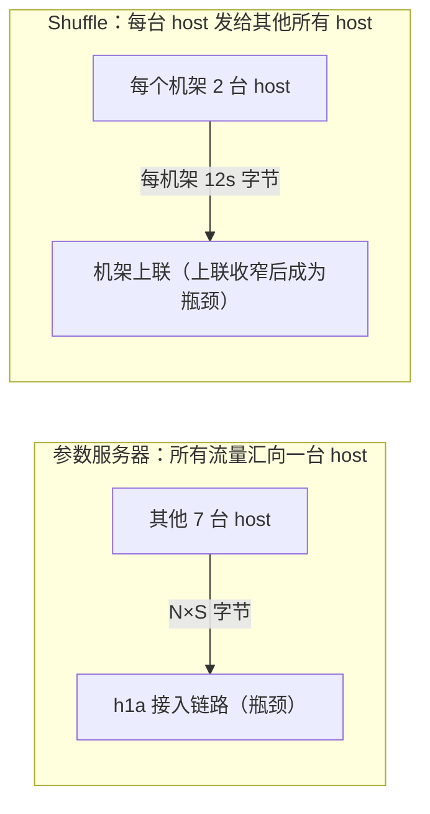

# 第 08 讲 分布式作业的通信代价：时间花在哪，加机器为什么会变慢

> **课程导读**：第 07 讲看的是一个前端等 N 个后端。本讲把同样的结构放进分布式计算：每一轮都要等所有 worker 到齐才能继续。你会看到一个反直觉的现象：**总计算量不变，7 个 worker 的作业比 3 个 worker 慢 41%。** 计算确实被分摊了，但通信没有。学完后，你应能把作业完成时间拆成计算、上传、等待、下载四段，用两个参数预测它，算出最划算的 worker 数，并判断一个慢节点到底要付出多少代价。

---

## 学习目标

1. 说清 BSP 与 barrier 的含义，把一轮作业分成计算、上传、等待、下载四段，并说明每一段的计时起止。
2. 读懂原始时间戳，手算一轮的四段时间，解释为什么公平分享会把“等待”藏进通信。
3. 用 $T(m)=\alpha+\beta m$ 描述点对点传输，从测量曲线得到 $\alpha$、$\beta$，并说出 $\alpha$ 里实际包含什么。
4. 预测参数服务器作业的 JCT，写出最优 worker 数 $N^*$，并说明模型在什么条件下失效。
5. 写出 shuffle 的流量矩阵，算出接入链路与机架上联各自的下界；判断同样的 straggler 在什么情况下代价更大。

| 时间 | 内容 | 课堂产出 |
| --- | --- | --- |
| 0–10 分钟 | 模块一：作业为什么要通信 | 画出一轮的四段时间线；说清计时口径 |
| 10–25 分钟 | 模块二：把 JCT 拆开 | 手算一轮的四段时间 |
| 25–46 分钟 | 模块三：α-β 模型 | 手算 $\alpha$、$\beta$；亲手看 $\alpha$ 随时延和空闲变化；预测不同 N 的 JCT |
| 46–63 分钟 | 模块四：模型之外的代价 | 算出 shuffle 的下界；亲手看 ECMP 撞车；解释 straggler 的两种代价 |
| 63–88 分钟 | 模块五：综合动手——几个 worker 最划算 | 预测表、两组实测、一段结论 |
| 88–90 分钟 | 模块六：课后思考与拓展 | 三道短题；Lab 6 说明 |

**课前准备（不计入上述 90 分钟）**：学生自行准备 Ubuntu Linux，工具与第 07 讲相同。不同小组各用独立主机或虚拟机，同一台机器由一人操作。本讲的脚本以压缩包分发，解压后得到 `lecture08_prep` 目录，完整实验床就是其中的 `lab4_topo.sh`，Lab 3 没有做完也不影响。本讲标为“实测样例”的输出来自 2026-11-08 的备课虚拟机（Ubuntu 26.04.1、Linux `7.0.0-43-generic`、x86_64、2 核 2.8 GB），单次读数以自己的测量为准。

```bash
# 1. 进入本讲目录（lecture08_prep 压缩包解压后的目录，路径换成你自己的）；本讲所有命令都在这里执行
cd ~/lecture08_prep

# 2. 清理第 05 讲课堂网络与 Lab 3 网络（节点重名，不能同时存在）
sudo bash lab3_classroom.sh down
sudo bash lab3_topo.sh down

# 3. 准备路由守护进程的 Python 环境
uv sync --frozen

# 4. 搭建完整实验床（默认加载 Lab 2 参考路由），并自检
sudo bash lab4_topo.sh up
sudo bash lab4_topo.sh check
```

准备完成应出现 `[OK] 8 条上联往返、8 台 host 网关可达、跨机架往返。`。本讲用到的脚本、Lab 2 参考路由和 Python 环境配置都在 `lecture08_prep` 目录里，它们是 Lab 2–4 与 Lab 6 中相应文件的副本，脚本按自己所在的目录找其他文件，**以下所有命令都在这个目录里执行**（新开终端时先 `cd` 进去）。Lab 6 在它自己的目录里完成，这里的 `jobkit/` 不用改。本讲的作业与测量工具默认只用 Python 标准库，直接用系统 `python3` 运行。**中途不要拆拓扑；提前结束或中断时，执行 5.6 节的清理命令。**

---

## 模块一：作业为什么要通信

### 1.1 算不完的数据，分给很多机器

训练一个模型，或者在大表上做聚合，一台机器算不完，于是把数据切开，分给 N 台机器。每台机器算出的只是**局部结果**，要合起来才有意义，下一步的计算又依赖合并后的结果。所以这类作业是一轮一轮推进的：

$$\text{本地计算}\ \rightarrow\ \text{交换结果}\ \rightarrow\ \text{本地计算}\ \rightarrow\ \cdots$$

我们用**作业完成时间**（Job Completion Time，JCT）衡量它：从第一个 worker 开始算，到最后一个 worker 拿到最终结果为止。

### 1.2 BSP 与 barrier

这种节奏有一个经典的名字：**整体同步并行**（Bulk Synchronous Parallel，BSP），由 Valiant 在 1990 年提出。一个超步（superstep）包含本地计算、通信，以及最后的一道**屏障**（barrier）：全部参与者都到了，才一起进入下一步。

barrier 让程序容易写对，因为每一轮大家看到的都是同一份状态。代价你已经在第 07 讲见过：barrier 就是一轮扇出，**一轮的时间由最慢的那个决定**。这个最慢的成员叫 **straggler**。

### 1.3 参数服务器的一轮

本讲的作业是**参数服务器**（Parameter Server，PS）结构：一个 PS 持有模型，N 个 worker 持有数据。每一轮：

1. 每个 worker 用当前模型在本地数据上算出梯度；
2. 把梯度发给 PS；
3. PS 收齐全部 N 份梯度（barrier），聚合成新模型；
4. PS 把新模型发回每个 worker。



*图示说明：教学示意，时间长度不按比例。每个 worker 的一轮首尾相接地分成四段：计算、上传、等待、下载。算得慢的 worker 没有等待段，算得快的 worker 要等它。*

### 1.4 计时口径：起点在哪，终点在哪

比较之前先定义清楚。一轮里每个 worker 的四段是：

| 段 | 起点 | 终点 | 含义 |
| --- | --- | --- | --- |
| 计算 | `compute_start` | `compute_end` | 本地算梯度 |
| 上传 | `compute_end` | PS 收到该 worker 梯度的最后一个字节 | 数据真正到了对端 |
| 等待 | 上一段的终点 | PS 收齐所有 worker 的梯度并聚合完（barrier） | 自己已到，等别人 |
| 下载 | barrier | 该 worker 收到模型的最后一个字节 | 模型真正到手 |

有两个容易出错的地方：

- **`sendall` 返回不等于对方收到**。它只说明数据交给了本地 TCP，还可能全部躺在发送缓冲区里。所以上传的终点必须取 PS 那边的时间戳，下面的实测会让你看到两者差多少。
- **跨进程的时间戳能不能相减**，取决于是不是同一个钟。这里所有 namespace 都在同一台机器上，共用一个单调时钟 `time.monotonic()`，可以直接相减。真实集群的时钟要先同步（第 07 讲 2.3 节），否则这张表做不出来。

---

## 模块二：把 JCT 拆开

### 2.1 实验床与作业

沿用完整实验床。PS 固定在 h1a，worker 从另外 7 台 host 里取。



*图示说明：物理拓扑，每个机架有 2 台 host。图中只标出 PS 模式下的瓶颈，没有画出具体的 ECMP 路径。无论 worker 在哪个机架，数据都要经过 h1a 的接入链路，所以它是每一轮的共同瓶颈。*

工具分工：

- `jobrun.py` 在各个 namespace 里启动 PS 和 worker，运行结束后把全部时间戳合并成一个 JSON，写到 `/tmp/lab06-results/<label>.json`（同名标签会被覆盖），并打印实测 JCT。
- 作业本身在 `job.py`：一个 worker 一条长连接，显式用 CUBIC；`--compute-ms` 指定每轮计算时间。**默认用 `time.sleep` 占位**，因为这些 namespace 共用同一台机器的 CPU，真实计算会互相抢 CPU，JCT 的差别就不只来自通信了。
- `timeline.py` 只读这个 JSON，打印某一轮每个 worker 的原始时间戳。

### 2.2 短观察：手算一轮的四段

**问题与预测**：N=7，模型 $S=1$ MB，每轮计算 200 ms。7 份梯度都要挤过 PS 的 100 Mbit/s 接入链路。运行之前估一下：上传要多久？哪一段最长？等待段大不大？

**工具与观察点**：用 PS 一侧的时间戳判断“到了没有”，用 worker 一侧的时间戳判断“算完没有”。这里读的是第 5 轮（从 0 数），避开开头的不稳定。

```bash
# 1. 基线作业：7 个 worker，模型 1 MB，每轮计算 200 ms，10 轮，约 14 秒
sudo python3 jobrun.py --label base

# 2. 看第 5 轮的原始时间戳（只读文件，不需要 root）
python3 timeline.py /tmp/lab06-results/base.json --round 5
```

**实测样例**（单位 ms，以这一轮最早的计算开始为 0）：

```output
[base] ps N=7 模型 1 MB 10 轮 cubic：JCT = 13.705 s，结果 /tmp/lab06-results/base.json
作业 base：N=7，模型 1 MB，第 5 轮（从 0 数），单位 ms
worker           计算开始         计算结束    sendall返回         PS收齐      barrier         模型收齐
h1b              13.6        215.1        361.3        787.9        800.0       1358.7
h2a              10.3        210.4        406.7        792.7        800.0       1380.7
h2b              12.3        212.4        410.8        799.2        800.0       1384.9
h3a              13.5        213.6        409.6        797.3        800.0       1362.8
h3b              13.5        214.3        414.9        800.0        800.0       1385.5
h4a              13.2        213.3        412.7        799.4        800.0       1374.9
h4b               0.0        200.2        387.8        781.7        800.0       1380.4
```

**一起算 h3a 这一行**：

| 段 | 算式（ms） | 结果（ms） |
| --- | --- | --- |
| 计算 | $213.6-13.5$ | 200.1 |
| 上传 | $797.3-213.6$ | 583.7 |
| 等待 | $800.0-797.3$ | 2.7 |
| 下载 | $1362.8-800.0$ | 562.8 |
| 合计 | $1362.8-13.5$ | 1349.3 |

四段之和正好等于一轮的总长，这就是拆账对不对的检查方法。**自己再挑一行算一遍。**

1. **通信占大头**：这一轮计算只占 $200.1/1349.3\approx15\%$，上传加下载占约 85%。给 worker 换更快的 CPU，这一轮最多省下 15%。
2. **上传和理论值对得上**：7 MB 等于 56 Mbit，按 3.2 节测出的 95.6 Mbit/s 需要约 586 ms，h3a 实测 583.7 ms。
3. **`sendall` 早就返回了**：h3a 在 409.6 ms 时 `sendall` 已返回，PS 却要到 797.3 ms 才收齐。如果把 `sendall` 当作上传的终点，上传时间只有 196 ms，少算了约三分之二。
4. **等待只有 2.7 ms**：7 个 worker 的“PS收齐”都落在 781.7 到 800.0 ms 之间，相差不到 20 ms。

### 2.3 等待少，不等于没有争用

第 4 点值得多想一下。这张表里 7 个 worker 几乎同时收齐，等待段接近 0，看起来没人在等谁。但其实每条流都只分到了 $1/7$ 的带宽：TCP 的公平分享让大家**一起变慢、一起结束**，等待被藏进了上传段。

**边界**：这里只看了一轮，并且所有 worker 算得一样快。只凭“等待小”不能断定没有瓶颈，要结合上传段的绝对长度和理论值一起判断。如果你的数字差很多，先执行 `sudo bash lab4_topo.sh status`，看端口是否偏离基线，以及机器上有没有别的负载。

---

## 模块三：α-β 模型

### 3.1 两个参数描述一次传输

把 $m$ 字节从一台机器传到另一台，时间可以近似成：

$$T(m)=\alpha+\beta m$$

| 参数 | 单位 | 含义 | 由什么决定 |
| --- | --- | --- | --- |
| $\alpha$ | 秒 | 固定开销，和数据量无关 | 传播时延、协议开销、连接状态 |
| $\beta$ | 秒/字节 | 多传一个字节要多花的时间 | 路径上的有效带宽，$\beta=8/B$ |

这就是 **α-β 模型**（也常叫 Hockney 模型）。小消息主要付 $\alpha$，大消息主要付 $\beta m$。

### 3.2 短观察：测一条传输曲线

**问题与预测**：h1a→h3a，100 Mbit/s。传 16 MB 大约要多久？1 KB 呢？两者的比值接近 16000 倍吗？

**工具与观察点**：`curve.py` 在一条长连接上按打乱的顺序发送不同大小的消息，**接收端收齐后回一个字节，发送端收到回执才停表**，这样测到的是“对端确实收齐”的时间。每个大小 9 次，取中位数；两次发送之间空闲 300 ms，模拟作业的计算阶段。

```bash
# 1. 测 h1a→h3a 的传输曲线，约 35 秒
sudo python3 curve.py --label curve
```

**实测样例**：

```output
[curve] h1a→h3a cubic，空闲 300 ms，每个大小 9 次
        字节      中位数 ms      最小 ms      最大 ms
      1000        0.49       0.44       1.12
     10000        1.06       0.96       1.17
    100000        8.84       8.60       9.11
   1000000       84.19      83.91      85.30
   4000000      335.52     334.89     339.16
  16000000     1339.25    1338.68    1368.51
结果：/tmp/lab06-results/curve.json
```

**一起算**：

- **算 $\beta$**：用两个大样本的差，把 $\alpha$ 消掉：

$$\beta=\frac{1339.25-84.19\ \text{ms}}{16\,000\,000-1\,000\,000\ \text{字节}}=83.67\ \text{ns/字节}$$

- **换算成带宽**：$8/\beta=95.6$ Mbit/s。配置是 100 Mbit/s，差的部分是报文头：一个 1514 字节的帧只带 1448 字节负载，$100\times1448/1514\approx95.6$ Mbit/s，吻合。
- **算 $\alpha$**：用最小的样本，减掉它自己的传输时间：$0.49-83.67\times10^{-6}\times1000\approx0.41$ ms。

**读数据**：1000 字节用了 0.49 ms，其中传输本身只要 0.08 ms；16 MB 用了 1339 ms，$\alpha$ 可以忽略。**小消息看 $\alpha$，大消息看 $\beta$。** 所以 $\alpha$ 要用小样本估计。

**边界**：这里只测了一条路径、一种负载。Lab 6 会用最小二乘拟合全部样本，你会看到这样得到的 $\alpha$ 很不稳定：大样本几毫秒的波动，就比 $\alpha$ 本身还大。

### 3.3 动手实践：α 里面到底有什么

本节每人动手，约 7 分钟：写预测 1 分钟，运行约 40 秒，其余时间读数据。

**问题与预测**：在 h1a 的出口加 5 ms 延迟。**运行前先写下你的预测**：$\alpha$ 和 $\beta$ 分别会怎样变？连接空闲很久以后，$\alpha$ 还是这个值吗？上传和下载都会多 5 ms 吗？

```bash
# 1. 只在 h1a 的出方向加 5 ms 延迟，保持 100 Mbit/s
sudo bash lab4_topo.sh impair h1a eth0 delay 5ms

# 2. 再测一条曲线，并测一组空闲 3 秒的 100 KB 传输，共约 25 秒
sudo python3 curve.py --label d5 --sizes 1000,100000,1000000,4000000 --trials 5
sudo python3 curve.py --label d5-idle --sizes 100000 --trials 5 --gap-ms 3000

# 3. 一个 worker 的小作业，看上传和下载各自付了多少；计算时间设为 0
sudo python3 jobrun.py --label oneway --n 1 --model-mb 0.1 --compute-ms 0
python3 timeline.py /tmp/lab06-results/oneway.json --round 5

# 4. 恢复基线并核对
sudo bash lab4_topo.sh clear h1a eth0
sudo bash lab4_topo.sh status
```

**实测样例**（节选，省略了 `impair`、`clear` 的提示与 `status` 的基线行）：

```output
[d5] h1a→h3a cubic，空闲 300 ms，每个大小 5 次
        字节      中位数 ms      最小 ms      最大 ms
      1000        5.64       5.48       6.76
    100000       13.86      13.71      14.20
   1000000       88.94      88.81      96.27
   4000000      340.99     339.92     349.49
[d5-idle] h1a→h3a cubic，空闲 3000 ms，每个大小 5 次
        字节      中位数 ms      最小 ms      最大 ms
    100000       21.57      21.07      22.32
作业 oneway：N=1，模型 0.1 MB，第 5 轮（从 0 数），单位 ms
worker           计算开始         计算结束    sendall返回         PS收齐      barrier         模型收齐
h3a               0.0          0.1          0.2          8.4          8.5         21.9
```

**读数据**：先用自己的输出算一遍，再和下面对照，看预测哪里错了。你的数字以自己的测量为准。

1. **$\alpha$ 变了，$\beta$ 没变**：1 KB 从 0.49 ms 变成 5.64 ms，多了约 5 ms；$\beta=(340.99-88.94)/3\,000\,000\approx84.0$ ns/字节，基本不变。时延改的是 $\alpha$，带宽改的是 $\beta$。
2. **$\alpha$ 里含一个完整的往返**：`curve.py` 要等回执，所以 5 ms 全算进去了。可作业里的单向传输只经历一个方向：上传 $8.4-0.1=8.3$ ms，几乎只有传输时间（$\beta S=8.4$ ms）；下载 $21.9-8.5=13.4$ ms，正好多了这 5 ms。延迟只加在 h1a 的出方向，所以只有下载看得到它。
3. **$\alpha$ 不只是传播时延**：同样 100 KB，空闲 300 ms 用 13.86 ms，空闲 3 秒用 21.57 ms，多出约 7.7 ms。空闲超过一个 RTO 后，TCP 按 [RFC 2861](https://www.rfc-editor.org/rfc/rfc2861) 的思路收缩拥塞窗口，发送要重新爬坡；Linux 由 `tcp_slow_start_after_idle` 控制，新建 namespace 里默认开启（本机 `h1a` 上读到 1）。内核每过一个 RTO 才把窗口减半一次，所以 300 ms 的空闲减得不多，3 秒才基本退回初始窗口。

**边界**：把 $\alpha$ 写成一个常数是简化。它随方向、空闲时间和连接状态变化。大模型作业里 $\alpha$ 的份额很小，可以忽略；小消息、高时延的场景不能忽略。

### 3.4 预测整个作业

假设 PS 的接入链路是唯一瓶颈，所有 worker 公平分享。每一轮先把 $N\times S$ 字节送进 PS，再把 $N\times S$ 字节送出 PS，一轮的时间是：

$$T_{\text{round}}=c+2(\alpha+\beta NS)$$

其中 $c$ 是一轮的计算时间。用 3.2 节算出的 $\alpha=0.41$ ms、$\beta=83.67$ ns/字节代入 N=7、$S=1$ MB、$c=200$ ms：

$$T_{\text{round}}=0.2+2\times(0.00041+83.67\times10^{-9}\times7\times10^{6})=1.372\ \text{s}$$

10 轮约 13.72 s，实测 13.705 s。再验证另外几个 N：

```bash
# 1. N=1、2、4 各跑一次，约 18 秒；N=7 用前面的 base
for n in 1 2 4; do
  sudo python3 jobrun.py --label n"$n" --n "$n"
done
```

**实测样例**：

```output
[n1] ps N=1 模型 1 MB 10 轮 cubic：JCT = 3.701 s，结果 /tmp/lab06-results/n1.json
[n2] ps N=2 模型 1 MB 10 轮 cubic：JCT = 5.346 s，结果 /tmp/lab06-results/n2.json
[n4] ps N=4 模型 1 MB 10 轮 cubic：JCT = 8.662 s，结果 /tmp/lab06-results/n4.json
```

| $N$ | 预测 JCT（s） | 实测 JCT（s） | 偏差 |
| --- | --- | --- | --- |
| 1 | 3.68 | 3.701 | −0.5% |
| 2 | 5.36 | 5.346 | +0.2% |
| 4 | 8.70 | 8.662 | +0.5% |
| 7 | 13.72 | 13.705 | +0.1% |

只用两个参数和一个公式，就把 JCT 预测到了 1% 以内。**不要以为模型总是这么准。** 这里能这么准，是因为实验条件满足它的全部假设：计算时间固定，只有一个瓶颈，所有 worker 对称。N=4 这一行也有波动：另外两次备课运行都约 8.92 s，比这次高 3%，所以单次读数的偏差不要过度解读。

---

## 模块四：模型之外的代价

### 4.1 Shuffle：另一种流量形状

MapReduce 一类作业的通信不是“都找 PS”，而是**每个节点都要把数据发给其他所有节点**，这叫 **shuffle**。写成流量矩阵（行是发送端，列是接收端），8 台 host，每台给其余 7 台各发 $s$ 字节：除对角线外，每一格都是 $s$。

我们来算下界（这是**教学计算，只算不测**，忽略报文头）。取 $s=1$ MB，host 接入 $C_h=100$ Mbit/s：

| 约束 | 需要送过的数据 | 容量 | 时间下界 |
| --- | --- | --- | --- |
| 一台 host 的接入链路 | 发出 $7s=56$ Mbit | $C_h=100$ Mbit/s | 0.56 s |
| 一个机架的上联，$C_u=100$ Mbit/s | 2 台 host 各发给 6 台外部 host：$12s=96$ Mbit | $2C_u=200$ Mbit/s | 0.48 s |
| 一个机架的上联，$C_u=50$ Mbit/s | 同上，96 Mbit | $2C_u=100$ Mbit/s | 0.96 s |

作业至少要等最紧的那个约束，所以下界取较大者。上联 100 Mbit/s 时是 0.56 s，瓶颈在 host 接入；上联降到 50 Mbit/s 时是 0.96 s，**瓶颈跑到了机架上联**。

同样把上联降到 50 Mbit/s，换成 PS 模式又如何？h1a 所在机架有 6 个外部 worker，$6S=48$ Mbit 走 100 Mbit/s 的上联总容量，需要 0.48 s；h1a 接入要过 $7S=56$ Mbit，需要 0.56 s。**瓶颈还在接入链路，上联收窄理论上不影响 PS。**



*图示说明：两种通信模式的对照，不是一次实验。左图的瓶颈在 PS 的接入链路，只和 N、S 有关；右图的跨机架流量要过上联，所以上联收窄会直接拖慢。图中数字是教学设定下的结果，忽略报文头。*

### 4.2 动手实践：理论上不影响，实际上呢

本节每人动手，约 7 分钟，5 次运行共 80–90 秒。

**问题与预测**：按 4.1 节的计算，上联降到 50 Mbit/s 后 PS 的 JCT 应该基本不变。但上联有两条，流量靠 ECMP 哈希分配。6 条跨机架流落到两条 50 Mbit/s 的上联上，理想情况是 3:3。**运行前先写下你的预测**：不是 3:3 时会怎样？

**趁运行的时间算一算**：一条 50 Mbit/s 上联的有效速率约 47.8 Mbit/s。$k$ 条流各传 1 MB，这条上联要多久？$k=3$、4、5 时，分别和 h1a 接入链路的 0.59 s 比，谁更慢？

```bash
# 1. 全部上联降到 50 Mbit/s，host 接入仍是 100 Mbit/s
sudo bash lab4_topo.sh rate 50

# 2. 定义一个读端口累计发送字节的函数
sent() { sudo ip netns exec "$1" tc -s class show dev "$2" classid 1:10 | awk '/Sent/{print $2; exit}'; }

# 3. 跑 5 次，记录 r1 出方向（下载）与两台 spine 到 r1 方向（上传）的字节
for i in 1 2 3 4 5; do
  a0=$(sent r1 r1-r5); b0=$(sent r1 r1-r6); c0=$(sent r5 r5-r1); d0=$(sent r6 r6-r1)
  sudo python3 jobrun.py --label r50-"$i"
  a1=$(sent r1 r1-r5); b1=$(sent r1 r1-r6); c1=$(sent r5 r5-r1); d1=$(sent r6 r6-r1)
  echo "第 $i 次（MB）：下载 r1→r5 $(( (a1-a0)/1000000 ))，r1→r6 $(( (b1-b0)/1000000 ))；上传 r5→r1 $(( (c1-c0)/1000000 ))，r6→r1 $(( (d1-d0)/1000000 ))"
done

# 4. 恢复 100 Mbit/s
sudo bash lab4_topo.sh rate 100
```

**实测样例**（整理成表）。每条跨机架流 10 轮约传 10.5 MB（含报文头），所以 53、10 MB 对应 5 条流和 1 条流：

| 次 | 下载字节（r1→r5 : r1→r6，MB） | 上传字节（r5→r1 : r6→r1，MB） | JCT（s） |
| --- | --- | --- | --- |
| 1 | 53 : 10 | 42 : 21 | 17.223 |
| 2 | 32 : 32 | 32 : 32 | 14.003 |
| 3 | 53 : 10 | 10 : 53 | 17.357 |
| 4 | 32 : 32 | 42 : 21 | 14.601 |
| 5 | 32 : 32 | 32 : 32 | 13.763 |

**读数据**：把你的 5 次也整理成这张表。哈希结果每次都不同，你的分配不会和这里一样，重点看分配和 JCT 的关系。

先对答案：$k$ 条流各传 1 MB 需要 $k\times8/47.8$ s，$k=3$ 时 0.50 s，比接入链路的 0.59 s 快；$k=4$ 时 0.67 s，$k=5$ 时 0.84 s，都比它慢。

样例里两个方向都是 3:3 的两次，JCT 是 14.0 和 13.8 s，接近基线的 13.7 s，和 4.1 节的计算相符。下载方向 5:1 的两次都超过了 17 s：5 条流挤进一条 50 Mbit/s 的上联，这条上联就成了新的瓶颈。

**边界**：这是一组 5 次的小样本，哈希结果每次运行都不同。如果你的 5 次碰巧都接近 3:3，就看不到明显变慢，这不代表测错了，可以多跑几次。备课时另一组 5 次运行里，下载 5:1、上传 3:3 的那次是 15.55 s，比这里的 17 s 小，那次上传方向是均匀的，这可能是差别的来源，但没有单独验证。各 worker 的阶段会部分重叠，把两个方向的时间简单相加会高估。这份证据说明撞车和变慢同时出现，样本还不足以给出定量规律。

### 4.3 短观察：同一个慢节点，两种代价

**问题与预测**：让 h3a 的计算时间变成 4 倍，每轮多算 600 ms，10 轮一共多 6 s。barrier 要等它，所以 JCT 也应该多 6 s？模型 1 MB 和 0.1 MB 时都这样吗？

```bash
# 1. 模型 1 MB，h3a 的计算时间乘 4；基线用前面的 base
sudo python3 jobrun.py --label strag --straggler h3a:4
python3 timeline.py /tmp/lab06-results/strag.json --round 5

# 2. 模型 0.1 MB：基线与慢节点各跑一次
sudo python3 jobrun.py --label light --model-mb 0.1
sudo python3 jobrun.py --label light-strag --model-mb 0.1 --straggler h3a:4
```

**实测样例**：

```output
[strag] ps N=7 模型 1 MB 10 轮 cubic：JCT = 14.690 s，结果 /tmp/lab06-results/strag.json
作业 strag：N=7，模型 1 MB，第 5 轮（从 0 数），单位 ms
worker           计算开始         计算结束    sendall返回         PS收齐      barrier         模型收齐
h1b               4.4        204.5        360.2        709.7        893.8       1479.3
h2a               2.9        203.0        385.4        718.8        893.8       1477.5
h2b               1.4        201.5        354.2        705.9        893.8       1471.5
h3a               7.9        808.1        835.7        893.8        893.8       1476.5
h3b               0.0        200.1        385.4        719.6        893.8       1477.3
h4a              13.4        213.6        404.8        724.9        893.8       1473.4
h4b               9.3        209.4        381.2        723.1        893.8       1468.1
[light] ps N=7 模型 0.1 MB 10 轮 cubic：JCT = 3.144 s，结果 /tmp/lab06-results/light.json
[light-strag] ps N=7 模型 0.1 MB 10 轮 cubic：JCT = 8.678 s，结果 /tmp/lab06-results/light-strag.json
```

| 模型大小 | 基线 JCT（s） | 有慢节点（s） | 增加（s） | 多算的总时间（s） |
| --- | --- | --- | --- | --- |
| 1 MB（通信主导） | 13.705 | 14.690 | +0.985 | 6 |
| 0.1 MB（计算主导） | 3.144 | 8.678 | +5.534 | 6 |

**读数据**：同样的慢节点，代价差了 5.6 倍。原因在 1 MB 的时间线里：

1. 其他 6 个 worker 上传 6 MB 要约 $6\times84=502$ ms，大约在 720 ms 收齐，它们的“PS收齐”列（706–725 ms）对得上。
2. h3a 在 808.1 ms 算完，这时链路已经空了，它独自上传 1 MB，约 84 ms，到 893.8 ms 结束。
3. 所以这一轮的 barrier 只比基线晚了约 94 ms（893.8 对 800.0）。**h3a 多算的 600 ms，大部分和别人的上传重叠了**，这段时间网络本来就忙着。

0.1 MB 时通信只有 59 ms 上传，没有什么可以重叠，慢多少就付多少：

$$0.8+0.0084+0.0586\approx0.867\ \text{s/轮}$$

10 轮约 8.67 s，实测 8.678 s。

**边界**：这里只模拟了固定 4 倍的慢节点，慢的总是同一台机器，每一轮都慢。真实的 straggler 往往随机出现、原因各异，那时第 07 讲的放大规律才派得上用场。MapReduce 用**备份任务**（speculative execution）应对它，和对冲请求的思路相同。这部分在 Lab 6 的挑战任务里继续。

---

## 模块五：综合动手——几个 worker 最划算

### 5.1 任务与条件

**你的角色**：同事说“作业慢，再加几台机器”。你要用数据回答：加几台最划算？这个答案由什么决定？

**固定条件**：PS 在 h1a；worker 按固定顺序选取（`--n N` 取 h3a、h2a、h4a、h1b、h2b、h3b、h4b 的前 N 台）；10 轮；CUBIC；100 Mbit/s 档位。**每轮总计算量固定为 $W=1400$ ms，平分给 N 个 worker。**

| 组 | 模型大小 $S$ | N | 改变的因素 |
| --- | --- | --- | --- |
| A | 1 MB | 1、2、3、4、7 | 只改 N |
| B | 0.25 MB | 1、3、5、6、7 | 在 A 的基础上只改 $S$，再扫 N |

指标：JCT，由 `jobrun.py` 打印，从第一个 worker 开始计算到最后一个 worker 收齐模型。


*图示说明：三个框是三次实验，不是机架。节点位置相同，只有 worker 数不同。计算量随 N 减少，经过 h1a 接入链路（100 Mbit/s）的数据量随 N 增加。省略路由器；没有接任务的主机并没有从实验床删除。*

### 5.2 先填预测（4 分钟）

对 $N$ 求导，得到让 JCT 最小的 worker 数：

$$T(N)=R\left(\frac{W}{N}+2\beta NS+2\alpha\right),\qquad N^*=\sqrt{\frac{W}{2\beta S}}$$

用你在 3.2 节算出的 $\alpha$、$\beta$ 运行下面的脚本（样例里是备课时的值，要换成自己的），先把预测抄进下表。

```bash
# 1. 组 A 的预测：把 alpha、beta 换成你自己算出的值
python3 -c "
alpha, beta, S, W, R = 0.00041, 83.67e-9, 1e6, 1.4, 10   # 换成你自己的 α、β
for N in (1, 2, 3, 4, 7):
    print(N, round(R * (W / N + 2 * (alpha + beta * N * S)), 2))
print('N* =', round((W / (2 * beta * S)) ** 0.5, 1))"
```

**样例结果**：

```output
1 15.68
2 10.35
3 9.7
4 10.2
7 13.72
N* = 2.9
```

| N | 我的预测（s） | 实测（s） | 差多少、为什么 |
| --- | --- | --- | --- |
| 1 | | | |
| 2 | | | |
| 3 | | | |
| 4 | | | |
| 7 | | | |

### 5.3 实测组 A（4 分钟）

```bash
# 1. 约 60 秒，每行打印一次 JCT
for n in 1 2 3 4 7; do
  sudo python3 jobrun.py --label u"$n" --n "$n" --compute-total-ms 1400
done

# 2. 对比 N=3 和 N=7 的一轮
python3 timeline.py /tmp/lab06-results/u3.json --round 5
python3 timeline.py /tmp/lab06-results/u7.json --round 5
```

**实测样例**：

```output
[u1] ps N=1 模型 1 MB 10 轮 cubic：JCT = 15.722 s，结果 /tmp/lab06-results/u1.json
[u2] ps N=2 模型 1 MB 10 轮 cubic：JCT = 10.411 s，结果 /tmp/lab06-results/u2.json
[u3] ps N=3 模型 1 MB 10 轮 cubic：JCT = 9.716 s，结果 /tmp/lab06-results/u3.json
[u4] ps N=4 模型 1 MB 10 轮 cubic：JCT = 10.188 s，结果 /tmp/lab06-results/u4.json
[u7] ps N=7 模型 1 MB 10 轮 cubic：JCT = 13.720 s，结果 /tmp/lab06-results/u7.json
作业 u3：N=3，模型 1 MB，第 5 轮（从 0 数），单位 ms
worker           计算开始         计算结束    sendall返回         PS收齐      barrier         模型收齐
h2a               7.9        474.6        605.1        725.8        726.0        980.0
h3a               8.9        475.7        559.7        725.9        726.0        979.7
h4a               0.0        466.8        543.9        715.3        726.0        980.9
作业 u7：N=7，模型 1 MB，第 5 轮（从 0 数），单位 ms
worker           计算开始         计算结束    sendall返回         PS收齐      barrier         模型收齐
h1b              23.4        223.7        525.6        804.1        806.0       1394.2
h2a              18.9        219.4        413.5        802.5        806.0       1387.1
h2b              22.7        222.8        427.5        806.0        806.0       1390.9
h3a              11.7        211.8        408.0        797.3        806.0       1385.2
h3b              17.8        217.9        406.2        799.6        806.0       1379.3
h4a              19.4        221.2        424.4        805.9        806.0       1385.5
h4b               0.0        200.1        380.8        772.0        806.0       1393.8
```

### 5.4 读结果（5 分钟）

| N | 预测（s） | 实测（s） | 计算（$RW/N$，s） | 通信（预测的 $2R\beta NS$，s） |
| --- | --- | --- | --- | --- |
| 1 | 15.68 | 15.722 | 14.00 | 1.67 |
| 2 | 10.35 | 10.411 | 7.00 | 3.35 |
| 3 | 9.70 | 9.716 | 4.67 | 5.02 |
| 4 | 10.20 | 10.188 | 3.50 | 6.69 |
| 7 | 13.72 | 13.720 | 2.00 | 11.71 |

1. **最低点在 N=3**：计算随 $1/N$ 下降，通信随 $N$ 线性上升，两条曲线的和是一个 U 形。N=7 的 JCT 是 N=3 的 $13.72/9.716\approx1.41$ 倍。
2. **从时间线上看原因**：N=3 时一轮是 980 ms，计算约 467 ms，上传与下载各约 250 ms；N=7 时一轮是 1394 ms，计算只有 200 ms，上传与下载各约 585 ms。**N 从 3 到 7，计算省了约 267 ms，通信多花了约 660 ms。**
3. **加机器不是免费的**：N=1 到 N=2，JCT 少了 34%；N=4 到 N=7，JCT 反而多了 35%。

**边界**：`W/N` 假设计算可以完美均分，这一点在这里靠占位计算保证；真实作业的计算很难这么理想。

### 5.5 只改模型大小（6 分钟）

**预测**：模型变小到 0.25 MB，最优的 N 往哪边移动？$N^*$ 变成多少？

```bash
# 1. 组 B 的预测：把 alpha、beta 换成你自己算出的值
python3 -c "
alpha, beta, S, W, R = 0.00041, 83.67e-9, 0.25e6, 1.4, 10   # 换成你自己的 α、β
for N in (1, 3, 5, 6, 7):
    print(N, round(R * (W / N + 2 * (alpha + beta * N * S)), 2))
print('N* =', round((W / (2 * beta * S)) ** 0.5, 1))"

# 2. 实测组 B，约 35 秒
for n in 1 3 5 6 7; do
  sudo python3 jobrun.py --label v"$n" --n "$n" --compute-total-ms 1400 --model-mb 0.25
done
```

**实测样例**（把预测结果与实测放在一起）：

```output
1 14.43
3 5.93
5 4.9
6 4.85
7 4.94
N* = 5.8
[v1] ps N=1 模型 0.25 MB 10 轮 cubic：JCT = 14.426 s，结果 /tmp/lab06-results/v1.json
[v3] ps N=3 模型 0.25 MB 10 轮 cubic：JCT = 5.924 s，结果 /tmp/lab06-results/v3.json
[v5] ps N=5 模型 0.25 MB 10 轮 cubic：JCT = 4.870 s，结果 /tmp/lab06-results/v5.json
[v6] ps N=6 模型 0.25 MB 10 轮 cubic：JCT = 4.825 s，结果 /tmp/lab06-results/v6.json
[v7] ps N=7 模型 0.25 MB 10 轮 cubic：JCT = 4.892 s，结果 /tmp/lab06-results/v7.json
```

模型变小为四分之一，$N^*$ 变成 2 倍（从 2.9 到 5.8），实测最低点从 N=3 移到了 N=6。

**小组交付**：把下面的结论写完整，用你自己的数字。

> 在 W=＿＿＿、S=＿＿＿ 时，最优 worker 数是＿＿＿，实测 JCT 是＿＿＿ s。这个数由＿＿＿决定，当模型变大时，它会往＿＿＿移动，因为＿＿＿。这个结论依赖的假设是＿＿＿，当＿＿＿时会不成立。

**这份证据还不能证明**：只测了一个瓶颈位置和一种拓扑，并且 worker 是对称的。把 PS 的瓶颈去掉（比如换成 Ring AllReduce）以后，这条 U 形曲线会不会变，是第 09 讲的问题。

### 5.6 恢复与清理（2 分钟）

```bash
# 1. 核对全部端口已恢复基线
sudo bash lab4_topo.sh status

# 2. 需要保留结果就先复制；同名标签再次运行会被覆盖
cp -r /tmp/lab06-results "$HOME/lab06-lecture-results"

# 3. 不做 Lab 6 的话，拆实验床（幂等）
sudo bash lab4_topo.sh down
```

作业进程运行完就退出，不留后台进程。如果中途异常退出，执行第 3 步即可，`lab4_topo.sh down` 会结束所有 namespace 里的进程。

### 5.7 从课堂走向 Lab 6

| 层次 | 从本讲带走什么 | Lab 6 再向前一步 |
| --- | --- | --- |
| A 段（第 08 讲） | 手算一轮的四段；手算 $\alpha$、$\beta$；预测 JCT | 把拆账写成程序，处理整个作业；用最小二乘拟合；在更多配置上对账，解释偏差最大的一项 |
| B 段（第 09 讲） | PS 的瓶颈在接入链路；上联收窄时的 ECMP 现象 | 实现 Ring AllReduce，实测通信量；比较随机环序和拓扑感知环序；研究 straggler |

---

## 模块六：课后思考与拓展

### 6.1 离堂检查（2 分钟）

1. 某 worker 一轮的时间戳（ms）：计算开始 0、计算结束 300、`sendall` 返回 320、PS 收齐 700、barrier 750、模型收齐 1200。写出四段时间。
2. $\alpha$ 忽略不计，$\beta=80$ ns/字节，N=5，$S=2$ MB，$c=0.5$ s，一轮要多久？
3. 同样的慢节点，模型大的作业和模型小的作业，哪个受的影响大？为什么？

*思考提示*：第 1 题计算 300、上传 400、等待 50、下载 450，上传不要用 `sendall` 的时间；第 2 题 $0.5+2\times80\times10^{-9}\times5\times2\times10^{6}=2.1$ s；第 3 题对比 4.3 节，通信越重，慢节点越能和别人的通信重叠。

### 6.2 思考题

1. **去掉 barrier 行不行**：异步 SGD 允许 worker 不互相等待。JCT 会变短吗？代价是什么？

   *思考提示*：等待没了，但梯度基于旧模型算出（staleness），可能要更多轮才能收敛。JCT 取决于“每轮多快”和“要多少轮”两个因素，本讲的工具只测了前者。

2. **PS 成了瓶颈怎么办**：只用本讲的知识，你能提出几种降低 PS 接入链路压力的办法？

   *思考提示*：把模型切片放到多个 PS 上；压缩梯度；让 worker 之间直接合并（第 09 讲）。每种办法分别改变了公式里的什么量？

3. **能不能对冲一个 straggler**：第 07 讲的对冲请求对计算任务还成立吗？

   *思考提示*：请求可以随便多发一份，计算任务要付出整段的计算量和一份数据的传输。MapReduce 的备份任务只在作业快结束时才启动，为什么？

4. **模型的假设**：把 $T(N)$ 用到 $N=1000$ 的集群上，还差哪些因素？

   *思考提示*：计算不可能完美均分；PS 的接入链路不只一个机架能用；故障概率随 N 上升。

### 6.3 拓展资料与 RFC 列表

| 资料 | 范围 | 用途 |
| --- | --- | --- |
| [Valiant，A Bridging Model for Parallel Computation（CACM 1990）](https://doi.org/10.1145/79173.79181) | 全文 | BSP 模型 |
| [Li et al.，Scaling Distributed Machine Learning with the Parameter Server（OSDI 2014）](https://www.usenix.org/conference/osdi14/technical-sessions/presentation/li_mu) | §1–§4 | 参数服务器的设计 |
| [Dean & Ghemawat，MapReduce（OSDI 2004）](https://www.usenix.org/legacy/events/osdi04/tech/full_papers/dean/dean.pdf) | §3.1、§3.6 | shuffle 与备份任务 |
| [Thakur et al.，Optimization of Collective Communication Operations in MPICH（IJHPCA 2005）](https://doi.org/10.1177/1094342005051521) | 代价模型与算法部分 | 用 α-β 这类模型分析集合通信，下一讲用到 |
| [Ananthanarayanan et al.，Effective Straggler Mitigation: Attack of the Clones（NSDI 2013）](https://www.usenix.org/conference/nsdi13/technical-sessions/presentation/ananthanarayanan) | 全文 | straggler 的成因与克隆缓解 |
| [RFC 2861：TCP Congestion Window Validation](https://www.rfc-editor.org/rfc/rfc2861) | §3 | 空闲后收缩拥塞窗口 |
| [RFC 5681：TCP Congestion Control](https://www.rfc-editor.org/rfc/rfc5681) | §4.1 | 重启空闲连接 |
| [Linux IP sysctl 文档](https://docs.kernel.org/networking/ip-sysctl.html) | `tcp_slow_start_after_idle` | 默认值与含义 |

拓展阅读不作为本周必须实现的任务。

### 6.4 后续衔接实验

- 上游：[第 05 讲](datacenter_network.md)的收敛比与 ECMP；[第 07 讲](tail_latency.md)的扇出放大；本讲目录的 `lab4_topo.sh`。
- 本讲：[Lab 6 指导书](../experiments/06/README.md)的 A 段，用本讲的工具把手算写成程序。
- 下一讲：[第 09 讲](collective_communication.md)把“都找 PS”换成 worker 之间直接合并，看公式里的 $N$ 还是不是 $N$，也就是 Lab 6 的 B 段。
