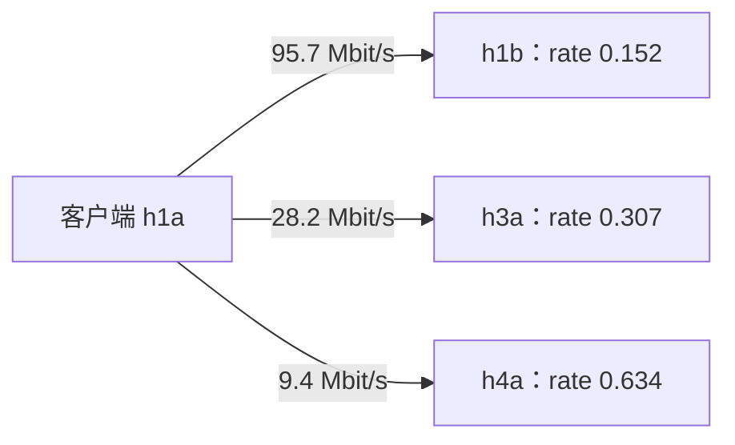
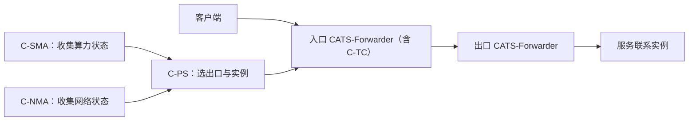

# 第 11 讲 算力网络与算网协同：最近的不一定最快

> **课程导读**：第 10 讲的调度器只看网络，默认每台机器算得一样快。真实的系统里，离用户近的边缘节点往往算力有限，算力充足的数据中心又往往离得远。本讲把同一个服务部署成三个实例：离客户端最近的算得最慢，算得最快的离得最远。同一批请求，只换“发给谁”这一个决定：**12 个重计算的请求全部发给最近的实例要 12 秒，发给算力最强的只要 3 秒；换成 12 个大输入的请求，结果正好反过来，最近的 1.7 秒，算力最强的 5 秒以上。** 只看网络或只看算力都会选错，要把两者放进同一个式子。学完后，你应能测出网络与算力两张画像，用“传输、排队、计算”三项估计一个请求在各实例上的完成时间，说清排队怎样让最好的实例变差，并把这套做法对应到 IETF 的算力感知流量调度（CATS）框架。

---

## 学习目标

1. 说出一个请求从发出到返回经过的四段时间，用实测说明“哪个实例最快”取决于请求的输入大小与计算量。
2. 测出网络与算力两张画像；说明 cgroup 的 `cpu.max` 怎样限定一个进程的算力，并用 `cpu.stat` 读出它被限速的证据。
3. 用 $T = T_{\text{传输}} + T_{\text{排队}} + T_{\text{计算}}$ 估计一个请求在各实例上的完成时间，与实测对账，并解释“就近”和“算力最强”各在哪类请求上选错。
4. 说明排队怎样让最好的实例变差，比较“最空闲”与“联合代价”两种分摊请求的思路，手工推演前几个请求的分配。
5. 说出 CATS 框架里各组件的职责并对应到本讲的工具；说明算力度量为什么难统一、度量多久更新一次为什么重要；用同一个式子分析云边协同与星上计算。

| 时间 | 内容 | 课堂产出 |
| --- | --- | --- |
| 0–12 分钟 | 模块一：三个实例，谁最快 | 两类请求各发给三个实例，读出最快的各是谁 |
| 12–27 分钟 | 模块二：两张画像 | 网络画像、算力画像；读出限速的证据 |
| 27–50 分钟 | 模块三：把两张画像放进一个式子 | 手算估计表；三种策略的实测；手工推演联合代价 |
| 50–63 分钟 | 模块四：算力网络里的其他问题 | CATS 组件对应表；笔算星上计算 |
| 63–87 分钟 | 模块五：综合动手——给两类请求定一条分流规则 | 两张画像、估计表、四种做法的实测与后悔值 |
| 87–90 分钟 | 模块六：课后思考与拓展 | 三道短题；Lab 7 B 段说明 |

**课前准备（不计入上述 90 分钟）**：学生自行准备 Ubuntu Linux，工具与第 10 讲相同，另外需要 cgroup v2（Ubuntu 22.04 起默认就是）。不同小组各用独立主机或虚拟机，同一台机器由一人操作。本讲的脚本以压缩包分发，解压后得到 `lecture11_prep` 目录。本讲标为“实测样例”的输出来自 2026-11-15 的备课虚拟机（Ubuntu 26.04.1、Linux `7.0.0-43-generic`、x86_64、2 核 2.8 GB），单次读数以自己的测量为准。

```bash
# 1. 进入本讲目录（lecture11_prep 压缩包解压后的目录，路径换成你自己的）；本讲所有命令都在这里执行
cd ~/lecture11_prep

# 2. 清理第 05 讲课堂网络与 Lab 3 网络（节点重名，不能同时存在）
sudo bash lab3_classroom.sh down
sudo bash lab3_topo.sh down

# 3. 准备路由守护进程的 Python 环境
uv sync --frozen

# 4. 搭建完整实验床（默认加载 Lab 2 参考路由），并自检
sudo bash lab4_topo.sh up
sudo bash lab4_topo.sh check
```

准备完成应出现 `[OK] 8 条上联往返、8 台 host 网关可达、跨机架往返。`。本讲用到的脚本、Lab 2 参考路由和 Python 环境配置都在 `lecture11_prep` 目录里，脚本按自己所在的目录找其他文件，**以下所有命令都在这个目录里执行**（新开终端时先 `cd` 进去）。这些文件是 Lab 2–4 与 Lab 7 中相应文件的副本，有一处不同：`steer.py` 的“联合代价”策略是 Lab 7 B 段的任务，课上先手算。本讲的工具只用 Python 标准库，直接用系统 `python3` 运行。**中途不要拆拓扑；提前结束或中断时，执行 5.7 节的清理命令。**

---

## 模块一：三个实例，谁最快

### 1.1 一个服务，三个实例

本讲换一种工作负载。前几讲的作业是一组进程一起算很多轮；这一讲是**请求与响应**：客户端发来一个请求，服务算完把结果送回去。图像识别、语音转写、代码补全都是这个样子。

同一个服务可以部署在很多地方，每一处叫一个**服务实例（Service Instance）**。本讲在实验床上起三个实例，客户端在 h1a。一个请求分两部分：

- **输入**：客户端要上传的数据，例如一张图片。输入越大，越依赖网络。
- **计算**：实例处理这份输入要用的 CPU 时间。计算越重，越依赖实例的算力。

本讲用两类请求做对比：

| 名称 | 输入 | 计算 | 像什么 |
| --- | --- | --- | --- |
| `upload` | 1 MB（$10^6$ 字节） | 20 ms | 传一张大图，做一次简单的处理 |
| `compute` | 10 kB | 150 ms | 传一小段文字，做一次较重的推理 |

“计算 150 ms”指的是 150 ms 的 **CPU 时间**。实例如果只分到一部分 CPU，墙上的时间会更长。

一个请求从发出到拿到结果，经过四段：


*图示说明：一个请求的四段时间。传输是从客户端发出到实例收齐全部输入；排队是从收齐到开始计算，实例一次只算一个请求，先到先算；计算是这个请求占用实例的时间；返回是把一行结果送回客户端。本讲的结果只有一百多字节，返回这一段通常只有一两毫秒。四段首尾相接，加起来就是这个请求的完成时间。*

`steer.py` 是本讲的请求分发器，它在 h1a 上按给定的策略把请求发给实例，并记下每个请求的这四段时间。实例由 `edge.sh` 启动，每个实例是 `instance.py` 的一个进程。

### 1.2 短观察：同一个重计算请求，发给谁最快

**问题与预测**：三个实例分别在 h1b、h3a、h4a。h1b 与客户端 h1a 在同一个机架。三个实例的算力不一样，网络条件也不一样，具体数字先不告诉你。把同一个 `compute` 请求分别发给它们，各要多久？**先猜一猜哪个最快，再运行。**

**工具与观察点**：`steer.py run --policy only:主机` 把请求全部发给指定的实例；`--requests 1` 只发一个，这时实例是空闲的，没有排队。`steer.py report` 把几次运行排成表，“传输”“排队”“计算”三列是该次运行里各请求的平均值，单位 ms。

```bash
# 1. 加载网络场景，启动三个实例
sudo bash lab4_topo.sh scenario lecture11
sudo bash edge.sh up

# 2. 同一个重计算请求（输入 10 kB、计算 150 ms），给三个实例各发 1 个
sudo python3 steer.py run --policy only:h1b --workload compute --requests 1 --label c1-h1b
sudo python3 steer.py run --policy only:h3a --workload compute --requests 1 --label c1-h3a
sudo python3 steer.py run --policy only:h4a --workload compute --requests 1 --label c1-h4a

# 3. 排成表
python3 steer.py report c1-h1b c1-h3a c1-h4a
```

**实测样例**：

```output
[*] 场景 lecture11 已加载。结束后执行 lab4_topo.sh scenario clear，再用 lab4_topo.sh status 核对。
[*] 预设 lecture11：实例已启动，端口 7700。查看限额用 edge.sh status；结束后执行 edge.sh down。
[c1-h1b] only:h1b compute 1 个请求：批完成 1.011 s，单个请求 p50 1011 ms、p95 1011 ms；h1b×1
[c1-h3a] only:h3a compute 1 个请求：批完成 0.510 s，单个请求 p50 510 ms、p95 510 ms；h3a×1
[c1-h4a] only:h4a compute 1 个请求：批完成 0.253 s，单个请求 p50 253 ms、p95 253 ms；h4a×1
标签     策略          负载    批完成s p50ms p95ms 传输 排队 计算  各实例请求数
c1-h1b   only:h1b      compute   1.011  1011  1011    8    1 1000  h1b×1
c1-h3a   only:h3a      compute   0.510   510   510    8    1  500  h3a×1
c1-h4a   only:h4a      compute   0.253   253   253   10    0  241  h4a×1
```

**读数据**：

1. **最近的实例最慢**：h1b 用了 1011 ms，h4a 只用了 253 ms，相差 4 倍。
2. **时间几乎全在计算**：三行的“传输”都不到 10 ms，10 kB 的输入一眨眼就传完了。
3. **150 ms 的计算，墙上时间各不相同**：h1b 约 1000 ms，h3a 约 500 ms，h4a 约 241 ms。同样的工作量，h1b 花的时间是 h4a 的 4 倍多，说明 h1b 能用的 CPU 少得多。

### 1.3 短观察：换成大输入的请求

**问题与预测**：把请求换成 `upload`（输入 1 MB、计算 20 ms），其他不变。还是 h4a 最快吗？**先写下预测。**

```bash
# 1. 大输入的请求（输入 1 MB、计算 20 ms），给三个实例各发 1 个
sudo python3 steer.py run --policy only:h1b --workload upload --requests 1 --label u1-h1b
sudo python3 steer.py run --policy only:h3a --workload upload --requests 1 --label u1-h3a
sudo python3 steer.py run --policy only:h4a --workload upload --requests 1 --label u1-h4a

# 2. 排成表
python3 steer.py report u1-h1b u1-h3a u1-h4a
```

**实测样例**：

```output
[u1-h1b] only:h1b upload 1 个请求：批完成 0.218 s，单个请求 p50 218 ms、p95 218 ms；h1b×1
[u1-h3a] only:h3a upload 1 个请求：批完成 0.343 s，单个请求 p50 343 ms、p95 343 ms；h3a×1
[u1-h4a] only:h4a upload 1 个请求：批完成 0.903 s，单个请求 p50 903 ms、p95 903 ms；h4a×1
标签     策略          负载    批完成s p50ms p95ms 传输 排队 计算  各实例请求数
u1-h1b   only:h1b      upload    0.218   218   218   87    0  129  h1b×1
u1-h3a   only:h3a      upload    0.343   343   343  283    0   59  h3a×1
u1-h4a   only:h4a      upload    0.903   903   903  877    1   24  h4a×1
```

**读数据**：

1. **顺序反过来了**：这次 h1b 最快（218 ms），h4a 最慢（903 ms）。
2. **h4a 慢在传输**：877 ms 都花在把 1 MB 送过去上，计算只用了 24 ms。
3. **h1b 传得快但算得慢**：传输 87 ms，计算 129 ms；20 ms 的计算在它上面仍然要 6 倍多的时间。

两次观察合起来：**没有一个实例对所有请求都最快。重计算的请求要找算力强的，大输入的请求要找网络近的。** 分发器要选对，得同时知道两件事：到每个实例的网络有多快，每个实例算得有多快。

**边界**：每种情况只发了一个请求，实例是空闲的。请求一多，还要考虑排队，这是模块三的内容。实例与场景保持运行，模块二、三接着用。

---

## 模块二：两张画像

### 2.1 网络画像

第 10 讲测过全部 56 对主机。分发器只关心客户端到各个实例的路，所以这里只测 3 对。

```bash
# 1. 网络画像：只测客户端 h1a 到三个实例，约 10 秒
sudo python3 checkup.py --src h1a --dst h1b,h3a,h4a --tput-repeats 1 --tput-seconds 1 --tput-omit 1 --out /tmp/lab07-results/net-profile.json
```

**实测样例**（节选：省略了两张矩阵，矩阵里没测的格子显示为“—”）：

```output
[计划] 3 个有向对；往返时间 3 个无序对 × 20 个探测；吞吐 3 对 × 1 次 × (-O 1 + -t 1) 秒
[计划] 预计约 0.2 分钟
[RTT]  h1a ⇄ h1b  p50 0.087 ms  p90 0.116 ms  丢 0/20
[RTT]  h1a ⇄ h3a  p50 0.138 ms  p90 0.187 ms  丢 0/20
[RTT]  h1a ⇄ h4a  p50 0.140 ms  p90 0.199 ms  丢 0/20
[吞吐] h1a → h1b  95.7 Mbit/s（95.7–95.7，n=1）
[吞吐] h1a → h3a  28.2 Mbit/s（28.2–28.2，n=1）
[吞吐] h1a → h4a  9.4 Mbit/s（9.4–9.4，n=1）
[完成] 用时 0.2 分钟；画像 /tmp/lab07-results/net-profile.json；原始输出 /tmp/lab07-results/net-profile.raw/
```

三条路差别很大：到同机架的 h1b 是 95.7 Mbit/s，到 h3a 是 28.2，到 h4a 只有 9.4。往返时间都在 0.2 ms 以内，对这两类请求可以忽略。场景 `lecture11` 把机架 3 的上联降到了 30 Mbit/s，机架 4 的降到了 10 Mbit/s。

### 2.2 算力画像，以及算力是怎么限出来的

**工具与观察点**：`cpuprof.py` 逐个实例发 5 个只有计算的探测请求（输入 1 kB、计算 100 ms），一次只测一个实例。实例回报每次计算开始与结束的时刻，据此算出

$$\text{rate} = \frac{\text{工作量（CPU 时间）}}{\text{计算用的墙上时间}}$$

rate 为 1.0 表示相当于一个不受限的 CPU 核；0.3 表示同样的计算要花约 3.3 倍的时间。

```bash
# 1. 算力画像：每个实例探测 5 次，约 6 秒
sudo python3 cpuprof.py

# 2. 算力是怎么限出来的：看三个实例的 CPU 限额
sudo bash edge.sh status

# 3. 被限速的证据：h1b 的计算进程被暂停了多少次、合计多久
cat /sys/fs/cgroup/lab07/h1b/cpu.stat
```

**实测样例**：

```output
[算力] h1b  100 ms 的计算用了 657.0 ms（656.5–666.7，n=5）  rate 0.152
[算力] h3a  100 ms 的计算用了 326.1 ms（318.7–327.3，n=5）  rate 0.307
[算力] h4a  100 ms 的计算用了 157.7 ms（156.6–159.3，n=5）  rate 0.634
[完成] 算力画像 /tmp/lab07-results/cpu-profile.json
[预设] lecture11
[实例] h1b  cpu.max 1500 10000（15% 个核）  计算进程 162939 
[实例] h3a  cpu.max 3000 10000（30% 个核）  计算进程 162941 
[实例] h4a  cpu.max 6000 10000（60% 个核）  计算进程 162943 
```

`cpu.stat` 节选（省略了 `user_usec`、`system_usec` 等 6 行，数值随运行变化）：

```output
usage_usec 674231
nr_periods 460
nr_throttled 443
throttled_usec 3703123
```

**读数据**：

1. **算力画像**：三个实例的 rate 是 0.152、0.307、0.634。100 ms 的计算在 h1b 上要 657 ms，在 h4a 上只要 158 ms。
2. **限额写在 `cpu.max` 里**：`1500 10000` 的意思是每 10000 微秒（10 ms）的周期里，这个组里的进程合计最多运行 1500 微秒，也就是 15% 个核。用完配额，内核就把进程暂停到下一个周期。这是 Linux 的控制组（Control Group，cgroup）v2 提供的 CPU 限额，容器平台给容器限 CPU 用的是同一个机制。
3. **rate 与限额对得上**：15%、30%、60% 对应 0.152、0.307、0.634，实测略高于限额。
4. **`cpu.stat` 是被限速的直接证据**：到这一刻共经过 460 个周期（`nr_periods`），其中 443 个周期里进程因为用完配额被暂停过（`nr_throttled`），合计被暂停了 3.70 秒（`throttled_usec`），而它实际用掉的 CPU 时间只有 0.67 秒（`usage_usec`）。

**边界**：

- rate 是用一种纯 CPU 的计算量出来的。换一种计算（大量访问内存、读写磁盘、使用 GPU），同一台机器的“算力”会是另一个数。4.1 节接着讨论。
- 画像是在实例空闲时测的，它说明实例“能算多快”，不说明它“现在忙不忙”。
- 限额改了、机器上有别的负载，都要重测。

### 2.3 把两张画像放在一起



*图示说明：场景与预设 `lecture11` 下的两张画像。箭头上的数字是客户端到实例的吞吐（网络画像），方框里的 rate 是实例的算力（算力画像）。离客户端最近的 h1b 网络最快、算力最弱；h4a 算力最强、网络最慢；h3a 居中。图中只画客户端到三个实例的逻辑通路，省略了 leaf、spine 和其余主机。*

这正是导读里说的局面：**近的不强，强的不近**。它不是特意为难人的设定。边缘机房离用户近但空间和供电有限，大型数据中心算力充足但往往建在远处，4.3 节会回到这一点。

---

## 模块三：把两张画像放进一个式子

### 3.1 三项的估计

把 1.1 节的四段写成式子（返回这一段很短，略去）：

$$T = T_{\text{传输}} + T_{\text{排队}} + T_{\text{计算}}$$

设请求的输入是 $D$（Mbit），计算量是 $W$（秒，CPU 时间）；实例的吞吐是 $b$（Mbit/s），算力是 $r$：

$$T_{\text{传输}} = \frac{D}{b}, \qquad T_{\text{计算}} = \frac{W}{r}$$

实例空闲时 $T_{\text{排队}} = 0$；实例正忙时，要等它把前面的请求算完。与第 10 讲的代价模型相比，网络那一项没有变，新增的是算力和排队两项。

### 3.2 动手算：两类请求在三个实例上各要多久（5 分钟）

用 2.1 与 2.2 节的两张画像，实例空闲。单位换算：1 MB 是 8 Mbit，10 kB 是 0.08 Mbit。

**第一行的算法写在这里，其余五行自己填，再往下看。**

| 请求 | 实例 | $T_{\text{传输}}$（ms） | $T_{\text{计算}}$（ms） | 估计（ms） |
| --- | --- | --- | --- | --- |
| `upload` | h1b | $8 / 95.7 = 83.6$ | $20 / 0.152 = 131.6$ | 215 |
| `upload` | h3a | | | |
| `upload` | h4a | | | |
| `compute` | h1b | | | |
| `compute` | h3a | | | |
| `compute` | h4a | | | |

*思考提示：`upload`：h3a 是 $8/28.2 = 283.7$ 加 $20/0.307 = 65.1$，约 349 ms；h4a 是 $8/9.4 = 851.1$ 加 $20/0.634 = 31.5$，约 883 ms。`compute`：传输分别只有 0.8、2.8、8.5 ms；计算是 $150/0.152 = 986.8$、$150/0.307 = 488.6$、$150/0.634 = 236.6$ ms，合计约 988、491、245 ms。*

与 1.2、1.3 节的实测对账：

| 请求 | 实例 | 估计（ms） | 实测（ms） | 误差（估计相对实测） |
| --- | --- | --- | --- | --- |
| `upload` | h1b | 215 | 218 | −1.4% |
| `upload` | h3a | 349 | 343 | +1.7% |
| `upload` | h4a | 883 | 903 | −2.2% |
| `compute` | h1b | 988 | 1011 | −2.3% |
| `compute` | h3a | 491 | 510 | −3.7% |
| `compute` | h4a | 245 | 253 | −3.2% |

六个估计都在 4% 以内，而且每类请求里三个实例的快慢顺序都对。分发器要的正是这个顺序：`upload` 选 h1b，`compute` 选 h4a。

### 3.3 短观察：两种只看一样的策略

**问题与预测**：现在不是一个请求，而是一批：12 个请求，每隔 100 ms 发出一个。两种策略各自只看一张画像：

- `nearest`（就近）：只看网络画像，全部发给吞吐最大的实例；
- `strongest`（算力最强）：只看算力画像，全部发给 rate 最大的实例。

`compute` 与 `upload` 两类请求各跑一批，共四次。**先预测每一次的“批完成”时间**（最后一个请求完成的时刻减第一个请求发出的时刻）。提示：实例一次只算一个请求；用 3.2 节的表算一算，一个请求在选中的实例上要算多久，12 个排起来是多久。

```bash
# 1. 重计算的一批：就近、算力最强各一次（约 12 秒与 3 秒）
sudo python3 steer.py run --policy nearest --workload compute --label c-near
sudo python3 steer.py run --policy strongest --workload compute --label c-strong

# 2. 大输入的一批：就近、算力最强各一次
sudo python3 steer.py run --policy nearest --workload upload --label u-near
sudo python3 steer.py run --policy strongest --workload upload --label u-strong

# 3. 排成表
python3 steer.py report c-near c-strong u-near u-strong
```

**实测样例**：

```output
[c-near] nearest compute 12 个请求：批完成 12.043 s，单个请求 p50 5513 ms、p95 10943 ms；h1b×12
[c-strong] strongest compute 12 个请求：批完成 3.011 s，单个请求 p50 1007 ms、p95 1910 ms；h4a×12
[u-near] nearest upload 12 个请求：批完成 1.698 s，单个请求 p50 388 ms、p95 598 ms；h1b×12
[u-strong] strongest upload 12 个请求：批完成 5.261 s，单个请求 p50 4209 ms、p95 4558 ms；h4a×12
标签     策略          负载    批完成s p50ms p95ms 传输 排队 计算  各实例请求数
c-near   nearest       compute  12.043  5513 10943    3 4960 1001  h1b×12
c-strong strongest     compute   3.011  1007  1910    8  826  249  h4a×12
u-near   nearest       upload    1.698   388   598   85  183  134  h1b×12
u-strong strongest     upload    5.261  4209  4558 4085    3   29  h4a×12
```

**读数据**：

1. **每种策略各赢一次、各输一次**：重计算的一批，就近 12.043 秒，算力最强 3.011 秒；大输入的一批，就近 1.698 秒，算力最强 5.261 秒。
2. **就近输在计算**：`c-near` 的 12 个请求全在 h1b 上排队，每个算 1001 ms，$12 \times 1.0 = 12$ 秒，与 12.043 秒一致。平均排队 4960 ms，后到的请求大部分时间在等。
3. **算力最强输在传输**：`u-strong` 平均传输 4085 ms。12 个 1 MB 的输入要挤过去 h4a 的慢路。
4. **选对了也在排队**：`c-strong` 是这四次里重计算最快的，但平均排队仍有 826 ms。h4a 算一个请求要约 249 ms，请求却每 100 ms 来一个，来得比算得快，队伍越排越长：$12 \times 0.249 = 2.99$ 秒，与 3.011 秒一致。

**边界**：`u-strong` 这个数在不同的运行里会变。备课时另一次是 6.761 秒。去机架 4 有两条上联，每条 10 Mbit/s，12 条连接由 ECMP 分到两条上，分得越不均匀越慢。网络画像里的 9.4 Mbit/s 是一条连接单独测的，它既看不见第 10 讲那种“两条流挤一条路”，也看不见这里“多条流可以用上两条路”。

### 3.4 短观察：把请求分摊出去

只用一个实例，再好也会排队。第三种策略 `least`（最空闲）把每个请求发给“已经发出、还没返回的请求数最少”的实例，它不看任何画像，只看谁手头的活少。再加上两类请求交替出现的 `mixed` 负载，把三种策略都跑一遍。

**问题与预测**：`least` 在 `compute` 上会比 `strongest` 快吗？**先写下预测和理由。**

```bash
# 1. 最空闲：两类负载各一批
sudo python3 steer.py run --policy least --workload compute --label c-least
sudo python3 steer.py run --policy least --workload upload --label u-least

# 2. 混合负载（upload 与 compute 交替）：三种策略各一批
sudo python3 steer.py run --policy nearest --workload mixed --label m-near
sudo python3 steer.py run --policy strongest --workload mixed --label m-strong
sudo python3 steer.py run --policy least --workload mixed --label m-least

# 3. 九次运行排成表，再看 c-least 在各实例上的明细
python3 steer.py report c-near c-strong c-least u-near u-strong u-least m-near m-strong m-least
python3 steer.py show c-least
```

**实测样例**：

```output
[c-least] least compute 12 个请求：批完成 4.006 s，单个请求 p50 691 ms、p95 3006 ms；h1b×4 h3a×4 h4a×4
[u-least] least upload 12 个请求：批完成 1.975 s，单个请求 p50 341 ms、p95 875 ms；h1b×6 h3a×4 h4a×2
[m-near] nearest mixed 12 个请求：批完成 6.908 s，单个请求 p50 2987 ms、p95 5808 ms；h1b×12
[m-strong] strongest mixed 12 个请求：批完成 2.775 s，单个请求 p50 602 ms、p95 2091 ms；h4a×12
[m-least] least mixed 12 个请求：批完成 2.159 s，单个请求 p50 755 ms、p95 1053 ms；h1b×4 h3a×5 h4a×3
标签     策略          负载    批完成s p50ms p95ms 传输 排队 计算  各实例请求数
c-near   nearest       compute  12.043  5513 10943    3 4960 1001  h1b×12
c-strong strongest     compute   3.011  1007  1910    8  826  249  h4a×12
c-least  least         compute   4.006   691  3006    4  433  582  h1b×4 h3a×4 h4a×4
u-near   nearest       upload    1.698   388   598   85  183  134  h1b×12
u-strong strongest     upload    5.261  4209  4558 4085    3   29  h4a×12
u-least  least         upload    1.975   341   875  331    7   88  h1b×6 h3a×4 h4a×2
m-near   nearest       mixed     6.908  2987  5808   43 2397  566  h1b×12
m-strong strongest     mixed     2.775   602  2091  893  102  141  h4a×12
m-least  least         mixed     2.159   755  1053  197  199  311  h1b×4 h3a×5 h4a×3
[c-least] least compute 12 个请求：批完成 4.006 s，单个请求 p50 691 ms、p95 3006 ms；h1b×4 h3a×4 h4a×4
实例     请求数    传输    排队    计算    返回    完成   （各段是该实例上请求的平均值，ms）
h1b           4     3.3   946.1   998.6     2.0  1950.0
h3a           4     2.9   291.1   498.4     1.1   793.5
h4a           4     7.0    61.3   248.0     2.1   318.4
```

**读数据**：

1. **`least` 在重计算上反而比 `strongest` 慢**：4.006 秒对 3.011 秒。它把 12 个请求平分给了三个实例，每个 4 个。
2. **慢在分给 h1b 的那 4 个**：`show` 的明细里，h1b 上每个请求算 999 ms，4 个排起来就是 4 秒；同一时间 h4a 上的 4 个平均 318 ms 就做完了，之后一直闲着。平分请求数不等于平分工作量：h4a 的算力是 h1b 的 4 倍，却只分到同样多的请求。
3. **`least` 在混合负载上是三者里最好的**：2.159 秒，就近是 6.908 秒，算力最强是 2.775 秒。分摊本身是有用的。
4. **三类负载，三种策略，没有一种全赢**：重计算是 `strongest` 最好，大输入是 `nearest` 最好，混合是 `least` 最好。

**边界**：每个格子只跑了一次。`m-strong` 与 `m-least` 备课时的另一次是 3.819 秒和 2.555 秒，原因与 3.3 节的边界相同。排序在两次里没有变。

### 3.5 动手推演：联合代价（6 分钟）

三种策略各有一个盲区：`nearest` 不看算力，`strongest` 不看网络，`least` 两张画像都不看。**联合代价**的做法是：每来一个请求，用 3.1 节的式子为每个实例估计“发给它的话什么时候做完”，选最早的那个；并记下这个实例因此要忙到什么时候。

为每个实例记一个数 $F$：它预计算完手头所有请求的时刻，开始都是 0。时刻 $t$ 来了一个请求，发给某个实例的话：

- 输入在 $t + T_{\text{传输}}$ 到齐；
- 到齐时实例还在忙（到齐时刻早于 $F$），就等到 $F$ 再开始；
- 完成时刻 = 开始时刻 + $T_{\text{计算}}$。

选完成时刻最早的实例，并把它的 $F$ 改成这个完成时刻。

**推演 `compute` 这一批的前 4 个请求**，它们在 0、0.1、0.2、0.3 秒发出。用 3.2 节的数：传输 0.001、0.003、0.009 秒，计算 0.987、0.489、0.237 秒（依次是 h1b、h3a、h4a）。第一行已填好：

| 请求 | 发出时刻 | 发给 h1b 的完成时刻 | 发给 h3a | 发给 h4a | 选谁 | 选后该实例的 $F$ |
| --- | --- | --- | --- | --- | --- | --- |
| 0 | 0 | 0.988 | 0.492 | 0.246 | h4a | 0.246 |
| 1 | 0.1 | | | | | |
| 2 | 0.2 | | | | | |
| 3 | 0.3 | | | | | |

*思考提示：请求 1：h4a 要等到 0.246 才能开始，完成于 $0.246 + 0.237 = 0.483$；h3a 空闲，完成于 $0.1 + 0.003 + 0.489 = 0.592$；选 h4a，$F = 0.483$。请求 2：h4a 完成于 $0.483 + 0.237 = 0.720$；h3a 完成于 $0.2 + 0.003 + 0.489 = 0.692$，更早，选 h3a，$F_{\text{h3a}} = 0.692$。请求 3：h4a 仍是 0.720；h3a 要等到 0.692，完成于 1.181；h1b 完成于 1.288；选 h4a。四个请求依次发给 h4a、h4a、h3a、h4a。*

它不是平分，也不是全给最强的：强的实例多分，忙到一定程度就让次强的分担，最弱的 h1b 只有在其他实例都排得很长时才会用到。

课上的 `steer.py` 不带这个策略，把它写成程序是 Lab 7 B 段的任务。备课时用参考实现测过同样的三批请求，供你做 Lab 时对照：

| 负载 | `nearest` | `strongest` | `least` | 联合代价（备课时用参考实现测得） |
| --- | --- | --- | --- | --- |
| `compute` | 12.043 | 3.011 | 4.006 | 2.100 |
| `upload` | 1.698 | 5.261 | 1.975 | 1.431 |
| `mixed` | 6.908 | 2.775 | 2.159 | 1.608 |

单位是秒。前三列是本节的实测；最后一列是同一天、同一场景下另一次搭建的实验床上测的，不是同一批运行。

### 3.6 恢复基线

```bash
# 1. 停实例，恢复网络基线并核对；模块五要换一组条件
sudo bash edge.sh down
sudo bash lab4_topo.sh scenario clear
sudo bash lab4_topo.sh status
```

**实测样例**：

```output
[*] 实例已停止，cgroup 已删除。
[*] 已恢复基线：全部端口 HTB + fq、档位不变，钉路已取消。
[档位] leaf–spine 100 Mbit/s；host 接入 100 Mbit/s。场景：无。
[基线] 32 个限速端口均为 HTB + fq，速率与 burst 为基线值。
[基线] r1–r4 没有额外策略路由（自然 ECMP）。
```

---

## 模块四：算力网络里的其他问题

本模块只讲知识，不运行命令。

### 4.1 算力为什么难度量

网络画像里的吞吐，不管是谁的数据，单位都是 Mbit/s。算力没有这样现成的通用单位。2.2 节的 rate 是用一种纯 CPU 的循环量出来的，它至少漏掉了这些：

- **计算的类型**：同一台机器，做矩阵运算、压缩文件、跑神经网络推理，相对快慢各不相同；有没有 GPU 或专用加速器，差别可以是数量级的。
- **当前的负载**：rate 是空闲时测的。分发器真正想知道的是“现在发过去要等多久”，这取决于实例上已有的请求。
- **其他资源**：内存够不够、模型有没有已经装载好，都可能比 CPU 更要紧。

所以实际系统里的“算力度量”通常不是硬件参数，而是更接近服务本身的量，例如排队的请求数、预计的处理时延。要把不同厂商、不同类型的实例放在一起比较，还得把这些量换算成可以相互比较的分数。

### 4.2 CATS：把“选实例”交给网络

本讲的分发器在客户端上，它自己测画像、自己选实例。**算力感知流量调度（Computing-Aware Traffic Steering，CATS）** 是 IETF 的一个工作组，它讨论的是把这件事交给运营商的网络来做：客户端只说“我要访问这个服务”，由网络入口根据网络状态和算力状态，把流量送到合适的实例。它的框架在 2026 年 10 月发布为 RFC 10053，问题陈述与用例是 RFC 10054。

框架里的功能组件，可以和本讲的工具一一对照：



*图示说明：RFC 10053 的 CATS 框架示意，只画一条服务请求的通路和度量的流向，是教学用的简化。C-SMA 收集服务站点与实例的状态，C-NMA 收集底层网络的状态，两者把信息交给 C-PS；C-PS 为服务请求选择出口 CATS-Forwarder（也可以进一步选定服务联系实例）；入口 CATS-Forwarder 上的 C-TC 识别出属于这个服务的流量，按选定的路径送往出口。组件可以合在同一台设备上，也可以分开部署；图中省略了多个站点与多个实例，底层网络只用一条连线表示。*

| CATS 组件 | 职责（RFC 10053） | 本讲里对应什么 |
| --- | --- | --- |
| 服务实例、服务联系实例（Service Contact Instance） | 提供服务；后者是面向客户端、接收请求的那个入口 | `instance.py`，一个进程兼任两者 |
| C-SMA（Service Metric Agent） | 收集服务站点、服务器资源和各实例的状态 | `cpuprof.py` 测的算力画像 |
| C-NMA（Network Metric Agent） | 收集底层网络的状态 | `checkup.py` 测的网络画像 |
| C-PS（Path Selector） | 用这些度量为服务请求选择出口和实例，并选路径 | `steer.py` 里的策略 |
| C-TC（Traffic Classifier） | 识别哪些流量属于哪个服务 | `steer.py` 知道每个请求的类型 |
| 入口、出口 CATS-Forwarder | 把服务流量沿选定的路径送到出口，再交给实例 | 本讲没有：分发器直接连实例 |

三点值得注意：

- **客户端不知道实例在哪**。CATS 里客户端用服务标识（CS-ID）访问服务，选哪个实例由网络决定；本讲的分发器则直接拿着实例的地址。
- **度量要归一化和聚合**。RFC 10053 第 5.4 节指出，每个实例都单独通告度量会带来规模问题，需要把度量换算成不带单位的分数，并在站点一级汇总。这就是 4.1 节说的那件难事。度量的具体定义还在草案阶段（`draft-ietf-cats-metric-definition`），尚未成为 RFC。
- **度量多久更新一次**。算力状态变化很快，更新得太勤，网络里到处是通告；更新得太慢，所有入口都按同一份过时的信息把流量送向同一个“看起来最闲”的实例。Lab 7 B 段的进阶任务让你亲眼看到后一种情况。

### 4.3 云边协同

把本讲的三个实例换个名字：h1b 是离用户最近的**边缘节点（Edge）**，算力有限；h4a 是远处的**云数据中心（Cloud）**，算力充足；h3a 介于两者之间。云边协同要回答的就是 3.2 节那张表回答的问题：哪些请求留在边缘，哪些送去云端。

- 输入大、计算轻、对时延敏感的，适合留在边缘，例如视频画面的预处理。
- 输入小、计算重的，适合送去云端，例如大模型推理。
- 还有一种常见做法是拆开：边缘先做一遍轻量的处理，把输入变小，再把结果送去云端做重的那部分。这相当于用一点边缘的算力，换掉大部分传输时间。

### 4.4 笔算：星上计算（3 分钟）

把计算放到卫星上，是同一个式子的极端情形：卫星与地面站之间的链路又慢又不是一直可用。下面的数字是**教学设定**，不代表任何真实系统：

- 一颗遥感卫星拍一景图像，原始数据 2 GB（16000 Mbit）；
- 卫星过境时与地面站的下行链路是 100 Mbit/s；
- 从图像里找出目标，在地面的服务器上要算 3 秒；星上的处理器慢 20 倍；
- 处理的结果只有 2 MB（16 Mbit）。

**算一算**：（1）“把原始数据传回地面再算”与“在星上算完只传结果”，一景图像各要多久？（2）一次过境只有 8 分钟可以通信，两种做法各能交付几景？

*思考提示：（1）传回地面：$16000 / 100 = 160$ 秒传输，加 3 秒计算，共 163 秒。星上算：$3 \times 20 = 60$ 秒计算，加 $16 / 100 = 0.16$ 秒传输，约 60 秒。（2）8 分钟是 480 秒：传原始数据最多 3 景；星上算的话，计算不必等过境，过境时只传结果，480 秒可以传 $480 / 0.16 = 3000$ 景的结果，瓶颈变成星上每 60 秒才能算完一景。算力弱 20 倍的那一端反而更划算，因为它省掉的传输远多于多花的计算。这和 1.3 节里 h1b 赢过 h4a 是同一个道理。*

### 4.5 小结

| 策略 | 看什么 | 在哪类请求上选错 |
| --- | --- | --- |
| 就近 | 网络画像 | 计算重的请求：近的实例算得慢 |
| 算力最强 | 算力画像 | 输入大的请求：强的实例离得远 |
| 最空闲 | 各实例手头的请求数 | 实例算力相差大时：平分请求数不等于平分工作量 |
| 联合代价 | 两张画像，加上各实例要忙到什么时候 | 画像过时、多个分发器互不知情时 |

---

## 模块五：综合动手——给两类请求定一条分流规则

### 5.1 任务与条件

换一组条件：实例换了位置，各自的算力和到它们的网络都变了，没有人告诉你怎么变的。你要为 `upload` 和 `compute` 两类请求各选一个实例，定一条分流规则，并用数据说明它比三种现成的策略好多少。

| 项目 | 内容 |
| --- | --- |
| 输入 | 网络场景 `lecture11x` 与实例预设 `lecture11x`，**课上先不看定义** |
| 固定条件 | 客户端 h1a；负载 `mixed`：12 个请求，`upload` 与 `compute` 交替，每 100 ms 发出一个；CUBIC |
| 改变的因素 | 只有分发策略 |
| 四种做法 | `nearest`、`strongest`、`least`，以及你定的 `split:A,B`（输入不小于 100 kB 的发给 A，其余发给 B） |
| 指标 | 批完成时间；后悔值：这种做法的批完成时间与四者中最小值之比 |
| 产出 | 两张画像、一张估计表、一张对照表、一句分流规则 |

四种做法在同一组条件下各运行一次。**做完之前不要运行 `edge.sh status` 和 `lab4_topo.sh status`，它们会直接列出定义。**

### 5.2 加载条件，测两张画像（3 分钟）

```bash
# 1. 加载新的网络场景，按新的预设启动实例（先不看定义）
sudo bash lab4_topo.sh scenario lecture11x
sudo bash edge.sh up lecture11x

# 2. 旧的网络画像不适用了，先删掉（checkup.py 不会覆盖已有的画像）
sudo rm -rf /tmp/lab07-results/net-profile.json /tmp/lab07-results/net-profile.raw

# 3. 两张画像：客户端到三个新实例的网络，三个新实例的算力
sudo python3 checkup.py --src h1a --dst h2a,h3b,h4b --tput-repeats 1 --tput-seconds 1 --tput-omit 1 --out /tmp/lab07-results/net-profile.json
sudo python3 cpuprof.py
```

**实测样例**（节选：省略了 `[计划]` 行和两张矩阵）：

```output
[*] 场景 lecture11x 已加载。结束后执行 lab4_topo.sh scenario clear，再用 lab4_topo.sh status 核对。
[*] 预设 lecture11x：实例已启动，端口 7700。查看限额用 edge.sh status；结束后执行 edge.sh down。
[RTT]  h1a ⇄ h2a  p50 0.142 ms  p90 0.189 ms  丢 0/20
[RTT]  h1a ⇄ h3b  p50 0.127 ms  p90 0.210 ms  丢 0/20
[RTT]  h1a ⇄ h4b  p50 0.141 ms  p90 0.185 ms  丢 0/20
[吞吐] h1a → h2a  9.4 Mbit/s（9.4–9.4，n=1）
[吞吐] h1a → h3b  95.2 Mbit/s（95.2–95.2，n=1）
[吞吐] h1a → h4b  28.8 Mbit/s（28.8–28.8，n=1）
[完成] 用时 0.2 分钟；画像 /tmp/lab07-results/net-profile.json；原始输出 /tmp/lab07-results/net-profile.raw/
[算力] h2a  100 ms 的计算用了 163.4 ms（156.4–164.3，n=5）  rate 0.612
[算力] h3b  100 ms 的计算用了 657.4 ms（656.6–662.3，n=5）  rate 0.152
[算力] h4b  100 ms 的计算用了 326.8 ms（322.2–327.8，n=5）  rate 0.306
[完成] 算力画像 /tmp/lab07-results/cpu-profile.json
```

### 5.3 填估计表，定分流规则（8 分钟）

用 3.1 节的式子和你自己测到的两张画像，实例空闲：

| 请求 | 实例 | $T_{\text{传输}}$（ms） | $T_{\text{计算}}$（ms） | 估计（ms） |
| --- | --- | --- | --- | --- |
| `upload` | h2a | | | |
| `upload` | h3b | | | |
| `upload` | h4b | | | |
| `compute` | h2a | | | |
| `compute` | h3b | | | |
| `compute` | h4b | | | |

然后回答：

1. `upload` 发给谁最快？`compute` 呢？写成一条规则 `split:A,B`。
2. `nearest` 会把 12 个请求全发给谁？`strongest` 呢？
3. 预测四种做法的批完成时间。提示：`mixed` 里两类请求各 6 个，同一类的相邻两个相隔 200 ms；先看每个实例上一个请求要算多久，会不会排队。

*思考提示（用样例画像）：`upload`：h3b 是 $8/95.2 = 84$ 加 $20/0.152 = 132$，约 216 ms；h4b 约 $278 + 65 = 343$ ms；h2a 约 $851 + 33 = 884$ ms。`compute`：h2a 约 $9 + 245 = 254$ ms；h4b 约 $3 + 490 = 493$ ms；h3b 约 $1 + 987 = 988$ ms。规则是 `split:h3b,h2a`。`nearest` 全发给 h3b：6 个 `upload` 各算 132 ms、6 个 `compute` 各算 987 ms，排成一队约 $6 \times 0.132 + 6 \times 0.987 = 6.7$ 秒。`split:h3b,h2a`：h3b 上每 200 ms 来一个 132 ms 的计算，不排队；h2a 上每 200 ms 来一个 245 ms 的计算，略有积压，最后一个在 1.1 秒发出，约 1.6 秒做完。*

### 5.4 实测（3 分钟）

```bash
# 1. 三种现成的策略
sudo python3 steer.py run --policy nearest --workload mixed --label x-near
sudo python3 steer.py run --policy strongest --workload mixed --label x-strong
sudo python3 steer.py run --policy least --workload mixed --label x-least

# 2. 你的分流规则；把 h3b,h2a 换成你自己定的
sudo python3 steer.py run --policy split:h3b,h2a --workload mixed --label x-mine

# 3. 排成表
python3 steer.py report x-near x-strong x-least x-mine
```

**实测样例**：

```output
[x-near] nearest mixed 12 个请求：批完成 6.902 s，单个请求 p50 2992 ms、p95 5802 ms；h3b×12
[x-strong] strongest mixed 12 个请求：批完成 2.772 s，单个请求 p50 574 ms、p95 2303 ms；h2a×12
[x-least] least mixed 12 个请求：批完成 3.228 s，单个请求 p50 844 ms、p95 2129 ms；h2a×4 h3b×4 h4b×4
[x-mine] split:h3b,h2a mixed 12 个请求：批完成 1.607 s，单个请求 p50 220 ms、p95 507 ms；h2a×6 h3b×6
标签     策略          负载    批完成s p50ms p95ms 传输 排队 计算  各实例请求数
x-near   nearest       mixed     6.902  2992  5802   43 2399  567  h3b×12
x-strong strongest     mixed     2.772   574  2303  881   66  138  h2a×12
x-least  least         mixed     3.228   844  2129  453  221  383  h2a×4 h3b×4 h4b×4
x-mine   split:h3b,h2a mixed     1.607   220   507   47   62  185  h2a×6 h3b×6
```

### 5.5 读结果（5 分钟）

用样例数据填出的对照表：

| 做法 | 预测批完成（s） | 实测批完成（s） | 后悔值 |
| --- | --- | --- | --- |
| `nearest` | 6.7 | 6.902 | 4.29 |
| `strongest` | 不好估（见下） | 2.772 | 1.72 |
| `least` | 不好估（见下） | 3.228 | 2.01 |
| `split:h3b,h2a` | 1.6 | 1.607 | 1.00 |

1. **分流规则最好**：1.607 秒，是就近的 23%。两类请求各去了对它最快的实例，平均排队只有 62 ms。
2. **就近最差**：全部 12 个请求在算力最弱的 h3b 上排成一队，平均排队 2399 ms。
3. **算力最强的批完成时间取决于那 6 MB 怎样过去**：平均传输 881 ms。去 h2a 的路有两条 10 Mbit/s 的上联，6 条大连接怎样分到两条上，决定了它是 2.6 秒还是 5 秒多，所以表里没有填一个预测值。
4. **最空闲不如分流**：它把请求平分给三个实例，于是有大输入的请求被送去了慢的路，也有重计算的请求被送去了弱的实例。

**你的数据如果不同**：先核对四次运行是在同一组条件下；再看“各实例请求数”一列是否符合你对每种策略的预期。如果你的规则把两类请求发给了同一个实例，结果会接近 `nearest` 或 `strongest`。

### 5.6 小组交付（2 分钟）

写在纸上或文档里：

1. 两张画像的三行数、你的估计表、你的对照表。
2. 一句话写出分流规则，一句话说明第三个实例为什么没有用上，以及什么情况下应该用上它。
3. 揭晓：运行下面的命令，核对你从画像里读出的条件。

```bash
# 1. 揭晓实例的限额与网络场景的定义
sudo bash edge.sh status
sudo bash lab4_topo.sh status
```

**实测样例**：

```output
[预设] lecture11x
[实例] h2a  cpu.max 6000 10000（60% 个核）  计算进程 164209 
[实例] h3b  cpu.max 1500 10000（15% 个核）  计算进程 164211 
[实例] h4b  cpu.max 3000 10000（30% 个核）  计算进程 164213 
[档位] leaf–spine 100 Mbit/s；host 接入 100 Mbit/s。场景：lecture11x。
[偏离] r2 r2-r5：rate 10 / ceil 10 Mbit/s（基线 100）
[偏离] r5 r5-r2：rate 10 / ceil 10 Mbit/s（基线 100）
[偏离] r2 r2-r6：rate 10 / ceil 10 Mbit/s（基线 100）
[偏离] r6 r6-r2：rate 10 / ceil 10 Mbit/s（基线 100）
[偏离] r4 r4-r5：rate 30 / ceil 30 Mbit/s（基线 100）
[偏离] r5 r5-r4：rate 30 / ceil 30 Mbit/s（基线 100）
[偏离] r4 r4-r6：rate 30 / ceil 30 Mbit/s（基线 100）
[偏离] r6 r6-r4：rate 30 / ceil 30 Mbit/s（基线 100）
[基线] r1–r4 没有额外策略路由（自然 ECMP）。
```

条件是：h2a 60%、h3b 15%、h4b 30%；机架 2 的上联 10 Mbit/s，机架 4 的上联 30 Mbit/s。分发器不需要知道这些配置，它需要的是那两张画像。

### 5.7 恢复与清理（2 分钟）

```bash
# 1. 停实例、删 cgroup，恢复网络基线并核对
sudo bash edge.sh down
sudo bash lab4_topo.sh scenario clear
sudo bash lab4_topo.sh status

# 2. 需要保留结果就先复制；同名标签再次运行会被覆盖
mkdir -p "$HOME/lecture11-results" && cp -r /tmp/lab07-results "$HOME/lecture11-results/"

# 3. 不接着做 Lab 7 的话，拆实验床（幂等）
sudo bash lab4_topo.sh down
```

**实测样例**：

```output
[*] 实例已停止，cgroup 已删除。
[*] 已恢复基线：全部端口 HTB + fq、档位不变，钉路已取消。
[档位] leaf–spine 100 Mbit/s；host 接入 100 Mbit/s。场景：无。
[基线] 32 个限速端口均为 HTB + fq，速率与 burst 为基线值。
[基线] r1–r4 没有额外策略路由（自然 ECMP）。
[*] 实验床已拆除；路由日志保留在 /tmp/lab04-results。
```

`edge.sh down` 会结束实例的两个进程并删除 `/sys/fs/cgroup/lab07`，重复执行不报错。如果中途异常退出，按第 1 步和第 3 步的顺序执行即可：先停实例，再拆实验床。

### 5.8 从课堂走向 Lab 7

| 课上已经做到 | Lab 7 B 段要做 |
| --- | --- |
| 测网络与算力两张画像 | 用程序读两张画像 |
| 手算一个请求在各实例上的估计 | 把“传输、排队、计算”写成函数 |
| 手工推演联合代价的前 4 个请求 | 实现联合代价分发器，与三种现成策略对照 |
| 凭估计表定一条分流规则 | 让程序对每个请求自动做这个决定 |
| 听说过“度量更新得太慢”的问题 | 实测实例状态隔一段时间才上报时，请求怎样涌向同一个实例 |

---

## 模块六：课后思考与拓展

### 6.1 离堂检查（2 分钟）

1. 一个请求的完成时间由哪几段组成？哪一段取决于网络，哪一段取决于算力？
2. `cpu.max` 写着 `3000 10000`，这个实例的计算进程最多能用多少 CPU？100 ms 的计算大约要多久？
3. “最空闲”在重计算的一批上为什么输给了“算力最强”？

### 6.2 思考题

1. **第三个实例什么时候有用**：5.4 节的分流规则只用了两个实例。把请求的间隔从 100 ms 缩短到 50 ms，会发生什么？这时该怎样改规则？

   *思考提示：h2a 算一个 `compute` 要约 245 ms。请求来得更快，它的队伍会越排越长。用 3.5 节的推演方法想一想，排到多长时，把下一个请求发给 h4b 更划算。*

2. **两个分发器**：如果 h1a 和 h2b 上各有一个联合代价分发器，各自记着自己的 $F$，互相不知道对方发了什么，会出什么问题？

   *思考提示：两个分发器都以为 h4a 是空的。这和第 10 讲 6.2 节的第 5 题是同一个问题，只是这次挤的是算力。CATS 里的 C-SMA 就是为了让所有入口看到同一份状态。*

3. **度量更新的间隔**：实例每隔 1 秒上报一次自己的积压，分发器在两次上报之间只按旧数据决策。这一秒里来的请求会去哪里？间隔越短越好吗？

   *思考提示：上报的那一刻最闲的实例，会在接下来的一秒里收到所有请求。间隔短，决策更准，但上报本身也是流量和负载；想想 1000 个实例、100 个入口时的通告量。*

4. **拆开来做**：4.3 节提到边缘先做一遍轻量处理、再把变小的输入送去云端。用本讲的两张画像和式子，估计“先在 h1b 上算 20 ms、把 1 MB 变成 10 kB，再送去 h4a 算 150 ms”的完成时间，与直接送去 h4a 相比如何？

   *思考提示：两段的传输和计算分别加起来。注意第二段的输入是从 h1b 发往 h4a，不是从客户端，画像里没有这一对的数，需要再测一次。*

### 6.3 拓展资料与 RFC 列表

| 资料 | 范围 | 用途 |
| --- | --- | --- |
| [RFC 10053：A Framework for Computing-Aware Traffic Steering (CATS)](https://www.rfc-editor.org/rfc/rfc10053) | 第 2、3 节；第 4.2、5.4 节 | CATS 的术语、功能组件、度量分发与使用度量的考虑 |
| [RFC 10054：Computing-Aware Traffic Steering (CATS) Problem Statement, Use Cases, and Requirements](https://www.rfc-editor.org/rfc/rfc10054) | 用例与需求部分 | 为什么需要把算力状态纳入流量调度 |
| [draft-ietf-cats-metric-definition：CATS Metrics Definition](https://datatracker.ietf.org/doc/draft-ietf-cats-metric-definition/) | 全文（草案，内容可能变化） | 算力度量的分级与归一化 |
| [Linux 内核文档：Control Group v2](https://docs.kernel.org/admin-guide/cgroup-v2.html) | CPU 一节的 `cpu.max` 与 `cpu.stat` | CPU 限额的含义与统计项 |

拓展阅读不作为本周必须实现的任务。

### 6.4 后续衔接实验

- 上游：[第 06 讲](network_measurement.md)的测量口径；[第 07 讲](tail_latency.md)的排队与尾部延迟；[第 10 讲](topology_aware_scheduling.md)的网络画像与代价模型；本讲目录的 `lab4_topo.sh`、`edge.sh` 与 `netprof/`。
- 本讲：[Lab 7 指导书](../experiments/07/README.md)的 B 段，把三项的估计和联合代价分发器写成程序，并实测度量滞后时的现象。
- 下一讲：第 12 讲是课程总结。
