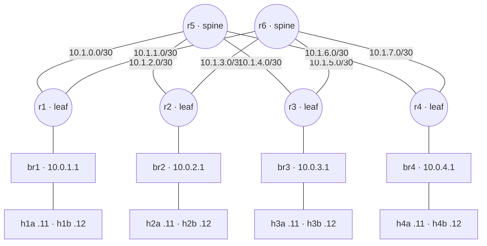
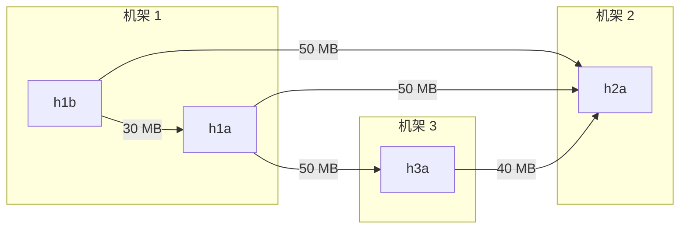
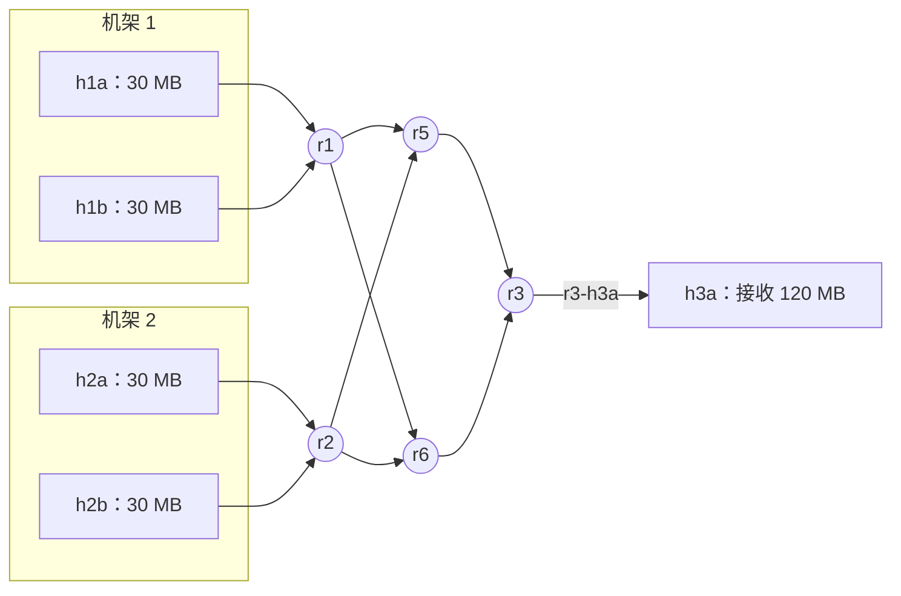
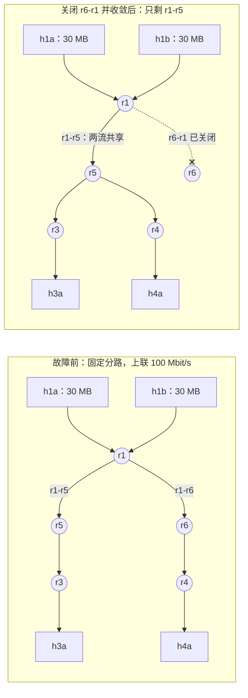

# 第 05 讲回顾：路很多，为什么还慢

> **课程导读**：[第四讲回顾](link_state_router_review.md)把九条规则落到一个路由进程；这一讲把三台路由器扩成 2 spine × 4 leaf × 8 host 的迷你数据中心，追问“能互通之后还缺什么”。用流量矩阵、查表、抓包、`tc` 配置与共同窗口串起[第五讲讲义](datacenter_network.md)：**需求 → 路径 → 容量 → 封装 → 完成时间**。最后用一次上联故障的补测，把“路由恢复”和“容量恢复”分开。

---

## 使用说明

- ● **记得吗**：回忆概念；●● **看得懂吗**：读图、读字段、算一步；●●● **说得清吗**：解释因果与证据边界。回答时指出支持判断的字段、数值或图中位置。
- [参考答案](datacenter_network_review_answers.md)单独成文，32 个题号逐一对应。第十一节提供程序员视角的讨论，不要求唯一答案。
- **课堂路线（约 40 分钟）**：题 2、5（6 分钟）；题 10、13（7 分钟）；题 17、19（6 分钟）；题 23、25（5 分钟）；题 30 读补测数据（6 分钟）；题 31 小组诊断（8 分钟）；判断题选讲、收束（2 分钟）。只有 10 分钟时选题 25、30。其他题供课后自查。
- **证据来源**：标为“原讲义实测节选”的输出来自第五讲的记录（2026-10-04，Ubuntu 24.04、Linux `6.8.0-142-generic`、ARM64、4 核 4 GB，Lab 2 参考实现）。标为“本次补测”的数据是 2026-10-24 在备课虚拟机（Ubuntu 26.04.1、Linux `7.0.0-38-generic`、x86_64、2 核 2.8 GB）上用 `classroom.sh up --reference` 搭建同一实验床后测得，用于题 10、24、27–31；补测的传输计时用 Lab 3 的 `measure.py`，与课堂脚本的计时方式不同。纸面推演与教学设定另行标明。
- 本回顾不给出 Lab 3 `topo.sh` 各 TODO 的实现，也不代替 Lab 3 的思考题与报告；题目只要求解释讲义与指导书已经给出的命令、配置和输出。
- 阅读无需搭环境。若复现，按原讲义“课前准备”搭建课堂实验床，从仓库根目录执行；结束后按原讲义 6.7 节清理。补测的复现步骤写在参考答案题 30、31。

**本回顾的实验题都使用下图。** 第三、六节的纸面题另设条件，均在题干中说明。



*图 1：课堂实验床，与原讲义 2.2 节、Lab 3 指导书 3.2 节相同。第 $k$ 条 leaf–spine 链路用 `10.1.k.0/30`，$k=2(\text{leaf}-1)+(\text{spine}-5)$，leaf 端为 .1、spine 端为 .2，接口按“本端-对端”命名，如 `r1-r5`、`r5-r1`。机架 $i$ 用 `10.0.i.0/24`，网桥 br$i$ 与 leaf 在同一 namespace。主机接入口双向 100 Mbit/s；leaf–spine 链路双向 100 或 50 Mbit/s，由 `classroom.sh rate` 切换。路由器运行 `lsrd --ecmp`，`fib_multipath_hash_policy=1`、`rp_filter=2`。*

---

## 一、从“能互通”到“够用”

> 涉及原讲义：1.1–1.3 节。

1. ● 8 个 worker 分在 4 个机架，每个 worker 都向其余 7 个发送中间结果。（1）这一轮有多少组有方向的通信关系？为什么不能说成“固定有这么多条 TCP 连接”？（2）下列通信各属东西向还是南北向：外部用户的请求进入前端；worker 之间交换中间结果；参数服务器把模型下发给 worker；作业结束后把结果返回数据中心外的客户端。（3）8 台主机两两 `ping` 全通，为什么还不能说明这张网络适合并行计算？写出一条缺少的证据。



*图 2：题 2 流量矩阵的非零项（教学设定，十进制 MB）。箭头是有方向的通信需求，尚未指定经过哪个 spine；同机架的 h1b → h1a 只经过 br1。本阶段没有需求的四台主机省略。*

2. ●● 下表是一个作业阶段的主机级流量矩阵（教学设定，十进制 MB；行＝发送端，列＝接收端）。

    | 发送端 ↓ ／接收端 → | `h1a` | `h1b` | `h2a` | `h3a` |
    | --- | ---: | ---: | ---: | ---: |
    | `h1a` | 0 | 0 | 50 | 50 |
    | `h1b` | 30 | 0 | 50 | 0 |
    | `h2a` | 0 | 0 | 0 | 0 |
    | `h3a` | 0 | 0 | 40 | 0 |

    （1）写出各行和、列和与总量。这一阶段最突出的通信形态是什么，应先检查哪条链路？（2）机架 1 的两条上联合计要向外发送多少应用数据？`h1b → h1a` 与 `h3a → h2a` 经过机架 1 的上联吗？（3）设所有链路都是 100 Mbit/s、忽略开销：`r2 → h2a` 这条接入链路给出的完成时间下界是多少？若机架 1 发往外部的流量全部碰撞在同一条上联，下界变成多少、瓶颈换到哪里？（4）`h2a` 一行全是 0、`h1b` 一列全是 0，能否说明它们与别的主机不通？

3. ●● 同学甲说：“h1a → h3a 要传 80 MB，要求 10 秒内传完，所以这条流达到了 64 Mbit/s。”同学乙在同一个 10 秒窗口里，测到接收端收到的应用数据共 80 MB，其中前 4 秒收到 48 MB，后 6 秒收到 32 MB。（1）两人的 64 Mbit/s 各是什么含义，哪一个是测量值？（2）乙的数据中，前 4 秒与后 6 秒的平均速率各是多少？10 秒的平均值掩盖了什么？（3）要把乙的结果与另一次测量放进同一张速率矩阵比较，还要统一哪些口径？

---

## 二、leaf-spine：路有几条，经过谁

> 涉及原讲义：2.1–2.5 节。

4. ● （1）本课程为什么采用“机架内交换、机架间路由”，而不是把所有机架接成一个大二层网络、再靠 STP 消除环路？（2）2 spine × 4 leaf 的 fabric 有几条 leaf–spine 链路？每个 spine、每个 leaf 至少要几个 fabric 端口？（3）再加第 5 个 leaf、或第 3 个 spine，分别要求哪些设备有空闲端口？加 spine 之后，跨机架最短路径变成几条？

5. ●● 按图 1 的地址约定回答。（1）写出 h2a → h4b 的两条最短路径，各经过哪几台转发设备、哪两条 /30。（2）在 h2a 上 `traceroute -n -I` 到 10.0.4.12：第 2 行显示 10.1.3.2，这次探测经过哪台 spine？第 3 行显示 10.1.7.1 或 10.1.6.1，各属于哪台设备的哪个接口？一共应有几行？（3）若 r2–r5 断开，哪条路径仍在？r2 的可用上联容量变为原来的多少？

6. ●●● 原讲义 2.5 节的查表与抓包（实测节选，省略 uid、时间戳等字段）：

    ```text
    10.0.1.12 dev eth0 src 10.0.1.11
    10.0.3.11 via 10.0.1.1 dev eth0 src 10.0.1.11
    r1-h1b Out IP 10.0.1.11 > 10.0.1.12: ICMP echo request
    r1-r6  Out IP 10.0.1.11 > 10.0.3.11: ICMP echo request
    ```

    （1）前两行的差别说明 h1a 对两个目的地址分别怎样交付？两种情况下，h1a 发出的帧的目的 MAC 各属于谁？（2）抓包为什么放在 r1 上、用 `-i any -Q out`？原讲义第 3 步的过滤式中，`icmp[0] = 8` 与 `src host 10.0.1.11` 各排除了什么？如果只在 h1a 的 `eth0` 上抓，加什么参数也能区分交换与路由，又会缺少哪项信息？（3）同学据第四行写下“h1a 到 h3a 走 r6”。这句话的证据边界在哪里？

---

## 三、ECMP：三个环节分别核对

> 涉及原讲义：3.1–3.5 节。

7. ● ECMP 分为三个环节：（a）SPF 得到等价首跳集合；（b）内核 FIB 装上多个 `nexthop`；（c）数据平面按哈希为报文选出接口。各由谁完成，用什么命令或证据核对？“有两条物理路径”“SPF 算出两条”“内核装了两条”“业务用了两条”为什么是四件事？对相邻的每两件，各举一种前一件成立、后一件不成立的情形。

8. ●● 原讲义 3.2 节列出四种 `fib_multipath_hash_policy`。（1）同一对主机 h1a → h3a 开 8 条 TCP 连接，策略 0 与策略 1 下分别预期怎样分布？（2）为什么讲义要求先读取当前值再解释现象，而不能只说“ECMP 默认按五元组”？在一个新建的 network namespace 里读到的值通常是多少？（3）讲义说本实验床里“相同五元组的新 TCP 连接可能选到不同上联”，这与“同一组哈希输入选择同一个下一跳”矛盾吗？

9. ●● 两条上联各 50 Mbit/s、主机接入 100 Mbit/s。（1）一条 TCP 连接在常规按流 ECMP 下最多约多少？为什么不能把两条上联加起来？（2）8 条连接最多约多少，受哪两项约束？原讲义 3.5 节测得的 47.59 与 93.52 Mbit/s 各对应哪个约束？（3）若要一条连接同时利用两条路径，需要哪一类机制，主要代价是什么？

10. ●●● 本次补测在 50 档下运行两次 `classroom.sh ecmp`：第一次临时把 r1 的 `fib_multipath_hash_policy` 改为 0，第二次恢复为 1。表中同时列出原讲义 3.5 节的记录，各为一次运行。

    | 来源与 r1 的哈希策略 | 八流连接数 r5 : r6 | 按 SYN 路径分组的接收应用数据 r5 / r6 | 八流接收吞吐 |
    | --- | ---: | ---: | ---: |
    | 本次补测，策略 0 | 0 : 8 | 0.00 / 30.41 MB | 46.95 Mbit/s |
    | 本次补测，策略 1 | 1 : 7 | 28.70 / 29.36 MB | 92.44 Mbit/s |
    | 原讲义，策略 1 | 3 : 5 | 29.10 / 29.49 MB | 93.52 Mbit/s |

    同一次补测中，两种策略下的单流都是 47.59 Mbit/s。（1）策略 0 下 8 条连接为什么都走 r6？吞吐为什么与单流几乎相同？（2）策略 1 的连接数是 1 : 7，两侧接收的字节却几乎相等。估算 r5 上那 1 条连接、r6 上平均每条连接的应用速率。（3）由此说明测量时为什么要分别记录流数、字节数与吞吐。若改为每条连接各传固定的 3.75 MB（八条共 30 MB），1 : 7 的分配会让哪一侧的连接最后完成，大约多久？

---

## 四、收敛比与完成时间下界

> 涉及原讲义：3.4、4.1–4.3、4.5 节。

11. ● （1）收敛比与路由“收敛”有什么不同？（2）每个 leaf 接 2 台 100 Mbit/s 主机，两条上联各 50 Mbit/s，按本讲的“下联 : 上联”写出收敛比。有人按全双工把下联算成 400、上联仍算 100，错在哪里？另一份资料写“上联 : 下联 = 1:2”，与本讲的写法矛盾吗？（3）每条上联 100 Mbit/s，但其中一条故障，收敛比是多少？

12. ●● 设若干条大流各自独立、等概率地选择两条等容量路径（教学假设）。（1）两条流碰撞在同一路径的概率是多少？三条流全部挤在同一路径的概率呢？三条流中至少有两条同路的概率呢？（2）原讲义 3.4 节的分配 A：路径 1 只有 1 条 1 GB 的流，路径 2 有 4 条各 1 MB 的流。按流数、按字节，哪条路径更忙？（3）普通哈希 ECMP 能不能按队列长度把新流放到较空的路径？



*图 3：题 13 的多对一传输（教学设定）。四台发送端同时各发 30 MB 给 h3a；画出了全部候选上联，没有指定哪条流经过哪个 spine。主机接入口均为 100 Mbit/s，leaf–spine 链路按题目取 100 或 50 Mbit/s；省略网桥、ACK 回程与其他主机。*

13. ●● 用 $T_{\mathrm{comm}}\geq\max_e 8D_e/C_e$ 计算（十进制 MB，忽略首部与启动开销）。（1）原讲义 4.3 节：同机架两台主机各向不同的远端发 100 MB，两条上联各 50 Mbit/s，分路与碰撞时下界各是多少？（2）图 3：leaf–spine 为 100 Mbit/s。按“发送端接入、源 leaf 上联、spine 到 r3、r3 到 h3a”四类链路分别写出承载量，下界是多少，由哪条链路决定？（3）把 leaf–spine 降为 50 Mbit/s：若四条流在两个 spine 上恰好各两条，下界变不变？若三条流挤到同一个 spine 呢？（4）这个下界不是什么？

14. ●● 原讲义 4.5 节在 50 档读到三行 `class htb 1:10 root leaf 10: prio 0 rate … ceil …`。（1）`rate`、`ceil` 各是什么，能否当作测得的吞吐？`leaf 10:` 与拓扑中的 leaf 交换机有关吗？（2）只看 r1 的 `r1-r5`、`r1-r6`，能否确认 r5 → r3 方向也是 50 Mbit/s？要核对 6.3 节 B 条件的瓶颈，应在哪台设备、哪个接口上看？为什么不是 h3a 的 `eth0`？（3）没加 `tc` 时，`ethtool` 对一个 veth 显示 `Speed: 10000Mb/s`。能拿它计算收敛比吗？

---

## 五、overlay：租户看到的网络

> 涉及原讲义：5.1–5.3、5.6、5.7 节。

15. ● （1）underlay 与 overlay 各负责什么？两个租户都用 192.168.10.0/24，为什么不能直接放进同一张普通路由表？（2）VNI 有多少位，最多能区分多少个虚拟网络？与 802.1Q 的 12 位 VLAN ID 相比如何？（3）VXLAN 的 UDP 目的端口按 IANA 分配是多少？为什么实验要显式写 `dstport 4789`？（4）VNI 能否提供加密或带宽保证？CNI 是一种隧道协议吗？

16. ●● 原讲义 5.2 节给出了 8 字节 VXLAN 首部的位图。（1）第 1 个字节中 `I` 位在哪一位？抓包里的 `flags [I] (0x08)` 中的 0x08 怎样得到？（2）VNI 100 在首部第 5–7 字节中的十六进制是什么？Lab 3 任务 6 的过滤式 `udp[12:4] = 0x00006400` 为什么能选出 VNI 100：偏移 12 从哪里数起，为什么取 4 个字节、最后一个字节是 00？（3）要选出 VNI 200，过滤值应改成什么？


*图 4：原讲义 5.7 节那个 ICMP 请求在 r1 上联上的封装层次，从左到右为报文中的先后顺序；宽度不按比例，问号留给题目填写。外层 IPv4 无选项，内层 Ethernet 不带 VLAN 标签。*

17. ●●● 原讲义 5.7 节在 t1a 的 `eth0` 与 r1 的上联上抓到同一个请求（实测节选）：

    ```text
    [租户侧]
    IP (ttl 64, id 63437, proto ICMP (1), length 60)
        192.168.10.11 > 192.168.10.12: ICMP echo request, id 8652, seq 1, length 40
    [underlay]
    r1-r6 Out IP (ttl 64, id 27129, proto UDP (17), length 110)
        10.0.1.1.48599 > 10.0.3.1.4789: VXLAN, flags [I] (0x08), vni 100
    IP (ttl 64, id 63437, proto ICMP (1), length 60)
        192.168.10.11 > 192.168.10.12: ICMP echo request, id 8652, seq 1, length 40
    ```

    （1）填出图 4 中的四个问号，并用它们核对外层的 `length 110`。（2）内层 IP 的 `id 63437` 在两处相同，外层却是 `id 27129`，为什么？哪些字段合起来才足以说明两处是“同一个包”？（3）`48599` 与 `4789` 各是什么？只看 `10.0.1.1 > 10.0.3.1`，能否知道这个包经过哪个 spine，哪一处给出了出口？（4）若改为 `ping -s 1000`，内、外层 IP 总长各是多少？在 `r1-r6` 上按经典 Ethernet 格式抓到的帧长是多少？

18. ●● 原讲义 5.7 节的隔离正反例：先验证 A、B 各自跨机架可达，再关闭 A 的接收端 t3a 的接口；此时 A 的 `ping` 失败，B 仍能 `ping` 通同一个 192.168.10.12。（1）这组正反例支持什么结论？为什么要先做两个可达性检查，再关闭 A？（2）它不能证明哪些事？至少写出三件。（3）设计一个最小对照，说明“隔离不等于带宽保证”：固定什么、只改变什么、比较什么指标？

---

## 六、封装之后：选路与 MTU

> 涉及原讲义：5.4、5.5、5.8 节。

19. ●●● （1）同一对 VTEP 之间的多个内层流，外层源、目的 IP 都相同。如果 underlay 只按外层 IP 做哈希，会怎样？VXLAN 用哪个字段提供区分，这又要求做 ECMP 选择的设备满足什么条件？（2）在本实验床中，对 VXLAN 报文做 ECMP 选择的是哪台设备？r5、r6 去往 10.0.3.1 各有几个下一跳？（3）Linux 对配置了固定 remote 的 VXLAN 设备缓存路由结果：按 CPU 分别保存，路由表变化时失效。据此解释两种看似矛盾的现象：外层源端口不同却走同一条上联；同一个外层源端口的数据分到两条上联。抓包看到外层源端口不同，是否足以证明走了两个 spine？

20. ●● （1）列出 VXLAN 封装要占用的 50 字节。为什么外层 Ethernet 的 14 字节不计入？（2）若内层帧带一个 802.1Q VLAN 标签，或外层改用 IPv6（固定首部 40 字节），underlay IP MTU 仍为 1500 时，内层 IP MTU 各应设为多少？两者同时出现呢？（3）underlay 改用 9000 字节的巨型帧（IP MTU 9000，外层 IPv4、内层无标签），内层可以设为多少？

21. ●● 原讲义 5.8 节（实测节选）：

    ```text
    PING 192.168.10.12 (192.168.10.12) 1422(1450) bytes of data.
    1430 bytes from 192.168.10.12: icmp_seq=1 ttl=64 time=0.080 ms
    PING 192.168.10.12 (192.168.10.12) 1423(1451) bytes of data.
    ping: local error: message too long, mtu=1450
    1 packets transmitted, 0 received, +1 errors, 100% packet loss
    ```

    （1）第一行括号里的 1450 与第二行的 1430 各包含哪些部分？（2）`-s 1423` 的输出中，哪些字样说明包丢在源端？若真正过不去的是中途某台 MTU 更小的路由器，`ping -M do` 通常会看到什么？（3）同学只摘了 `100% packet loss` 并写“远端丢包”，错在哪里？把这条预期失败的命令写进带 `set -e` 的脚本时要注意什么？

---

## 七、同样传 60 MB，为什么慢了一倍

> 涉及原讲义：6.1–6.6 节。

22. ●● 原讲义 6.2 节的预测表中，C 行的下界留给学生填写。（1）补全 C 的下界；说明 A 中为什么不把两个 2.4 秒相加，B 中却要把 30 + 30 MB 相加。（2）Lab 3 任务 3 用帧长口径修正下界：满长帧 1514 B 只载 1448 B 应用数据。A、B、C 的帧级下界各是多少？（3）课堂脚本的共同窗口从何时计到何时？为什么讲义不把它叫作 JCT？

23. ●●● 原讲义 6.3 节（实测节选，各轮保留路径与共同窗口）：

    ```text
    [运行] spread：h1a → h3a 30 MB；h1b → h4a 30 MB；临时策略路由固定到不同上联。
    [真实数据连接] 10.0.1.11:40001 → 10.0.3.11:5201 经 r5
    [真实数据连接] 10.0.1.12:40002 → 10.0.4.11:5202 经 r6
    [共同窗口] 两流全部完成 2.541 s；合计 60.00 MB；平均应用有效速率 188.89 Mbit/s（含建连与启动）
    [运行] hotspot：h1a → h3a 30 MB；h1b → h3a 30 MB；临时策略路由固定到不同上联。
    [真实数据连接] 10.0.1.11:40003 → 10.0.3.11:5201 经 r5
    [真实数据连接] 10.0.1.12:40004 → 10.0.3.11:5202 经 r6
    [共同窗口] 两流全部完成 5.052 s；合计 60.00 MB；平均应用有效速率 95.01 Mbit/s（含建连与启动）
    ```

    （1）两轮的路径证据说明了什么？为什么对照中要临时固定分路，模块三观察 ECMP 时却不固定？（2）计算两轮共同窗口之比与 B 的有效速率；B 接近哪一条已用 `tc` 查到的约束？（3）B 中 r1 的收敛比仍是 1:1，为什么“收敛比 1:1”不足以保证没有瓶颈？（4）若只把 h3a 的接入口换成 1 Gbit/s、其他不变，B 的理想下界变成多少，新的约束在哪里？

24. ●● 原讲义 6.4 节 C 条件测得共同窗口 5.055 s，理想下界 4.8 s。（1）按题 22 的帧级下界，这 0.255 s 中有多少可由首部开销解释？其余落在哪些环节？为什么不能把差额都叫作“排队时延”？（2）本次补测在 2 核虚拟机上用 `measure.py` 做同一映射、同一档位，共三轮：共同窗口 5.101、5.122、5.113 s，两条流的客户端计时都在 5.019–5.025 s 之间。与原记录相差约 58 ms，应怎样解释、怎样报告？

25. ●●● B、C 的共同窗口都约 5 秒。（1）对 B、C 各给出一项能缩短时间的措施，并写出它成立的前提。（2）有人提议给 C 增加第 3 个 spine，新链路同样是 50 Mbit/s。r1 的收敛比变成多少？两个发送端仍各用一条 TCP 连接时，C 的下界会变吗？B 呢？（3）由此说明“看完成时间”与“看矩阵、路径和配置”在选择措施时各起什么作用。

26. ●● 下列四份报告各错在哪里？应先查哪条证据？（a）“A 条件中两流用 iperf3 各测得 95 Mbit/s，合计 190 Mbit/s”，两次 iperf3 是先后运行的。（b）“C 条件只用了 2.6 秒，容量减半没有影响”：同学先执行 `classroom.sh rate 50`，接着运行 `classroom.sh matrix`。（c）“B 的 60 MB 用了 2.6 秒”，而自写脚本的汇总里 `bytes` 为 30000000。（d）把课堂 `ecmp` 的 93.52 Mbit/s 与 `matrix` 的 188.89 Mbit/s 直接比较，得出“iperf3 比 transfer.py 慢一半”。

---

## 八、补测：坏了一条上联，路通了为什么还慢

> 涉及原讲义：4.4 节；第四讲 5.5、6.11 节。题 27–30 使用本次补测。

原讲义 4.4 节只用文字说明“路由恢复与容量恢复是两件事”。本次补测在课堂实验床上（参考实现，Hello 2 秒、Dead 8 秒，未开 `--watch-links`；leaf–spine 100 Mbit/s）先测图 5 的故障前对照，再执行 `sudo ip -n r6 link set r6-r1 down`，关闭 r6 一侧的接口：r1 一侧的 `r1-r6` 仍是管理性 UP，只是失去载波。关闭前后在 r1、r3、r6 上记录 `ip -ts monitor route` 与守护进程日志，同时运行 8 条单向探针；收敛后再重复两流与单流传输，最后打开接口观察恢复。以下时刻只保留秒及以下部分，均为 07:25:xx。



*图 5：补测的两流对照：h1a → h3a、h1b → h4a 各 30 MB，即原讲义 6.1 节的 A 映射。两行节点位置相同。故障前用与课堂脚本相同的策略路由把 h1a 固定到 r5、h1b 固定到 r6；故障后只剩一个下一跳，不再固定。只画正向路径，省略网桥、ACK 回程、未使用的候选链路与其他主机；主机接入口始终为 100 Mbit/s。单流对照只发 h1a → h3a。*

27. ●● 关闭接口后的事件如下（时刻来自脚本、守护进程日志与 `ip -ts monitor route`）：

    | 事件 | 时刻 | 来源 |
    | --- | --- | --- |
    | 关闭 r6-r1 | 06.546 | 脚本在执行命令前取时 |
    | r6 判定 rid=1 Down，并在 12.795 发布不再列出 r1 的 LSA | 12.784 | r6 日志 |
    | r1 判定 rid=6 Down，并在 12.917 发布不再列出 r6 的 LSA | 12.892 | r1 日志 |
    | r6 把 10.0.1.0/24 改装为经 r2、r3、r4 三个下一跳 | 12.934 | r6 的 `ip monitor` |
    | r3 把 10.0.1.0/24 改为只经 r5 | 12.943 | r3 的 `ip monitor` |
    | r1 把 10.0.3.0/24 改为只经 r5 | 12.959 | r1 的 `ip monitor` |

    同一操作重做一次，关闭后 0.5 秒读到 r1 的路由如下，同时 `ip -n r6 route show 10.0.1.0/24` 没有任何输出：

    ```text
    10.0.3.0/24 proto 200 metric 20
        nexthop via 10.1.0.2 dev r1-r5 weight 1
        nexthop via 10.1.1.2 dev r1-r6 weight 1 linkdown
    ```

    （1）从关闭接口到 r1 改好路由用了多久？两端的检测时间各是多少，落在第四讲回顾题 9 推出的范围内吗？为什么两端接近却不相同？（2）r3 改路由的时刻，早于 r1 的新 LSA 加上 100 ms 合并等待所能达到的最早时刻。它是被哪条 LSA 触发的？这说明哪一端的检测决定了全网的收敛时刻？（3）对同一次操作，r1 与 r6 的内核反应为什么不同？带 `linkdown` 的下一跳还会被选中吗？（4）若两端都开 `--watch-links`，哪一段会大幅缩短？

28. ●●● 8 条单向探针各 100 pps、20 秒，在第 5 秒左右关闭接口。去程 F0–F3 由 h1a 发往 h3a（目的端口 9100–9103），回程 R0–R3 由 h3a 发往 h1a（9110–9113）；出口取自 r1、r3 上 `-Q out` 的抓包，计数器在关闭前与探针结束后各读一次。

    | 探针 | 源端口 | 抓包所见出口 | 收到／发出 | 最长中断 |
    | --- | --- | --- | --- | --- |
    | F0、F1、F2 | 46001–46003 | 全程 r1-r5 | 各 2000／2000 | 无 |
    | F3 | 46004 | r1-r6 最后一包在 06.552；r1-r5 第一包在 12.961 | 1360／2000 | 6410 ms |
    | R0、R2、R3 | 46101、46103、46104 | 全程 r3-r5 | 各 2000／2000 | 无 |
    | R1 | 46102 | r3-r6 共 1105 包，最后一包在 12.932；此后 r3-r5 | 1362／2000 | 6390 ms |

    计数器：r6 的 `IpExtInNoRoutes` 由 0 增至 637；r1 的 `IpExtInNoRoutes` 与三台路由器的 `TcpExtIPReversePathFilter` 均保持 0。（1）为什么 8 条探针只有 2 条中断？两段中断各与题 27 的哪一行对应？（2）回程丢在哪里？用抓包与计数器说明 1105、638、637 三个数的关系。（3）去程的 640 个包没有任何计数器记录，为什么仍可判断丢在 r1？这个推断依赖哪些证据？（4）对一个由许多 TCP 连接组成的作业，这 6.4 秒意味着什么？连接实际停顿的时间可能比路由恢复更长吗？

29. ●● 收敛与恢复中的两组细节：

    | 事件 | 时刻 |
    | --- | --- |
    | 打开 r6-r1 | 55.193 |
    | r1 记 rid=6 Init | 56.632 |
    | r6 记 rid=1 Init，随即 Full | 56.685、56.686 |
    | r6 发布新 LSA，`links` 重新列出 1 | 56.694 |
    | r1 记 rid=6 Full，6 ms 后发布列出 5、6 的 LSA | 58.632 |
    | r3 的 10.0.1.0/24 恢复两个下一跳 | 58.773 |
    | r1 的 10.0.3.0/24 恢复两个下一跳 | 58.783 |

    （1）题 27 中，r6 在 12.934 把 10.0.1.0/24 装成经 r2、r3、r4 三个下一跳。按 LSR-lite 的算法，这条路由的 cost 是多少？其他 leaf 去机架 1 会经过 r6 吗？生产网络常怎样避免这种经 leaf 中转回另一台 spine 的路径？（2）恢复用了约 3.6 秒。为什么 r6 在 56.694 已经重新列出 r1，r3 却到 58.773 才把 r6 加回去往机架 1 的下一跳？（3）从关闭到恢复，r1 去其他机架的 ECMP 宽度怎样变化？其间机架 1 发出的跨机架流量最多能用多少上联容量？

30. ●●● 故障前后与 50 档对照的传输结果（本次补测，每格三轮，括号内为中位数）：

    | 条件 | r1 去 10.0.3.0/24 的下一跳 | r1 收敛比 | 两流共 60 MB 的共同窗口 | 单流 30 MB 的共同窗口 |
    | --- | --- | --- | --- | --- |
    | 故障前，上联 100 | 2 | 1:1 | 2.609、2.622、2.634 s（2.622） | 2.602、2.624、2.585 s（2.602） |
    | 故障收敛后，上联 100 | 1（r1-r5） | ？ | 5.090、5.129、5.125 s（5.125） | 2.613、2.611、2.593 s（2.611） |
    | 不故障，上联 50 | 2 | 2:1 | 5.101、5.122、5.113 s（5.113） | 5.100、5.119、5.124 s（5.119） |

    故障收敛后，`h1a → h3a`、`h1b → h4a` 的 `ping` 都是 3/3；两流的数据包都只出现在 `r1-r5`，每流客户端计时 4.995–5.024 s。（1）填出表中的问号。路由已更新、`ping` 已恢复，两流共同窗口为什么约翻倍？用 4.3 节的公式和数据包出口说明。（2）故障后与 50 档的收敛比相同，两流共同窗口也接近，单流却相差一倍：为什么？收敛比没有告诉你什么？（3）只看“`ping` 恢复”和“下一跳数”，能否判断作业的通信何时恢复到故障前？还需要哪些证据？（4）把补测数据填进原讲义 4.4 节所说的两本账：一本是“检测、泛洪、计算安装”的时间分解，一本是故障前后的可用容量。

---

## 九、八分钟小组诊断：同样“看起来没问题”，问题在哪一层

> 涉及原讲义：3.1–3.5、5.1、5.7 节；第四讲 5.4 节。甲、乙两个现场来自本次补测，丙取自 Lab 3 任务 6 的指导书样例。

31. ●●● **8 分钟小组诊断。** 每个现场都有人给出了一个结论。目标是选出下一条最有区分力的观察，而不是凭一行输出猜唯一原因。前 2 分钟标记证据，4 分钟填表，2 分钟汇报。每行交付“可下的结论／仍缺的证据／下一步与预期分支”，最后说明怎样确认已经修好。

    | 现场 | 已知证据 | 不能直接断言什么？下一步看哪里？ |
    | --- | --- | --- |
    | 甲：八条连接没有分开 | r1 去 10.0.3.0/24 有两个 `nexthop`，`weight` 均为 1；50 档下运行 `classroom.sh ecmp`：单流 47.59 Mbit/s；八流 r5 0 条、r6 8 条，接收 30.41 MB、46.95 Mbit/s；`syn-r5.txt` 为空，`syn-r6.txt` 有 9 行 SYN。同学认为“lsrd 的 ECMP 写错了” | ____ |
    | 乙：抖动之后一半主机对不通 | r6-r1 被误关约 0.54 秒后恢复；12 秒后，h1a、h1b 发往其他机架的 12 个主机对中有 6 个 `ping` 全部失败，重复测试失败的组合不变；`classroom.sh check` 以退出码 1 结束、没有打印原因；六台路由器的 LSDB 指纹都是 `6603f6088a`，r6 的四个邻居都是 Full，UP-FOR 没有归零，`neighbor_down` 为 0；r6 的 `TcpExtIPReversePathFilter` 由 0 增至 18，`IpExtInNoRoutes` 仍为 0。同学认为“控制平面全部正常，一定是 r1 的哈希坏了” | ____ |
    | 丙：B 一开始传，A 就变慢 | A、B 都用 192.168.10.0/24，VNI 分别为 100、200；外层目的地址钉到 r5，上联 50 Mbit/s；仅 A 传输时 A 的同窗口速率 46.02 Mbit/s；A、B 同时传输时 A 为 23.08 Mbit/s，总速率 46.08 Mbit/s，两租户的目标数据都经过 `r1-r5`；隔离正反例通过。同学认为“VNI 隔离失效” | ____ |

    **固定条件**：课堂实验床与参考实现，Hello 2 秒、Dead 8 秒，未开 `--watch-links`；三个现场相互独立。甲、乙在 2026-10-24 的补测中实际出现过，其中乙出现在修复前的 `router.py` 上（同日已修复，见参考答案）；丙为 Lab 3 指导书任务 6 的修订样例（2026-10-05，4 核沙箱）。**评价指标**：诊断是否由证据支持，下一步观察能否区分不同解释；不按命令数量评分。

---

## 十、判断并改错

32. ●● 下列说法哪些成立？对错误说法给出必要条件或改写，不只写“对／错”。

    | 编号 | 说法 |
    | --- | --- |
    | A | 8 台主机两两 `ping` 全通，说明网络已经能支持任意通信模式的并行计算。 |
    | B | 流量矩阵中 $D_{ij}=0$，说明主机 $i$ 到主机 $j$ 不通。 |
    | C | 收敛比是容量之比；一条上联故障后剩余上联容量减少，收敛比随之变大，例如从 1:1 变为 2:1。 |
    | D | 内核路由里有两个 `nexthop`、`weight` 都是 1，所以每条流各把一半数据发到两条路径上。 |
    | E | 常规按流 ECMP 下，只要路由集合与哈希配置不变，一条 TCP 连接的报文走同一个下一跳。 |
    | F | 改变 TCP 源端口，一定能把一条流换到另一条上联。 |
    | G | 收敛比为 1:1 时，这个 leaf 上的任何流量矩阵都不会遇到瓶颈。 |
    | H | `tc class show` 里的 `rate 50Mbit` 表示这条链路实测吞吐为 50 Mbit/s。 |
    | I | VXLAN 封装不改变内层 IP 首部；spine 按外层目的地址，即远端 VTEP 的地址转发。 |
    | J | 抓包看到两个外层 UDP 源端口不同，就能证明两条内层流经过了不同的 spine。 |
    | K | underlay IP MTU 为 1500、外层 IPv4 无选项且内层无 VLAN 标签时，内层 IP MTU 可设为 1450。 |
    | L | 上联故障后路由重新收敛、`ping` 恢复，作业的通信时间也就恢复了。 |

---

## 十一、从程序员视角再想一步

### 1. 需求、资源与映射分开建模

流量矩阵、拓扑与容量、路由与哈希分别回答“要传什么”“有什么”“怎样落到资源上”。你写过的调度器、负载均衡器或数据库分片里，哪一部分对应“映射”？只调“资源”不看“映射”时，会出现什么样的误判？

### 2. 哈希分散的是“个数”，不是“负载”

ECMP 按流哈希，和缓存、数据库按键哈希分片是同一类做法。热点键、大对象与大象流有什么共同点？除了换一个哈希函数，还能怎样处理“一个键就占满一个分片”的情况？

### 3. 先算下界，再看测量

$\max_e 8D_e/C_e$ 只用一张表就能算出。测量值远高于下界时该查什么，远低于下界时又该怀疑什么？在你写的程序里，有没有类似“先估一个数量级再测”的习惯？

### 4. 名字空间隔离不等于资源隔离

VNI 让两个租户用同一套地址而互不可见，却仍然共享上联。容器、虚拟机与多租户数据库里的“吵闹邻居”问题和题 31 丙有什么相同？要给某个租户“保证”资源，需要在哪里分类、预留和调度？

### 5. 部分失败比全部失败更难发现

题 28 中只有走 r6 的探针中断，题 31 乙中只有一半主机对不通。单一健康检查（一个 `ping`、一个端口）为什么容易漏掉这类故障？你会怎样设计探测，让它覆盖不同的路径或分片？

### 6. 期望状态要和实际状态对账

题 31 乙里，路由进程记得自己“装过”的路由，内核里却已经没有了。第四讲回顾第十一节也讨论过 `installed` 这本账。怎样的对账循环既能及时发现差异，又不会因为频繁读写系统状态而带来新的问题？

本回顾到“能读懂矩阵、配置、抓包与计时，说清证据边界”为止；[Lab 3](../experiments/03/README.md) 让你搭起自己的实验床，并把这些现象亲手量出来。下一讲[网络性能测量与流量控制](network_measurement.md)把吞吐、延迟、抖动与丢包变成可比较的网络画像。参考实现与本回顾中的样例数字不是验收常数，学生实现须按 Lab 3 的要求独立验收。
