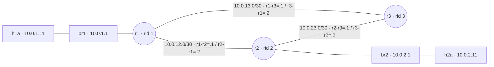
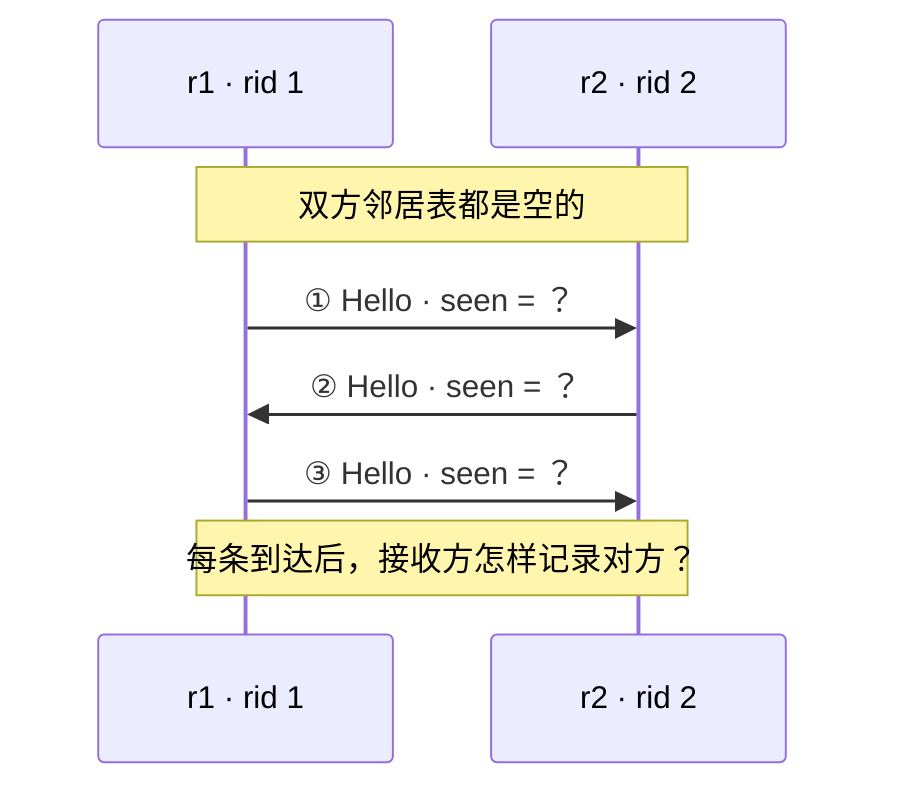
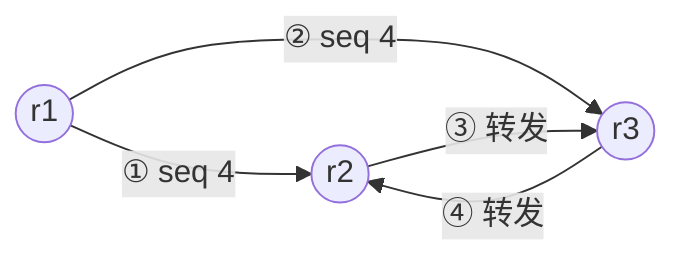
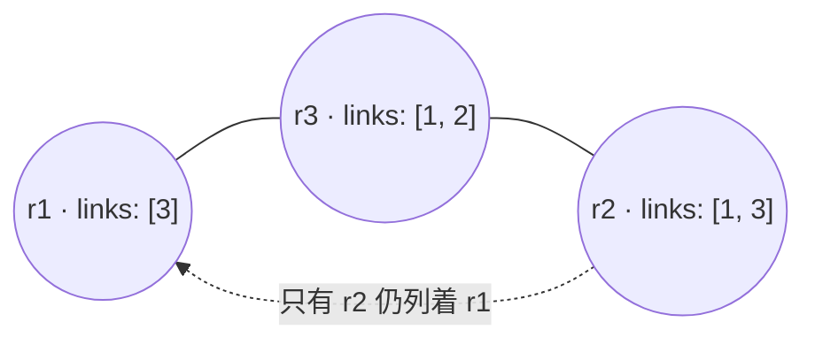
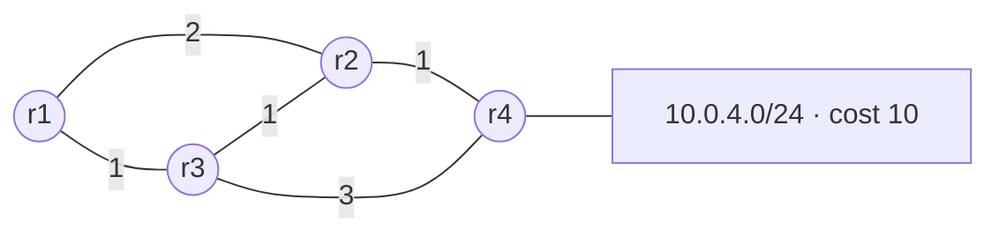
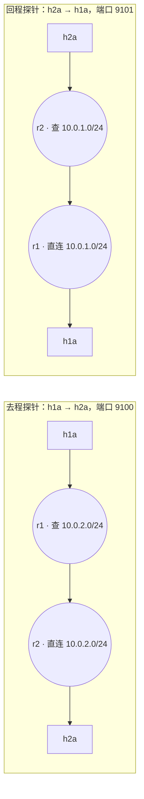

# 第 04 讲回顾：把九条规则写成一个路由进程

> **课程导读**：[第三讲回顾](routing_protocol_review.md)追问“表是谁算出来的”，这一讲把答案落到程序：九条规则怎样变成定时器、报文与内核三类事件，Hello 怎样把两台路由器从 Init 推到 Full，序列号怎样让洪水停下，SPF 的首跳怎样翻译成 `via … dev …`，一次收敛和一次重启的时间又花在了哪里。用代码片段、抓包、日志与计数器串起[第四讲讲义](link_state_router.md)：**事件 → 状态 → 动作 → 内核 → 业务证据**。

---

## 使用说明

- ● **记得吗**：回忆概念；●● **看得懂吗**：读代码、读字段、算一步；●●● **说得清吗**：解释因果与证据边界。回答时指出支持判断的代码行、字段或时间戳。
- [参考答案](link_state_router_review_answers.md)单独成文，32 个题号逐一对应。第十一节提供程序员视角的讨论，不要求唯一答案。
- **课堂路线（约 40 分钟）**：题 2、5（6 分钟）；题 8、11、12（9 分钟）；题 16、18、22（9 分钟）；题 30 读补测数据（6 分钟）；题 31 小组诊断（8 分钟）；判断题选讲、收束（2 分钟）。只有 10 分钟时选题 13、30。其他题供课后自查。
- **证据来源**：标为“原讲义实测节选”的输出来自第四讲模块六的记录（时间戳为 2026-09-27，原讲义未注明内核版本），其中 6.8–6.12 节由教师的参考实现产生。标为“本次补测”的数据是 2026-10-18 在备课虚拟机（Ubuntu 26.04、Linux `7.0.0-38-generic`、x86_64、2 核）上用仓库中的 `2026/experiments/02/reference/lsrd` 重做 6.12 节的重启场景，只用于第八节；其中补测 A、B 的主要数字已写入原讲义 6.12 节末尾。代码片段已按当前骨架与参考实现核对；纸面推演与教学设定另行标明。
- 本回顾不给出 Lab 2 TODO 的实现，也不代替 Lab 2 的思考题与报告；题目只要求解释讲义已经给出的代码、合同与输出。
- 阅读无需搭环境。若复现，按原讲义 6.1–6.2 节准备实验床，从仓库根目录执行；结束后按 6.13 节停止守护进程、拆除实验床。

**本回顾的实验题都使用下图。** 第六节的图 4 是实验床在故障瞬间的教学设定，图 5 是与实验床无关的纸面图，均在图注中说明。



*图 1：Lab 2 三角形实验床的物理连接简图，地址规划与第三讲回顾图 1 相同。br1、br2 分别位于 r1、r2 内，作为 passive 接口只通告网段、不发 Hello；省略同机架的 h1b、h2b。路由器间接口 cost 均为 10，Hello 2 秒、Dead 8 秒，协议报文走 UDP 5200。图中未选择业务路径。*

---

## 一、九条规则怎样变成一个进程

> 涉及原讲义：1.1–1.5、2.5 节。

1. ● 把下列文件归入“I/O、事件循环、协议状态、计算、内核接口、管理接口”，并写出 FRR 中的对应者：`transport.py`；`loop.py`；`neighbor.py` 与 `lsdb.py`；`spf.py`；`sysnet.py` 加上 `router.py` 的安装部分；`cli.py`。基础任务要写的两百多行落在哪两格？
2. ●● 下列事件各来自定时器、报文、内部事件还是内核事件？各对应哪条规则、改动哪张表？（a）0.5 秒一次的 tick 发现某个 Full 邻居已 8.2 秒没有 Hello；（b）收到一条 rid=3、`seq` 比 LSDB 中更大的 LSA；（c）某邻居刚进入 Full；（d）开启 `--watch-links` 时 `r3-r1` 失去载波；（e）100 ms 合并定时器到期。为什么 R3、R4 在代码里没有自己的入口？
3. ●● 设 10 台路由器接在同一台交换机上，都运行 LSR-lite。每台在该接口上有几个邻居？这个网段上一共有几对邻接？OSPF 用哪项机制避免两两建立完全邻接，LSR-lite 为什么在三角形实验床上可以不要它？再把 DR/BDR、区域、校验和与认证分别归入原讲义 1.1 节所说的“规模、安全、广播网”三类问题。

---

## 二、报文从哪个接口进来

> 涉及原讲义：2.1、2.4 节。

4. ●● 哪两条规则要求守护进程知道报文的入接口？把 `SO_BINDTODEVICE`、`SO_REUSEADDR`、`SO_BROADCAST` 分别与“收发都固定在一个接口上”“三个套接字共用端口 5200”“允许发往 255.255.255.255”对应起来。若只用一个监听全部接口的套接字，还能靠什么得到入接口？
5. ●● 若删掉 `_on_readable()` 里的下面两行，按给定的 `process_hello` 流程推演：r1 的 `r1-r2` 接口上会多出什么邻居？r1 的下一条 Hello 的 `seen` 是什么，它被回送后那个条目的状态又会怎样变？为什么后果不止“邻居表多一行”？

    ```python
          if src == link.addr:
            continue                      # 自己发的广播会被内核回送一份，忽略
    ```

6. ●● 下列四条报文到达 r1，哪些在 `transport.decode()` 中被拒绝、使 `bad_rx` 加 1，哪些会交给协议层？（a）`"v":2` 的 Hello；（b）`"dead":0` 的 Hello；（c）`"seen":["2"]` 的 Hello；（d）字段齐全、`rid=2`、`seq=999`、内容编造的 LSU。对能通过校验的那条，应由哪一层判断它“说的对不对”？R6 能挡住什么，留给 Lab 2 任务 11。

---

## 三、一个 select() 怎样同时等报文和定时器

> 涉及原讲义：2.2、2.3、2.5 节。

7. ●● 设定时器堆中有：Hello 将在 1.3 秒后到期，tick 在 0.2 秒后，SPF 合并定时器在 0.05 秒后；另有一个已被 `cancel()` 的旧 SPF 定时器在 0.01 秒后到期。本轮 `select()` 的超时是多少？若 0.02 秒时某个套接字可读，`select()` 返回后会执行哪些回调？堆里一个定时器也没有时，超时又是什么？
8. ●●● 读下面的 `_fire_due_timers()`：`now` 是在执行定时器回调之前还是之后取值？设 Hello 周期 2 秒，本应在时刻 $T$ 发送，事件循环却被前一个回调拖住，直到 $T+3$ 才进入本批定时器。分别按现有的 `now + interval` 与改成 `when + interval` 推演：本批发出几条 Hello，下一条在何时？对端看到的最长 Hello 间隔是多少，离 Dead=8 还有多少余量？

    ```python
      def _fire_due_timers(self) -> None:
        now = self.now()
        while self._timers and self._timers[0][0] <= now:
          _, _, timer = heapq.heappop(self._timers)
          if timer.cancelled:
            continue
          timer.callback(*timer.args)
          if timer.interval is not None and not timer.cancelled:
            timer.when = now + timer.interval
            heapq.heappush(self._timers, (timer.when, next(self._seq), timer))
    ```

9. ●● Hello 2 秒、Dead 8 秒、tick 每 0.5 秒一次，且故障前 Hello 稳定到达。只靠 Dead 定时器时，从故障发生到判定 Down 的时间落在什么范围？原讲义 6.11 节中 r3 的内核在 `14:44:36.495426` 报告 `r3-r1` 为 `NO-CARRIER`，日志在 `14:44:43.454` 记下 `neighbor rid=1 ...: Down`：相差多少，落在范围里吗？为什么协议计时用 `time.monotonic()`，日志却用墙上时钟？
10. ●● r1 收到一条 Hello 后，`process_hello` 返回 `[("init", nbr), ("full", nbr)]`。按原讲义 2.5 节的 `_handle_events()`，主板依次做了哪些动作？本机 LSA 重新生成几次？如果 0.5 秒的 tick 中 `expire()` 返回 `[("lost", nbr)]` 呢？邻居模块只报告事件、不直接调用泛洪模块，带来了哪些好处？

---

## 四、Init 与 Full 之间差一句“我听到你了”

> 涉及原讲义：3.1–3.6、6.4–6.7 节。



*图 2：两台刚启动的路由器在 r1–r2 链路上交换 Hello，时间向下；r1 先开口，且 ① 被 r2 收到。只画这一条链路，邻居表按接口分别维护；三条 Hello 的间隔不一定相等。*

11. ●● 填出图 2 中三条 Hello 的 `seen`，以及每条到达后接收方邻居表里对方的状态。谁先到 Full？若 `seen` 只放 Full 邻居，从哪一条开始两边都无法再推进？
12. ●● 原讲义 6.4 与 6.6 节在 r1–r2 链路上各抓到 r1 发出的一条 Hello（节选，省略其他行）：

    ```text
    14:43:21.805409 IP 10.0.12.1.5200 > 255.255.255.255.5200: UDP, length 59
    E..W"n@.@..(
    ........P.P.C.U{"dead":8,"hello":2,"rid":1,"seen":[],"type":"hello","v":1}
    ```

    ```text
    14:43:38.067045 IP 10.0.12.1.5200 > 255.255.255.255.5200: UDP, length 60
    E..X*.@.@..z
    ........P.P.D.V{"dead":8,"hello":2,"rid":1,"seen":[2],"type":"hello","v":1}
    ```

    多出的 1 字节是什么？`-A` 把 IP 首部与 UDP 首部也按 ASCII 打印，不可打印的字节显示为 `.`：开头的 `E`、第 4 个字符 `W`／`X` 各是哪个字段的哪一字节，数值是多少？JSON 前面的 `.P.P.C`／`.P.P.D` 又是什么？若某接口上有邻居 2 和 3，Hello 的 UDP 长度是多少？
13. ●●● 原讲义 6.6 节 r1 的日志（节选，省略一行 WARNING）：

    ```text
    14:43:30.183 INFO    router: neighbor rid=2 via r1-r2 (10.0.12.2): Init
    14:43:30.317 INFO    router: neighbor rid=3 via r1-r3 (10.0.13.2): Init
    14:43:32.181 INFO    router: neighbor rid=2 via r1-r2 (10.0.12.2): Full
    14:43:32.315 INFO    router: neighbor rid=3 via r1-r3 (10.0.13.2): Full
    ```

    r1 对两个邻居都是先 Init、约 2.0 秒后 Full。r1 第一次听到 r2 时，r2 那条 Hello 的 `seen` 是什么？按图 2 的规律，这次谁先到 Full？推断 r2 日志中 rid=1 的 Init 与 Full 相隔多久，并用原讲义 6.12 节 r2 日志中的 `11.175 ... Init`、`11.175 ... Full` 两行检验。`run.sh start` 依次启动三台，为什么 r1 的第一条 Hello 往往没人收到？
14. ●●● 原讲义 3.5 节的单向阻断：在 r2 上执行 `iptables -I INPUT -i r2-r1 -p udp --dport 5200 -j DROP`。按留白的合同（`expire` 与“退回 Init”）推演：哪一端的邻居表先变、大约何时变、变成什么、产生什么事件？另一端随后怎样变？此后 r1 的 Hello 里 `seen` 还有 2 吗，这对 r2 有用吗？两台的新 LSA 让地图里还剩 r1–r2 这条边吗？
15. ●● 原讲义 3.6 节列出三个常见错误：（a）`seen` 只放 Full 邻居；（b）第 3 步忘了刷新 `last_seen`；（c）第 1 步比较写反。它们各在 `show neighbors`、`tcpdump -A`、日志这三面镜子里最先露出什么症状？（c）的症状与 6.4 节“会说、不会听”的阶段有何相同，怎样区分？

---

## 五、序列号让洪水停下来

> 涉及原讲义：4.1–4.4、6.9、6.10 节。



*图 3：r1 被 poke 后重新生成内容不变、`seq=4` 的 LSA。箭头是逐邻居单播的 LSU，编号沿用原讲义 4.2 节；③、④ 都在 r2–r3 链路上、方向相反，到达后是否被存入留给题目判断。省略 Hello。*

16. ●● 原讲义 6.9 节在 r3 上抓到三个包，并在 poke 前后读了计数器（实测节选）：

    ```text
    14:43:55.255106 r3-r1 In  IP 10.0.13.1.5200 > 10.0.13.2.5200: UDP, length 210
    14:43:55.255573 r3-r2 In  IP 10.0.23.1.5200 > 10.0.23.2.5200: UDP, length 210
    14:43:55.255645 r3-r2 Out IP 10.0.23.2.5200 > 10.0.23.1.5200: UDP, length 210
    ```

    | 计数器 | r2 前 | r2 后 | r3 前 | r3 后 |
    | --- | --- | --- | --- | --- |
    | `lsu_rx` | 7 | 9 | 5 | 7 |
    | `lsa_installed` | 5 | 6 | 4 | 5 |
    | `lsa_dropped_stale` | 3 | 4 | 3 | 4 |

    三个包分别是图 3 的哪一份？为什么在 r3 上看不到第四份？用前后差值核对“线上 4 份、有用 2 份”。抓包过滤写成 `udp port 5200 and greater 150` 是为了排除什么？
17. ●● 同一组数据里，poke 之前 r2 的 `lsu_rx=7`，而 `lsa_installed + lsa_dropped_stale = 8`。这是计数错误吗？`lsu_rx` 与两个 `lsa_*` 计数器各以什么为单位？按参考实现，还有哪类收到的 LSA 两个 `lsa_*` 计数器都不记？
18. ●●● R5 有两个条件：“更新才存入并转发”与“除来源外”。在三角形上分别只拿掉其中一个，泛洪还会停吗？哪一个条件决定“会停”，另一个影响的是什么？原讲义 6.10 节谁也没有 poke，为什么三台一启动就进入了风暴？
19. ●● 原讲义 6.10 节相隔约一秒两次读 r2 的计数器：`lsu_rx` 从 40566 到 53732，`lsa_installed` 从 40568 到 53734，`spf_runs` 从 33 到 44。这段时间收到多少条 LSU，SPF 为什么只多跑了 11 次？100 ms 合并定时器在风暴里保护了什么，又没能挡住什么？
20. ● 原讲义 4.4 节的 LSDB 指纹为什么要按 rid 排序、用 `sort_keys=True` 序列化后再取哈希？三台指纹相同能说明什么，不能说明什么？

---

## 六、从地图到 ip route replace

> 涉及原讲义：5.1–5.4、6.8、6.11 节。



*图 4：r1–r2 断开后的一瞬间（教学设定）。r1 已判定 r2 Down 并发布新 LSA，r2 尚未发现，LSDB 里仍是它的旧 LSA。实线表示双方互相列出的边，虚线是单方面声明；cost 均为 10，r2 通告 10.0.2.0/24（cost 10）。省略主机与 r1、r3 的前缀。*

21. ●●● 以图 4 为 r1 的 LSDB：（1）若“任一方列出即算边”，r1 的 SPF 为 10.0.2.0/24 算出什么首跳、多少 cost？（2）这个结果进入 `run_spf()` 的翻译一步后会怎样（提示：此刻 r2 已不是 r1 的 Full 邻居）？（3）按 R7 的双向规则又是什么结果？（4）对尚未发现故障的 r2，双向规则带来什么好处？



*图 5：纸面推演用的四路由器图（教学设定，不是实验床）。所有边由两端互相列出，两个方向的 cost 相同；只有 r4 通告 10.0.4.0/24。以 r1 为根，首跳用 rid 集合表示。*

22. ●● 以 r1 为根对图 5 运行原讲义 5.2 节的 Dijkstra：逐步写出取出的顶点与松弛后的（距离，首跳集合）。r2 的首跳集合在哪一步由 {2} 变成 {2, 3}？r4 的首跳为什么最终是 {2, 3}，而不是 {3}？写出基础版与 `--ecmp` 版对 10.0.4.0/24 的结果（cost 与首跳 rid）。
23. ●● 原讲义 6.8 节 `check` 报告内核里 r1、r2、r3 分别有 2、2、3 条 `proto 200` 路由。下面是 r1 的 RIB 与 6.11 节拔线前 r3 的内核路由（实测节选）：

    ```text
    PREFIX           COST  NEXTHOP(S)                           KERNEL
    10.0.2.0/24        20  10.0.12.2 dev r1-r2                  installed
    10.0.23.0/30       20  10.0.12.2 dev r1-r2                  installed
    ```

    ```text
    10.0.1.0/24 via 10.0.13.1 dev r3-r1 metric 20
    10.0.2.0/24 via 10.0.23.1 dev r3-r2 metric 20
    10.0.12.0/30 via 10.0.13.1 dev r3-r1 metric 20
    ```

    为什么 r3 比 r1、r2 多一条？r1 到 10.0.23.0/30 的两条路 cost 各是多少，基础版为何装 `via 10.0.12.2`？r3 的 10.0.12.0/30 为何走 `r3-r1`？若三台都加 `--ecmp`，哪些前缀会出现两个下一跳？
24. ●●● 两次实测的 SPF 日志如下：6.11 节拔线后 r3 记 `spf: 3 prefixes (3.5 ms), installed 2, deleted 0 (3.8 ms)`；6.12 节 r2 重启时 r1 记 `spf: 1 prefixes (2.4 ms), installed 1, deleted 1 (3.9 ms)`。若改成每次 `ip route flush proto 200` 后全部重装，这两次各要调用几次 `ip`，哪条本来没变的路由会短暂消失？diff 安装能不能消除 6.12 节 r1 上约 2 秒的路由缺失？为什么？
25. ●● `run.sh show r1 routes` 与 `ip -n r1 route show proto 200` 各是谁的账？若有人在 r1 上执行 `sudo ip -n r1 route add 10.0.2.0/24 via 10.0.13.2`，`show routes` 的 KERNEL 列会显示什么，内核转发时用哪条？为什么守护进程的 diff 看不见这条路由？要用什么命令才能同时看到两条？

---

## 七、第二只耳朵与一次收敛的账

> 涉及原讲义：5.5、5.6、6.11 节。

原讲义 6.11 节在 r1 一端拔掉 r1–r3，r3 上的 `ip -ts monitor link route` 与 r3 日志（实测节选，省略链路恢复之后的行）：

```text
[2026-09-27T14:44:36.495426] 29: r3-r1@if30: <NO-CARRIER,BROADCAST,MULTICAST,UP> mtu 1500 qdisc noqueue state DOWN group default
[2026-09-27T14:44:43.563059] 10.0.1.0/24 via 10.0.23.1 dev r3-r2 proto 200 metric 20
[2026-09-27T14:44:43.564915] 10.0.12.0/30 via 10.0.23.1 dev r3-r2 proto 200 metric 20
```

```text
14:44:43.454 INFO    router: neighbor rid=1 via r3-r1 (10.0.13.1): Down
14:44:43.457 INFO    router: originated LSA(rid=3 seq=4 links=[2:10] prefixes=[10.0.23.0/30:10])
14:44:43.563 INFO    router: route replace 10.0.1.0/24 via 10.0.23.1 dev r3-r2
14:44:43.565 INFO    router: route replace 10.0.12.0/30 via 10.0.23.1 dev r3-r2
14:44:43.565 INFO    router: spf: 3 prefixes (3.5 ms), installed 2, deleted 0 (3.8 ms)
```

26. ●● 把 r3 的这次收敛拆成“检测、生成 LSA、合并等待与计算、安装”四段，各约多少毫秒？检测占从失去载波到最后一条路由改好的总时长的百分之几？哪些时间戳来自内核、哪些来自进程日志，精度与含义有何不同？
27. ●● 进阶任务 T6 让守护进程订阅 `ip -o monitor link`。在 6.11 节的场景里，开启后哪台路由器会收到哪种链路事件？检测段预计从约 7 秒变成什么量级？下面哪些情形它仍然听不到，只能等 Dead：（a）`ip -n r1 link set r1-r3 down`；（b）两端用 iptables 丢弃 UDP 5200；（c）r1 的 lsrd 进程被 `kill -9`。
28. ●● 原讲义 6.12 节 `probe.py` 的报告为 `received 1800 / 2000 (up to seq 1999), lost 200 (10.0%)` 与 `longest interruption: 2010 ms (200 packets)`。按 100 pps 换算，200 个包名义上是多少毫秒？为什么空洞长度用“首个丢失包的发送时刻 → 空洞后第一个收到的包的发送时刻”计算，而不用接收端的时钟？与 `ping` 相比，它能把哪两件事分开？

---

## 八、只重启一个进程，业务断在哪里

> 涉及原讲义：4.1、6.12 节。题 30 使用本次补测。

原讲义 6.12 节：r2 先被 poke 到 `seq=6`，随后 `run.sh restart r2`；r2 日志节选如下。

```text
14:45:10.236 INFO    router: originated LSA(rid=2 seq=1 links=[] prefixes=[10.0.12.0/30:10,10.0.2.0/24:10,10.0.23.0/30:10])
14:45:11.175 INFO    router: neighbor rid=1 via r2-r1 (10.0.12.1): Init
14:45:11.175 INFO    router: neighbor rid=1 via r2-r1 (10.0.12.1): Full
14:45:11.178 INFO    router: originated LSA(rid=2 seq=2 links=[1:10] prefixes=[10.0.12.0/30:10,10.0.2.0/24:10,10.0.23.0/30:10])
14:45:11.449 INFO    router: originated LSA(rid=2 seq=3 links=[1:10,3:10] prefixes=[10.0.12.0/30:10,10.0.2.0/24:10,10.0.23.0/30:10])
14:45:12.235 WARNING lsdb: received my own LSA with seq=6 (mine is 3): jumping ahead
14:45:12.235 WARNING lsdb: received my own LSA with seq=6 (mine is 3): jumping ahead
14:45:12.289 INFO    router: originated LSA(rid=2 seq=7 links=[1:10,3:10] prefixes=[10.0.12.0/30:10,10.0.2.0/24:10,10.0.23.0/30:10])
```

29. ●● r2 重启后发布的 `seq=1、2、3` 为什么都没有被 r1、r3 存入？两行 `jumping ahead` 各由谁的什么动作引起？若没有 R6，r2 还要再生成几次本机 LSA，它的新版本才会被接受？在没有任何拓扑变化的稳态里，这几次生成会发生吗？



*图 6：本次补测同时运行的两条单向探针（各 100 pps、20 秒），r2 上的 lsrd 在第 5 秒左右被 `restart`。两行节点位置相同，只画重启前的基线路径（经 r1–r2 直连），省略 r3、网桥与候选路径。“查”表示转发该方向的包需要的非直连路由。*

30. ●●● 原讲义 6.12 节先演示了一次只测去程的重启：断 2010 ms，断在 r1。节末的补测按图 6 同时测两个方向，并读取两台路由器的内核计数器：`IpExtInNoRoutes`（转发时查不到路由而丢弃）与 `TcpExtIPReversePathFilter`（反向路径过滤丢弃）。计数在重启前均为 0。

    | 项目 | 6.12 节演示 | 补测 A（默认） | 补测 B（只改 r2） |
    | --- | --- | --- | --- |
    | r2 的 `rp_filter` | 未记录 | 2 | 0 |
    | 去程丢失／最长中断 | 200 个／2010 ms | 245 个／2460 ms | 199 个／2000 ms |
    | 回程丢失／最长中断 | 未测 | 244 个／2450 ms | 240 个／2410 ms |
    | r1 内核缺 10.0.2.0/24 | 10.346 → 12.342 | 33.281 → 35.277 | 09.263 → 11.254 |
    | r2 内核缺 10.0.1.0/24 | 未记录 | 32.835 → 35.274 | 08.854 → 11.248 |
    | r1 无路由丢弃 | 未记录 | 199 | 199 |
    | r2 反向路径过滤丢弃 | 未记录 | 45 | 0 |
    | r2 无路由丢弃 | 未记录 | 244 | 239 |

    缺路由的时刻取自 `ip -ts monitor route` 的删除与重新安装事件，只保留秒及以下部分；两次补测中 r1 的 `TcpExtIPReversePathFilter` 均为 1。（1）补测 A 中去程丢了 245 个，为什么明显多于 r1 缺路由约 2.0 秒对应的包数？用计数器把它拆开。（2）回程断在哪台路由器，为什么 r2 会缺去机架 1 的路由？（3）补测 B 只改变了什么，两个方向的结果各说明了什么？（4）演示中“去程只断在 r1”在什么条件下成立？对一条需要双向往返的 TCP 连接，还能说只断在 r1 吗？

---

## 九、八分钟小组诊断：同样“跑起来了”，问题在哪一层

> 涉及原讲义：3.4–3.6、4.1、5.2–5.4 节；衔接 [Lab 2](../experiments/02/README.md) 任务 2–4。本节为纸面任务，三个现场均为教学设定。

31. ●●● **8 分钟小组诊断。** 每个现场都是一位同学的实现“看起来能跑”。目标是选出下一条最有区分力的观察，而不是凭一行输出猜唯一原因。前 2 分钟标记证据，4 分钟填写表格，2 分钟汇报。每行交付“可下的结论／仍缺的证据／下一步与预期分支”，最后说明怎样确认已经修好。

    | 现场 | 已知证据 | 不能直接断言什么？下一步看哪里？ |
    | --- | --- | --- |
    | 甲：邻居反复重建 | r1 的 `show neighbors` 中 r2 的 UP-FOR 与 LAST-HELLO 一起增长到约 8 秒，条目消失后随即重新出现；日志每隔约 8–10 秒出现一组 `Down`、`Init`、`Full`；在 r1 上 `tcpdump -A` 每 2 秒看到 r2 的 Hello，`seen` 含 1；r1 的 `hello_rx` 每 2 秒加 1 | ____ |
    | 乙：重启后指纹不一致 | `run.sh restart r1` 后跨机架业务正常，邻接全 Full；r1 的 LSDB 中 rid=1 为 `seq=3`，r2、r3 中 rid=1 仍为 `seq=5`；r2 日志有 `LSA rid=1 seq=2 ... not newer, dropped` 与 `seq=3 ... not newer, dropped`；r1 日志里没有 `jumping ahead` | ____ |
    | 丙：实验床全通，测试失败 | `run.sh check` 全部 OK；离线测试只有 `test_five_routers` 失败：期望 `'10.2.0.0/24': [4, [3]]`，实际 `[4, [4]]`；同学认为“实验床都通了，是测试写错了” | ____ |

    **固定条件**：三角形实验床、默认参数（Hello 2、Dead 8、cost 10）；三个现场相互独立。丙的离线测试与原讲义 5.2 节使用同一张 `five.json`。**评价指标**：诊断是否由证据支持，下一步观察能否区分不同解释；不按命令数量评分。

---

## 十、判断并改错

32. ●● 下列说法哪些成立？对错误说法给出必要条件或改写，不只写“对／错”。

    | 编号 | 说法 |
    | --- | --- |
    | A | 守护进程空闲时会主动轮询，检查有没有该做的事。 |
    | B | `select()` 的超时取最近一个定时器的剩余时间，所以套接字与定时器能在一个线程里合流。 |
    | C | 每个接口开一个套接字，是因为一个 UDP 套接字只能收一个接口的包。 |
    | D | Hello 的 `seen` 里只放已经 Full 的邻居。 |
    | E | 邻居表以 rid 为键，同一台路由器在表里只占一行。 |
    | F | Dead=8 秒，所以只靠 Dead 时，检测恰好用 8 秒。 |
    | G | 同一条 LSA 的同一版本，每台路由器最多存入并转发一次；这是泛洪在有环拓扑上会停下的原因。 |
    | H | R6 让重启的路由器把自己的 `seq` 跳到网络中残留的旧版本之上。 |
    | I | 只要 A 的 `links` 里列了 B，SPF 就把 A–B 当成一条边。 |
    | J | r1 与 r2 之间有直连链路，r1 到 r2 的首跳就一定是 r2。 |
    | K | `ip route replace` 有则改、无则加，所以 diff 安装不必区分新增与修改。 |
    | L | 守护进程退出时只清理控制平面状态，重启期间这台路由器自己的转发不受影响。 |

---

## 十一、从程序员视角再想一步

### 1. 等事件，而不是到处找事做

整个守护进程只有一个线程、一个 `select()`。哪些需求会逼你离开这种写法（例如某个回调必须做阻塞 I/O）？`epoll`、`selectors`、`asyncio` 解决的是同一个问题的哪一部分？

### 2. 在边界校验，在内部报告

`transport.decode()` 只管“是不是一条合法报文”，`neighbor.py` 只返回事件、由主板决定动作。你写过的哪个程序把这两件事混在一起了，排错时付出了什么代价？

### 3. 期望状态与实际状态的调和

`rib` 与 `installed` 两本账之间的 diff，和部署系统、配置管理里“把实际状态调和到期望状态”的循环有什么相同？`installed` 记的是“我以为写进去了什么”，当别人改了内核表时会怎样？

### 4. 版本号是分布式状态里的“见过了”

序列号同时承担去重、判断新旧和重启后追赶三件事。如果一个服务重启后计数器从 1 开始，你会把计数持久化到磁盘，还是像 R6 那样从同伴那里学回来？各有什么风险？

### 5. 超时依赖时钟，也依赖调度

Dead 用单调时钟，分辨率受 0.5 秒 tick 限制，也会被慢回调拖延。在你的服务里，心跳超时该怎样设置，才能既及时又不把“进程暂时没被调度”误判为“对端死了”？

### 6. 让程序自己说出证据

三面镜子、计数器、带时间戳的日志、`ip monitor`，都是为了在出问题时不必猜。设计 Lab 3、Lab 4 的观测时，哪些量要从一开始就记录下来？

本回顾到“能读懂代码与输出、说清证据边界”为止；[Lab 2](../experiments/02/README.md) 让你写出自己的 `neighbor.py`、`lsdb.py` 与 `spf.py`，并测量、解释收敛。下一讲[数据中心网络](datacenter_network.md)把 5.2 节的首跳集合放到 leaf-spine 上，装成多个下一跳。参考实现与本回顾中的样例数字不是验收常数，学生实现须按 Lab 2 的要求独立验收。
