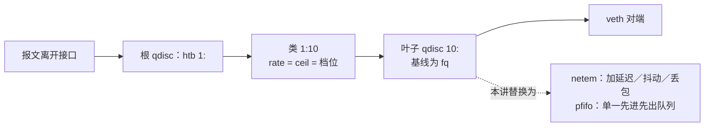
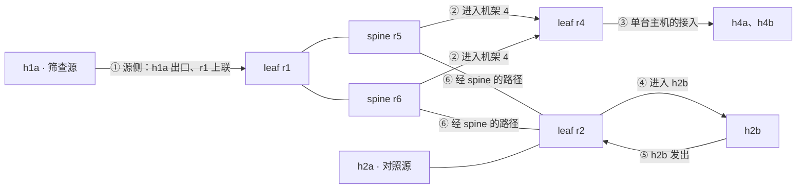

# 第 06 讲 给网络做体检：性能测量与流量控制

> **课程导读**：上一讲我们用 `tc` 给链路限速，用 `iperf3` 和 `transfer.py` 量过吞吐，每次关心的都是一个结果。本讲从调度器的一个问题出发：“h1a 到 h3a 有多快？”同一对主机，可以量出 0.2 ms 或 121 ms 的往返时间，也可以量出 47 Mbit/s 或 91 Mbit/s 的速率（4.4、4.5 节）。这些数都是真的，差别在于**测的是什么、怎么测、在什么条件下测、测得有多准**。学完后，你应能为一对主机交出一张“体检单”：每个数字都写明指标、方法、条件和不确定度，并能用它为不同的作业选择放置。

本讲对应[课程大纲](../README.md)第 06 讲和 [Lab 4 设计](../experiments/README.md#lab-4给网络做体检)，按 **90 分钟有效授课时间**设计。延迟、丢包、吞吐的定义与读数为基础要求；令牌桶与负载下延迟要求看懂现象并会计算；统计区间要求会算一次。TCP 为什么会把队列填满、长尾怎样放大、α-β 模型怎样定义，分别留给第 07、09、10 讲。

**材料状态**：✅ 已定稿（2026-10-17）。标为“实测样例”的输出来自 2026-10-17 的备课虚拟机：Ubuntu 26.04.1、Linux `7.0.0-38-generic`、x86_64、2 核 2.8 GB，iproute2 6.19.0、iputils 20250605、iperf3 3.20；使用[完整实验床](../experiments/04/topo.sh)与 Lab 2 参考路由。为便于阅读省略了无关字段；端口、时间与单次读数以自己的测量为准，算例另标为教学设定或理论值。定稿时按原文逐块重跑了全部命令，并核对了阅读版的内容与显示。本文命令尚未在 Ubuntu 22.04／24.04 上复核，`tc` 的部分行为随内核版本变化（见 2.2 节）。

**课堂组织**：前五个模块各讲一类体检项目，每次短观察只回答一个问题：用什么工具、在哪个接口和方向观察、读哪些字段、这些数据支持什么判断。模块六给一张藏了条件的实验床完整做一次体检。课前搭建一次，全程沿用 **100 Mbit/s 档位**；每个短观察结束时恢复基线，用 `topo.sh status` 确认后再进入下一个。

---

## 学习目标

1. 写出测量结果的五要素（指标、结果、参考范围、方法、条件），区分单次测量、样本与统计量；说明只报一个平均值为什么往往不够。
2. 定义并测量往返时间、单向延迟、两种延迟变化和丢包率；能说出单方向加延迟时往返时间增加多少，会为丢包率给出区间，包括“全部收到”时的上界。
3. 区分容量、可用容量与吞吐；读懂 `iperf3` 的逐秒输出、sender/receiver 两行与 JSON 中的 CPU 字段，用帧级上界核对吞吐。
4. 用 `tc` 的队列结构解释整形、令牌桶突发与负载下延迟；会用 netem 与 HTB 在指定接口、指定方向施加条件，并完整恢复。
5. 用预热、重复和区间设计测量，识别 CPU 争用与测量互扰；综合往返时间、单向延迟与吞吐证据，为一张有隐藏条件的实验床交出体检单与放置建议。

| 时间 | 内容 | 课堂产出 |
| --- | --- | --- |
| 0–10 分钟 | 模块一：一个数字回答不了“有多快” | 体检单格式；从 40 个 RTT 样本算出统计量 |
| 10–26 分钟 | 模块二：延迟、抖动与丢包 | 单方向延迟与 RTT 的关系；两种延迟变化；丢包率的区间 |
| 26–38 分钟 | 模块三：带宽的三种含义 | 读懂 `iperf3`；竞争流下的新流吞吐与旧流变化 |
| 38–54 分钟 | 模块四：tc 流量控制——体质与病因 | 计算令牌桶突发；教师演示负载下延迟 |
| 54–64 分钟 | 模块五：让测量可信 | 用 5 次重复算区间；教师演示 CPU 争用 |
| 64–87 分钟 | 模块六：综合动手——给迷你数据中心做体检 | 小组交付体检单、定位结论与放置建议 |
| 87–90 分钟 | 模块七：离堂检查与课后衔接 | 提交三道短题 |

**课前准备（不计入上述 90 分钟）**：学生自行准备 Ubuntu Linux，工具与 Lab 3 相同（`iproute2`、`iputils-ping`、`iperf3`、Python 3 与 `uv`）。所有命令从仓库根目录执行；不同小组各用独立主机或虚拟机，同一台机器由一人操作，避免几个人同时测量互相干扰（原因见 5.3 节）。本讲使用[完整实验床脚本](../experiments/04/topo.sh)，它与 Lab 3 的节点名、接口、地址与档位完全一致，另提供条件注入与基线核对。

```bash
# 1. 清理第 05 讲课堂网络与 Lab 3 网络（节点重名，不能同时存在）
sudo bash 2026/experiments/03/classroom.sh down
sudo bash 2026/experiments/03/topo.sh down

# 2. 路由守护进程复用 Lab 2 的环境
uv sync --project 2026/experiments/02 --frozen

# 3. 搭建完整实验床（默认加载 Lab 2 参考路由），并自检
sudo bash 2026/experiments/04/topo.sh up
sudo bash 2026/experiments/04/topo.sh check
```

准备完成应出现 `[OK] 8 条上联往返、8 台 host 网关可达、跨机架往返。` 与 `[OK] 4 个 leaf 去往其他 3 个机架的 12 条路由均有两个下一跳。`。想用自己的 `lsrd`，把第 3 步换成 `topo.sh up --own`。本讲的辅助工具 [`stats.py`](../experiments/04/stats.py)、[`owd.py`](../experiments/04/owd.py) 与 Lab 3 的 [`transfer.py`](../experiments/03/transfer.py) 都只用 Python 标准库，直接用系统 `python3` 运行。**中途不要拆拓扑；提前结束或中断时，执行 6.7 节的清理命令。**

---

## 模块一：一个数字回答不了“有多快”

### 1.1 调度器到底要问什么

第 05 讲的流量矩阵描述“作业需要传多少”，属于需求；本讲测量“网络能提供什么”，属于供给。调度器把两个 worker 放到哪两台主机上，取决于作业怎样通信。看两个教学设定：

| 作业 | 通信特征 | 主要关心 | 粗略估算 |
| --- | --- | --- | --- |
| A：交换中间结果 | 两个 worker 之间传 200 MB | 吞吐 | $8\times200\,\mathrm{MB}/\text{吞吐}$ |
| B：参数同步 | 两个 worker 之间做 $10^4$ 次小消息往返 | 往返时间 | $10^4\times\text{RTT}$ |

同一张网络，对 A 好的主机对未必对 B 好。所以调度器要的不是“一个速度”，而是**至少两个维度**的读数；而每个读数又必须交代清楚是怎么来的。

### 1.2 体检单的五要素

借用体检报告的格式，每个测量结果写成一行：

| 项目（指标定义） | 结果 | 参考范围 | 方法 | 条件 |
| --- | --- | --- | --- | --- |
| h1a→h3a 往返时间 | p50 0.155 ms，p90 0.192 ms（n=40） | 0.1 ms 级（本机软件转发） | `ping -i 0.05`，最近秩分位数 | 空载，100 档，自然 ECMP，2026-10-17 |

- **项目**说明测的是哪个量：往返还是单向，应用字节还是接口字节。
- **结果**要带单位与样本量。
- **参考范围**来自配置或模型（例如帧级上界），用来判断读数是否异常。
- **方法**写明工具、参数与统计方法。
- **条件**写明负载、档位、路径控制与时间。

缺了后三项，别人就无法判断两个读数能不能放在一起比较。上表的数值来自 1.4 节的实测。

### 1.3 一次测量、样本与统计量

[RFC 2330 第 11 节](https://www.rfc-editor.org/rfc/rfc2330#section-11)把测量分为三层：

- **单次测量**（Singleton）：一个 `ping` 回复的时间；
- **样本**（Sample）：按一定方式采集的一组单次测量，例如每 50 ms 一次、共 40 次；
- **统计量**（Statistic）：从样本算出的一个数，例如中位数、第 90 百分位数（p90）或均值。

统计量的选择要服务于问题。延迟样本通常右偏：大多数很小，少数因为排队或调度而很大。均值会被少数大值拉动；中位数（p50）描述“典型”情况，p90 描述“较差但常见”的情况。本讲用**最近秩法**（Nearest Rank）计算分位数：把 $n$ 个样本从小到大排列，第 $p$ 分位数取第 $\lceil pn\rceil$ 个。换一种分位数算法，小样本的结果会有差别，因此“方法”一栏要写明。

本讲的 [`stats.py`](../experiments/04/stats.py) 只做这件事：从 `ping` 输出中按 `icmp_seq` 取出 `time=` 的值（或每行读一个数），打印 `n`、`min`、`p10`、`p50`、`p90`、`max`、均值 `mean` 和总体标准差 `sd`。它不发送任何报文，只读你给它的样本。

### 1.4 短观察：读一组 RTT 样本

**问题与预测**：h1a→h3a 跨机架，路径上有三台路由器。40 个 RTT 样本的均值与中位数会差多少？`ping` 摘要中的 `mdev` 与哪个统计量对应？

```bash
# 1. 每 50 ms 发一个探测，共 40 个；保存原始输出，再交给 stats.py
sudo ip netns exec h1a ping -c 40 -i 0.05 10.0.3.11 | tee /tmp/o1.txt | tail -2
python3 2026/experiments/04/stats.py < /tmp/o1.txt
```

`-i` 小于 0.2 秒需要 root，这里通过 `sudo` 满足。`tee` 先把原始输出存档，以后可以换别的统计方法重算。

**实测样例**：

```output
--- 10.0.3.11 ping statistics ---
40 packets transmitted, 40 received, 0% packet loss, time 1989ms
rtt min/avg/max/mdev = 0.087/0.157/0.226/0.029 ms
样本   n=40 min=0.087 p10=0.115 p50=0.155 p90=0.192 max=0.226 mean=0.157 sd=0.029
```

**一起读数据**：

1. `ping` 摘要给出 min/avg/max/mdev；`stats.py` 从同一组样本算出 p50 = 0.155 ms、p90 = 0.192 ms。按最近秩法，p90 是从小到大第 $\lceil0.9\times40\rceil=36$ 个样本。
2. 本次均值 0.157 ms 与中位数 0.155 ms 几乎相同，样本没有明显的长尾。若有少数特别大的样本，均值会被拉高，中位数基本不动。
3. `mdev` 0.029 与 `sd` 0.029 相同：在这组数据上，iputils `ping` 的 mdev 等于样本的总体标准差。它描述离散程度，但不是分位数：只知道 mdev，说不出 90% 的样本落在什么范围内。
4. 写进 1.2 节的体检单：p50 0.155 ms、p90 0.192 ms、n = 40，方法与条件照抄命令与档位。

**边界**：本实验床的 RTT 在 0.1 ms 级，主要由主机内核与进程调度决定，而不是“线路长度”；模块五会看到 CPU 状态就能改变这个量级的读数。**要让两对主机在延迟上可比，差异必须明显超出这个噪声底**，这正是后面用 netem 注入毫秒级延迟的原因。

---

## 模块二：延迟、抖动与丢包

### 2.1 往返时间与单向延迟

**往返时间**（Round-Trip Time，RTT）是一个报文从源出发、对端回应、回应回到源的总时间，包含去程、对端处理与回程，定义见 [RFC 2681](https://www.rfc-editor.org/rfc/rfc2681)。**单向延迟**（One-Way Delay）只看一个方向，定义见 [RFC 7679](https://www.rfc-editor.org/rfc/rfc7679)。两个方向的条件可以不同：例如只在进入某台主机的方向排队。只看 RTT，无法知道延迟在哪个方向。

测单向延迟需要两端的时钟一致。真实网络中两台主机的时钟各自走，必须先用 NTP 或 PTP 同步，同步误差直接进入结果（第 08 讲）。本实验床的所有 namespace 跑在同一台主机上，共用同一个内核时钟，所以可以直接相减。[`owd.py`](../experiments/04/owd.py) 就利用这一点：发送端在 UDP 报文里写入发送时刻（`CLOCK_MONOTONIC`），接收端用同一时钟读出接收时刻，二者之差就是单向延迟。它在 Python 中打时间戳，自身会带来零点几毫秒的开销，2.3 节会读到这个噪声底。

### 2.2 用 netem 制造“病因”

本实验床每个端口的发送方向都是同一个结构：



*图示说明：HTB 类决定这个端口每秒最多发多少（容量）；叶子 qdisc 决定排队的报文以什么顺序、在什么条件下离开。只替换叶子，限速保持不变。所有配置只作用于该接口的发送方向（egress）。*

网络模拟器 netem（Network Emulator）是一种 qdisc，可以给经过的报文加延迟、抖动、丢包等，参数见 [`tc-netem(8)`](https://man7.org/linux/man-pages/man8/tc-netem.8.html)。手册提醒：受 TCP 小队列（TCP Small Queues，TSQ）等机制影响，netem 若放在 TCP 发送主机自己的出口上，测得的 TCP 性能会失真（手册建议放在接收主机的入口）。本讲把 netem 挂在**路由器**的端口上，避开了发送主机本地的这一问题。

替换叶子要**先删后加**。在 Linux 7.0 上，用 `tc qdisc replace … handle 10:` 把 fq 直接换成另一种 qdisc 会被拒绝，报 `Error: Invalid qdisc name: must match existing qdisc.`；先 `del` 再 `add` 的写法在各版本上都可用。恢复时用 `topo.sh clear 节点 接口`，它会按基线重建该端口。

### 2.3 短观察：只在一个方向加 5 ms，RTT 加多少？

**问题与预测**：只在 r3 发往 h3a 的出口加 5 ms。h1a→h3a 的 RTT 增加 5 ms 还是 10 ms？h1a→h3a 与 h3a→h1a 的单向延迟各是多少？

**观察点**：条件放在接入链路 `r3-h3a` 上，而不是上联，这样无论 ECMP 选哪个 spine，去往 h3a 的报文都必经此处。

```bash
# 1. 看现状：HTB 类 1:10 下挂着 fq
sudo ip netns exec r3 tc qdisc show dev r3-h3a

# 2. 把叶子换成 netem，只在 r3 → h3a 方向加 5 ms
sudo ip netns exec r3 tc qdisc del dev r3-h3a parent 1:10
sudo ip netns exec r3 tc qdisc add dev r3-h3a parent 1:10 handle 10: netem delay 5ms

# 3. RTT 样本
sudo ip netns exec h1a ping -c 40 -i 0.05 10.0.3.11 | python3 2026/experiments/04/stats.py
```

单向延迟要先起接收端，再起发送端。下面用 `&` 把接收端放到后台，`wait` 等它打印摘要：

```bash
# 4. 去程 h1a → h3a：h3a 接收、h1a 发送 50 个包（每 20 ms 一个）
sudo ip netns exec h3a python3 2026/experiments/04/owd.py recv --count 50 & sleep 0.3
sudo ip netns exec h1a python3 2026/experiments/04/owd.py send --to 10.0.3.11 --count 50; wait

# 5. 回程 h3a → h1a：交换两端角色
sudo ip netns exec h1a python3 2026/experiments/04/owd.py recv --count 50 & sleep 0.3
sudo ip netns exec h3a python3 2026/experiments/04/owd.py send --to 10.0.1.11 --count 50; wait
```

**实测样例**：

```output
[第 1 步：替换前]
qdisc htb 1: root refcnt 129 r2q 100 default 0x10 direct_packets_stat 0 direct_qlen 1000
qdisc fq 10: parent 1:10 limit 10000p flow_limit 100p buckets 1024 ...
[第 2 步之后]
qdisc htb 1: root refcnt 129 r2q 100 default 0x10 direct_packets_stat 0 direct_qlen 1000
qdisc netem 10: parent 1:10 limit 1000 delay 5ms seed 6992773566544686460
[第 3 步：RTT]
样本   n=40 min=5.090 p10=5.200 p50=5.240 p90=5.380 max=5.450 mean=5.263 sd=0.076
[第 4 步：单向 h1a → h3a]
{"sent": 50, "received": 50, "lost": 0, "min_ms": 5.199, "median_ms": 5.285, "p90_ms": 5.335, "max_ms": 6.669}
[第 5 步：单向 h3a → h1a]
{"sent": 50, "received": 50, "lost": 0, "min_ms": 0.154, "median_ms": 0.236, "p90_ms": 0.291, "max_ms": 0.323}
```

**一起读数据**：

1. `qdisc netem 10: parent 1:10` 说明 netem 挂在原来 fq 的位置，`htb 1:` 仍在：限速不变，只多了延迟。
2. RTT 的 p50 从 1.4 节的 0.155 ms 变为 5.240 ms，增加约 5.09 ms，而不是 10 ms：条件只作用在 r3→h3a 一个方向，请求经过一次，回复不经过。
3. 单向探针把两个方向分开：h1a→h3a 中位数 5.285 ms，h3a→h1a 0.236 ms。后者就是 `owd.py` 在空载时的读数，比 RTT 的 0.155 ms 还大，说明 Python 收发与打时间戳本身约占 0.2–0.3 ms。这是**这个工具的噪声底**，它只适合分辨毫秒级的差异。
4. 去程的 `max_ms` 6.669 是一个孤立的大值，p90 只有 5.335。最大值容易受偶然调度影响，所以体检单报分位数，而不只报最大值。

**再加抖动**：`netem delay 5ms 1ms` 让每个报文的延迟在 5 ms 附近随机变化。`change` 只修改已有 netem 的参数，不需要先删。

```bash
# 6. 在原 netem 上加 1 ms 抖动，采 100 个单向样本，逐包延迟写入文件
sudo ip netns exec r3 tc qdisc change dev r3-h3a parent 1:10 handle 10: netem delay 5ms 1ms
sudo ip netns exec h3a python3 2026/experiments/04/owd.py recv --count 100 --samples /tmp/owd.txt & sleep 0.3
sudo ip netns exec h1a python3 2026/experiments/04/owd.py send --to 10.0.3.11 --count 100; wait

# 7. 同一组样本，用两种定义计算延迟变化
python3 2026/experiments/04/stats.py --jitter < /tmp/owd.txt
```

**实测样例**：

```output
{"sent": 100, "received": 100, "lost": 0, "min_ms": 4.302, "median_ms": 5.288, "p90_ms": 6.15, "max_ms": 6.382}
样本   n=100 min=4.302 p10=4.539 p50=5.274 p90=6.144 max=6.382 mean=5.316 sd=0.568
|IPDV| n=99 min=0.006 p10=0.117 p50=0.492 p90=1.458 max=1.893 mean=0.629 sd=0.462  # 相邻两个样本之差的绝对值
PDV    n=100 min=0.000 p10=0.237 p50=0.972 p90=1.842 max=2.080 mean=1.014 sd=0.568  # 每个样本减去样本最小值
```

“抖动”在不同资料中有不同定义。[RFC 5481](https://www.rfc-editor.org/rfc/rfc5481) 比较了两种，它们都建立在**单向延迟**之上：

| 定义 | 计算方式 | 回答的问题 |
| --- | --- | --- |
| 相邻包延迟变化（Inter-Packet Delay Variation，IPDV，第 4.1 节） | 按发送顺序，$D(i)-D(i-1)$；`stats.py` 取其绝对值 | 相邻两个包的间隔被拉开或压缩了多少 |
| 包延迟变化（Packet Delay Variation，PDV，第 4.2 节） | $D(i)-D_{\min}$，相对样本中最小的延迟 | 接收端要多大的缓冲才能“等齐”大多数包；排队占了多少 |

**一起读数据**：

1. 100 个单向样本落在 4.302–6.382 ms，与“5 ms 上下 1 ms”加上约 0.2–0.3 ms 的工具开销相符。`tc-netem(8)` 没有写明不指定 `distribution` 时抖动服从什么分布，本讲只报告观测到的范围。
2. PDV 的 p90 为 1.842 ms：90% 的包比本组最快的包慢不超过约 1.84 ms。接收端若要“等齐”90% 的包，缓冲要能吸收约 1.8 ms 的差异。
3. |IPDV| 的 p50 为 0.492 ms：相邻两个包的延迟差通常约 0.5 ms。它比 PDV 小，因为 IPDV 只比较相邻的包，PDV 拿每个包与全组最快的包比。两个数都对，回答的问题不同，体检单要写明用的是哪一种。
4. 同一组样本，`owd.py` 摘要中的中位数是 5.288 ms，`stats.py` 的 p50 是 5.274 ms：前者用 Python 的 `statistics.median`（偶数个样本取中间两个的平均），后者用最近秩法。差别很小，却说明“方法”一栏为什么必须写。
5. 本组 100 个包没有丢失。若有丢包，IPDV 应只在发送序号相邻的两个包之间计算；`stats.py` 只是把收到的样本依次相减，不处理这种情况。

### 2.4 丢包率要带区间

丢包率（定义见 [RFC 7680](https://www.rfc-editor.org/rfc/rfc7680)）通常由“发出 $n$ 个、丢了 $k$ 个”估计为 $\hat p=k/n$。但 $\hat p$ 本身是一个随机量：同样配置 2% 丢包，200 个探测可能丢 2 个，也可能丢 8 个。报告时要给出区间。对“$n$ 次试验、$k$ 次发生”的比例，常用 Wilson 区间：

$$\frac{\hat p+\frac{z^2}{2n}\pm z\sqrt{\frac{\hat p(1-\hat p)}{n}+\frac{z^2}{4n^2}}}{1+\frac{z^2}{n}},\qquad z=1.96\ (95\%)$$

一个特例很常用：**$n$ 个探测全部收到时，丢包率的 95% 上界约为 $3/n$**（称为“3/n 法则”，Rule of Three；来自 $(1-p)^n=0.05$，即 $p\approx-\ln0.05/n\approx3/n$）。100 个 `ping` 全通，只能说丢包率大概率低于 3%。回想第 05 讲 1.3 节的 `0% packet loss`：它只对应那几个样本。

**短观察**：把 2.3 节的 netem 改成 2% 随机丢包，重复三轮、每轮 200 个探测，再恢复基线，确认 100 个探测全部收到。

```bash
# 1. 只保留随机丢包；change 会按新参数整体重设 netem
sudo ip netns exec r3 tc qdisc change dev r3-h3a parent 1:10 handle 10: netem loss 2%
sudo ip netns exec r3 tc qdisc show dev r3-h3a

# 2. 三轮，每轮 200 个探测；-q 只打印摘要
for i in 1 2 3; do sudo ip netns exec h1a ping -c 200 -i 0.01 -q 10.0.3.11 | grep transmitted; done
```

**实测样例**：

```output
qdisc htb 1: root refcnt 129 r2q 100 default 0x10 direct_packets_stat 0 direct_qlen 1000
qdisc netem 10: parent 1:10 limit 1000 loss 2% seed 6992773566544686460
200 packets transmitted, 197 received, 1.5% packet loss, time 2194ms
200 packets transmitted, 199 received, 0.5% packet loss, time 2200ms
200 packets transmitted, 197 received, 1.5% packet loss, time 2192ms
```

**一起读数据**：

1. `qdisc show` 中只剩 `loss 2%`，原来的 `delay 5ms 1ms` 不见了：`change` 按这次给出的参数整体重设 netem，没写的参数回到默认值。**改完条件要再查一次配置**，不能凭命令推测当前状态。
2. 三轮读数 1.5%、0.5%、1.5% 都低于配置的 2%，这不说明配置没生效。按 Wilson 公式，3/200 的 95% 区间约为 0.51%–4.32%，1/200 约为 0.09%–2.78%，都包含 2%。
3. 三轮合并为 7/600 ≈ 1.17%，区间约为 0.57%–2.39%，仍包含 2%，但比单轮窄得多。**样本越多，区间越窄**；要分辨 1% 与 2% 这样接近的丢包率，几百个探测还不够。
4. 丢包只设在 r3→h3a 方向，丢的是请求；`ping` 只看到“这一来回没有回复”，分不出丢在去程还是回程。单向探针可以分开统计（`owd.py` 摘要的 `lost` 字段）。

### 2.5 恢复基线

```bash
# 1. 按基线重建 r3-h3a（HTB 100 Mbit/s + fq）
sudo bash 2026/experiments/04/topo.sh clear r3 r3-h3a

# 2. 恢复后再发 100 个探测，然后核对全网
sudo ip netns exec h1a ping -c 100 -i 0.01 -q 10.0.3.11 | grep transmitted
sudo bash 2026/experiments/04/topo.sh status
```

```output
[*] r3 r3-h3a 已恢复基线（HTB 100 Mbit/s + fq）。
100 packets transmitted, 100 received, 0% packet loss, time 1093ms
[档位] leaf–spine 100 Mbit/s；host 接入 100 Mbit/s。场景：无。
[基线] 32 个限速端口均为 HTB + fq，速率与 burst 为基线值。
[基线] r1–r4 没有额外策略路由（自然 ECMP）。
```

恢复后 100 个探测全部收到。按 3/n 法则，只能说丢包率大概率低于 3%（这是单侧 95% 上界；用 Wilson 公式算 0/100 的双侧区间，上端约为 3.7%），不能说“丢包率为 0”。

`status` 逐个检查 32 个限速端口：叶子是否为 fq、HTB 的 rate/ceil 是否等于基线、burst 是否为默认值，并列出 leaf 上的策略路由。**每个短观察结束都应回到这三行**，否则后面的读数会混入前面留下的条件。

---

## 模块三：带宽的三种含义

### 3.1 容量、可用容量与吞吐

“带宽”一词在日常用语中指好几样东西。本讲按 [RFC 5136](https://www.rfc-editor.org/rfc/rfc5136) 与 [RFC 3148](https://www.rfc-editor.org/rfc/rfc3148) 区分三个量：

| 量 | 定义 | 本实验床中 | 用什么得到 |
| --- | --- | --- | --- |
| 容量（Capacity） | 链路在 IP 层每秒最多能传多少比特；路径容量取各链路的最小值（RFC 5136 第 2.3.2、2.3.3 节） | HTB 的 `rate` | 读配置；或用无竞争的测量逼近 |
| 可用容量（Available Capacity） | 容量中未被占用的部分：$C\times(1-\text{利用率})$，路径取最小（第 2.3.6、2.3.7 节） | 空闲时等于容量，有其他流时变小 | 需要链路利用率，端到端难以直接测 |
| 吞吐（Throughput） | 某次传输、用某种协议实际达到的速率；一条拥塞控制连接的长期平均速率称为 BTC（Bulk Transport Capacity，RFC 3148 第 1 节） | `iperf3`、`transfer.py` 的读数 | 发真实流量 |

三者的关系不是简单的“依次减小”。RFC 5136 第 2.3.7 节特别强调，可用容量随时间剧烈变化，必须写明测量时刻和时间窗口。3.4 节会看到：已有一条流占满链路时，可用容量接近 0，但新来的 TCP 流仍能分到一半——因为它从旧流那里“抢”到了份额。

### 3.2 吞吐的上界从哪里来

Lab 3 任务 3 已经推导过：HTB 按以太网帧长扣令牌。MTU 1500、TCP 带时间戳选项时，一个满长帧 1514 字节，只载 1448 字节应用数据。所以 100 Mbit/s 端口上，单条连接的应用吞吐上界为

$$100\times\frac{1448}{1514}\approx95.6\ \mathrm{Mbit/s}.$$

这是**参考范围**一栏的来源。读数明显低于它，要找原因；读数略高于它，要检查计时窗口（3.3 节）。

### 3.3 读懂 `iperf3`

`iperf3` 由客户端向服务端发送 TCP 数据，参数说明见 [iperf3 文档](https://software.es.net/iperf/invoking.html)。本讲用到：

| 参数 | 作用 |
| --- | --- |
| `-s -1 -D` | 服务端只服务一次测试、以后台方式运行；测完自动退出 |
| `-t N` | 测 N 秒 |
| `-O N` | 忽略开头 N 秒，不计入汇总（预热，见 5.1 节） |
| `-i N` | 每 N 秒打印一行 |
| `-J` | 输出 JSON，便于程序读取 |

```bash
# 1. h3a 起一次性服务端，h1a 测 5 秒
sudo ip netns exec h3a iperf3 -s -1 -D
sudo ip netns exec h1a iperf3 -c 10.0.3.11 -t 5
```

**实测样例**：

```output
Connecting to host 10.0.3.11, port 5201
[  5] local 10.0.1.11 port 40748 connected to 10.0.3.11 port 5201
[ ID] Interval           Transfer     Bitrate         Retr  Cwnd
[  5]   0.00-1.00   sec  12.5 MBytes   105 Mbits/sec    0    256 KBytes
[  5]   1.00-2.00   sec  11.6 MBytes  97.6 Mbits/sec    0    256 KBytes
[  5]   2.00-3.00   sec  11.0 MBytes  92.3 Mbits/sec    0    256 KBytes
[  5]   3.00-4.00   sec  11.5 MBytes  96.4 Mbits/sec    0    256 KBytes
[  5]   4.00-5.00   sec  11.5 MBytes  96.4 Mbits/sec    0    256 KBytes
- - - - - - - - - - - - - - - - - - - - - - - - -
[ ID] Interval           Transfer     Bitrate         Retr
[  5]   0.00-5.00   sec  58.1 MBytes  97.5 Mbits/sec    0            sender
[  5]   0.00-5.02   sec  57.1 MBytes  95.5 Mbits/sec                  receiver
```

**一起读数据**：

1. 逐秒行与 `sender` 行由客户端统计，数的是写进本机发送缓冲的字节。第一秒 105 Mbit/s、汇总 97.5 Mbit/s 都超过了 3.2 节的上界 95.6，因为开头有一批数据只是进了缓冲，还没到达对端。`receiver` 行由服务端统计实际收到的字节，为 95.5 Mbit/s，略低于上界。**体检单取 receiver**。
2. `Transfer` 列的 MBytes 是 $2^{20}$ 字节，`Bitrate` 的 Mbits 是 $10^6$ 比特：$57.1\times2^{20}\times8/5.02\,\mathrm{s}\approx95.4$ Mbit/s，与 receiver 行一致。单位换算要按工具的约定。
3. `Retr` 是发送端重传的报文段数，本次为 0；`Cwnd` 是发送端的拥塞窗口。
4. 用 `-J` 时，程序读 `end.sum_received.bits_per_second` 取接收速率，读 `end.cpu_utilization_percent` 的 `host_total`、`remote_total` 取两端的 CPU 占用。本机一次 `-t 3 -O 1 -J` 的实测为 95 476 654 bit/s，`host_total` 0.7%，`remote_total` 8.4%：CPU 远未成为瓶颈。

### 3.4 短观察：一条新流能分到多少，旧流会怎样

**问题与预测**：h1b→h3b 已经在跑，h1a→h3a 再加入，两条流共用同一条上联。新流能测到多少？旧流会怎样？

**实验控制**：自然 ECMP 下，两条流可能落在不同的 spine 上，彼此不争用。这里用 `topo.sh pin` 临时把 h1a、h1b 发出的报文都固定经 r5，观察结束后取消。`pin` 在源 leaf 上按源地址加策略路由，和 Lab 3 任务 3 的做法相同。

```bash
# 1. 两个源都固定经 r5：它们共用 r1→r5 与 r5→r3 两段 100 Mbit/s
sudo bash 2026/experiments/04/topo.sh pin h1a r5
sudo bash 2026/experiments/04/topo.sh pin h1b r5

# 2. 先起两个服务端；后台流 h1b → h3b 跑 10 秒，逐秒输出存档
sudo ip netns exec h3b iperf3 -s -1 -D
sudo ip netns exec h3a iperf3 -s -1 -D
sudo ip netns exec h1b iperf3 -c 10.0.3.12 -t 10 --forceflush > /tmp/bg.txt &

# 3. 3 秒后，新流 h1a → h3a 测 4 秒；随后查看后台流的逐秒记录
sleep 3; sudo ip netns exec h1a iperf3 -c 10.0.3.11 -t 4
wait; cat /tmp/bg.txt

# 4. 取消钉路，回到自然 ECMP
sudo bash 2026/experiments/04/topo.sh unpin
```

`--forceflush` 让后台输出逐行写入文件，便于事后对照时间。

**实测样例（新流只保留汇总两行；后台流保留逐秒记录）**：

```output
[新流 h1a → h3a，汇总两行]
[  5]   0.00-4.00   sec  23.2 MBytes  48.7 Mbits/sec    8            sender
[  5]   0.00-4.03   sec  22.8 MBytes  47.4 Mbits/sec                  receiver
[后台流 h1b → h3b，/tmp/bg.txt 的逐秒行与 receiver 行]
[  5]   0.00-1.00   sec  12.4 MBytes   104 Mbits/sec    0    252 KBytes
[  5]   1.00-2.00   sec  11.2 MBytes  94.3 Mbits/sec   61    123 KBytes
[  5]   2.00-3.00   sec  11.2 MBytes  94.4 Mbits/sec    5    129 KBytes
[  5]   3.00-4.00   sec  6.12 MBytes  51.4 Mbits/sec    1    123 KBytes
[  5]   4.00-5.00   sec  5.62 MBytes  47.2 Mbits/sec    1    115 KBytes
[  5]   5.00-6.00   sec  5.50 MBytes  46.2 Mbits/sec    1    102 KBytes
[  5]   6.00-7.00   sec  6.25 MBytes  52.4 Mbits/sec    0    139 KBytes
[  5]   7.00-8.00   sec  10.6 MBytes  89.2 Mbits/sec    0    188 KBytes
[  5]   8.00-9.00   sec  11.4 MBytes  95.3 Mbits/sec    1    164 KBytes
[  5]   9.00-10.00  sec  11.1 MBytes  93.2 Mbits/sec    0    211 KBytes
[  5]   0.00-10.02  sec  90.6 MBytes  75.9 Mbits/sec                  receiver
```

**一起读数据**：

1. 新流的 receiver 为 47.4 Mbit/s，约为 3.3 节单独测量（95.5）的一半。
2. 后台流的逐秒记录显示了另一面：第 0–3 秒约 94 Mbit/s；新流加入的第 3–7 秒降到 46–52 Mbit/s；新流结束后回到 89–95 Mbit/s。两条流在共享的 100 Mbit/s 上大致平分，这是 TCP 拥塞控制与 fq 按流公平共同作用的结果，机制留给第 07 讲。
3. 对照 3.1 节：新流加入前，r1→r5 已被后台流占满，**可用容量接近 0**；新流却测到 47 Mbit/s，因为它从后台流那里分走了一半。所以“新流测到的吞吐”既不是容量，也不是可用容量，而是“此刻再加入一条流能分到多少”。
4. **测量本身改变了被测网络**：后台流在这 4 秒里少传了约一半。如果后台流是一个正在运行的作业，这次“体检”就让它变慢了。画像工具要考虑什么时候测、测多久（思考题 5）。
5. 后台流汇总的 75.9 Mbit/s 是 10 秒的平均，掩盖了中间的变化；只看汇总，会错过竞争发生的时段。

---

## 模块四：tc 流量控制——体质与病因

### 4.1 `tc` 管的是什么

Linux 的流量控制（Traffic Control，`tc`）在接口的**发送方向**上管理报文：

- **qdisc**（排队规则）决定报文怎样排队、何时离开；
- **class**（类）在可分类的 qdisc（如 HTB）里划分容量；
- **filter**（过滤器）决定报文进入哪个类。本实验床每个端口只有一个类，所有报文默认进入 `1:10`。

`tc` 默认只能控制发送方向。要约束接收方向，可以在 ingress 上用监管丢包，或把流量重定向到 IFB 虚拟设备再整形，本讲不展开。本实验床的做法是**在链路两端各自限制发送方向**。所以第 05 讲 6.1 节强调：查进入 h3a 方向的限速要看 r3 的 `r3-h3a`，h3a 的 `eth0` 管的是反方向。

> 术语提醒：`tc` 的“流量控制”与 TCP 的**流量控制**（Flow Control，接收方用接收窗口限制发送方）是两件事。前者是网络设备上的排队与限速，后者是端到端的协议机制。

### 4.2 整形与监管

超出约定速率的报文有两种处理方式：

| 方式 | 做法 | 留下的症状 | 本实验床 |
| --- | --- | --- | --- |
| 整形（Shaping） | 先排队，按速率放行 | 延迟增加；队列满后才丢包 | HTB 类 |
| 监管（Policing） | 超出部分直接丢弃（或重新标记） | 丢包；几乎不增加延迟 | 未使用 |

同样“限速 50 Mbit/s”，整形与监管在体检单上留下的症状不同：一个表现为延迟，一个表现为丢包。看到症状时，要能反推可能的机制。

### 4.3 令牌桶：rate 与 burst

整形器通常用**令牌桶**（Token Bucket）描述：桶以速率 $r$ 积累令牌，最多存 $b$ 字节；发送报文要消耗与帧长相等的令牌。于是在任意长度为 $t$ 的时间窗口内，发出的字节数满足

$$A(t)\le b+rt,\qquad \frac{A(t)}{t}\le r+\frac{b}{t}.$$

**窗口越短，平均速率越可能被突发抬高**；窗口远大于 $b/r$ 时，读数才接近 $r$。

HTB 为每个类维护两个令牌桶：一个按 `rate` 积累、最多存 `burst` 字节，一个按 `ceil` 积累、最多存 `cburst` 字节（参数说明见 [`tc-htb(8)`](https://man7.org/linux/man-pages/man8/tc-htb.8.html)）。本实验床的类没有可借用容量的父类，两个桶都有令牌才能发送，所以要放大突发必须**两个都调大**。备课实测：只把 `burst` 或只把 `cburst` 调到 1 000 000 字节，4.4 节的 2 MB 传输仍需 0.335 s；两个都调大才降到 0.176 s。本机默认 burst 为 1600 字节，相对于 50 Mbit/s 只有 $8\times1600/(50\times10^6)\approx0.26$ ms，可以忽略。

**单位要用工具自己的输出核对**：`tc` 手册把 `mb` 写作“Megabytes”，但在本机 `tc -j class show` 中，`burst 1mb` 显示为 `1048576` 字节，即 $2^{20}$。下面的命令直接写字节数，避免这种歧义。

### 4.4 短观察：突发让短测量“变快”

**问题与预测**：把 h3a 的接入口降到 50 Mbit/s，分别传 2 MB 与 20 MB。burst 从默认值改为 1 000 000 字节后，两种数据量各快多少？先用 $b/r$ 估算。

**观察点**：瓶颈放在 r3 发往 h3a 的出口，上游的 100 Mbit/s 端口不是瓶颈。传输用 Lab 3 的 `transfer.py`：接收端读完全部数据才回执，客户端打印的 `completion_seconds` 包含建连与回执。

```bash
# 1. 默认 burst：只把 r3-h3a 的速率降到 50 Mbit/s
sudo ip netns exec r3 tc class change dev r3-h3a parent 1: classid 1:10 htb rate 50mbit ceil 50mbit
sudo ip netns exec r3 tc class show dev r3-h3a

# 2. 传 2 MB（h3a 先起一次性接收端）；20 MB 把 --bytes 改为 20000000，源端口另取一个
sudo ip netns exec h3a python3 2026/experiments/03/transfer.py server --port 5301 & sleep 0.2
sudo ip netns exec h1a python3 2026/experiments/03/transfer.py client --destination 10.0.3.11 \
  --port 5301 --source 10.0.1.11 --source-port 41000 --bytes 2000000; wait

# 3. 两个桶都放大到 1 000 000 字节，重复第 2 步的两种数据量
sudo ip netns exec r3 tc class change dev r3-h3a parent 1: classid 1:10 htb rate 50mbit ceil 50mbit \
  burst 1000000 cburst 1000000
sudo ip netns exec r3 tc class show dev r3-h3a
```

每次传输换一个源端口：刚结束的连接仍处于 TIME_WAIT，复用同一端口会报 `Address already in use`。下面是两种 burst 交替各做两轮的结果。

**实测样例（`transfer.py` 输出只保留完成时间与速率）**：

```output
[第 1 步]
class htb 1:10 root leaf 10: prio 0 rate 50Mbit ceil 50Mbit burst 1600b cburst 1600b
[第 3 步]
class htb 1:10 root leaf 10: prio 0 rate 50Mbit ceil 50Mbit burst 1000000b cburst 1000000b
[两轮交替，整理自 transfer.py 的 completion_seconds 与 application_mbps]
burst 1600b      2 MB：0.337 s，47.4 Mbit/s    20 MB：3.354 s，47.7 Mbit/s
burst 1000000b   2 MB：0.176 s，90.9 Mbit/s    20 MB：3.187 s，50.2 Mbit/s
burst 1600b      2 MB：0.335 s，47.7 Mbit/s    20 MB：3.348 s，47.8 Mbit/s
burst 1000000b   2 MB：0.175 s，91.3 Mbit/s    20 MB：3.187 s，50.2 Mbit/s
```

**一起算**：

1. 两种 burst 交替两轮，同一条件的两次读数相差不到 0.01 s，差异来自 burst，而不是偶然波动。
2. 先算默认 burst 下的理想时间：2 MB 应用数据对应帧字节 $2\times10^6\times1514/1448\approx2.09\times10^6$ 字节，在 50 Mbit/s 上需要 0.335 s，与实测的 0.335–0.337 s 吻合。
3. 放大 burst 后，2 MB 省下 0.160–0.161 s，20 MB 省下 0.161–0.167 s：两种数据量省下的时间几乎相同，都接近 $b/r=8\times10^6/(50\times10^6)=0.16$ s。突发只是让开头的 $b$ 字节不用等令牌，与传输总量无关。
4. 2 MB 的读数从约 47.5 升到约 91 Mbit/s，几乎翻倍；20 MB 只从约 47.7 升到 50.2 Mbit/s。按 $r+b/t$：$t\approx0.18$ s 时 $b/t$ 很大，$t\approx3.2$ s 时 $b/t$ 只剩约 2.5 Mbit/s。**同一个限速器，短测量读出了近两倍的“带宽”**。
5. 用令牌桶核对 2 MB 的 0.175 s：桶里的 $10^6$ 字节可以立即放行，但上游 h1a 的出口只有 100 Mbit/s。剩下约 $1.09\times10^6$ 字节按 50 Mbit/s 需要 0.175 s，上游发完全部 $2.09\times10^6$ 字节需要 0.167 s，取较大者 0.175 s，与实测一致。

### 4.5 教师演示：吞吐相同，负载下延迟差几百倍

**问题与预测**：h3a 接入口为 50 Mbit/s。h1b 向 h3a 发一条 40 MB 的大流，同时从 h1a `ping` h3a，RTT 是多少？把这个端口的叶子从 fq 换成单一先进先出队列 `pfifo`，大流的吞吐和 `ping` 的 RTT 各怎样变化？

**观察点**：大流由 h1b 发出、ping 由 h1a 发出，两者只在 r3→h3a 这一处共用队列；大流与 ping 若从同一台主机发出，结论会不同（见本节末的边界）。

公平队列 fq（Fair Queue）按流分别排队、轮流发送（[`tc-fq(8)`](https://man7.org/linux/man-pages/man8/tc-fq.8.html)）；本机默认每条流最多排 `flow_limit 100` 个包。`pfifo limit 1000` 让所有报文排同一个队，最多 1000 个包。

```bash
# 1. 瓶颈：r3-h3a 降到 50 Mbit/s（叶子仍为 fq）
sudo ip netns exec r3 tc class change dev r3-h3a parent 1: classid 1:10 htb rate 50mbit ceil 50mbit

# 2. h1a 先起 ping（每 0.1 秒一个，共 60 个），1 秒后 h1b 开始 40 MB 大流
sudo ip netns exec h1a ping -c 60 -i 0.1 10.0.3.11 > /tmp/ping-fq.txt &
sleep 1
sudo ip netns exec h3a python3 2026/experiments/03/transfer.py server --port 5302 & sleep 0.2
sudo ip netns exec h1b python3 2026/experiments/03/transfer.py client --destination 10.0.3.11 \
  --port 5302 --source 10.0.1.12 --source-port 41101 --bytes 40000000 &

# 3. 传输中途，在 h1b 查看大流自己的 RTT 估计与拥塞窗口；等全部结束
sleep 2.5; sudo ip netns exec h1b ss -tin dst 10.0.3.11; wait

# 4. 只统计负载期间的 ping：seq 15–60（第 1.4 秒起）
grep -E 'icmp_seq=(1[5-9]|[2-5][0-9]|60) ' /tmp/ping-fq.txt | python3 2026/experiments/04/stats.py

# 5. 叶子换成 pfifo；换源端口 41102、输出文件 /tmp/ping-pfifo.txt，重复第 2–4 步
sudo ip netns exec r3 tc qdisc del dev r3-h3a parent 1:10
sudo ip netns exec r3 tc qdisc add dev r3-h3a parent 1:10 handle 10: pfifo limit 1000
```

`ss -tin` 显示 TCP 连接的内部状态：`rtt:A/B` 是内核对这条连接 RTT 的平滑估计与变化量（ms），`cwnd` 是拥塞窗口（以报文段计）。它给出的是**大流自己**经历的往返时间。负载期间的统计窗口在运行前定好：ping 第 1 秒后约 0.2 秒启动大流，40 MB 在 50 Mbit/s 上约需 6.7 秒，所以 seq 15–60 都落在传输期间。

**实测样例（ping 只统计负载期间 seq 15–60 的样本）**：

```output
[fq]    ss（h1b 的大流）：rtt:20.723/0.542 cwnd:92
[fq]    大流：40000000 B，6.711 s，47.68 Mbit/s
[fq]    ping seq 1–13（负载前）：0.108–0.232 ms；seq 14（负载开始）：6.54 ms
[fq]    ping seq 15–60：样本 n=46 min=0.077 p10=0.151 p50=0.235 p90=0.359 max=0.441
[pfifo] ss（h1b 的大流）：rtt:119.384/0.476 cwnd:521
[pfifo] 大流：40000000 B，6.694 s，47.80 Mbit/s
[pfifo] ping seq 1–13（负载前）：0.088–0.262 ms；seq 14–20：6.63 12.3 15.5 20.6 26.5 31.5 36.3 ms
[pfifo] ping seq 55–60：212 218 224 228 234 239 ms
[pfifo] ping seq 15–60：样本 n=46 min=12.300 p10=31.500 p50=121.000 p90=218.000 max=239.000
```

**一起读数据**：

1. 两次大流都在约 6.7 s 内传完 40 MB，吞吐 47.68 与 47.80 Mbit/s，都贴近 $50\times1448/1514\approx47.8$ 的上界：**换队列没有改变吞吐**。
2. fq 下，h1b 大流自己的 RTT 为 20.7 ms，cwnd 为 92 个报文段；h1a 的 ping 在负载期间的 p50 只有 0.235 ms。fq 给每条流单独排队，每条最多 `flow_limit 100` 个包，大流的队列最多约 $100\times1514\times8/(50\times10^6)\approx24.2$ ms，与 20.7 ms 同一量级；ping 的流几乎没有积压，轮到就走。
3. pfifo 下，所有报文排同一个队。ping 从负载开始时的 6.6 ms 一路涨到 239 ms，接近队列上限 $1000\times1514\times8/(50\times10^6)\approx242$ ms。大流的 cwnd 521 个报文段约对应 $521\times1514\times8/(50\times10^6)\approx126$ ms，与 `ss` 的 119 ms 相符。
4. 结论：**延迟属于“流 + 队列”，不只属于“路径”**。同一条路径、同样的吞吐，排队方式不同，另一条流看到的 RTT 可以差几百倍。画像中的延迟必须注明测量时有没有负载、负载与它是否共用队列。TCP 为什么会把 pfifo 一直填到接近满，是第 07 讲的内容。
5. 两种队列下，负载开始时的那一个样本（seq 14）都约 6.5 ms，属于启动瞬间；统计窗口事先定为 seq 15–60。这个单点的原因本讲没有查明，不作结论。

**边界：瓶颈的位置也会改变结论。** 本演示让大流由 h1b 发出，h1a 的 ping 与它只在 r3→h3a 这一处共用队列。备课时另做过一组对照：全网保持 100 Mbit/s，让 h1a 自己发大流，同时从 h1a ping。这时瓶颈在 h1a 自己的 `eth0`（HTB + fq），ping 的 p50 反而约 45 ms；把这里的 fq 换成 pfifo 时约 14 ms，去掉 h1a 的限速时约 9 ms。队列统计显示 h1a 的 `eth0` 里 136 260 字节只算 2 个包，即每个约 68 KB 的 TCP 大包：即使接口关闭了分段卸载，本机 TCP 仍可以先把大包交给 qdisc，发往网卡前再切分（软件 GSO）。其中的机制涉及 GSO、HTB 与 fq 的配合，本讲不展开。它提醒我们：“fq 能隔离小流”只在本节的条件下得到验证；**测延迟时，不要让测量与本机自己的大流共用出口**（5.3 节）。

```bash
# 6. 恢复 r3-h3a 的基线（HTB 100 Mbit/s + fq）
sudo bash 2026/experiments/04/topo.sh clear r3 r3-h3a
```

---

## 模块五：让测量可信

### 5.1 预热：先看数据，再决定丢掉多少

预热要排除的是一次性开销：进程启动、建立连接、TCP 慢启动、各种缓存首次填充。它们是否显著，取决于条件，不能套固定规则。

**短观察**：给 r3→h3a 加 10 ms 单向延迟，用 `-i 0.2` 看 `iperf3` 开头 2 秒的逐段读数。

```bash
# 1. 加 10 ms 单向延迟（先删后加），测 2 秒、每 0.2 秒一行，然后恢复
sudo ip netns exec r3 tc qdisc del dev r3-h3a parent 1:10
sudo ip netns exec r3 tc qdisc add dev r3-h3a parent 1:10 handle 10: netem delay 10ms
sudo ip netns exec h3a iperf3 -s -1 -D
sudo ip netns exec h1a iperf3 -c 10.0.3.11 -t 2 -i 0.2
sudo bash 2026/experiments/04/topo.sh clear r3 r3-h3a
```

**实测样例（逐段行节选）**：

```output
[ ID] Interval           Transfer     Bitrate         Retr  Cwnd
[  5]   0.00-0.20   sec  3.50 MBytes   147 Mbits/sec    0    362 KBytes
[  5]   0.20-0.40   sec  2.25 MBytes  94.4 Mbits/sec    0    362 KBytes
[  5]   0.40-0.60   sec  2.25 MBytes  94.4 Mbits/sec    0    362 KBytes
[  5]   0.60-0.80   sec  2.25 MBytes  94.4 Mbits/sec    0    362 KBytes
[  5]   0.80-1.00   sec  2.12 MBytes  89.1 Mbits/sec    0    362 KBytes
...（1.00–2.00 秒的 5 行在 93.9–110 Mbit/s 之间，略）
[  5]   0.00-2.00   sec  24.4 MBytes   102 Mbits/sec    0            sender
[  5]   0.00-2.01   sec  22.5 MBytes  93.8 Mbits/sec                  receiver
```

**一起读数据**：

1. 加了 10 ms 单向延迟后 RTT 约 10 ms。如果慢启动明显，开头几段应**偏低**；实测第一段却是 147 Mbit/s，**偏高**。原因与 3.3 节相同：逐段读数由发送端统计，开头有一批数据一次性写进了发送缓冲。
2. 从第二段起稳定在约 94 Mbit/s。按带宽时延积估算，$95\,\mathrm{Mbit/s}\times10\,\mathrm{ms}\approx119$ KB，约 80 多个满长报文段；从初始窗口增长到这个量级只需几个 RTT（几十毫秒），在 0.2 s 一段的读数里看不出来。
3. 汇总行中，sender 的 102 Mbit/s 被开头的缓冲抬高；receiver 的 93.8 Mbit/s 把建连等开头时间也算进了 2.01 s，略低于稳定值。
4. iperf3 手册把 `-O` 描述为“跳过 TCP 慢启动阶段”。在本条件下，`-O 1` 的实际作用主要是去掉发送端开头的“缓冲高估”。RTT 更大（例如几十毫秒）时，慢启动造成的低估才会在开头显现。**丢掉多少、为什么丢，应由自己的逐段数据决定**。

### 5.2 重复与区间

一次读数不能说明波动有多大。对同一条件重复 $n$ 次，得到 $x_1,\dots,x_n$：

- 报告**中位数**及最小、最大值，适合偏斜的数据；
- 若要比较均值，给出 95% 区间 $\bar x\pm t_{0.975,\,n-1}\,\dfrac{s}{\sqrt n}$，其中 $s$ 为样本标准差，$n=5$ 时 $t=2.776$。

两个区间不重叠，可以粗略认为有差别；重叠时不能下结论，要增加样本或检查条件。延迟样本通常偏斜，用分位数而不是“均值 ± 标准差”。

**短观察**：基线下对 h1a→h3a 重复 5 次 `iperf3 -t 2 -O 1`，取 JSON 中的接收速率，交给 `stats.py --ci`。

```bash
# 1. 5 次重复，每次一个一次性服务端；只打印接收速率（Mbit/s）
for i in 1 2 3 4 5; do
  sudo ip netns exec h3a iperf3 -s -1 -D; sleep 0.3
  sudo ip netns exec h1a iperf3 -c 10.0.3.11 -t 2 -O 1 -J |
    python3 -c 'import json,sys; print(round(json.load(sys.stdin)["end"]["sum_received"]["bits_per_second"]/1e6, 2))'
done | tee /tmp/repeat.txt

# 2. 分位数与均值区间
python3 2026/experiments/04/stats.py --ci < /tmp/repeat.txt
```

**实测样例**：

```output
95.39
94.9
94.59
95.62
95.22
样本   n=5 min=94.590 p10=94.590 p50=95.220 p90=95.620 max=95.620 mean=95.144 sd=0.363
均值 95% t 区间：95.144 ± 0.504（s=0.406，t=2.776，n=5）
```

**一起算一次**：

1. 5 次读数在 94.59–95.62 Mbit/s 之间，中位数 95.22。
2. 区间用样本标准差 $s=0.406$（除以 $n-1$），而不是 `sd` 一栏的总体标准差 0.363。$t_{0.975,4}=2.776$，半宽 $2.776\times0.406/\sqrt5\approx0.504$，95% 区间约为 94.64–95.65 Mbit/s。
3. 上界 95.6 落在区间上端附近：这条路径上的单流吞吐已基本贴着帧级上界，剩下的差异主要来自计时窗口与调度。
4. 区间只描述“这台机器、这一时段、这种测法”下均值的不确定度；换一台机器或在有负载的时段测，结论要重新得出。

### 5.3 干扰从哪里来

| 干扰 | 表现 | 识别方法 |
| --- | --- | --- |
| CPU 争用 | 不限速的吞吐下降；亚毫秒级延迟读数改变 | `iperf3 -J` 的 CPU 字段；“限速与不限速”对照（5.4 节） |
| 测量本身占用资源 | 测吞吐时挤占其他流（3.4 节） | 测量期间观察其他业务；错开测量 |
| 几个测量同时进行 | 共享链路上的读数互相拉低 | 同一时刻只测一对，或明确设计并发测量 |
| ECMP 下不同连接走不同的路 | 同一主机对的样本出现两簇 | 记录每次连接的路径；必要时钉路（Lab 4 任务 5） |
| 测延迟的主机同时在发大流 | RTT 读数包含本机出口自己造成的排队（4.5 节边界） | 测延迟时停掉本机其他大流，或从另一台主机测 |
| 上一个实验的残留条件 | 读数整体偏离参考范围 | 每次测量前 `topo.sh status` |

### 5.4 教师演示：CPU 争用改变了谁

**问题与预测**：在每个 CPU 上各跑一个占满 CPU 的进程，下面三个读数会怎样变化？

1. 一条**不限速**路径的吞吐；
2. 一条 **100 Mbit/s 限速**路径的吞吐；
3. 跨机架 RTT。

**做法**：临时删除 h1a→h1b 两个端口的根 qdisc，让同机架这对主机不限速；用 `yes > /dev/null` 占满 CPU。

```bash
# 1. 临时去掉 h1a 出口与 r1→h1b 出口的限速
sudo ip netns exec h1a tc qdisc del dev eth0 root
sudo ip netns exec r1 tc qdisc del dev r1-h1b root

# 2. 空闲时测三项：不限速吞吐、限速吞吐（JSON 存档）、跨机架 RTT
sudo ip netns exec h1b iperf3 -s -1 -D
sudo ip netns exec h1a iperf3 -c 10.0.1.12 -t 3 -O 1 -J > /tmp/free.json
sudo ip netns exec h3a iperf3 -s -1 -D
sudo ip netns exec h1a iperf3 -c 10.0.3.11 -t 3 -O 1 -J > /tmp/shaped.json
sudo ip netns exec h1a ping -c 100 -i 0.01 10.0.3.11 | python3 2026/experiments/04/stats.py

# 3. 从 JSON 读接收速率（Mbit/s）与两端 CPU 占用（%）
for f in /tmp/free.json /tmp/shaped.json; do
  python3 -c 'import json,sys; e=json.load(open(sys.argv[1]))["end"]; c=e["cpu_utilization_percent"]
print(sys.argv[1], round(e["sum_received"]["bits_per_second"]/1e6, 1), round(c["host_total"], 1), round(c["remote_total"], 1))' "$f"
done

# 4. 在每个 CPU 上各起一个 yes，重复第 2、3 步，然后结束这些进程
for i in $(seq "$(nproc)"); do yes > /dev/null & done
sudo pkill -x yes

# 5. 恢复两个端口
sudo bash 2026/experiments/04/topo.sh clear h1a eth0
sudo bash 2026/experiments/04/topo.sh clear r1 r1-h1b
```

`iperf3 -J` 的 `end.cpu_utilization_percent` 给出本端（`host_total`）与对端（`remote_total`）在测试期间的 CPU 占用。

**实测样例（空闲与占满各测一次）**：

```output
[空闲]      不限速 h1a → h1b：4330.7 Mbit/s；host_total 99.2%，remote_total 50.3%
[空闲]      限速   h1a → h3a：  95.7 Mbit/s；host_total  0.7%，remote_total 17.1%
[空闲]      RTT    h1a → h3a：样本 n=100 min=0.056 p10=0.080 p50=0.107 p90=0.148 max=0.427
[占满 2 核] 不限速 h1a → h1b：2319.8 Mbit/s；host_total 43.4%，remote_total 28.6%
[占满 2 核] 限速   h1a → h3a：  95.7 Mbit/s；host_total  0.6%，remote_total 11.6%
[占满 2 核] RTT    h1a → h3a：样本 n=100 min=0.022 p10=0.028 p50=0.050 p90=0.066 max=0.213
```

吞吐与 CPU 两列整理自 `iperf3 -t 3 -O 1 -J` 的 `end.sum_received.bits_per_second` 与 `end.cpu_utilization_percent`；RTT 一列是 `ping -c 100 -i 0.01` 交给 `stats.py` 的结果。

**一起读数据**：

1. 不限速时，h1a→h1b 达到 4331 Mbit/s，发送端进程的 `host_total` 为 99.2%，约占满一个核：瓶颈是 CPU，不是网络。占满两个核后降到 2320 Mbit/s，几乎减半。这种读数反映的是“这台机器还剩多少 CPU”。
2. 限速路径两次都是 95.7 Mbit/s，发送端 CPU 占用不到 1%：瓶颈在 100 Mbit/s 的 HTB，CPU 余量充足。**这正是实验床把链路压到 100 Mbit/s 一档的原因**：让测量回答网络的问题。
3. RTT 的 p50 从 0.107 ms **降到** 0.050 ms，与“CPU 越忙越慢”的直觉相反。本机是虚拟机，cpuidle 驱动为 `none`；一种可能的解释是空闲 CPU 进入停机等待，被唤醒需要额外时间，CPU 忙时省去了这一步。本讲没有验证这个解释。能确定的只是：**亚毫秒级的延迟读数会随 CPU 状态改变，而且方向不一定**。
4. 识别 CPU 争用：看 `iperf3 -J` 的 CPU 字段是否接近一个核的 100%；做“限速与不限速”的对照；记录测量时机器上还运行着什么。

### 5.5 一份测量设计清单

把本讲的方法收成一张清单，Lab 4 的画像工具要逐条落实：

1. **先定义指标**：往返还是单向；应用字节还是帧；吞吐的计时起止。
2. **先算参考范围**：容量、帧级上界、单方向条件对 RTT 的贡献。
3. **窗口远大于突发**：测量时长远大于 $b/r$；短传输的读数单独标注。
4. **预热看数据**：用逐段读数决定 `-O`。
5. **重复并报告区间或分位数**，写明 $n$ 与统计方法。
6. **记录条件**：档位、场景、钉路、负载、时间；测量前 `status`。
7. **检查干扰**：CPU 字段、同时运行的测量、ECMP 路径。
8. **一次只改一个因素**，对照时其他条件保持不变。

---

## 模块六：综合动手——给迷你数据中心做体检

> **本模块是小组跟做版，约 23 分钟。** 前五个模块分别学了延迟、丢包、吞吐、tc 与测量方法；现在把它们用于同一个任务：一张实验床被加了两项你事先不知道的条件，你要先筛查、再对照定位、再复测，最后交出体检单与放置建议。

### 6.1 任务：为两个 worker 选位置（3 分钟）

调度器要在 8 台主机中为两个 worker 选位置，运行 1.1 节的两类作业 A（传 200 MB）与 B（$10^4$ 次小消息往返）。公开规格说“全网 100 档，均匀”。教师脚本 `topo.sh scenario lecture06` 施加了两项条件；**课上先不看脚本中这个场景的定义**，只用端到端测量判断。

先按公开规格填预测，作为参考范围：

| 主机对类别 | 预测 RTT | 预测吞吐 | 依据 |
| --- | --- | --- | --- |
| 同机架 | 0.1 ms 级 | 约 95 Mbit/s | 1.4 节噪声底；3.2 节帧级上界 |
| 跨机架 | 0.1–0.2 ms 级 | 约 95 Mbit/s | 多两跳转发，容量不变 |

```bash
# 1. 加载场景（先自动恢复基线）
sudo bash 2026/experiments/04/topo.sh scenario lecture06
```

### 6.2 筛查一行：从 h1a 到其他 7 台主机（5 分钟）

每个目的地 `ping` 20 个样本取 p50，`iperf3` 测 2 秒（忽略开头 1 秒）取接收速率。**这是筛查，每对只测一次**，用来找出可疑的格子，不作为最终结论。

```bash
# 1. 逐个目的地测 RTT 中位数与吞吐；约 30 秒
for pair in h1b:10.0.1.12 h2a:10.0.2.11 h2b:10.0.2.12 h3a:10.0.3.11 \
            h3b:10.0.3.12 h4a:10.0.4.11 h4b:10.0.4.12; do
  dst=${pair%%:*}; ip=${pair#*:}
  rtt=$(sudo ip netns exec h1a ping -c 20 -i 0.05 "$ip" | python3 2026/experiments/04/stats.py | grep -oE 'p50=[0-9.]+')
  sudo ip netns exec "$dst" iperf3 -s -1 -D; sleep 0.3
  tput=$(sudo ip netns exec h1a iperf3 -c "$ip" -t 2 -O 1 | grep receiver | grep -oE '[0-9.]+ Mbits/sec')
  echo "h1a -> $dst  RTT $rtt ms  吞吐 $tput"
done
```

**实测样例**：

```output
h1a -> h1b  RTT p50=0.100 ms  吞吐 95.4 Mbits/sec
h1a -> h2a  RTT p50=0.160 ms  吞吐 95.3 Mbits/sec
h1a -> h2b  RTT p50=4.250 ms  吞吐 95.7 Mbits/sec
h1a -> h3a  RTT p50=0.155 ms  吞吐 95.2 Mbits/sec
h1a -> h3b  RTT p50=0.161 ms  吞吐 95.7 Mbits/sec
h1a -> h4a  RTT p50=0.183 ms  吞吐 28.8 Mbits/sec
h1a -> h4b  RTT p50=0.161 ms  吞吐 28.6 Mbits/sec
```

在预测表旁标出与参考范围不符的格子。样例中有两类异常：发往 h4a、h4b 的吞吐约 28.7 Mbit/s，RTT 正常；与 h2b 之间的 RTT 约 4.25 ms，吞吐正常。其余 4 个格子在参考范围内。

### 6.3 对照定位：一次只改一个因素（7 分钟）

筛查只告诉我们“哪些格子异常”，没有告诉我们“异常在哪里”。先在拓扑上列出候选位置，再用对照逐个排除：



*图示说明：编号是筛查后需要排除的**候选位置**，不是已知答案。“发往机架 4 吞吐低”可能在 ①②③；“与 h2b 的 RTT 高”可能在 ①④⑤⑥。省略了 h1b、机架 3 与回程路径。ECMP 下 h1a 到机架 4 可以经 r5 或 r6，所以 ② 指两台 spine 发往 r4 的出口。*

每一行对照相对筛查只改一个因素：

| 对照 | 相对筛查改了什么 | 能排除或确认什么 |
| --- | --- | --- |
| h2a→h4a | 换源（另一机架） | 仍慢则排除 ①；恢复正常则问题在 ① |
| h1a→h4a 与 h1a→h4b | 换目的主机（筛查中已有） | 两台都慢则 ③ 不太可能（除非两台的接入同时受限） |
| h4a→h1a | 反方向 | 反向正常说明只有进入机架 4 的方向受限 |
| h2a→h2b | 换源（与 h2b 同机架，不经 spine） | 仍高则排除 ① 与 ⑥，问题在 ④ 或 ⑤ |
| h1a⇄h2b 单向延迟 | 拆开两个方向 | 区分 ④ 与 ⑤ |

```bash
# 1. 三组对照：每组 ping 20 个样本取 p50，iperf3 测 2 秒
for pair in h2a:h4a:10.0.4.11 h4a:h1a:10.0.1.11 h2a:h2b:10.0.2.12; do
  IFS=: read -r src dst ip <<< "$pair"
  rtt=$(sudo ip netns exec "$src" ping -c 20 -i 0.05 "$ip" | python3 2026/experiments/04/stats.py | grep -oE 'p50=[0-9.]+')
  sudo ip netns exec "$dst" iperf3 -s -1 -D; sleep 0.3
  tput=$(sudo ip netns exec "$src" iperf3 -c "$ip" -t 2 -O 1 | grep receiver | grep -oE '[0-9.]+ Mbits/sec')
  echo "$src -> $dst  RTT $rtt ms  吞吐 $tput"
done

# 2. h1a 与 h2b 之间的两个单向延迟
sudo ip netns exec h2b python3 2026/experiments/04/owd.py recv --count 50 & sleep 0.3
sudo ip netns exec h1a python3 2026/experiments/04/owd.py send --to 10.0.2.12 --count 50; wait
sudo ip netns exec h1a python3 2026/experiments/04/owd.py recv --count 50 & sleep 0.3
sudo ip netns exec h2b python3 2026/experiments/04/owd.py send --to 10.0.1.11 --count 50; wait
```

**实测样例**：

```output
h2a -> h4a  RTT p50=0.159 ms  吞吐 28.8 Mbits/sec
h4a -> h1a  RTT p50=0.158 ms  吞吐 95.7 Mbits/sec
h2a -> h2b  RTT p50=4.190 ms  吞吐 95.7 Mbits/sec
{"sent": 50, "received": 50, "lost": 0, "min_ms": 4.215, "median_ms": 4.386, "p90_ms": 4.579, "max_ms": 6.177}
{"sent": 50, "received": 50, "lost": 0, "min_ms": 0.172, "median_ms": 0.26, "p90_ms": 0.365, "max_ms": 0.536}
```

**跟着数据做判断**：

1. 换源 h2a→h4a 仍为 28.8 Mbit/s：排除 ①，问题在去往机架 4 的路上。h4a、h4b 都受影响，单台主机的接入（③）不太可能，剩下 ②。
2. 反向 h4a→h1a 恢复到 95.7 Mbit/s：只有进入机架 4 的方向受限。ECMP 下每次测量都慢，说明两台 spine 发往 r4 的出口都受限。约 28.7 Mbit/s 的读数对应 30 Mbit/s 的容量（$30\times1448/1514\approx28.7$）。
3. 机架 4 的空载 RTT 没有变：限速本身不增加空载延迟，只有排队时才会（4.5 节）。
4. h2a→h2b 同机架、不经过 spine，RTT 仍高（4.19 ms）：排除 ① 与 ⑥，问题在 h2b 的接入链路上。单向探针区分了 ④ 与 ⑤：h1a→h2b 为 4.386 ms，h2b→h1a 为 0.26 ms，延迟在进入 h2b 的方向（④），扣除约 0.2–0.3 ms 的工具噪声底后约 4 ms。
5. 证据边界：端到端测量能定位到“进入机架 4 的 spine→leaf 方向”和“进入 h2b 的接入方向”，但不能确定是什么配置造成的。课后用 `topo.sh status` 查看实际配置，核对自己的结论。

### 6.4 复测：差异是否超出波动（3 分钟）

筛查每对只测了一次。对最关键的一对 h1a→h4a 重复 5 次：

```bash
# 1. 5 次重复，取 receiver 行的速率，再算区间
for i in 1 2 3 4 5; do
  sudo ip netns exec h4a iperf3 -s -1 -D; sleep 0.3
  sudo ip netns exec h1a iperf3 -c 10.0.4.11 -t 2 -O 1 | grep receiver | grep -oE '[0-9.]+ Mbits/sec' | cut -d' ' -f1
done | python3 2026/experiments/04/stats.py --ci
```

**实测样例**：

```output
样本   n=5 min=28.300 p10=28.300 p50=28.700 p90=28.800 max=28.800 mean=28.640 sd=0.185
均值 95% t 区间：28.640 ± 0.257（s=0.207，t=2.776，n=5）
```

5 次读数在 28.3–28.8 Mbit/s 之间，均值区间约为 28.38–28.90 Mbit/s；5.2 节基线的区间约为 94.64–95.65 Mbit/s。两个区间相距很远，差异远超测量波动。

### 6.5 交付体检单与放置建议（3 分钟）

把证据整理成体检单，每行写明方法与条件，只写数据支持的结论。下表“参考实测”一栏是本文样例，交付时换成自己的数据：

| 项目 | 参考实测 | 参考范围 | 方法与条件 | 判断 |
| --- | --- | --- | --- | --- |
| 发往机架 4 的吞吐（h1a→h4a） | p50 28.7 Mbit/s，均值区间 28.38–28.90（n=5） | 约 95 Mbit/s | `iperf3 -t 2 -O 1`，receiver 行；`lecture06`，自然 ECMP | 显著偏低，换源仍低 |
| 机架 4 发出的吞吐（h4a→h1a） | 95.7 Mbit/s（n=1） | 约 95 Mbit/s | 同上 | 正常：只有进入方向受限 |
| 与 h2b 之间的 RTT | p50 4.25 ms（h1a→h2b，n=20） | 0.1–0.2 ms | `ping -c 20 -i 0.05` | 偏高约 4 ms；同机架源也高 |
| h1a⇄h2b 单向延迟 | 去 4.386 ms，回 0.26 ms（中位数，各 50 包） | 噪声底约 0.25 ms | `owd.py`，共用时钟 | 延迟在进入 h2b 的方向 |

再用画像估算两类作业的通信时间（**理论下界**，忽略建连、计算与其他开销）：

| 放置（发送方 → 接收方） | 作业 A：200 MB | 作业 B：$10^4$ 次往返 |
| --- | --- | --- |
| 避开机架 4 与 h2b，如 h1a → h3a | $8\times200/95.2\approx16.8$ s | $10^4\times0.155\,\mathrm{ms}\approx1.6$ s |
| 接收方在机架 4，如 h1a → h4a | $8\times200/28.7\approx55.7$ s | $10^4\times0.183\,\mathrm{ms}\approx1.8$ s |
| 一方是 h2b，如 h1a → h2b | $8\times200/95.7\approx16.7$ s | $10^4\times4.25\,\mathrm{ms}\approx42.5$ s |

*表注：吞吐取 6.2 节筛查读数，RTT 取 p50；均为理论下界，未计建连、计算与其他开销。作业 A 若是从机架 4 向外发送，h4a→h1a 方向约 95.7 Mbit/s，不受这一条件影响：放置时还要看数据的方向。*

**结论：两类作业要避开的主机不同。** 只看吞吐的调度器会把作业 B 放到 h2b 上；只看 RTT 的调度器会把作业 A 放进机架 4。网络画像必须同时有两个维度，并且写明测量条件——这就是 Lab 9 用它做调度决策的前提。

若自己的数值偏离样例，沿证据检查：

| 现象 | 下一条要看的证据 | 要排除什么 |
| --- | --- | --- |
| 所有格子都正常 | `topo.sh status` 是否列出两个场景条件 | 场景未加载或已被清除 |
| 发往机架 4 时快时慢 | 每次连接走的 spine；`tc class show` 的两个 spine 出口 | 只有一个 spine 受限（与本场景不同） |
| 吞吐整体偏低 | `iperf3 -J` 的 CPU 字段；是否有其他测量同时进行 | CPU 争用、互扰 |
| 单向延迟两个方向都大 | 两端是否在同一台主机 | 跨主机测量需要时钟同步 |

### 6.6 从课堂实践走向 Lab 4

课上完成的是“一行、手工、单次”的体检：提出预测、筛查、对照定位、复测、交付。Lab 4 把它变成可复用的工具，任务与验收以 [Lab 4 设计](../experiments/README.md#lab-4给网络做体检)为准。

| 层次 | 从本讲带走什么 | Lab 4 再向前一步 |
| --- | --- | --- |
| 基础 | 体检单五要素；`ping`、`iperf3`、`stats.py` 的读法；重复与区间 | 写 `profile.py`：自动测全部 28 对 RTT 与 56 对有向吞吐，输出带样本量、区间与方法的 `profile.json`；用数据为 `-t`、`-O`、$n$ 的取法辩护，并识别 CPU 争用 |
| 进阶 | 单向延迟；ECMP 下“一对主机走两条路” | 场景 `uplink-r1r5` 只降一条上联，处理同一主机对的双峰样本；测不同数据量下的传输时间，为第 10 讲的 α-β 模型准备数据 |
| 挑战 | 对照定位 | `topo.sh blind` 随机注入隐藏条件，只凭端到端测量定位并给出置信度；并发测量找出共享瓶颈 |

### 6.7 恢复与清理（2 分钟）

```bash
# 1. 清除场景条件与钉路，恢复基线并核对
sudo bash 2026/experiments/04/topo.sh scenario clear
sudo bash 2026/experiments/04/topo.sh status

# 2. 课后不接着做 Lab 4 时，拆除实验床；重复执行应成功
sudo bash 2026/experiments/04/topo.sh down
sudo bash 2026/experiments/04/topo.sh down
ip netns list
```

`status` 应只输出档位行与两行 `[基线]`。拆除后 `ip netns list` 不应再列出 `r1`–`r6`、`h1a`–`h4b`。路由日志保留在 `/tmp/lab04-results/`；本讲写到 `/tmp/o1.txt`、`/tmp/owd.txt` 等文件的样本，需要留存时在下次覆盖前自行复制。如果中途异常，直接执行 `topo.sh down` 收尾，再从课前准备重建；残留的 `yes` 进程用 `sudo pkill -x yes` 结束。

---

## 模块七：课后思考与拓展

### 7.1 离堂检查

1. 只在 r3 发往 h3a 的方向加 5 ms 延迟，h1a→h3a 的 RTT 增加多少？用什么工具能看出延迟在哪个方向？
2. 100 个 `ping` 全部收到，丢包率的 95% 上界约是多少？
3. 一次 2 MB 传输读到 91 Mbit/s，能否说明这条路径的容量是 91 Mbit/s？

预期要点：约 5 ms，单向延迟探针（本实验床共用时钟）；约 3%；不能，突发让短窗口的平均速率可达 $r+b/t$，要用远大于 $b/r$ 的窗口或读配置。

### 7.2 思考题

1. **全通的 ping 能否证明链路无损？** 一条链路丢包率为 0.1%，要有 95% 的把握发现它“不是 0”，大约要发多少个探测？
   - *思考提示：先用 3/n 法则反过来想：全通时上界约 $3/n$；要让上界低于 0.1%，$n$ 至少是多少？再想想每秒发多少个探测才不会干扰业务。*
2. **画像应该在空载时测，还是在有负载时测？** 4.5 节中同一条路径的 RTT 从 0.2 ms 变到上百毫秒。Lab 9 的调度器读到的 RTT 应该是哪一个？
   - *思考提示：区分“链路固有的延迟”和“排队延迟”；调度决策发生在作业运行之前还是之中？可以两者都记录，并写明条件。*
3. **ECMP 下，“一对主机的带宽”应该怎样表示？** 若 h1a 去往机架 3 的两条路径中有一条降为 20 Mbit/s，5 次 `iperf3` 的读数会是什么样？报中位数合适吗？
   - *思考提示：每次连接按哈希选一条路，样本会分成两簇。中位数可能落在任一簇，也可能掩盖另一簇；考虑分路径报告，或用 `pin` 分别测量。*
4. **能否用 RTT 估计带宽？** 有同学说“RTT 越小，带宽越大”。用模块六的数据反驳或支持这个说法。
   - *思考提示：机架 4 吞吐降到约 28 Mbit/s 时空载 RTT 没变；h2b 的 RTT 增加 4 ms 时吞吐没变。两者由不同的机制决定。*
5. **测量也是流量。** 3.4 节中新流加入后旧流变慢了。如果调度器每分钟对 56 个主机对各测一次吞吐，会对正在运行的作业造成什么影响？怎样减少？
   - *思考提示：估算每轮测量占用的总时间与流量；考虑只测必要的主机对、利用拓扑对称性、在空闲时段测量，或改用被动观测。*

### 7.3 拓展资料与 RFC 列表

| 资料 | 建议阅读范围 | 对应问题 |
| --- | --- | --- |
| [RFC 2330：Framework for IP Performance Metrics](https://www.rfc-editor.org/rfc/rfc2330) | 第 11 节 Singletons, Samples, and Statistics | 单次测量、样本与统计量 |
| [RFC 2681：A Round-trip Delay Metric for IPPM](https://www.rfc-editor.org/rfc/rfc2681) | 第 2 节 | 往返延迟的定义 |
| [RFC 7679：A One-Way Delay Metric for IPPM](https://www.rfc-editor.org/rfc/rfc7679) | 第 3 节 | 单向延迟与时钟要求 |
| [RFC 7680：A One-Way Loss Metric for IPPM](https://www.rfc-editor.org/rfc/rfc7680) | 第 2 节 | 单向丢包的定义 |
| [RFC 3393：IP Packet Delay Variation Metric](https://www.rfc-editor.org/rfc/rfc3393) | 第 1、2 节 | IPDV 的定义与选择函数 |
| [RFC 5481：Packet Delay Variation Applicability Statement](https://www.rfc-editor.org/rfc/rfc5481) | 第 4 节 | IPDV 与 PDV 的区别与用途 |
| [RFC 5136：Defining Network Capacity](https://www.rfc-editor.org/rfc/rfc5136) | 第 2.3 节、第 3.5 节 | 容量、可用容量与 BTC 的区别 |
| [RFC 3148：A Framework for Defining Empirical Bulk Transfer Capacity Metrics](https://www.rfc-editor.org/rfc/rfc3148) | 第 1 节 | BTC 的直观定义与可比性问题 |
| [RFC 6349：Framework for TCP Throughput Testing](https://www.rfc-editor.org/rfc/rfc6349) | 第 1、3 节，选读 | 用 TCP 测吞吐时的方法学 |
| [`tc-htb(8)`](https://man7.org/linux/man-pages/man8/tc-htb.8.html)、[`tc-netem(8)`](https://man7.org/linux/man-pages/man8/tc-netem.8.html)、[`tc-fq(8)`](https://man7.org/linux/man-pages/man8/tc-fq.8.html) | 参数说明与注意事项 | 令牌桶、netem 放置位置、按流排队 |
| [iperf3 文档](https://software.es.net/iperf/invoking.html) | 客户端与服务端参数 | `-O`、`-J`、`-1` 等参数 |

拓展阅读不作为本周必须实现的任务。UDP 模式的 `iperf3` 抖动、主动队列管理（AQM）、按流公平与 FQ-CoDel 不纳入基础验收。

### 7.4 后续衔接实验

- 上游：[第 05 讲](datacenter_network.md)的流量矩阵、收敛比与 `tc class show`；[Lab 3 指导书](../experiments/03/README.md)任务 3 的帧级下界与 `tc -s` 计数。
- 本讲：[Lab 4 设计](../experiments/README.md#lab-4给网络做体检)；实验床脚本 [`04/topo.sh`](../experiments/04/topo.sh)，Lab 4–9 共用。
- 下一讲：第 07 讲解释为什么 TCP 会把 4.5 节的队列填满，以及多个发送端同时向一个接收端发送时会发生什么（incast）。
- 后半程：第 09 讲把本讲的分位数用于长尾延迟；第 10 讲用“传输时间与数据量”的关系定义 α-β 模型；Lab 9 的调度器以 Lab 4 的网络画像为输入。
