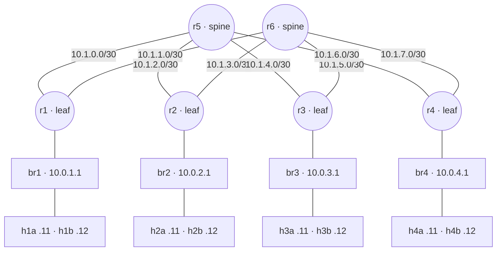
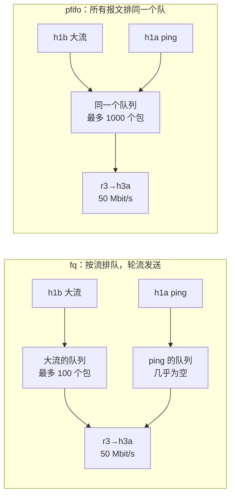
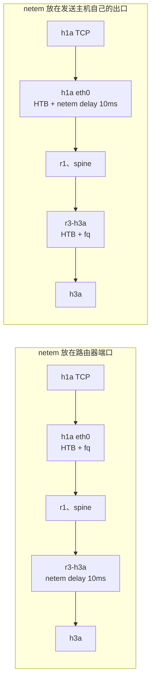

# 第 06 讲回顾：读数能信吗

> **课程导读**：[第五讲回顾](datacenter_network_review.md)追问“能互通之后还缺什么”，答案是容量与映射；这一讲换一个问法：**手里的读数能不能信**。同一对主机可以读出 0.2 ms 或 121 ms，也可以读出 19、47 或 95 Mbit/s，这些数都是真的。用体检单五要素串起[第六讲讲义](network_measurement.md)：**定义 → 方法 → 条件 → 不确定度 → 判断**。最后用一组补测看四种常见的“读数陷阱”：算法、多路径、并发和工具的位置。

---

## 使用说明

- ● **记得吗**：回忆概念；●● **看得懂吗**：读输出、读字段、算一步；●●● **说得清吗**：解释因果与证据边界。回答时指出支持判断的字段、数值或计算。
- [参考答案](network_measurement_review_answers.md)单独成文，32 个题号逐一对应。第十节提供程序员视角的讨论，不要求唯一答案。
- **课堂路线（约 40 分钟）**：题 2、5（7 分钟）；题 16（4 分钟）；题 18（6 分钟）；题 25（5 分钟）；题 28 读补测数据（6 分钟）；题 31 小组诊断（8 分钟）；判断题选讲、收束（4 分钟）。只有 10 分钟时选题 18、28。其他题供课后自查。
- **证据来源**：标为“原讲义实测节选”的输出来自第六讲的记录（2026-10-17，备课虚拟机：Ubuntu 26.04.1、Linux `7.0.0-38-generic`、x86_64、2 核 2.8 GB，Lab 2 参考路由）。标为“本次补测”的数据是 2026-11-07 在同一台虚拟机（内核已升级为 `7.0.0-43-generic`，iperf3 3.20）的完整实验床上测得，用于题 8、16、22、27–31，**TCP 算法都显式指定为 CUBIC**，除非题目另有说明。纸面推演与教学设定另行标明。
- 本回顾不给出 Lab 4 `netprof` 各 TODO 的实现。Lab 4 已改为选做，本回顾不依赖它；题 28 与 Lab 4 任务 5 用同一个场景，数字是另测的。
- 阅读无需搭环境。若复现，按原讲义“课前准备”搭建完整实验床，从仓库根目录执行；结束后按原讲义 6.7 节清理。补测的复现步骤写在参考答案题 27–30。

**本回顾的实验题都使用下图。** 第一节与部分纸面题另设条件，均在题干中说明。



*图 1：完整实验床（`04/topo.sh`），与原讲义、Lab 3 指导书 3.2 节相同。每个端口的发送方向都是 HTB 类 1:10 加叶子 fq；host 接入口与 leaf–spine 链路基线都是 100 Mbit/s。接口按“本端-对端”命名，host 一侧为 `eth0`。`tc` 只作用于发送方向：进入 h3a 的方向看 r3 的 `r3-h3a`，h3a 的 `eth0` 管的是反方向。*

---

## 一、一个数字回答不了“有多快”

> 涉及原讲义：1.1–1.4 节。

1. ● （1）体检单的五要素是哪五个？同学写“h1a 到 h3a 延迟 0.2 ms，带宽 95 M”，缺了哪些？按 1.2 节的格式改写其中“延迟”的部分（数值可用 1.4 节的实测）。（2）下列各是单次测量、样本还是统计量：一个 `ping` 回复的 `time=`；每 50 ms 一次、共 40 个回复；这 40 个回复的 p90。（3）为什么换一种分位数算法后，“方法”一栏必须跟着改？

2. ●● 10 个 RTT 样本（教学设定，单位 ms）：`0.12 0.15 0.13 0.11 0.14 0.16 0.13 0.12 5.20 0.14`。（1）按最近秩法求 p50、p90，再求均值。（2）Python 的 `statistics.median` 给出多少？它与最近秩的 p50 为什么不同？（3）均值与 p50 差了近 5 倍，哪个错了？只报 p90，能发现那个 5.20 吗？（4）作业要做 $10^4$ 次这样的往返，估算总时间应该用均值还是 p50？相差多少？

3. ●● 下表取自原讲义 6.2 节的筛查读数（实测）。

    | 放置 | 吞吐 | RTT p50 |
    | --- | ---: | ---: |
    | P：h1a → h2b | 95.7 Mbit/s | 4.25 ms |
    | Q：h1a → h4a | 28.8 Mbit/s（6.4 节 p50 为 28.7） | 0.183 ms |
    | R：h1a → h3a | 95.2 Mbit/s | 0.155 ms |

    （1）分别算作业 A（传 200 MB）与作业 B（$10^4$ 次往返）的通信时间下界，吞吐用 P 95.7、Q 28.7、R 95.2。（2）作业 C 依次做 A 和 B，选哪个放置？（3）如果调度器只能用一个数给主机对打分，用吞吐和用 RTT 各会犯什么错？

---

## 二、延迟、抖动与丢包

> 涉及原讲义：2.1–2.5 节。

4. ● （1）RTT 包含哪三段？单向延迟定义在哪份 RFC？（2）`owd.py` 为什么能把两端的时刻直接相减？（3）设把这个工具搬到两台真机上，h3a 的时钟比 h1a 快 3 ms，其他不变。原讲义的 h1a→h3a 5.285 ms、h3a→h1a 0.236 ms 会读成多少？负数说明什么？两个读数之和还可信吗？

5. ●● 原讲义 2.3 节，只在 r3→h3a 方向加 5 ms（实测节选）：

    ```text
    [第 3 步：RTT]
    样本   n=40 min=5.090 p10=5.200 p50=5.240 p90=5.380 max=5.450 mean=5.263 sd=0.076
    [第 4 步：单向 h1a → h3a]
    {"sent": 50, "received": 50, "lost": 0, "min_ms": 5.199, "median_ms": 5.285, "p90_ms": 5.335, "max_ms": 6.669}
    [第 5 步：单向 h3a → h1a]
    {"sent": 50, "received": 50, "lost": 0, "min_ms": 0.154, "median_ms": 0.236, "p90_ms": 0.291, "max_ms": 0.323}
    ```

    （1）1.4 节的基线 RTT p50 是 0.155 ms。RTT 增加了多少，为什么不是 10 ms？（2）空载方向的单向延迟 0.236 ms，比整个往返 0.155 ms 还大。这说明什么？（3）把 netem 挪到 r1→h1a 方向，预测 RTT 和两个单向延迟。两个方向都加 5 ms 呢？（4）为什么把条件放在接入链路 `r3-h3a`，而不是上联 `r1-r5`？

6. ●● （1）教学设定：按发送顺序的 5 个单向延迟为 5.0、5.4、4.8、5.1、6.2 ms。写出 |IPDV| 与 PDV 两个序列。接收端要等齐全部 5 个包，缓冲至少多大？（2）原讲义 2.3 节同一组 100 个样本中，|IPDV| 的 p50 是 0.492 ms，PDV 的 p50 是 0.972 ms。为什么前者通常更小？（3）如果序号 3 的包丢了，序号 2、4 之间能算 IPDV 吗？`stats.py` 会怎样处理？（4）`owd.py` 摘要的中位数是 5.288 ms，`stats.py` 的 p50 是 5.274 ms，哪个错了？

7. ● （1）原讲义 2.4 节执行 `tc qdisc change … netem loss 2%` 之后，`delay 5ms 1ms` 去哪了？从中得到什么操作习惯？（2）在 Linux 7.0 上用 `replace` 把 fq 直接换成 netem 会怎样，应该怎么写？（3）`topo.sh status` 逐项检查什么？为什么每个短观察结束都要回到它？

8. ●● 原讲义 2.4 节配置 2% 丢包，三轮各 200 个探测，收到 197、199、197 个。本次补测同样配置，三轮各 2000 个探测，收到 1962、1964、1960 个；恢复基线后 2000 个全部收到。（1）原讲义的三轮都低于 2%，能说配置没生效吗？（2）分别合并两组数据，写出点估计。用 Wilson 公式算出本次补测合并后的 95% 区间，比原讲义合并后的 0.57%–2.39% 窄了多少？（3）恢复基线后，100 个全部收到和 2000 个全部收到，各能说明什么？（4）要分辨 1% 与 2%，几百个探测为什么可能不够？

9. ●● 丢包配置在 r3→h3a。（1）`ping` 的一次失败，丢的是请求还是回复？`ping` 能分辨吗？（2）如果改配在 r1→h1a，`ping` 的丢包率读数会变吗？丢的又是什么？用什么工具可以分开统计？（3）两个方向都配 2%，`ping` 预期读到多少丢包率？（4）第 05 讲的 `0% packet loss` 对应几个探测？能写成“这条路径不丢包”吗？

---

## 三、带宽的三种含义

> 涉及原讲义：3.1–3.4 节。

10. ● 判断下列读数各属于容量、可用容量、吞吐，还是别的什么：（a）`tc class show` 的 `rate 100Mbit`；（b）$100\times1448/1514\approx95.6$；（c）`iperf3` 的 `95.5 Mbits/sec receiver`；（d）后台流占满 r1→r5 时，r1→r5 上还没被占用的部分；（e）此时新流测到的 47.4 Mbit/s。（d）和（e）差这么多，矛盾吗？

11. ●● 原讲义 3.3 节（实测节选）：

    ```text
    [ ID] Interval           Transfer     Bitrate         Retr  Cwnd
    [  5]   0.00-1.00   sec  12.5 MBytes   105 Mbits/sec    0    256 KBytes
    [  5]   1.00-2.00   sec  11.6 MBytes  97.6 Mbits/sec    0    256 KBytes
    ...
    [  5]   0.00-5.00   sec  58.1 MBytes  97.5 Mbits/sec    0            sender
    [  5]   0.00-5.02   sec  57.1 MBytes  95.5 Mbits/sec                  receiver
    ```

    （1）帧级上界是 95.6 Mbit/s，第一秒 105、sender 97.5 为什么能超过？（2）用 `Transfer` 列算出 receiver 行的速率，写清单位约定。（3）体检单取哪一行？写程序时读 `-J` 的哪个字段？（4）`Retr` 与 `Cwnd` 是谁的、什么含义？

12. ●● （1）写出 50、30、20 Mbit/s 端口的单流应用吞吐上界（MTU 1500、TCP 带时间戳）。（2）读到 28.7 Mbit/s，反推容量是多少？读到 18.9 呢？（3）如果 TCP 不带时间戳选项，100 Mbit/s 的上界变成多少？（4）读数略高于上界时，先查什么？明显低于上界时呢？

13. ●●● 原讲义 3.4 节，后台流 h1b→h3b 的逐秒 `Transfer`（MBytes）依次为 12.4、11.2、11.2、6.12、5.62、5.50、6.25、10.6、11.4、11.1，新流 h1a→h3a 在第 3–7 秒运行，接收端共收到 22.8 MBytes。（1）与前面稳定的 11.2 MBytes/s 相比，后台流在第 3–7 秒少传了多少？和新流收到的量比较。（2）后台流 10 秒汇总 75.9 Mbit/s，这个数告诉你什么、掩盖了什么？（3）新流的 47.4 Mbit/s 能写进体检单的“可用容量”吗？（4）调度器每分钟要把 56 个有向对各测一次，每次 `-O 1 -t 2`，逐对进行，做得到吗？还没算对正在运行的作业的影响。

---

## 四、tc：令牌桶与队列

> 涉及原讲义：4.1–4.5 节。

14. ● （1）qdisc、class、filter 各负责什么？（2）要限制进入 h3a 的流量，应在哪台设备、哪个接口上配？（3）`tc` 的“流量控制”和 TCP 的“流量控制”是一回事吗？（4）同样限速 50 Mbit/s，整形与监管在体检单上分别留下什么症状？

15. ●● 令牌桶 $r=50$ Mbit/s、$b=10^6$ 字节，忽略其他约束。（1）用 $r+b/t$ 算 $t=0.1$、0.18、1、3.2、10 秒时平均速率的上限。（2）$b/r$ 是多少？窗口至少多长，突发的贡献才低于 $r$ 的 5%？（3）默认 burst 1600 字节时，$b/r$ 是多少？（4）$t=0.1$ 秒算出的上限超过了上游 100 Mbit/s 的端口，实际能达到吗？

16. ●● 原讲义 4.4 节传 2 MB 应用数据（折合约 $2.09\times10^6$ 字节的帧），瓶颈 50 Mbit/s，上游 h1a 出口 100 Mbit/s。本次补测把 burst、cburst 一起改成 1 500 000 与 2 000 000 字节（每档重复 2–3 次）：

    | burst、cburst（字节） | 完成时间 | 来源 |
    | --- | ---: | --- |
    | 默认 1600 | 0.335–0.337 s | 原讲义、补测 |
    | 1 000 000 | 0.175–0.177 s | 原讲义、补测 |
    | 1 500 000 | ？（预测）；实测 0.168–0.170 s | 补测 |
    | 2 000 000 | ？（预测）；实测 0.168 s | 补测 |

    （1）写出完成时间的估算式，算出后两行的预测。（2）burst 继续放大，时间为什么不再下降？新的约束是什么？（3）纸面推演：把上游换成 1 Gbit/s，1 000 000 与 1 500 000 两档各约多久？（4）原讲义说只调 burst 或只调 cburst 都不够，为什么？

17. ●● 原讲义 4.4 节：同一限速器，默认 burst 时 2 MB 读 47.5 Mbit/s；放大 burst 后 2 MB 读 91 Mbit/s，20 MB 读 50.2 Mbit/s。（1）同学写“这条链路现在是 91 Mbit/s”，错在哪里？（2）放大 burst 后，2 MB 用时 0.175 s，20 MB 用时 3.187 s。不知道 $b$，能否用这两个点算出 $r$？（3）由此说明：要测一个带突发的限速器，测量该怎样设计？



*图 2：题 18 的两种队列，发送端、接收端、限速都相同，只换了 r3→h3a 这个端口的叶子。大流由 h1b 发出、ping 由 h1a 发出，它们只在这一处共用队列。省略路由器 r1、spine、回程与其他主机。*

18. ●●● 原讲义 4.5 节（实测节选，ping 只统计负载期间 seq 15–60）：

    ```text
    [fq]    ss（h1b 的大流）：rtt:20.723/0.542 cwnd:92
    [fq]    大流：40000000 B，6.711 s，47.68 Mbit/s
    [fq]    ping seq 15–60：样本 n=46 min=0.077 p10=0.151 p50=0.235 p90=0.359 max=0.441
    [pfifo] ss（h1b 的大流）：rtt:119.384/0.476 cwnd:521
    [pfifo] 大流：40000000 B，6.694 s，47.80 Mbit/s
    [pfifo] ping seq 15–60：样本 n=46 min=12.300 p10=31.500 p50=121.000 p90=218.000 max=239.000
    ```

    （1）换队列改变吞吐了吗？上界是多少？（2）算出两种队列的最大排队时间（fq 每流 100 包，pfifo 1000 包，帧长 1514 字节），和各自的读数对照。（3）fq 下大流自己的 RTT 约 20.7 ms，同一端口的 ping 只有 0.235 ms，为什么？（4）负载开始时的 seq 14 在两种队列下都约 6.5 ms，原讲义为什么说“不作结论”？（5）对体检单意味着什么？

19. ●●● 原讲义 4.5 节末的边界：全网 100 Mbit/s，让 h1a 自己发大流，同时从 h1a ping，p50 约 45 ms；把 h1a `eth0` 的 fq 换成 pfifo 约 14 ms；去掉 h1a 的限速约 9 ms。队列统计显示 136 260 字节只算 2 个包。（1）fq 在这里反而更差，和 4.5 节的主实验矛盾吗？两者差在哪？（2）136 260 字节 2 个包说明什么？按 100 Mbit/s，发完一个这样的包要多久？（3）能据此说“fq 不如 pfifo”吗？这组对照支持的结论是什么？（4）对测量的操作规则是什么？

---

## 五、让测量可信

> 涉及原讲义：5.1–5.5 节。

20. ●● 原讲义 5.1 节，r3→h3a 加 10 ms，`iperf3 -t 2 -i 0.2`：第一段 3.50 MBytes（147 Mbit/s），之后稳定在 2.25 MBytes（94.4 Mbit/s）。（1）验算这两个速率。（2）开头**偏高**，这和“慢启动造成低估”的直觉矛盾吗？（3）BDP 约多少个满长报文段？从初始窗口 10 个段翻倍增长到这个量，大约要几个 RTT，在 0.2 秒一段的读数里看得出来吗？（4）纸面推演：RTT 变成 100 ms，又要多久？`-O` 该怎么选？

21. ●● （1）原讲义 5.2 节 5 次读数 95.39、94.9、94.59、95.62、95.22，`stats.py` 给 `sd=0.363`，区间用的却是 $s=0.406$。两者差在哪，算区间该用哪个？（2）教学设定：条件 A 的 5 次读数为 95.0、95.4、94.8、95.3、95.1，条件 B 为 94.6、95.2、94.7、95.0、94.9。各算均值与 95% 区间（$t=2.776$）。能说 A 比 B 快吗？（3）原讲义 6.4 节 28.3–28.8 的区间与基线的区间相距很远，能下什么结论？这个结论的范围有多大？

22. ●● 原讲义 5.4 节（实测节选）：

    ```text
    [空闲]      不限速 h1a → h1b：4330.7 Mbit/s；host_total 99.2%，remote_total 50.3%
    [空闲]      限速   h1a → h3a：  95.7 Mbit/s；host_total  0.7%，remote_total 17.1%
    [空闲]      RTT    h1a → h3a：样本 n=100 min=0.056 p10=0.080 p50=0.107 p90=0.148 max=0.427
    [占满 2 核] 不限速 h1a → h1b：2319.8 Mbit/s；host_total 43.4%，remote_total 28.6%
    [占满 2 核] 限速   h1a → h3a：  95.7 Mbit/s；host_total  0.6%，remote_total 11.6%
    [占满 2 核] RTT    h1a → h3a：样本 n=100 min=0.022 p10=0.028 p50=0.050 p90=0.066 max=0.213
    ```

    本次补测在空闲的基线实验床上，按不同探测间隔各测 RTT 两轮（`-i 0.01` 100 个，`-i 0.05`、`-i 0.2` 各 40 个，`-i 1` 30 个）：

    | 探测间隔 | 第一轮 p50 | 第二轮 p50 |
    | ---: | ---: | ---: |
    | 0.01 s | 0.151 ms | 0.133 ms |
    | 0.05 s | 0.143 ms | 0.166 ms |
    | 0.2 s | 0.169 ms | 0.146 ms |
    | 1 s | 0.158 ms | 0.164 ms |

    （1）不限速读数降到原来的多少？这个数反映的是什么？为什么限速路径不受影响？（2）这正是实验床选 100 Mbit/s 一档的原因，为什么？（3）CPU 占满后 RTT p50 反而变小，能说“CPU 越忙网络越快”吗？（4）补测能说明探测间隔影响 RTT 吗？这组数据支持什么？

23. ●● 同学的测量计划：“先在 h1a 上 `iperf3 -c 10.0.3.11 -t 1`，取 sender 行作为 h1a 到 h3a 的带宽；另开一个窗口同时 `ping 10.0.3.12` 测延迟。上午实验留下的配置没动，反正只测一次。”对照原讲义 5.5 节的清单，至少指出 5 处问题，并分别说明怎样改。

---

## 六、综合动手：定位与放置

> 涉及原讲义：6.1–6.5 节。

24. ●● 原讲义 6.2 节（实测）：

    ```text
    h1a -> h1b  RTT p50=0.100 ms  吞吐 95.4 Mbits/sec
    h1a -> h2a  RTT p50=0.160 ms  吞吐 95.3 Mbits/sec
    h1a -> h2b  RTT p50=4.250 ms  吞吐 95.7 Mbits/sec
    h1a -> h3a  RTT p50=0.155 ms  吞吐 95.2 Mbits/sec
    h1a -> h3b  RTT p50=0.161 ms  吞吐 95.7 Mbits/sec
    h1a -> h4a  RTT p50=0.183 ms  吞吐 28.8 Mbits/sec
    h1a -> h4b  RTT p50=0.161 ms  吞吐 28.6 Mbits/sec
    ```

    （1）对照参考范围，标出异常的格子。（2）这是筛查，还不是诊断。列出每类异常的候选位置。（3）为什么筛查不重复测量？它的风险是什么？（4）只从 h1a 出发测一行，有什么情况看不到？

25. ●●● 原讲义 6.3 节的对照（实测）：

    ```text
    h2a -> h4a  RTT p50=0.159 ms  吞吐 28.8 Mbits/sec
    h4a -> h1a  RTT p50=0.158 ms  吞吐 95.7 Mbits/sec
    h2a -> h2b  RTT p50=4.190 ms  吞吐 95.7 Mbits/sec
    {"sent": 50, "received": 50, "lost": 0, "min_ms": 4.215, "median_ms": 4.386, "p90_ms": 4.579, "max_ms": 6.177}
    {"sent": 50, "received": 50, "lost": 0, "min_ms": 0.172, "median_ms": 0.26, "p90_ms": 0.365, "max_ms": 0.536}
    ```

    后两行依次是 h1a→h2b、h2b→h1a 的单向延迟。（1）每一行相对筛查只改了什么因素，排除了哪个候选？（2）28.7 Mbit/s 对应多大的容量？（3）“两台 spine 发往 r4 的出口都受限”这一判断的依据是什么？如果只有一台 spine 受限，读数会是什么样？（4）单向延迟多出来多少？和 RTT 的差值对得上吗？（5）端到端测量能确定什么、不能确定什么？

26. ●● 原讲义 6.5 节的放置表。（1）验算三种放置的作业 A、B 时间。（2）表注说“作业 A 若是从机架 4 向外发送”不受影响，为什么？调度器的画像要记录什么才能回答这一点？（3）教学设定：作业 D 传 20 MB，再做 $10^5$ 次往返。分别算这三种放置，选哪个？（4）这些数是预测 JCT 吗？还缺什么？

---

## 七、补测：同一条命令，读数为什么不止一个

> 涉及原讲义：4.5、5.3 节，2.2 节的手册提醒；第七讲 1.3 节。题 27–30 使用本次补测，复现命令在参考答案里。

27. ●●● 同学复跑原讲义 4.5 节的 pfifo 对照，`ping` p50 只有 3.6 ms，于是说讲义错了。本次补测用同样的命令，只在 h1b 上显式改算法：

    | 来源与 h1b 的算法 | 完成时间 | 应用速率 | `ss`（第 2.5 秒） | ping seq 15–60：p10、p50、p90、max（ms） |
    | --- | ---: | ---: | --- | ---: |
    | 原讲义记录（未显式指定） | 6.694 s | 47.80 Mbit/s | `rtt:119.384 cwnd:521` | 31.5、121、218、239 |
    | 本次补测，CUBIC | 6.705 s | 47.72 Mbit/s | `rtt:118.901 cwnd:520` | 30.2、121、217、237 |
    | 本次补测，BBR | 6.721 s | 47.61 Mbit/s | `rtt:5.446 cwnd:30` | 3.11、3.61、4.62、6.61 |

    （1）讲义错了吗？这张表支持什么判断？同学下一步先查什么？（2）用 `cwnd` 分别估算队列里的排队时间，和 `rtt` 对账。（3）只看吞吐，这三行有差别吗？这说明什么？（4）体检单的“条件”一栏要加什么？为什么说换一台机器复跑时，这一项不能默认相同？


*图 3：题 28 中 12 次吞吐读数的分布（本次补测，场景 `uplink-r1r5`，h1a→h3a）。阅读版中每个圆点是一次 `iperf3 -t 2 -O 1` 的接收速率，横轴按比例绘制。*

28. ●●● 本次补测，场景 `uplink-r1r5` 只把 r1–r5 一条上联的两个方向降到 20 Mbit/s。h1a→h3a 重复 12 次，每次前后读 r1 两条上联的发送字节：

    ```text
    run 1: 18.9 Mbit/s  r1-r5 +7 MB   r1-r6 +0 MB
    run 2: 18.9 Mbit/s  r1-r5 +7 MB   r1-r6 +0 MB
    run 3: 18.9 Mbit/s  r1-r5 +7 MB   r1-r6 +0 MB
    run 4: 95.6 Mbit/s  r1-r5 +0 MB   r1-r6 +37 MB
    run 5: 95.2 Mbit/s  r1-r5 +0 MB   r1-r6 +37 MB
    run 6: 18.8 Mbit/s  r1-r5 +7 MB   r1-r6 +0 MB
    run 7: 18.8 Mbit/s  r1-r5 +7 MB   r1-r6 +0 MB
    run 8: 18.8 Mbit/s  r1-r5 +7 MB   r1-r6 +0 MB
    run 9: 18.8 Mbit/s  r1-r5 +7 MB   r1-r6 +0 MB
    run 10: 95.6 Mbit/s  r1-r5 +0 MB   r1-r6 +38 MB
    run 11: 18.8 Mbit/s  r1-r5 +7 MB   r1-r6 +0 MB
    run 12: 18.9 Mbit/s  r1-r5 +7 MB   r1-r6 +0 MB
    [钉路] 经 r5：18.8、19.2、18.9；经 r6：94.4、95.3、95.7
    [钉路 RTT] 经 r5：p50=0.160 ms；经 r6：p50=0.144 ms
    ```

    （1）算这 12 次的均值、最近秩 p50 和均值的 95% t 区间（$t_{0.975,11}=2.201$，$s\approx34.65$）。它们描述了哪一次真实的传输？（2）字节计数怎样证明两簇对应两条路？7 MB 和 37 MB 怎样用 3 秒的测量窗口算出来？（3）能用 `ping` 发现这个问题吗？（4）传 200 MB，按均值、p50、两条路各自的读数分别估算，调度器应该怎样表示这对主机？（5）连测 3 次全落在同一条路上的概率是多少（设两条路等概率）？12 次里出现 9:3 算不算反常？

29. ●● 本次补测，基线实验床。h1a→h3a、h1b→h3b 单独测时都在 95.2–96.1 Mbit/s。同时测 12 轮，自然 ECMP（`-t 2 -O 1`，算法 CUBIC）：

    | 轮次 | h1a→h3a、h1b→h3b（Mbit/s） | 合计 | r1-r5、r1-r6 字节增量 |
    | --- | --- | ---: | --- |
    | 1、4、6（同类 3 轮） | 约 47.7、47.9 | 约 95.6 | +0、+37 MB |
    | 2、5、7、9（同类 4 轮） | 约 47.8、47.8 | 约 95.6 | +37、+0 MB |
    | 3、8、10、11、12（同类 5 轮） | 约 95.3、95.4 | 约 190.7 | 各 +37 或 +38 MB |

    （1）三类结果分别发生了什么？（2）有人说“同时测时吞吐减半，说明上联容量只有 50 Mbit/s”，错在哪里？（3）h1a→h3a 这 12 轮的均值约 67.5，中位数约 47.8，这两个数能写进体检单吗？（4）12 轮里 7 轮撞在一起，理论值是一半，算偏多吗？（5）逐对测量和同时测量各回答什么问题？什么时候应该故意同时测？



*图 4：题 30 的两个位置，netem 参数相同，只改挂载的端口。两种情况的路径和容量相同，只画去程。*

30. ●●● 手册提醒 netem 放在 TCP 发送主机自己的出口上时，TCP 的表现会失真。本次补测（`iperf3 -t 5 -O 1`，每行 3 次，cwnd 和 rtt 取最后一秒的报告）：

    | netem 位置与参数 | `ping` p50 | 接收速率（Mbit/s） | 重传 | cwnd | TCP 自测 rtt |
    | --- | ---: | ---: | ---: | ---: | ---: |
    | `r3-h3a`，`delay 10ms` | 10.2 ms | 95.4、95.4、95.6 | 0 | 358–361 KB | 17–23 ms |
    | `h1a eth0`，`delay 10ms` | 10.2 ms | 95.5、95.5、95.6 | 0 | 2948–2985 KB | 223–247 ms |
    | `r3-h3a`，`delay 10ms loss 1%` | 10.2 ms | 11.1、11.3、10.2 | 45–49 | 10–28 KB | 10–11 ms |
    | `h1a eth0`，`delay 10ms loss 1%` | 10.2 ms | 27.4、16.3、16.1 | 68–107 | 20–24 KB | 10–10.4 ms |

    （1）只看 `ping` 和吞吐（前两行），两个位置有差别吗？这张表哪一列暴露了失真？（2）把 `cwnd` 换算成排队时间（按 95.5 Mbit/s），和 TCP 自测 rtt 对账。BDP 约多大？（3）加 1% 丢包后，两个位置的平均速率各是多少，差多少倍？这组对照能说明谁更接近“真实网络里丢 1%”吗？（4）由此给出一条做实验的规则。

---

## 八、八分钟小组诊断：读数都是真的，结论错在哪

> 涉及原讲义：3.3、5.3、5.4、6.3 节。甲、乙两个现场来自本次补测，丙来自原讲义 5.4 节。

31. ●●● **8 分钟小组诊断。** 每个现场都有人给出了一个结论。目标是选出下一条最有区分力的观察，而不是凭一行输出猜唯一原因。前 2 分钟标记证据，4 分钟填表，2 分钟汇报。每行交付“可下的结论／仍缺的证据／下一步与预期分支”，最后说明怎样确认已经解决。

    | 现场 | 已知证据 | 不能直接断言什么？下一步看哪里？ |
    | --- | --- | --- |
    | 甲：忽高忽低 | h1a→h3b 测 7 次：95.1、18.9、95.0、18.9、18.9、95.6、18.8 Mbit/s；`ping` p50 0.145 ms；同机架 h1a→h1b 3 次都在 95.3–95.6。同学把均值 51.5 Mbit/s 写进体检单，认为“iperf3 不稳定，多测几次取平均就好” | ____ |
    | 乙：一台主机变差 | h1a→h3a：RTT p50 5.13 ms，200 个探测丢 1 个；吞吐 12.0、11.5、13.1 Mbit/s，每次重传 41–44。h1b→h3a：10.5、11.0、14.1。h3a→h1a：94.8–95.7，重传 0。h1a→h3b：RTT p50 0.132 ms，吞吐 95.3–95.5。同学认为“丢包才 0.5%，不可能打到 12 Mbit/s，一定是 h3a 的 CPU 不够” | ____ |
    | 丙：链路退化 | 同机架不限速路径 h1a→h1b 上午 4331 Mbit/s，下午 2320 Mbit/s；限速路径 h1a→h3a 两次都是 95.7 Mbit/s。同学认为“同机架链路容量掉了一半” | ____ |

    **固定条件**：完整实验床、Lab 2 参考路由，算法 CUBIC；三个现场相互独立。**评价指标**：诊断是否由证据支持，下一步观察能否区分不同解释；不按命令数量评分。

---

## 九、判断并改错

32. ●● 下列说法哪些成立？对错误说法给出必要条件或改写，不只写“对／错”。

    | 编号 | 说法 |
    | --- | --- |
    | A | `ping` 摘要里的 `mdev` 可以用来说明 90% 的样本落在什么范围内。 |
    | B | 100 个 `ping` 全通，所以这条路径不丢包。 |
    | C | 只在一个方向加 5 ms，RTT 增加约 5 ms。 |
    | D | `iperf3` 的 sender 行比 receiver 行更能代表网络吞吐。 |
    | E | 可用容量接近 0 的路径上，新的 TCP 流测不到吞吐。 |
    | F | 限速 50 Mbit/s 的整形器，在任何时间窗口内的平均速率都不超过 50 Mbit/s。 |
    | G | 把队列从 fq 换成 pfifo，延迟变大的同时吞吐也提高了。 |
    | H | fq 能保护小流不受大流影响，无论大流从哪里发出。 |
    | I | 不限速路径测到 4331 Mbit/s，说明这条 veth 的容量是 4331 Mbit/s。 |
    | J | 两个 95% 区间不重叠，可以粗略认为有差别；重叠时不能下结论。 |
    | K | 同一对主机的读数分成两簇时，取中位数就能代表它。 |
    | L | 只要 netem 参数相同，放在路径上的哪个端口，TCP 的表现都一样。 |

---

## 十、从程序员视角再想一步

### 1. 平均值、分位数与聚合

服务监控常画 p99 曲线。把 10 台机器各自的 p99 取平均，得到的是整体的 p99 吗？题 2 说明估算总耗时要用均值，题 28 说明均值可能描述不了任何一次请求。你的监控系统应该存什么，才能事后重算分位数？

### 2. 指标要带口径

MB 与 MiB、请求开始计时还是收到首字节计时、客户端还是服务端打点，都会改变读数。你见过两个仪表盘对同一件事给出不同数字吗？最后是怎样查清的？

### 3. 测量也是负载

题 13 的探测从正在运行的作业那里分走了一半带宽，题 29 的探测互相干扰。健康检查、压测和全链路探针也会占用资源。你会怎样决定探测的频率、规模和时机？

### 4. 恢复基线就是测试隔离

题 31 乙留下的残留条件，和单元测试之间共享全局状态是同一类问题。`topo.sh status` 相当于什么？你写的测试怎样保证“上一个用例没有留下东西”？

### 5. 一次只改一个因素

6.3 节的对照和 `git bisect`、A/B 实验有什么共同点？什么时候必须同时改两个因素，又该怎样设计？

### 6. 双峰是一条线索

缓存命中与未命中、走快路径与慢路径、连到本地还是远端副本，都会造成延迟的两簇。看到双峰时，你第一步会做什么？怎样在日志里留下足以把两簇分开的字段？

本回顾到“能读懂读数、说清口径与证据边界”为止；[Lab 4](../experiments/04/README.md)（选做）把体检做成自动化工具。下一讲[从拥塞控制到长尾延迟](tail_latency.md)解释 TCP 为什么会把队列填满，并把分位数用于长尾延迟。样例数字不是验收常数，你的读数以自己的环境为准。
