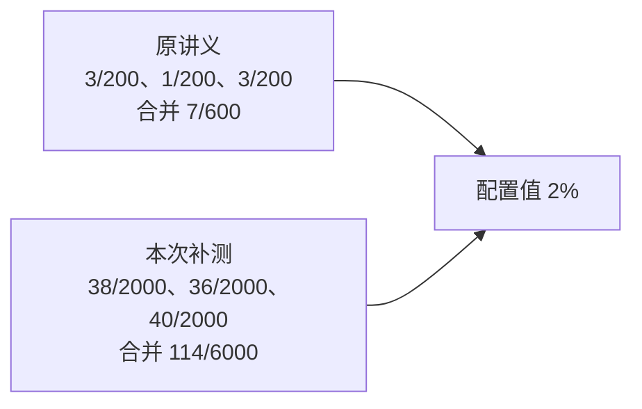
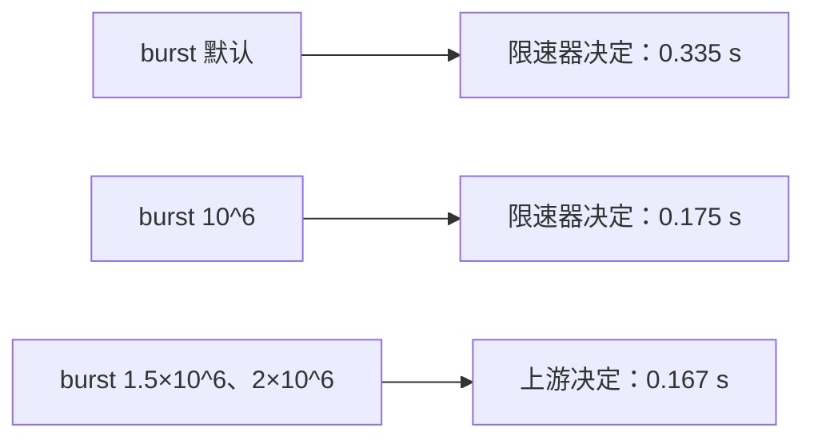
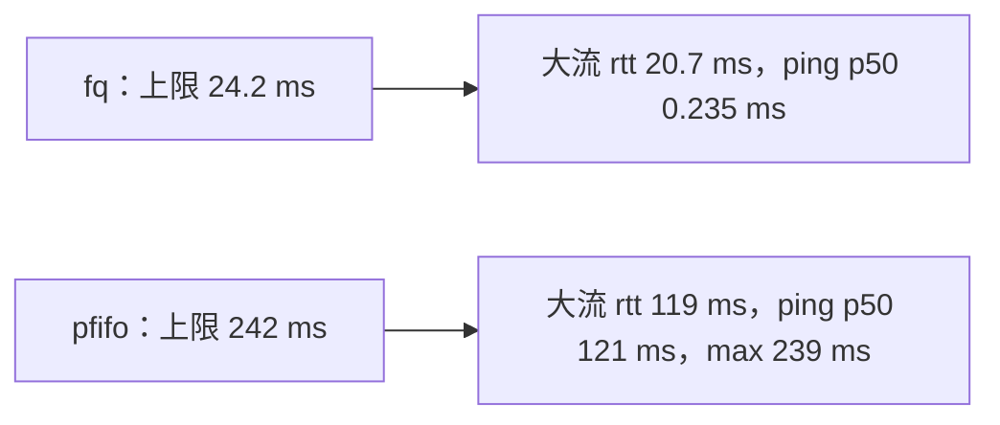
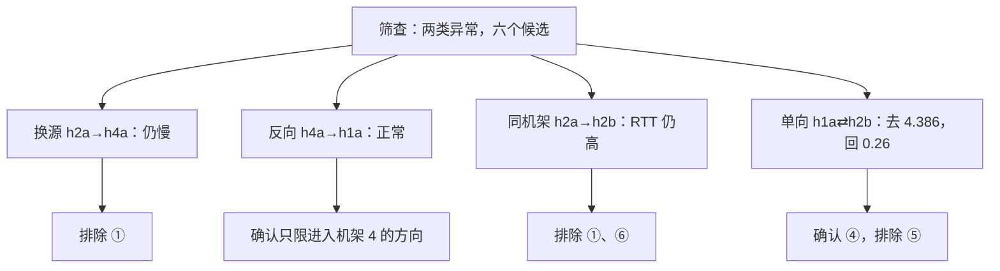
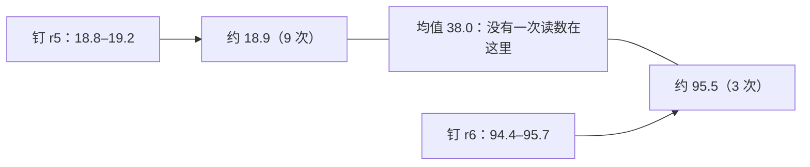

# 第 06 讲回顾讲义：参考答案

> 配合[第六讲回顾题单](network_measurement_review.md)使用。32 个题号逐一对应，每题末尾以“→”标注[第六讲原讲义](network_measurement.md)的相关小节；先给结论，再说明计算、字段和判断边界。第十节为开放问题的参考思路。

本文的推演图不是新增实测。“原讲义实测节选”沿用第六讲的记录（2026-10-17，备课虚拟机：Ubuntu 26.04.1、Linux `7.0.0-38-generic`、x86_64、2 核 2.8 GB，Lab 2 参考路由）。题 8、16、22、27–31 另用了本次补测：2026-11-07 在同一台虚拟机（内核已升级为 `7.0.0-43-generic`，iproute2 6.19.0、iperf3 3.20）的完整实验床上测得。这台虚拟机自 2026-11-03 起系统默认算法为 `bbr`（`/etc/sysctl.d/99-xxd-vps.conf`），所以补测的 TCP 都显式指定算法；`transfer.py` 没有算法参数，题 16、27 用 `sysctl` 设置发送端的 namespace。补测每组 2–12 次，只说明这台机器、这一时段的现象，不代表其他环境。

---

## 一、一个数字回答不了“有多快”

1. **（1）项目（指标定义）、结果、参考范围、方法、条件。** 原句的“延迟”没说是往返还是单向，“带宽”没说是容量还是吞吐，“95 M”单位不全；没有样本量、参考范围、方法和条件。改写：`h1a→h3a 往返时间 | p50 0.155 ms，p90 0.192 ms（n=40）| 0.1 ms 级（本机软件转发）| ping -i 0.05，最近秩分位数 | 空载，100 档，自然 ECMP，2026-10-17`。**（2）** 单次测量；样本；统计量。**（3）** 小样本上不同算法的结果不同（题 2 的 0.13 与 0.135），不写方法，别人无法判断两个读数能否比较。→ 1.2–1.4 节

2. **（1）排序后为 0.11、0.12、0.12、0.13、0.13、0.14、0.14、0.15、0.16、5.20。p50 取第 $\lceil0.5\times10\rceil=5$ 个，为 0.13；p90 取第 9 个，为 0.16；均值 0.64。** **（2）** 0.135。样本数为偶数时，`statistics.median` 取中间两个的平均，最近秩直接取第 5 个。**（3）都没错，回答的问题不同。** p50 说“典型的一次多快”，均值被 5.20 拉高。p90 同样看不到 5.20：它只排在第 10 个，要看 `max`，或用足够多的样本估计更高的分位数。**（4）用均值。** 总时间是各次往返之和，$\text{和}=n\times\text{均值}$：$10^4\times0.64$ ms $=6.4$ s；用 p50 只有 1.3 s，低估约 5 倍。前提是那个 5.20 是这个样本里真实会重复出现的现象；只有 10 个样本时，均值本身也很不稳定。原讲义 6.5 节用 p50 估算，是不考虑长尾的理论下界，表注写明了这一点。→ 1.3、6.5 节

3. 结果如下（理论下界，忽略建连与计算）。→ 1.1、6.5 节

    | 放置 | A：$8\times200/\text{吞吐}$ | B：$10^4\times\text{RTT}$ | C = A + B |
    | --- | ---: | ---: | ---: |
    | P：h1a → h2b | 16.7 s | 42.5 s | 59.2 s |
    | Q：h1a → h4a | 55.7 s | 1.8 s | 57.6 s |
    | R：h1a → h3a | 16.8 s | 1.6 s | 18.4 s |

    - **（2）选 R。** P、Q 的总时间接近，但慢的原因完全不同。
    - **（3）** 只看吞吐，P 与 R 差不多，看不出 P 上的 B 慢约 27 倍；只看 RTT，Q 与 R 差不多，看不出 Q 上的 A 慢约 3.3 倍。所以至少要两个维度，并写明测量条件。

---

## 二、延迟、抖动与丢包

4. **（1）去程、对端处理、回程。** 单向延迟见 RFC 7679（RTT 见 RFC 2681）。**（2）所有 namespace 跑在同一台主机上，共用一个内核时钟（`CLOCK_MONOTONIC`），不存在时钟差。** **（3）h1a→h3a 读成约 8.285 ms，h3a→h1a 读成约 −2.764 ms。** 接收端时钟快，读数就多 3 ms；接收端时钟慢，读数就少 3 ms。负数说明时钟不同步，物理上延迟不可能为负；不出现负数也不能说明已经同步。**两个读数之和 5.521 ms 仍然可信**：固定的时钟差在一去一回中抵消了，这也是 RTT 不需要同步的原因。前提是测量期间时钟差不变。→ 2.1 节

5. **（1）增加 $5.240-0.155\approx5.09$ ms。** 条件只在 r3→h3a 一个方向，请求经过一次，回复不经过。**（2）单向探针的读数包含 Python 收发和打时间戳的开销，约 0.2–0.3 ms，这是 `owd.py` 的噪声底。** 它只适合分辨毫秒级的差异；不能用它得出“单向比往返还慢”。**（3）** netem 挪到 r1→h1a：RTT 仍约 5.24 ms，h1a→h3a 约 0.24 ms，h3a→h1a 约 5.29 ms。两个方向都加：RTT 约 10.1–10.2 ms，两个单向都约 5.3 ms。这是由 2.3 节数据推出的预测，没有单独测。**（4）** 去往 h3a 的报文无论选哪个 spine 都必经 `r3-h3a`；放在 `r1-r5` 上，只有哈希到 r5 的连接受影响，读数会混入 ECMP 的因素（题 28）。→ 2.3 节

6. **（1）|IPDV|：0.4、0.6、0.3、1.1。PDV（减去最小值 4.8）：0.2、0.6、0、0.3、1.4。缓冲至少 1.4 ms。** **（2）** IPDV 只比相邻的包，连续几个包延迟接近时差值就小；PDV 每个包都和全组最快的那个比。两者回答不同问题，所以体检单要写明用哪一个。**（3）不能。** IPDV 定义在发送序号相邻的两个包之间，序号 2、4 不相邻。`stats.py` 只是把收到的样本依次相减，不处理这种情况，有丢包时结果要打折扣。**（4）都没错。** 100 个样本是偶数，`statistics.median` 取中间两个的平均，`stats.py` 用最近秩法。差别很小，却说明“方法”一栏为什么必须写。→ 2.3 节

7. **（1）`change` 按这次给出的参数整体重设 netem，没写的参数回到默认值，所以 delay 不见了。** 习惯：改完条件再 `tc qdisc show` 查一次，不凭命令推测当前状态。**（2）** 报 `Error: Invalid qdisc name: must match existing qdisc.`。先 `tc qdisc del … parent 1:10`，再 `add`。**（3）** 检查 32 个限速端口：叶子是否为 fq、HTB 的 rate/ceil 是否等于基线、burst 是否为默认值，并列出 leaf 上的策略路由。否则后面的读数会混入前面留下的条件（题 31 乙）。→ 2.2、2.4、2.5 节

8. **（1）不能。** 单轮的 Wilson 区间：3/200 为 0.51%–4.32%，1/200 为 0.09%–2.78%，都包含 2%。**（2）原讲义合并 7/600 = 1.17%，区间 0.57%–2.39%，宽 1.82 个百分点。本次补测丢 38、36、40 个，合并 114/6000 = 1.90%，区间 1.58%–2.28%，宽 0.70 个百分点，约窄到 2.6 分之一。** 区间宽度约与 $\sqrt n$ 成反比，样本多 10 倍，宽度约缩小到 1/3。**（3）** 100 个全收：丢包率的 95% 上界约 $3/100=3\%$。2000 个全收：约 0.15%（Wilson 双侧区间上端 0.19%）。都不能说“丢包率为 0”。**（4）** 200 个探测时，一次 2% 的区间就能跨到 1% 以下和 4% 以上，分不开。补测的 6000 个探测区间已不含 1%，才分得开。→ 2.4、2.5 节



*图 1：丢包率的 95% Wilson 区间。阅读版按比例绘制每一行的区间与点估计，竖线是配置的 2%。所有区间都包含 2%；样本越多，区间越窄。*

9. **（1）丢的是请求。** 去往 h3a 的报文经过 r3→h3a，回复不经过。`ping` 只看到“这一来回没有回复”，分不出来。**（2）读数同一量级，丢的是回复。** 用 `owd.py` 的 `lost` 字段分方向统计，或在两端 `tcpdump` 比对。**（3）** $1-0.98^2=3.96\%$，假设两个方向相互独立。**（4）3 个探测，不能。** 它只对应这 3 个样本。3/n 法则是 $n$ 较大时的近似；$n=3$ 时精确值由 $(1-p)^3=0.05$ 得 $p\approx63\%$，几乎没有说明力。→ 2.4 节；第 05 讲 1.3 节

---

## 三、带宽的三种含义

10. **（a）容量（配置值）；（b）既不是配置也不是测量，是由容量和首部推出的帧级上界，用作参考范围；（c）吞吐；（d）可用容量，约为 0；（e）吞吐。** （d）与（e）不矛盾：可用容量描述“还没被占用的部分”，新流的吞吐是“再加入一条流能分到多少”，它是从后台流那里分走的。→ 3.1、3.4 节

11. **（1）逐秒行与 sender 行由发送端统计，数的是写进本机发送缓冲的字节；开头一批数据只是进了缓冲，还没到达对端。** 上界约束的是实际送达的速率。**（2）$57.1\times2^{20}\times8/5.02\approx95.4$ Mbit/s，** 工具四舍五入后显示 95.5。`MBytes` 是 $2^{20}$ 字节，`Mbits` 是 $10^6$ 比特。**（3）取 receiver。** 程序读 `end.sum_received.bits_per_second`。**（4）** `Retr` 是发送端重传的报文段数，`Cwnd` 是发送端的拥塞窗口。→ 3.3 节

12. **（1）$50\times1448/1514\approx47.8$，$30\times1448/1514\approx28.7$，$20\times1448/1514\approx19.1$ Mbit/s。** **（2）** $28.7\times1514/1448\approx30.0$，即 30 Mbit/s。18.9 反推约 19.8，最接近 20 Mbit/s 的档位，读数略低于上界 19.1。**（3）** 载荷 1460 字节，$100\times1460/1514\approx96.4$ Mbit/s。**（4）** 略高于上界：先查计时窗口与统计端（是否误用 sender 行、是否短窗口吃到突发）。明显低于上界：查竞争流、丢包、CPU 字段、残留条件。→ 3.2、3.3、4.4、5.3 节

13. **（1）第 3–7 秒实传 $6.12+5.62+5.50+6.25=23.49$ MBytes；按 11.2 MBytes/s 应传 44.8，少传约 21.3 MBytes。新流收到 22.8 MBytes，二者接近：** 新流的数据基本是从后台流那里分来的。**（2）** 它说明这 10 秒平均约 76 Mbit/s，掩盖了中间有 4 秒只有一半的事实。**（3）不能。** 新流加入前可用容量接近 0。这个数应写成“此刻再加入一条流能分到多少”，并注明有竞争流。**（4）做不到。** $56\times(1+2)=168$ 秒，超过 60 秒。要么减少主机对（利用拓扑对称性），要么降低频率，要么并发，但并发又带来题 29 的问题。→ 3.4 节；7.2 节思考题 5

---

## 四、tc：令牌桶与队列

14. **（1）qdisc 决定报文怎样排队、何时离开；class 在可分类的 qdisc 里划分容量；filter 决定报文进入哪个类。** **（2）r3 的 `r3-h3a`。** h3a 的 `eth0` 管的是 h3a 发出的方向。**（3）不是。** `tc` 的流量控制是设备上的排队与限速；TCP 的流量控制是接收方用接收窗口限制发送方。**（4）** 整形先排队再放行，症状是延迟增加，队列满后才丢包；监管直接丢弃超出部分，症状是丢包，几乎不增加延迟。→ 4.1、4.2 节

15. **（1）$r+b/t$，其中 $b/t=8\times10^6/t$ bit/s：$t=0.1$ 秒 130，0.18 秒 94.4，1 秒 58，3.2 秒 52.5，10 秒 50.8 Mbit/s。** **（2）$b/r=8\times10^6/(50\times10^6)=0.16$ 秒。** 要求 $b/t<0.05r$，即 $t>3.2$ 秒。**（3）** $8\times1600/(50\times10^6)\approx0.26$ ms，可以忽略。**（4）不能。** 这只是令牌桶给出的上限，实际还受上游约束，最多 100 Mbit/s。题 16 正是这种情况。→ 4.3 节

16. **（1）设帧字节 $F\approx2.09\times10^6$，上游容量 $C$：**

    $$T\approx\max\!\left(\frac{8(F-b)}{r},\ \frac{8F}{C}\right)$$

    - 上游项为 $8F/(100\times10^6)\approx0.167$ 秒。
    - $b=10^6$：$8\times1.09\times10^6/(50\times10^6)\approx0.175$ 秒，取 0.175（实测 0.175–0.177）。
    - $b=1.5\times10^6$：第一项约 0.095 秒，取 0.167（实测 0.168–0.170）。
    - $b=2\times10^6$：第一项约 0.015 秒，取 0.167（实测 0.168）。实测比预测多 1–3 ms，估计来自建连和回执，没有单独拆开。
    - **（2）约束换成了上游 h1a 出口的 100 Mbit/s。** 瓶颈令牌够用之后，再放大 burst 也不能让数据更快到达。这时 2 MB 读到约 95 Mbit/s，“带宽”已经和 50 Mbit/s 的限速器无关。
    - **（3）纸面推演：** 上游项约 0.017 秒。$b=10^6$ 仍约 0.175 秒；$b=1.5\times10^6$ 约 0.095 秒，瓶颈回到限速器。
    - **（4）** HTB 每个类有两个令牌桶：按 `rate` 积累最多存 `burst`，按 `ceil` 积累最多存 `cburst`。本实验床的类没有可借用容量的父类，两个桶都有令牌才能发送。→ 4.3、4.4 节
    - **复现**：按原讲义 4.4 节第 3 步操作，把 `burst`、`cburst` 改成表中的值；执行前用 `sudo ip netns exec h1a sysctl -w net.ipv4.tcp_congestion_control=cubic` 指定算法。



*图 2：传 2 MB 的完成时间。阅读版用横条画出“限速器项”与“上游项”的预测，取较大者，并标出实测范围。b 放大到约 1.09×10^6 字节之后（两项相等），上游成为约束，时间不再下降。*

17. **（1）91 Mbit/s 是 2 MB 这个短窗口内的平均速率，由令牌桶的突发抬高，不是持续能力。** 持续能力是 $r$。20 MB 只读到 50.2 Mbit/s 就是证据。**（2）能。** 两次都先用掉同一桶令牌（$b$ 相同），差分把 $b$ 消去：帧字节之差 $18\times10^6\times1514/1448\approx18.82\times10^6$ 字节，时间差 $3.187-0.175=3.012$ 秒，$r\approx8\times18.82\times10^6/3.012\approx50.0$ Mbit/s。前提是两次传输的时间都由限速器决定（题 16 的第一项）。**（3）** 窗口要远大于 $b/r$，或者测多个数据量，用斜率而不是单点速率估计 $r$，截距单独解释。Lab 4 任务 6 的传输时间曲线就是这个思路。→ 4.3、4.4、5.5 节

18. **（1）没有。** 两次都是约 6.7 秒、47.7–47.8 Mbit/s，贴近上界 47.8。**（2）fq 每流上限 $100\times1514\times8/(50\times10^6)\approx24.2$ ms；pfifo 上限 $1000\times1514\times8/(50\times10^6)\approx242$ ms。** fq 下大流 `rtt` 20.7 ms，cwnd 92 约等于 22.3 ms；pfifo 下 ping 涨到 239 ms，接近上限，`ss` 取样的第 2.5 秒 cwnd 521 约等于 126 ms，与 119 ms 相符。**（3）fq 按流排队、轮流发送。** 大流的报文排在自己的队列里，ping 所在的流几乎没有积压，轮到就走。**（4）它是一个孤立的点，原因没有查明，统计窗口又是事先定好的 seq 15–60，** 不能事后挑数据下结论。**（5）延迟属于“流 + 队列”，不只属于“路径”。** 体检单要写明测量时有没有负载、负载与它是否共用队列。→ 4.5 节



*图 3：题 18 的排队时间。阅读版按比例画出两种队列的上限与读数。fq 的 ping p50 短到几乎看不见，这正是要点：吞吐相同，排队方式不同。大流 `rtt` 是传输第 2.5 秒的单次取样。*

19. **（1）不矛盾，条件不同。** 主实验的瓶颈在路由器 r3，大流与 ping 从不同主机发出，只在这一处共用队列。这里瓶颈在 h1a 自己的 `eth0`，大流与 ping 从同一台主机发出。**（2）** 平均每个约 68 KB：TCP 先把大包交给 qdisc，发往网卡前再切分（软件 GSO）。按 100 Mbit/s，一个约需 $68130\times8/10^8\approx5.45$ ms，所以小包要等这样的大块发完。**（3）不能。** 这组对照只支持“fq 能隔离小流只在 4.5 节的条件下得到验证”。45 ms、14 ms、9 ms 的具体机制涉及 GSO、HTB 与 fq 的配合，原讲义没有展开，也没有验证。**（4）测延迟时，不要让测量与本机自己的大流共用出口。** 停掉大流，或从另一台主机测。→ 4.5、5.3 节

---

## 五、让测量可信

20. **（1）$3.50\times2^{20}\times8/0.2\approx146.8$；$2.25\times2^{20}\times8/0.2\approx94.4$ Mbit/s。** **（2）不矛盾。** 逐段读数由发送端统计，开头一批数据一次性写进发送缓冲，所以偏高；慢启动造成的低估被盖住了。**（3）BDP $95\ \mathrm{Mbit/s}\times10\ \mathrm{ms}\approx119$ KB，约 82 个满长段。** 从 10 个段翻倍，$\log_2 8.2\approx3$ 个 RTT，约 30 ms，在 0.2 秒一段里看不出来。**（4）纸面推演：** BDP 约 1.19 MB、820 个段，$\log_2 82\approx6.4$ 个 RTT，约 640 ms，开头几段会明显偏低，`-O` 至少要 1 秒。**丢多少、为什么丢，由自己的逐段数据决定。** → 5.1 节

21. **（1）`sd` 是总体标准差（除以 $n$），$s$ 是样本标准差（除以 $n-1$）。** 算均值的区间用 $s$。**（2）A：均值 95.12，$s\approx0.239$，半宽 $2.776\times0.239/\sqrt5\approx0.296$，区间 94.82–95.42。B：均值 94.88，同样的半宽，区间 94.58–95.18。** 两个区间重叠，**不能说 A 比 B 快**，要增加样本或检查条件。**（3）** 能确定这个差异远超测量波动。范围只限“这台机器、这一时段、这种测法”，换机器或换时段要重新得出。→ 5.2、6.4 节

22. **（1）降到约 54%（4331 → 2320）。** 这个数反映“这台机器还剩多少 CPU”：空闲时发送端 `host_total` 99.2%，约占满一个核，瓶颈是 CPU。限速路径的瓶颈是 HTB，发送端 CPU 占用不到 1%，余量充足。**（2）** 压到 100 Mbit/s，CPU 就不是瓶颈，测量回答的才是网络的问题。**（3）不能。** 只能说亚毫秒级的延迟读数会随 CPU 状态改变，方向不一定。空闲 CPU 被唤醒要额外时间，这只是一种可能的解释，原讲义没有验证。**（4）不能。** 同一间隔两轮相差 0.006–0.023 ms，不同间隔之间的差别也在这个量级，而且没有一致的方向（0.05 s 第一轮比 0.2 s 小，第二轮反过来）。这组数据只支持“在这个样本量下，没有看到超出波动的影响”，不能证明间隔没有影响。这个结果也是证据，应该照实报告。→ 5.4 节

23. 对照 5.5 节，可以指出：

    - **窗口太短，没有预热**：`-t 1` 没有 `-O`，开头的缓冲高估全算进去了。改为按逐段数据选 `-t`、`-O`。
    - **取了 sender 行**：改为 receiver。
    - **只测一次**：看不出波动，也可能漏掉 ECMP 的另一簇。改为重复并报告中位数或区间。
    - **两个测量同时进行**：`ping` 与本机大流共用 h1a 的出口，RTT 会包含本机造成的排队（4.5 节边界）；两者分开测，或从另一台主机测。
    - **没有恢复基线**：上午的配置还在，先 `topo.sh status`。
    - **“带宽”没有定义**：写清是吞吐，并记录档位、路径控制、算法、时间；没有参考范围也无从判断。

    → 5.3、5.5 节

---

## 六、综合动手：定位与放置

24. **（1）两类异常：发往 h4a、h4b 的吞吐约 28.7 Mbit/s，RTT 正常；与 h2b 之间的 RTT 约 4.25 ms，吞吐正常。** **（2）** 发往机架 4 吞吐低：① 源侧（h1a 出口、r1 上联）、② 进入机架 4（两台 spine 发往 r4）、③ 单台主机的接入。与 h2b 的 RTT 高：① 源侧、④ 进入 h2b、⑤ h2b 发出、⑥ r2 经 spine 的路径。**（3）** 筛查是为了用较少的时间找出可疑的格子。风险是一次读数可能是偶然的，也可能漏掉一半的路径（题 28 的场景下，一次测量只看到一条路）。所以 6.4 节要对关键的一对复测。**（4）** 看不到反方向（发往 h1a 的流量）；看不到不经过 h1a 的问题；看不到只影响某条 ECMP 路径、而这次恰好没走到的问题。→ 6.2、6.3 节

25. **（1）** 见图 4。h2a→h4a 换源，仍为 28.8，排除 ①；h1a→h4a 与 h1a→h4b 都慢，③ 不太可能（除非两台的接入同时受限）；h4a→h1a 换方向，95.7，说明只有进入机架 4 的方向受限；h2a→h2b 换成同机架、不经过 spine 的源，RTT 仍高，排除 ① 与 ⑥；单向延迟拆开方向，确认是 ④。**（2）$28.7\times1514/1448\approx30.0$，即 30 Mbit/s。** **（3）** ECMP 下每次连接独立选 spine，而每次测量都慢（h1a→h4a、h1a→h4b、h2a→h4a，以及 6.4 节的 5 次复测）。如果只有一台 spine 受限，读数会分成两簇（题 28）。**（4）$4.386-0.26\approx4.13$ ms，减去两边工具噪声的差异后约 4 ms。** RTT 差值 $4.25-0.16\approx4.09$ ms（h2a→h2b 与同机架基线相比约 $4.19-0.10\approx4.09$），对得上。**（5）能确定**：受限位置在“进入机架 4 的 spine→leaf 方向”和“进入 h2b 的接入方向”。**不能确定**：是什么配置造成的，以及这两处之外有没有没被测到的条件。课后用 `topo.sh status` 核对。→ 6.3–6.5 节



*图 4：每个对照只改一个因素，排除一部分候选。阅读版把六个候选排成表，逐行标出证据与结论。证据只到“哪个方向、哪一段”，具体配置要另查。*

26. **（1）** 见题 3 的表：A 为 16.8、55.7、16.7 秒，B 为 1.6、1.8、42.5 秒。**（2）限速只在进入机架 4 的方向。** 从机架 4 向外发是另一组端口，6.3 节 h4a→h1a 测得 95.7 Mbit/s。画像要记录**有方向的**吞吐，这正是 56 个有向对（而不是 28 个无序对）的原因。**（3）** R（h1a→h3a）：$8\times20/95.2+10^5\times0.155$ ms $\approx1.7+15.5=17.2$ 秒。Q（h1a→h4a）：$5.6+18.3=23.9$ 秒。P（h1a→h2b）：$1.7+425=426.7$ 秒。选 R。**（4）不是。** 这是通信时间的理论下界，没有计建连、竞争、计算、等待，也没有计尾部（题 2）。JCT 还要加上这些，第 08 讲会把它们拆开。→ 6.5 节

---

## 七、补测：同一条命令，读数为什么不止一个

27. **（1）讲义没错。** CUBIC 的补测与原记录几乎相同（`cwnd` 520 对 521，ping p50 都是 121 ms），BBR 与它们相差约 33 倍。这张表支持“差别来自算法”。同学先查 `sysctl net.ipv4.tcp_congestion_control`。**（2）** CUBIC：$520\times1514\times8/(50\times10^6)\approx126$ ms，对上 `rtt` 118.9。BBR：$30\times1514\times8/(50\times10^6)\approx7.3$ ms，`rtt` 5.4 ms，同一量级。**（3）几乎没有差别，都是约 47.7 Mbit/s。** 只报吞吐的体检单看不出这组实验的任何区别。**（4）加上拥塞控制算法。** 系统默认值可以被发行版或系统配置改掉，这台虚拟机的默认值在 2026-11-03 就被改成了 `bbr`；学生的 Ubuntu 通常是 `cubic`。CUBIC 靠丢包判断拥塞，所以要把队列填满，BBR 不靠丢包，原因见第七讲 1.2、1.3 节。→ 4.5 节；第七讲 1.3 节

    **复现**（`sysctl` 只作用于 h1b 这个 namespace。把默认值设成 `bbr` 要求它在 `tcp_allowed_congestion_control` 里，否则报 `Operation not permitted`，此时先执行 `sudo modprobe tcp_bbr`，再在初始 namespace 里把 `bbr` 加进允许列表）：

    ```bash
    # 1. 显式设置 h1b 的算法；瓶颈设为 50 Mbit/s + pfifo 1000
    sudo ip netns exec h1b sysctl -w net.ipv4.tcp_congestion_control=cubic
    sudo bash 2026/experiments/05/tail.sh queue r3 r3-h3a 50 1000

    # 2. 接着按原讲义 4.5 节第 2–4 步运行；换 bbr 时只改第 1 步的算法名，源端口换一个
    # 3. 恢复
    sudo ip netns exec h1b sysctl -w net.ipv4.tcp_congestion_control=cubic
    sudo bash 2026/experiments/04/topo.sh clear r3 r3-h3a
    ```

28. **（1）均值 38.0；最近秩 p50 取第 6 个，为 18.9；均值的 95% t 区间 $38.0\pm2.201\times34.65/\sqrt{12}\approx38.0\pm22.0$，即 16.0–60.0。** 均值和区间描述不了任何一次传输：没有一次读数落在 19 与 95 之间。p50 描述了多数那一簇，但完全隐藏了另一簇。**（2）** 每次运行只有一条上联的字节在涨：约 19 Mbit/s 的那几次都走 r1-r5，约 95 Mbit/s 的都走 r1-r6，一一对应。`-O 1 -t 2` 共运行 3 秒：$20\times10^6\times3/8=7.5$ MB，$100\times10^6\times3/8=37.5$ MB，与 +7、+37 对得上。**（3）不能。** 钉路后两条路的 RTT p50 是 0.160、0.144 ms，差别在波动之内。限速本身不增加空载延迟。**（4）** 200 MB：按均值 38.0 约 42 秒，按 p50 约 85 秒，按两条路各自的读数是 85 秒（经 r5）或 17 秒（经 r6）。**应该分路报告，并写明这是双峰**；只给一个数，调度器要么过于乐观，要么过于悲观。如果路径不可控，要按最坏情况估计，或者钉路。**（5）** $2\times(1/2)^3=25\%$，所以每对只测 3 次平均有四分之一看起来“正常”。12 次里一方不超过 3 次的概率是 $2\times(1+12+66+220)/4096\approx14.6\%$，不算反常。不能因此认为两条路不是等概率的。→ 5.3 节；Lab 4 任务 5

    **复现**：

    ```bash
    # 1. 加载场景；同一对主机重复 12 次，每次读两条上联的发送字节（相邻两次相减）
    sudo bash 2026/experiments/04/topo.sh scenario uplink-r1r5
    for i in $(seq 12); do
      sudo ip netns exec h3a iperf3 -s -1 -D; sleep 0.3
      sudo ip netns exec h1a iperf3 -c 10.0.3.11 -t 2 -O 1 -C cubic | grep receiver
      sudo ip netns exec r1 tc -s class show dev r1-r5 | grep Sent
      sudo ip netns exec r1 tc -s class show dev r1-r6 | grep Sent
    done

    # 2. 钉路对照：先经 r5，再经 r6
    sudo bash 2026/experiments/04/topo.sh pin h1a r5
    sudo ip netns exec h3a iperf3 -s -1 -D; sleep 0.3
    sudo ip netns exec h1a iperf3 -c 10.0.3.11 -t 2 -O 1 -C cubic | grep receiver
    sudo ip netns exec h1a ping -c 40 -i 0.05 10.0.3.11 | python3 2026/experiments/04/stats.py
    sudo bash 2026/experiments/04/topo.sh unpin

    # 3. 恢复基线
    sudo bash 2026/experiments/04/topo.sh scenario clear
    ```



*图 5：题 28 的 12 次读数与统计量。阅读版横轴按比例，圆点是每次读数，标出最近秩 p50、均值与 t 区间，下方两行是钉路后的读数。两簇由路径解释，统计量落在什么位置都不能代替它。*

29. **（1）** 第一类：两条流都走 r6，共享 100 Mbit/s。第二类：都走 r5。第三类：分开走，各自独占。字节增量是证据：3 秒内一条上联最多传约 37.5 MB，所以相撞时一条 +37、另一条 +0，分开时各 +37。**（2）错在把竞争当成容量。** 同一对主机单独测是 95 Mbit/s；相撞时平分，不是容量变小。字节增量也说明另一条上联这时完全空闲。**（3）不能。** 均值 67.5 没有对应任何一轮；中位数 47.8 只描述相撞的情况。要分情况报告，并记录测量是否并发、路径如何。**（4）不算。** 两条流相撞的理论概率是 1/2，12 轮中不少于 7 轮相撞的概率约 38.7%。**（5）** 逐对测量回答“这对主机单独能有多快”；同时测量回答“这些流一起跑时能有多快”。要找共享瓶颈（Lab 4 任务 8），或者作业本身就是这些流同时运行时，才应该故意同时测，并且要钉路或记录路径。→ 3.4、5.3 节；第 05 讲 3.4 节

    **复现**：

    ```bash
    # 12 轮同时测；每轮结束读两条上联的发送字节（相邻两轮相减）
    for i in $(seq 12); do
      sudo ip netns exec h3a iperf3 -s -1 -D; sudo ip netns exec h3b iperf3 -s -1 -D; sleep 0.3
      sudo ip netns exec h1a iperf3 -c 10.0.3.11 -t 2 -O 1 -C cubic | grep receiver &
      sudo ip netns exec h1b iperf3 -c 10.0.3.12 -t 2 -O 1 -C cubic | grep receiver &
      wait
      sudo ip netns exec r1 tc -s class show dev r1-r5 | grep Sent
      sudo ip netns exec r1 tc -s class show dev r1-r6 | grep Sent
    done
    ```

30. **（1）前两行的 `ping` 和吞吐没有差别。暴露失真的是 TCP 自己的状态：** cwnd 从约 360 KB 涨到约 2970 KB，约 8 倍；TCP 自测 rtt 从约 20 ms 涨到约 230 ms。`ping` 走的是另一条流，只看到 netem 加的 10 ms。**（2）** $2970\times1024\times8/(95.5\times10^6)\approx255$ ms，与 223–247 ms 同一量级；$360$ KB 约 31 ms，rtt 17–23 ms，同一量级（cwnd 不等于全部在途，这里只做量级对账）。BDP 约 $95.5\times10^6\times0.01/8\approx119$ KB。也就是说发送主机上多排了约 2.8 MB，TCP 却没有丢包。这与手册的提醒相符：netem 放在发送主机自己的出口，TCP 小队列等机制的效果会受影响。具体机制本次没有逐项验证。**（3）平均约 10.9 与 19.9 Mbit/s，差约 1.8 倍。** 这组对照说明同样的“丢 1%”，放在发送主机上读数不同。路由器端口更接近“报文离开本机之后在网络里丢失”，所以应该以它为准；但 3 次运行里有一个 27.4 的离群值，具体差多少不能下结论，也没有证明路由器端口的读数等于真实网络的读数。**（4）netem 挂在路由器的端口上，不要挂在 TCP 发送主机自己的出口上。** 看 TCP 实验时，除了吞吐，也要看 cwnd 与 rtt。→ 2.2 节

    **复现**：

    ```bash
    # 1. 条件放在路由器端口；再把 r3 r3-h3a 换成 h1a eth0，把 delay 10ms 换成 delay 10ms loss 1%
    sudo bash 2026/experiments/04/topo.sh impair r3 r3-h3a delay 10ms
    sudo ip netns exec h1a ping -c 20 -i 0.05 10.0.3.11 | python3 2026/experiments/04/stats.py

    # 2. 读吞吐、重传与最后一秒的 cwnd（KB）、rtt（ms）
    sudo ip netns exec h3a iperf3 -s -1 -D; sleep 0.3
    sudo ip netns exec h1a iperf3 -c 10.0.3.11 -t 5 -O 1 -C cubic -J > /tmp/n.json
    python3 -c 'import json; d=json.load(open("/tmp/n.json")); s=d["intervals"][-1]["streams"][0]; print(round(d["end"]["sum_received"]["bits_per_second"]/1e6, 1), d["end"]["sum_sent"]["retransmits"], s["snd_cwnd"]//1024, s["rtt"]/1000)'

    # 3. 恢复这个端口
    sudo bash 2026/experiments/04/topo.sh clear r3 r3-h3a
    ```

---

## 八、八分钟小组诊断：读数都是真的，结论错在哪

31. 参考记录如下。→ 3.3、5.3、5.4、6.3 节；题 28

    | 现场 | 可下的结论 | 仍缺的证据 | 下一步与预期分支 |
    | --- | --- | --- | --- |
    | 甲 | 读数分成两簇，簇内很稳（18.8–18.9、95.0–95.6），工具不是“不稳定”；同机架正常，问题与跨机架路径有关。均值 51.5 没有对应任何一次传输，不能写进体检单 | 两簇是否对应两条路 | 每次读 r1 两条上联的字节，或 `topo.sh pin h1a r5`、`pin h1a r6` 分别测。钉路后各自稳定：这条路受限，再读 `tc class show`、`topo.sh status`（本例为 r1-r5 的 20 Mbit/s）。钉路后仍分两簇：查竞争流或时变条件 |
    | 乙 | 只有进入 h3a 的方向变差：两个源都慢，反方向和同机架的 h3b 都正常。CPU 不够解释不了反方向的 95 Mbit/s。“丢包才 0.5%”只是 1/200 的点估计，Wilson 区间 0.09%–2.78%，TCP 吞吐对丢包也很敏感（第七讲） | 配置；两个方向的单向延迟；`iperf3 -J` 的 CPU 字段 | 先 `topo.sh status`。本例会列出 `r3 r3-h3a：叶子 qdisc 为 netem … delay 5ms loss 2%`，是上一个实验的残留。若 status 干净：用 `owd.py` 拆方向、看 CPU 字段 |
    | 丙 | 不限速路径变慢，限速路径不变，不支持“链路变差”。不限速路径的读数反映的是 CPU 余量：空闲时 `host_total` 约占满一个核；这条路径本来就没有 4331 这样的容量 | 下午机器上还运行着什么；两次的 CPU 字段 | 读 `iperf3 -J` 的 `host_total`、`remote_total`，用 `top` 查其他负载，停掉后重测。恢复到约 4331：CPU 争用。不恢复：再查内核版本、虚拟机资源是否变化 |

    **怎样确认已经解决**：甲：钉 r5、钉 r6 都回到约 95 Mbit/s，自然 ECMP 重复多次（如 7 次）不再出现 19；乙：`topo.sh clear r3 r3-h3a` 后 `status` 回到三行基线，RTT 回到 0.1 ms 级，吞吐回到约 95 Mbit/s；丙：在记录了 CPU 状态的条件下复测，体检单上标明这是受 CPU 限制的读数。

    **本例的数据来源**：甲的条件是 `topo.sh scenario uplink-r1r5`；乙的条件是 `topo.sh impair r3 r3-h3a delay 5ms loss 2%`；两者都是 2026-11-07 的补测，算法 CUBIC。丙来自原讲义 5.4 节。

---

## 九、判断并改错

32. 逐项如下。→ 全讲

    | 编号 | 判断 | 改写或依据 |
    | --- | --- | --- |
    | A | 错 | `mdev` 描述离散程度，在 1.4 节的样本上等于总体标准差；只知道它说不出 90% 的样本落在什么范围。要分位数。 |
    | B | 错 | 只能说 95% 把握下丢包率低于约 3%（3/n 法则）。 |
    | C | 对 | 条件只影响一个方向。2.3 节实测增加约 5.09 ms。 |
    | D | 错 | sender 行数的是写进本机发送缓冲的字节，开头会高估；取 receiver。 |
    | E | 错 | 可用容量接近 0 时，新流仍能从现有流分走份额（3.4 节测到 47 Mbit/s）。这个数不是可用容量。 |
    | F | 错 | 令牌桶允许突发：$A(t)/t\le r+b/t$。短窗口可以超过 $r$，4.4 节 2 MB 读到约 91 Mbit/s。 |
    | G | 错 | 吞吐几乎相同（47.68 与 47.80 Mbit/s），只有延迟变大。 |
    | H | 错 | 4.5 节末的边界：大流与 ping 从同一台主机发出时，fq 下 p50 约 45 ms，比 pfifo 还大。“fq 能隔离小流”只在 4.5 节的条件下得到验证。 |
    | I | 错 | 那条路径去掉了限速，瓶颈是 CPU（`host_total` 99.2%）。占满 CPU 后读数降到 2320 Mbit/s。 |
    | J | 对 | 这是 5.2 节的粗略判断规则。还要注意区间只描述这台机器、这一时段、这种测法。 |
    | K | 错 | 题 28：中位数只描述多数那一簇，取决于哪一簇占多数。要分路报告，并标明双峰。 |
    | L | 错 | 题 30：放在发送主机自己的出口，TCP 的 cwnd 与 rtt 会失真，加丢包后吞吐也不同。netem 挂在路由器端口上。 |

---

## 十、从程序员视角再想一步

### 1. 平均值、分位数与聚合

不是。分位数不能简单平均：10 台机器的 p99 取平均，既不是整体的 p99，也没有明确含义。要重算分位数，就要保留原始样本，或者保存可以合并的直方图、分位数草图。同时保留计数与总和，才能算出均值，用来估计总耗时。

### 2. 指标要带口径

常见差异：单位（MB、MiB）、打点位置（客户端、网关、服务端）、计时起止（发出、首字节、完成）、是否包含重试、统计窗口。查清的方法通常是拿同一批请求的原始记录，在两边各算一遍，然后逐项对口径。

### 3. 测量也是负载

可以先估算探测占用的资源（频率 × 大小 × 目标数），和业务量比较。常见做法有抽样、错峰、利用对称性减少探测对、尽量用被动观测（业务请求本身的耗时）。压测和全链路探针要有明确的预算和中止条件。

### 4. 恢复基线就是测试隔离

`topo.sh status` 相当于“测试前置检查”：确认环境符合预期，再开始。测试可以在每个用例前重建状态，或者在用例前后断言全局状态没有变化。只靠用例自己清理是不够的，中途失败时清理代码可能没有运行。

### 5. 一次只改一个因素

共同点都是把可能的原因二分或逐个排除。必须同时改两个因素时，通常因为它们有交互作用（题 16 的 burst 与上游容量），这时要把组合都测到，至少说明没有覆盖的组合。

### 6. 双峰是一条线索

第一步是把样本按可能的分组字段拆开（路径、缓存命中、副本位置），看每组内部是否变成单峰。所以日志要提前记下这些字段。题 28 里能说清楚，靠的就是每次都读了两条上联的字节。

---

## 讲评时的核对入口

- [原讲义 Markdown](network_measurement.md)与 [HTML 阅读版](network_measurement.html)：本答案的章节号、命令与实测节选来源。
- [第七讲](tail_latency.md) 1.2、1.3 节：三种算法的信号与队列对照，题 27 的机制。
- [Lab 4 指导书](../experiments/04/README.md)（选做）：任务 4 的 CPU 对照、任务 5 的双峰、任务 6 的传输时间曲线、任务 8 的并发测量。实验床入口是 [`04/topo.sh`](../experiments/04/topo.sh)。
- 定义：[RFC 2330](https://www.rfc-editor.org/rfc/rfc2330)（单次、样本、统计量）、[RFC 2681](https://www.rfc-editor.org/rfc/rfc2681)（RTT）、[RFC 7679](https://www.rfc-editor.org/rfc/rfc7679)（单向延迟）、[RFC 7680](https://www.rfc-editor.org/rfc/rfc7680)（丢包）、[RFC 5481](https://www.rfc-editor.org/rfc/rfc5481)（IPDV 与 PDV）、[RFC 5136](https://www.rfc-editor.org/rfc/rfc5136)（容量）、[RFC 3148](https://www.rfc-editor.org/rfc/rfc3148)（BTC）。
- 工具：[`tc-netem(8)`](https://man7.org/linux/man-pages/man8/tc-netem.8.html)（发送主机的提醒）、[`tc-htb(8)`](https://man7.org/linux/man-pages/man8/tc-htb.8.html)（两个令牌桶）、[`tc-fq(8)`](https://man7.org/linux/man-pages/man8/tc-fq.8.html)（`flow_limit`）、[iperf3 文档](https://software.es.net/iperf/invoking.html)（`-O`、`-C`、`-J`）。复现时另记实际内核、发行版与 `sysctl` 读数。
