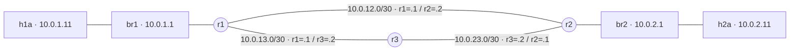
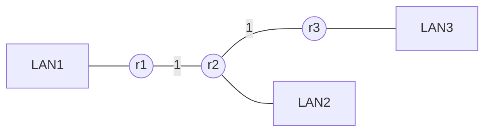
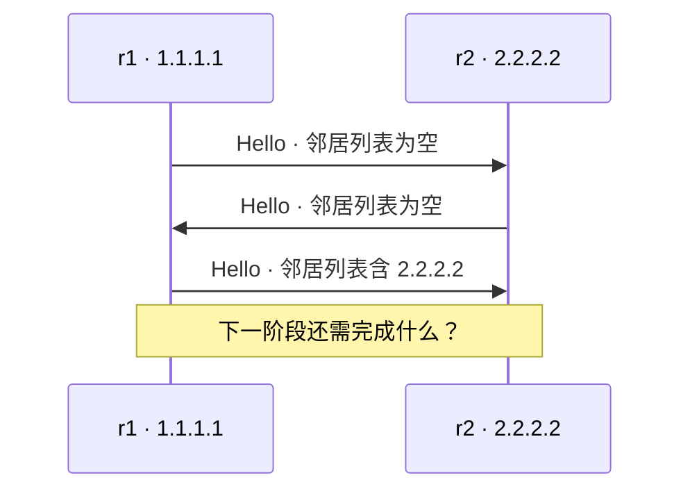
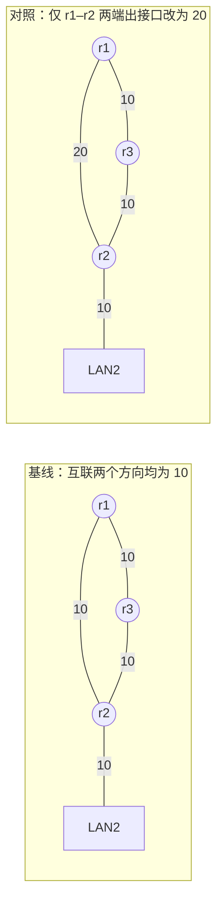
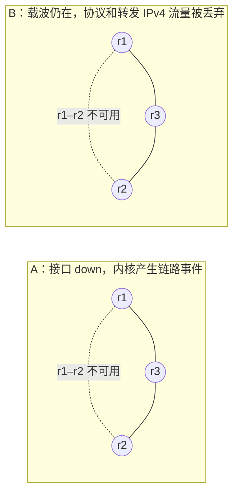
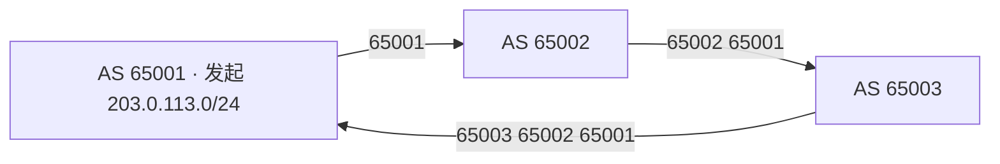

# 第 03 讲回顾：让网络自己找路

> **课程导读**：上一讲解决了“包怎样查表转发”，这一讲追问“表是谁算出来的，坏了多久能改好”。参照[第一讲](network_review.md)与[第二讲回顾](switching_routing_review.md)，用小图推演、协议抓包和 FRR 输出串起[动态路由协议讲义](routing_protocol.md)：**交换什么信息 → 怎样算出下一跳 → 怎样写进内核 → 怎样证明业务恢复**。

---

## 使用说明

- ● **记得吗**：回忆概念；●● **看得懂吗**：读图、读字段、算一步；●●● **说得清吗**：解释因果与证据边界。回答时指出支持判断的字段或图中具体一步。
- [参考答案](routing_protocol_review_answers.md)单独成文，36 个题号逐一对应。第十二节提供程序员视角的讨论，不要求唯一答案。
- **课堂路线（约 40 分钟）**：题 2、4、6（8 分钟）；题 11、15、19（10 分钟）；题 23、27、28（8 分钟）；题 35 小组诊断（8 分钟）；题 31 与判断题选讲、收束（6 分钟）。其他题供课后自查。
- **证据来源**：标为“原讲义实测节选”的数值来自第三讲模块六，其记录使用 FRR 8.4.4；本次未重新运行 Linux 实验，原记录未逐段给出内核版本与测量日期。简化表是从原输出提取的字段，图中推演与另设条件不是新增实测。
- 阅读无需搭环境。若复现，按原讲义 6.1–6.7 节准备 Linux 实验床，从仓库根目录执行；本文只补充读取状态的观察入口。故障与 cost 对照先恢复基线，抓包以 `Ctrl+C` 停止，最后按原讲义 6.12 节停止 FRR 并清理实验床。

**两张图不要混用。** 第二节的距离向量题沿用原讲义 2.2 节的“三机架链”；其余实验题采用模块六的“两机架三角形”，r3 只中转、没有 LAN3。



*图 1：课堂实验的物理连接简图。br1、br2 分别位于 r1、r2 内；省略同机架的 h1b、h2b。主机地址为 /24，三台路由器的 Router ID 分别为 1.1.1.1、2.2.2.2、3.3.3.3，全部在 Area 0；图中未选择业务路径。*

---

## 一、动态路由到底替我们做了什么

> 涉及原讲义：1.1–1.5、5.1 节。

1. ● 在“每个机架一个前缀、每台路由器为所有远端机架各写一条、没有汇总或默认路由”的模型里，40 个机架需要多少条静态路由？扩成 41 个机架时，全网增加多少条？为什么不能把这个公式当成所有网络的路由规模定律？
2. ●● 把“收到 Hello”“计算最短路”“把下一跳写进内核”“为 h1a 的一个 IP 包减 TTL 并转发”分别放进控制平面或数据平面。网络稳定时，控制平面是否就完全停止工作？
3. ● 完成比较：距离向量告诉邻居“____”；链路状态发布“____”；路径向量随前缀携带“____”。IGP 与 EGP 的分界是什么？动态路由是不是意味着地址、区域、邻居与策略都不需要配置？

---

## 二、只听邻居说距离，能算出路吗

> 涉及原讲义：2.1–2.5 节。以下为教学推演，采用直连 LAN 距离 1、路由器之间每跳加 1 的 RIP 约定。



*图 2：用于同步逐轮推演的三机架链；省略互联 /30 网段。每轮只使用上一轮邻居的向量，不在同一轮无限接力。这里 r3 有 LAN3，与图 1 的实验床不同。*

4. ●● 初始每台只知道本地 LAN。填出 r1 在第 0、1、2 轮到 LAN1、LAN2、LAN3 的距离和下一跳。为什么 r1 第二轮才知道 LAN3？这是否意味着真实 RIP 必须恰好 60 秒收敛？
5. ●● 写出 Bellman–Ford 更新式。另设 r1 到邻居 r2 的 cost 为 2，r2 宣告到 X 的距离为 5；r1 到 r3 的 cost 为 4，r3 宣告到 X 的距离为 1。r1 选哪个邻居、总距离多少？它需要知道 X 后面的完整路径吗？
6. ●●● 图 3 中 r1 已失去 LAN1，但先收到 r2 的旧通告。填写后续三次距离变化，并解释为什么 r2 不能只接受“比原来更好”的更新。TTL 能否修好这里的控制平面错误？

    ```mermaid
    %% routing-review:dv_loop
    flowchart LR
        L["LAN1 · 已断开"] -.- A["r1：LAN1=16"]
        B["r2：LAN1=2 via r1"] -->|"旧消息：我到 LAN1 是 2"| A
        A -.->|"采纳后将宣告多少？"| B
    ```

    *图 3：计数到无穷的教学时序；暂不启用水平分割、毒性逆转等防护。箭头表示路由通告，灰色断线表示 LAN1 已不可用，不是业务路径。*

7. ●● r2 的 LAN1 路由从 r1 学来。水平分割、毒性逆转分别会让 r2 向 r1 发送什么？触发更新改变的是消息内容还是发送时机？三者能否保证任意多节点环都不会出现？

---

## 三、抓到的 RIP 报文，真是“整张表”吗

> 涉及原讲义：2.3、2.5、6.11 节。现场回到图 1；这里只读原讲义切换到 RIP 后的结果。

原讲义 6.11 节实测节选；省略 IP 首部等字段：

```text
10.0.12.1.520 > 224.0.0.9.520:
    RIPv2, Response, length: 44, routes: 2 or less
      AFI IPv4, 10.0.1.0/24, tag 0x0000, metric: 1, next-hop: self
      AFI IPv4, 10.0.13.0/30, tag 0x0000, metric: 1, next-hop: self
```

8. ●● 目的地址和端口各说明什么？`metric: 1` 是发送者还是接收者到该网段的距离？接收者通过这条 cost 为 1 的链路学到后，距离应该是多少？44 字节包含 IP 与 UDP 首部吗？
9. ●● r1 的 RIP 表已有从 r2 学来的 `10.0.2.0/24`，为什么对 r2 的这份通告没有它？仅凭“没有出现”能不能认定该目的地不可达？
10. ●●● 另一份更新把若干目的网段标为 `metric: 16`。这一定是毒性逆转吗？怎样区分“故障后撤销路由”和“向学习来源明确宣告不可经我到达”？RIP 的 30、180、120 秒分别是什么定时器，触发更新是否承诺每跳毫秒级？

---

## 四、Hello 已经收到了，为什么还不是 Full

> 涉及原讲义：3.2、3.6、5.4、6.4–6.5 节。

原讲义 6.5 节抓包的语义节选，前三步如下：



*图 4：只展示握手中的三个 Hello，时间向下。第三条由 r1 发往 r2；两个方向的状态要分别判断，不能把一端的证据自动当成另一端的证据。*

11. ●● 前两步后，为什么可能只到 Init？第三条消息能让哪一端确认 2-Way？确认依据是 Hello 的源 IP，还是报文中的邻居列表？
12. ● 把 DBD、LS Request、LS Update、LS Ack 与“摘要、索要缺项、完整内容、确认收到”对应起来。为什么收到一个 Hello 不能直接宣称 LSDB 同步完成？
13. ●● 原输出为 `proto OSPF (89)`、目的 `224.0.0.5`、`ttl 1`，这应使用 `udp port 89` 还是 `proto ospf` 抓包？解释 `Full/-`、`passive-interface br1` 和点到点类型各表示什么；普通广播网中所有邻居都必须达到 Full 吗？
14. ●●● 在 r1 执行查询得到邻居 `2.2.2.2 Full/-`、`Dead Time 33.736s`、地址 `10.0.12.2`。Router ID 与接口 IP 是一回事吗？下一次有效 Hello 到达时倒计时如何变化？查询忘了 `vtysh -N r1` 中的 `-N r1` 会发生什么？

---

## 五、地图相同，为什么 Age 不同

> 涉及原讲义：3.3–3.4、3.6、6.6 节。

原讲义 6.6 节实测提取：两处都查看 **r1 发布的 Router-LSA**，不是各自发布的 LSA。

| 查看位置 | Link ID | ADV Router | Age | Seq# | CkSum | Link count |
| --- | --- | --- | --- | --- | --- | --- |
| r1 | 1.1.1.1 | 1.1.1.1 | 10 | 0x80000005 | 0x184b | 5 |
| r3 | 1.1.1.1 | 1.1.1.1 | 11 | 0x80000005 | 0x184b | 5 |

15. ●● 哪些字段支持“保存了同一版本”的判断？Age 不同为什么不构成反例？整个 AS 的所有区域是否必须有完全相同的 LSDB？
16. ●● r1 只有两位路由器邻居，为何 `Link count=5`？请分开数“点到点邻接”与“stub 网段”；`0x80000005` 能否单独证明发生过四次链路故障？
17. ●●● 设 r3 先从 r1 收到某条 LSA，又从 r2 收到同一版本。为什么不应再次扩散第二份？“同一条 LSA”用哪些字段识别？完整 OSPF 只比序列号就足够了吗？

    ```mermaid
    %% routing-review:flood_question
    flowchart LR
        A((r1)) -->|"LSA K · 版本 v"| B((r2))
        A -->|"LSA K · 版本 v · 先到"| C((r3))
        B -->|"LSA K · 版本 v · 后到"| C
    ```

    *图 5：同一 LSA 沿两条传播路径抵达 r3；箭头表示逐邻接发送的协议消息，省略确认。不是一个 TTL=1 的 IP 包穿过了 r2。K 表示 LSA 身份，v 表示本题已确认相同的版本。*

18. ●● 如果一次 LS Update 或其确认丢失，可靠泛洪如何继续？稳态下除了 Hello，是否永远不会再有 LSA 流量？LSDB 相同能否证明这一刻所有业务包都正常通过？

---

## 六、会算最短距离，还要会找第一跳

> 涉及原讲义：3.5、6.7、6.10 节。以下是按原实验 cost 的纸面计算，不是时延测量。



*图 6：相同布局下比较两组 cost。LAN2 是 10.0.2.0/24，末段为 r2 宣告的 stub cost 10；图中的对称链路是教学简写，OSPF 实际累加沿途出接口代价。省略主机、网桥和其他前缀。*

19. ●● 在基线中以 r1 为根，写出 Dijkstra 的“已确定集合”和候选距离的变化。分别算到 r2、r3、LAN2 的距离。为什么到 r2 的最短距离不等于到 LAN2 的距离？
20. ●● r1 到 `10.0.23.0/30` 有哪两个等价下一跳？请写真实的下一跳 IP 和 r1 出接口，不要只写“r2 与 r3”。为何该前缀有 ECMP，却不代表基线中到 LAN2 也有 ECMP？
21. ●● 在图 6 的对照中，计算 r1 到 LAN2 的两条路径总 cost。若**仅**把 r1 的 `r1-r2` 改为 20，而 r2 的反向接口保持 10，r1 的 ECMP 与 r2 回 LAN1 的 ECMP 会同时出现吗？
22. ●●● 三台路由器 LSDB 相同，为什么下一跳表仍不同？程序只返回每个顶点的最小距离够不够写入内核？还需要从图上保留哪些信息？

---

## 七、两个 20，真的是同一个意思吗

> 涉及原讲义：5.1–5.3、6.7、6.10 节。

原讲义实测节选：修改 cost 前的 RIB：

```text
O   10.0.1.0/24 [110/10] is directly connected, br1, weight 1, 00:00:21
C>* 10.0.1.0/24 is directly connected, br1, 00:00:21
O>* 10.0.2.0/24 [110/20] via 10.0.12.2, r1-r2, weight 1, 00:00:06
```

两端 cost 改为 20 后，同一前缀的 RIB 与内核输出分别为：

```text
O>* 10.0.2.0/24 [110/30] via 10.0.12.2, r1-r2, weight 1, 00:00:04
  *                      via 10.0.13.2, r1-r3, weight 1, 00:00:04
```

```text
10.0.2.0/24 proto ospf metric 20
        nexthop via 10.0.12.2 dev r1-r2 weight 1
        nexthop via 10.0.13.2 dev r1-r3 weight 1
```

23. ●● 解释 `O`、`C`、`>`、`*`、`[110/30]`。OSPF 也知道本地 LAN1，为什么写入 FIB 的却是 `C>*`？内核 `metric 20` 不随 cost 变成 30，是更新失败了吗？
24. ●● 把下图补成 FRR 到内核的工作链。谁运行 OSPF 算法，谁汇总协议候选，谁实际转发 h1a 的包？若原来的手工静态路由仍存在，为什么“OSPF 已经算对”仍可能看不到预期换路？

    ```mermaid
    %% routing-review:planes_question
    flowchart LR
        A["ospfd · 协议计算"] --> B["____ · 汇总与选优"] -->|"____ · 内核接口"| C["内核 FIB"] --> D["转发业务包"]
    ```

    *图 7：待补全的逻辑处理链；箭头表示路由状态的传递及其用途，不是业务包依次进入这些用户态进程。*

25. ●● 原实验哈希策略为 0，四组主机地址的 `ip route get` 恰好全选 r2。能否据此断言 ECMP 没生效？改成策略 1 后，不同源端口有何作用？等权是否保证六条连接恰好三条走一边？
26. ●●● `ip route get`、traceroute、真实业务抓包分别能证明哪一层？传统 UDP traceroute 改变探测端口时，为何同一跳会出现多个地址？能否把每一行的第一个地址机械拼成某条 TCP 连接的完整路径？

---

## 八、同一条备用路，为什么这次等了三十多秒

> 涉及原讲义：3.7、6.8–6.9 节。每个对照开始前均恢复基线；故障都针对 r1–r2。

| 条件 | A：接口 down | B：静默故障 |
| --- | --- | --- |
| 改变的因素 | r1 的 r1-r2 置 down，veth 对端失去载波 | 两端相应入接口的 INPUT、FORWARD 丢弃规则 |
| 互联接口载波 | 故障被内核感知 | 保持 UP、LOWER_UP |
| r1–r3–r2 备用路径 | 可用 | 可用 |
| 故障前互联 cost / Hello / Dead | 10 / 10 秒 / 40 秒 | 同左 |
| 原讲义采样 | 0.2 秒间隔，100 次 ping | 0.2 秒间隔，300 次 ping |



*图 8：两次独立对照保持相同节点布局；虚线表示故障链路仍在拓扑中但不能承担本次通信，实线是可用的备用连接，并非已经验证的业务轨迹。省略主机、LAN 与回程；INPUT 与 FORWARD 同时受影响，不能理解成只屏蔽 OSPF。*

27. ●● A 的原记录为 `100 transmitted, 100 received`，最大 RTT 为 1.461 ms；一秒后的表已经改为 `via 10.0.13.2`。能否因此精确断言“收敛用了 1.461 ms”，或“整个网络绝对没有业务中断”？更严谨的结论是什么？
28. ●● B 的记录为发送 300、收到 127，缺失序号 16–188；间隔 0.2 秒。估算这次探针观察到的中断量级。为何小于 40 秒仍符合 Dead=40？`no answer yet` 本身是否等于最终丢包？
29. ●●● 写出“检测 → 传播 → 计算 → 安装 → 业务恢复”的证据链，每段选一个观察点。如果只缩短 Hello/Dead，必然让所有网络故障都在 3 秒内恢复吗？应考虑哪些代价与前提？
30. ●● A 后 r1、r2 的 Router-LSA 从 `Seq#=0x80000005, Link count=5` 变为 `0x80000007, Link count=3`；r3 仍为 `0x80000004, Link count=4`。为什么 r3 自己的 LSA 没变，却仍须使用新 LSDB 重算？恢复接口后是否可以跳过邻接同步直接视为恢复完毕？

---

## 九、AS_PATH 更长，为什么反而选它

> 涉及原讲义：1.5、4.2–4.7 节。以下 ASN 与路径为教学设定，不对应现实运营商。



*图 9：eBGP 前缀通告的方向，边上的数字是 AS_PATH；普通配置、无改写或放宽防环的例外。箭头不表示业务流向，业务到该前缀的转发方向通常与通告传播方向相反。*

31. ●● 图 9 中 AS 65001 收到回传通告后怎样判断环路？某接收 AS 另有两条均合法、NEXT_HOP 均可达的候选：甲 `LOCAL_PREF=200, AS_PATH=65002 65003 65004`；乙 `LOCAL_PREF=100, AS_PATH=65005`。假定其他更早的本地优先条件相同，按本讲简化顺序选谁？
32. ●● BGP 使用哪种传输和端口？为什么可以在首次交换可通告路由后只发增量？TCP 可靠能否证明宣告的前缀归属真实，或保证任何策略组合都快速收敛？
33. ●●● 为什么不能把 OSPF 简单扩大成整个 Internet 共用的一张地图？数据中心内部使用 eBGP 与“BGP 用于 AS 之间”矛盾吗？采用 BGP 是否就能保证任何一次故障只影响直连邻居？

---

## 十、把“路由没通”拆成可检查的问题

> 涉及原讲义：模块五、6.5–6.10 节；衔接[第四讲](link_state_router.md)与 [Lab 2](../experiments/02/README.md)。本节为纸面综合任务，无需修改实验环境。

34. ●● 在原讲义 OSPF 实验床已启动的条件下，以下四个观察入口分别查什么？若要证明 h1a 的具体业务已经改走 r3，还缺哪种证据？

    ```bash
    # 1. 检查 r1 的 OSPF 邻接
    sudo vtysh -N r1 -c "show ip ospf neighbor"
    # 2. 检查 r1 保存的地图
    sudo vtysh -N r1 -c "show ip ospf database"
    # 3. 检查 FRR 选路与内核安装结果
    sudo vtysh -N r1 -c "show ip route"
    sudo ip -n r1 route show 10.0.2.0/24
    # 4. 按转发入接口查询 h1a 到 h2a 的本机选路
    sudo ip netns exec r1 ip route get 10.0.2.11 from 10.0.1.11 iif br1
    ```

35. ●●● **8 分钟小组诊断。** 输入为三个独立现场，目标是选出“下一条最有区分力的观察”，不是凭一行输出猜唯一原因。前 2 分钟标记证据，4 分钟填写表格，2 分钟汇报。每行交付“可下的结论／仍缺的证据／下一步与预期分支”，最后说明如何确认恢复。

    | 现场（教学设定） | 已知证据 | 不能直接断言什么？下一步看哪里？ |
    | --- | --- | --- |
    | 甲：断链后仍走旧下一跳 | r1 已收到反映断链的新 LSA；RIB 中新 OSPF 路由没有 `>*`；同前缀有 `K>*` | ____ |
    | 乙：接口 UP，却持续丢包 | r1 的 r2 邻居暂为 Full，Dead Time 持续下降；r3 邻居的倒计时正常重置 | ____ |
    | 丙：已有两个下一跳 | FIB 等权 ECMP；6 条等量短 TCP 连接中 5 条经 r2、1 条经 r3 | ____ |

    **固定条件**：沿用图 1、同一目的 LAN2；每个现场独立，不把甲的残留路由带入乙、丙。丙的连接路径由业务抓包确认，不只是 `route get`。**评价指标**：诊断是否由证据支持、后续观察是否能区分解释；不按命令数量评分。

---

## 十一、判断并改错

36. ●● 下列说法哪些成立？对错误说法给出必要条件或改写，不只写“对／错”。

    | 编号 | 说法 |
    | --- | --- |
    | A | 网络稳定后，控制平面不再发送任何报文。 |
    | B | RIP 只接受更小的 metric，才能避免坏消息污染路由表。 |
    | C | 水平分割与毒性逆转可以消除任意长度的路由环。 |
    | D | Hello 中看见自己的 Router ID，说明对方听到过自己；这尚不等于 LSDB 同步完成。 |
    | E | LSDB 的 Age 字段必须逐字相同，才算同步成功。 |
    | F | OSPF 跑在 UDP 89 上，LSA 和 LS Update 是同一层的同一个对象。 |
    | G | 内核 `proto ospf metric 20` 说明 OSPF 路径代价一定是 20。 |
    | H | 两条等权下一跳意味着每条 TCP 连接的包会交替走两边。 |
    | I | 100 次 ping 全收到，只能说明这组探针没有最终丢失，不能测出任意短的中断。 |
    | J | Dead=40 秒，所以故障发生后必须整整等 40 秒才失效。 |
    | K | BGP 总是选择 AS_PATH 最短的路径。 |
    | L | 在普通 eBGP 防环规则下，AS_PATH 含本 AS 的路由会被排除；这不验证前缀归属真实性。 |

---

## 十二、从程序员视角再想一步

### 1. “我有路”是一份需要过期的缓存

邻居说过一次“可达”，为什么不能永远保存？把距离、来源、版本、最近更新时间与失效处理映射到你写过的缓存或服务发现系统。

### 2. 双向握手在证明什么

收到对方消息只证明一个方向。Hello 列表让双方用什么证据确认另一个方向？哪些业务状态仍没有被证明？

### 3. 重试必须配合去重

LSA 可靠泛洪同时需要确认、重传与版本比较。若只做重传、不做去重会怎样？若只做去重、不做可靠补发又会怎样？

### 4. 算对了，不等于生效了

把“LSDB → SPF → RIB 选优 → FIB 安装 → 业务转发”当作一条状态处理链。你会在哪些边界记录输入、输出与失败，以便定位“地图正确但包仍不通”？

### 5. 超时是判断，不是事实本身

超时可能意味着邻居死了，也可能是消息丢失或处理不及时。更激进的定时器怎样交换“检测速度”与“误判、反复重算”？

### 6. 让计算看见网络，从区分指标开始

“两个下一跳”“两条连接分走两路”“总吞吐提高”“作业更早结束”是四件不同的事。设计下一讲或 Lab 的观察时，怎样逐层验证？

本讲回顾到“能解释协议与输出”为止；第四讲再拆解事件循环、报文与内核接口，Lab 2 按 **LSR-lite v1** 规则实现简化协议。不要把完整 OSPF 的报文、定时器或状态机逐字套进 Lab 2，也不要把 FRR 的样例数字当作所有实现的验收常数。
