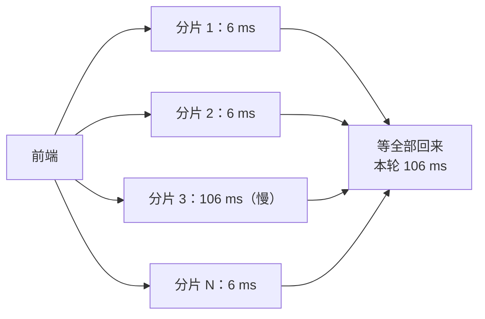
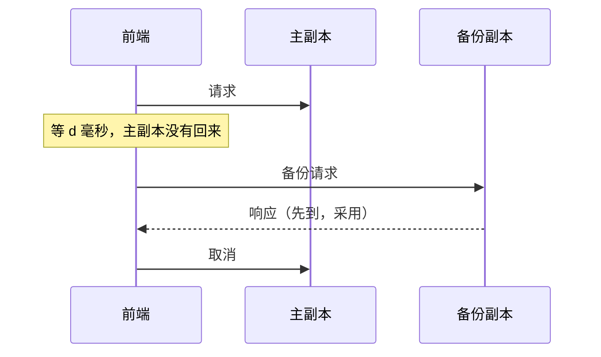
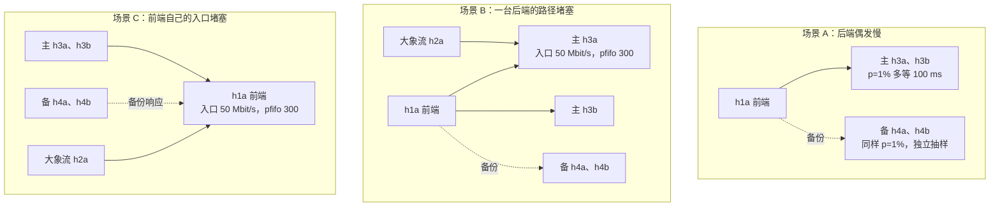

# 第 07 讲 从拥塞控制到长尾延迟：最慢的一个决定整体

> **课程导读**：第 06 讲留下一个现象：同一条路径、同样的吞吐，换一种队列，往返时间可以差几百倍。本讲先回答它：TCP 为什么会把队列填满，有哪些算法不这样做。接着把目光移到作业上：一个前端要等 100 个后端都回话，只要每个后端有 1% 的请求变慢，就有约 63% 的前端请求变慢。**平均值很好看，用户等的却是最慢的那一个。** 学完后，你应能算出尾部如何随扇出放大，读懂慢在哪里的证据，并判断对冲请求救得了哪一种慢、救不了哪一种。

---

## 学习目标

1. 用拥塞窗口和带宽时延积解释队列为什么被填满；说出 CUBIC、BBR、DCTCP 各靠什么信号判断拥塞，并能从 `ss`、`tc` 的读数验证。
2. 解释 incast 的成因，从丢包、重传和超时计数器判断它是否发生；说出 pacing、`SO_TXTIME` 与 ETF、报文时间戳分别解决什么问题。
3. 区分单请求延迟与轮次延迟，用 $1-(1-p)^N$ 预测尾部如何随扇出放大，并算出某个分位数跳变的位置。
4. 列举长尾的常见成因及其观察方法；能从计数器区分“服务慢”与“网络慢”，并说明一次丢包为什么会变成约 200 ms。
5. 解释对冲请求的机制、代价与前提；综合按后端分组的延迟、备份胜出比例与队列积压，判断慢的类型并选择措施。

| 时间 | 内容 | 课堂产出 |
| --- | --- | --- |
| 0–26 分钟 | 模块一：拥塞控制：谁把队列填满了 | 亲手测出三种算法的 `ss` 与队列读数；复现 incast 并读懂计数器 |
| 26–33 分钟 | 模块二：发送节奏与报文时间戳 | 从 `ss` 算出 `pacing_rate`；知道时间戳打在哪一层 |
| 33–52 分钟 | 模块三：长尾延迟：放大与成因 | 算出分位数跳变点并实测；用计数器解释 200 ms |
| 52–59 分钟 | 模块四：缓解手段与对冲请求 | 估算对冲的效果与额外负载 |
| 59–87 分钟 | 模块五：综合动手——对冲救得了哪一种慢 | 预测表、三场景对照、诊断表 |
| 87–90 分钟 | 模块六：离堂检查与课后衔接 | 提交三道短题 |

**课前准备（不计入上述 90 分钟）**：学生自行准备 Ubuntu Linux，工具与第 06 讲相同（`iproute2`、`iputils-ping`、`iperf3`、Python 3 与 `uv`）。不同小组各用独立主机或虚拟机，同一台机器由一人操作。本讲的脚本以压缩包分发，解压后得到 `lecture07_prep` 目录，完整实验床就是其中的 `lab4_topo.sh`，Lab 3 没有做完也不影响；Lab 4 改为选做，本讲不依赖它。本讲标为“实测样例”的输出来自 2026-11-07 的备课虚拟机（Ubuntu 26.04.1、Linux `7.0.0-43-generic`、x86_64、2 核 2.8 GB），单次读数以自己的测量为准。

```bash
# 1. 进入本讲目录（lecture07_prep 压缩包解压后的目录，路径换成你自己的）；本讲所有命令都在这里执行
cd ~/lecture07_prep

# 2. 清理第 05 讲课堂网络与 Lab 3 网络（节点重名，不能同时存在）
sudo bash lab3_classroom.sh down
sudo bash lab3_topo.sh down

# 3. 准备路由守护进程的 Python 环境
uv sync --frozen

# 4. 搭建完整实验床（默认加载 Lab 2 参考路由），并自检
sudo bash lab4_topo.sh up
sudo bash lab4_topo.sh check

# 5. 在 7 台 host 上启动后端，做一次往返验证
sudo bash lab5_tail.sh up
sudo bash lab5_tail.sh check

# 6. 载入模块一要用的算法与队列模块（只需一次，不报错即可）
sudo modprobe -a tcp_bbr tcp_dctcp sch_red
```

准备完成应出现 `[OK] 8 条上联往返、8 台 host 网关可达、跨机架往返。` 与 `[OK] 7 个后端都完成了 20 轮往返。`。本讲用到的脚本、Lab 2 参考路由和 Python 环境配置都在 `lecture07_prep` 目录里，它们是 Lab 2–5 中相应文件的副本，脚本按自己所在的目录找其他文件，**以下所有命令都在这个目录里执行**（新开终端时先 `cd` 进去）。Lab 5 在它自己的目录里完成，这里的 `tailkit/` 不用改。`lab5_tail.sh` 负责启停后端、设置队列和大象流；`tailbench.py`、`compare.py`、`bulk.py` 都只用 Python 标准库，直接用系统 `python3` 运行。第 6 步报找不到模块时，课前安装 `linux-modules-extra-$(uname -r)` 后重试；实在装不上也不影响后面的内容，1.3 节跳过 DCTCP 那一组即可。**中途不要拆拓扑；提前结束或中断时，执行 5.7 节的清理命令。**

---

## 模块一：拥塞控制：谁把队列填满了

### 1.1 拥塞窗口决定路上有多少数据

第 01 讲说过，发送方同时受两个窗口约束：对方的接收窗口（保护接收方）和自己的**拥塞窗口**（Congestion Window，cwnd，保护网络）。发送方最多让 cwnd 个报文段处于“已发出、未确认”的状态。这些报文只能待在两个地方：**链路上**，或者**瓶颈前的队列里**。

链路能容纳的数据量叫**带宽时延积**（Bandwidth-Delay Product，BDP）：

$$\mathrm{BDP}=\text{瓶颈带宽}\times\text{没有排队时的往返时间}$$


*图示说明：cwnd 超过 BDP 的部分只能排队。图中省略确认报文的回程，也省略瓶颈之外的其他链路。*

算一下本实验床：瓶颈 50 Mbit/s，空载往返约 0.1 ms，$\mathrm{BDP}=50\times10^6\times0.1\times10^{-3}/8=625$ 字节，还不到 1 个报文。也就是说，**这张实验床上 cwnd 几乎全部变成了排队**。

慢启动和拥塞避免的细节这里不展开。只需记住一条：发送方不知道瓶颈有多宽，只能边试边调，所以关键在于**它靠什么信号判断“够了”**。

### 1.2 三种算法，三种信号

| | CUBIC | BBR | DCTCP |
| --- | --- | --- | --- |
| 拥塞信号 | 丢包 | 测得的瓶颈带宽与最小往返时间 | 交换机打的 ECN 标记的比例 |
| 怎样调整 | 窗口按三次函数增长；丢包后乘 0.7（[RFC 9438 §4.6](https://www.rfc-editor.org/rfc/rfc9438#section-4.6)） | 按估计的带宽控制发送节奏，窗口取 BDP 的若干倍（[BBR 论文](https://queue.acm.org/detail.cfm?id=3022184)） | $\mathrm{cwnd}\leftarrow\mathrm{cwnd}\times(1-\alpha/2)$，$\alpha$ 是被标记字节比例的滑动平均（[RFC 8257 §3.3](https://www.rfc-editor.org/rfc/rfc8257#section-3.3)） |
| 对队列的预期 | 一直涨到丢包，所以要填满 | 不靠丢包，队列较浅 | 稳定在标记门限附近 |
| 依赖条件 | 两端即可 | 发送端即可 | 交换机标记 ECN，两端都支持；适合数据中心内部（[RFC 3168](https://www.rfc-editor.org/rfc/rfc3168) 定义 ECN） |

### 1.3 动手实践：同样的吞吐，队列差几十倍

本节每人动手，约 9 分钟：写预测 1 分钟，运行约 1 分钟，其余时间读数据。

**问题与预测**：h1b 向 h3a 发一条 15 秒的大流，瓶颈是 r3→h3a 的 50 Mbit/s。同时 h1a 持续 `ping` h3a，它和大流只在这个瓶颈共用队列。**运行前先写下你的预测**：三种算法的吞吐和 `ping` 的往返时间分别是多少？哪一种会把队列填满？

**工具与观察点**：`bulk.py` 发定时大流，两端都用套接字选项指定算法；`ss -tin` 在 h1b 读发送端状态；`tc -s qdisc` 在 r3 读队列。下面把一次运行写成函数 `run_cc`，算法由参数决定，后面只换参数，不用手工改命令。

```bash
# 1. 瓶颈设为 50 Mbit/s + 单队列 pfifo，上限 1000 个报文
sudo bash lab5_tail.sh queue r3 r3-h3a 50 1000

# 2. 定义一次运行：先起接收端和 ping（每 0.1 秒一个，共 17 秒），1 秒后 h1b 发 15 秒大流；
#    第 12 秒读发送端状态与队列；结束后只统计负载稳定后的 ping（seq 40–150，窗口在运行前定好）
run_cc() {
  local cc=$1
  sudo ip netns exec h3a python3 bulk.py server --port 5301 --cc "$cc" &
  sudo ip netns exec h1a ping -c 170 -i 0.1 10.0.3.11 > "/tmp/ping-$cc.txt" &
  sleep 1
  sudo ip netns exec h1b python3 bulk.py client --destination 10.0.3.11 --port 5301 --cc "$cc" --seconds 15 &
  sleep 12
  sudo ip netns exec h1b ss -tin dst 10.0.3.11
  sudo bash lab5_tail.sh backlog r3 r3-h3a
  wait
  grep -E 'icmp_seq=([4-9][0-9]|1[0-4][0-9]|150) ' "/tmp/ping-$cc.txt" | python3 stats.py
}

# 3. CUBIC 和 BBR 用同一个队列，各约 18 秒
run_cc cubic
run_cc bbr

# 4. DCTCP 先换队列：RED 的 ecn 模式让队列超过约 30 KB（约 20 个报文）时打标记，而不是丢包
sudo ip netns exec r3 tc qdisc del dev r3-h3a parent 1:10
sudo ip netns exec r3 tc qdisc add dev r3-h3a parent 1:10 handle 10: red limit 1000000 min 30000 max 31000 avpkt 1514 burst 21 bandwidth 50mbit probability 1 ecn
run_cc dctcp

# 5. 恢复基线
sudo bash lab5_tail.sh clear
```

**实测样例**（`ss` 省略了窗口缩放、字节计数等字段，`tc` 省略了首行；`Sent` 是队列创建以来的累计值，BBR 那一行包含 CUBIC 留下的 50 个丢包；为便于对照，每组输出前加了算法标题）：

```output
[CUBIC + pfifo]
cubic rto:431 rtt:230.088/0.36 mss:1448 cwnd:955 ssthresh:735 send 48080387bps pacing_rate 57696336bps delivery_rate 47821888bps retrans:0/50
Sent 74700188 bytes 49466 pkt (dropped 50, overlimits 0 requeues 0)
backlog 1440010b 953p requeues 0
[cubic] 接收端收到 92274688 B，用时 15.46 s，应用层 47.7 Mbit/s
样本   n=110 min=148.000 p10=179.000 p50=227.000 p90=236.000 max=242.000 mean=216.218 sd=22.506

[BBR + pfifo]
bbr rto:204 rtt:3.603/0.623 mss:1448 cwnd:24 ssthresh:138 bbr:(bw:48867320bps,mrtt:0.057,pacing_gain:1,cwnd_gain:2) send 77162365bps pacing_rate 48378640bps delivery_rate 47417104bps
Sent 171037730 bytes 113267 pkt (dropped 58, overlimits 0 requeues 0)
backlog 25738b 17p requeues 0
[bbr] 接收端收到 90636288 B，用时 15.19 s，应用层 47.7 Mbit/s
样本   n=111 min=0.230 p10=2.850 p50=3.530 p90=4.520 max=5.130 mean=3.531 sd=0.745

[DCTCP + RED ecn]
dctcp rto:206 rtt:5.172/0.263 mss:1448 cwnd:24 ssthresh:24 dctcp:(ce_state:0,alpha:156,ab_ecn:0,ab_tot:11584) send 53754060bps pacing_rate 64504872bps delivery_rate 44015192bps delivered:49238 delivered_ce:7418
Sent 74828400 bytes 49516 pkt (dropped 33, overlimits 7463 requeues 0)
backlog 31794b 21p requeues 0
marked 7430 early 33 pdrop 0 other 0
[dctcp] 接收端收到 90046464 B，用时 15.07 s，应用层 47.8 Mbit/s
样本   n=76 min=3.780 p10=4.110 p50=4.770 p90=5.220 max=5.450 mean=4.744 sd=0.383
```

**一起读数据**：先用自己的输出填出下表，再和样例对照，看预测哪里错了。你的数字以自己的测量为准。

| 算法与队列 | 应用层吞吐 | 大流 `rtt` | `cwnd` | 队列积压 | `ping` p50 | 收到 `ping` |
| --- | --- | --- | --- | --- | --- | --- |
| CUBIC + pfifo 1000 | 47.7 Mbit/s | 230 ms | 955 | 953 个报文 | 227 ms | 110/111 |
| BBR + pfifo 1000 | 47.7 Mbit/s | 3.6 ms | 24 | 17 个报文 | 3.53 ms | 111/111 |
| DCTCP + RED ecn | 47.8 Mbit/s | 5.2 ms | 24 | 21 个报文 | 4.77 ms | 76/111 |

1. **吞吐一样**：三者都贴近帧级上界 $50\times1448/1514\approx47.8$ Mbit/s。CUBIC 多排的队列没有换来任何吞吐。
2. **CUBIC 为什么填满队列**：`cwnd` 955，队列 953，二者几乎相等，正如 1.1 节所算。953 个报文要排 $953\times1514\times8/(50\times10^6)\approx231$ ms，对上了 `rtt` 230 ms。丢包是它唯一的信号，队列不满就不丢包，所以它只能一直涨到队列上限。`dropped 50` 与 `retrans:0/50` 一一对应。`ssthresh` 735 约等于 $1050\times0.7$，正是在队列上限附近丢包后乘 0.7 的结果。这就回答了第 06 讲 4.5 节留下的问题。
3. **BBR**：`bw` 48.9 Mbit/s 接近瓶颈，`mrtt` 0.057 ms 接近空载。17 个报文约等于 4.1 ms 的排队，与 `rtt` 3.6 ms 同一量级。队列没有被填满，它的丢包是 $58-50=8$ 个。`cwnd` 24 仍大于 $2\times\mathrm{BDP}$，实现里还有其他余量，本讲不展开。
4. **DCTCP**：21 个报文约 5.1 ms，对上 `rtt` 5.2 ms，也贴近约 20 个报文的标记门限。`alpha` 156 的刻度是 1024，$156/1024=15.2\%$，与 `delivered_ce`／`delivered` $=7418/49238=15.1\%$ 对得上。每次窗口只减 $\alpha/2\approx7.6\%$，而不是 CUBIC 的 30%，所以队列能稳在门限附近。

**边界与异常**：

- CUBIC 的 `cwnd` 是锯齿，第 12 秒读到的只是其中一点。2026-11-08 重跑时读到 `cwnd` 769、队列 769 个报文、`ping` p50 199 ms，和样例的 955、953、227 ms 不同，但 `cwnd` 与队列几乎相等、吞吐不变这两点没有变。你的数字不必和样例一致，看这些关系成不成立。
- DCTCP 的低延迟有代价：`ping` 只收到 76/111。`ping` 不声明 ECN 能力，RED 在 ecn 模式下对这类报文[只能丢弃](https://man7.org/linux/man-pages/man8/tc-red.8.html)，`early 33` 记录的就是这些丢弃。实际部署要给非 ECN 流量另安排队列。
- BBR 的读数不总这么平稳。备课时另一次运行的第 8 秒，`bw` 被估成 137 Mbit/s，队列涨到 68 个报文。这也是为什么要看分位数和多次采样。
- 这里只有一条流、一个瓶颈、0.1 ms 的往返时间。不同算法竞争同一队列时谁占便宜，这组数据回答不了。
- **第 06 讲 4.5 节的数据来自 CUBIC。** 备课时用该节的命令显式对照：CUBIC 得到 `cwnd` 520、`ping` p50 121 ms，与原文（521、121 ms）一致；BBR 的 `ping` p50 只有 3.61 ms。如果你复跑那一节看不到队列，先查 `sysctl net.ipv4.tcp_congestion_control`。

### 1.4 两条流为什么大致平分

第 06 讲 3.4 节看到，两条流共享 100 Mbit/s 时各得一半。这里有两个独立的机制：

- **加性增、乘性减**（AIMD）：两条流同时涨相同的量、丢包时按比例减，窗口大的减得多，反复几轮差距就缩小。
- **fq 按流调度**：实验床的基线队列按流轮流发送，直接把容量平分。

本讲没有单独做实验区分二者。第 06 讲那组数据同时有 CUBIC 和 fq，所以不能把平分全部归功于其中一个。

### 1.5 动手实践：incast，多个发送端同时回话

本节每人动手，约 6 分钟，两次运行合计约 40 秒。

**incast** 指多个发送端几乎同时向一个接收端发数据，接收端的入口队列在瞬间被冲垮。它不是罕见故障，而是扇出请求的日常：前端向 N 个后端要数据，N 个响应几乎同时回来。

**问题与预测**：前端 h1a 向 20 个分片各要 64 KB，同一轮的总量是 1.28 MB。入口 r1→h1a 为 100 Mbit/s。**运行前先写下你的预测**：队列上限从 1000 个报文改成 30 个，一轮要多久？重传和超时计数器会怎样变？

```bash
# 1. 深队列：100 Mbit/s + pfifo 1000；运行前后各读一次累计计数器，相减即增量
sudo bash lab5_tail.sh queue r1 r1-h1a 100 1000
sudo bash lab5_tail.sh tcpstat
sudo ip netns exec h1a python3 tailbench.py --fanout 20 --base-ms 1 --resp-bytes 64000 --rounds 100 --label incast-deep | sed -n 1,2p
sudo bash lab5_tail.sh tcpstat

# 2. 只改队列上限：30 个报文
sudo bash lab5_tail.sh queue r1 r1-h1a 100 30
sudo bash lab5_tail.sh tcpstat
sudo ip netns exec h1a python3 tailbench.py --fanout 20 --base-ms 1 --resp-bytes 64000 --rounds 100 --label incast-shallow | sed -n 1,2p
sudo bash lab5_tail.sh tcpstat
sudo bash lab5_tail.sh backlog r1 r1-h1a

# 3. 恢复基线
sudo bash lab5_tail.sh clear
```

`tcpstat` 汇总 8 台 host 的 `nstat` 累计值：`TcpRetransSegs`（重传段）、`TcpExtTCPTimeouts`（超时）、`TcpExtTCPLossProbes`（尾部丢失探测，3.6 节解释）。

**实测样例**（省略了脚本的 `[*]` 提示行；计数器是累计值，第一行之前已跑过 1.3 节）：

```output
重传段 58，超时 0，尾部丢失探测 0
[incast-deep] N=20 轮数=100 p=0 对冲=off cc=cubic
  轮次延迟 ms   n=100 p50=109.4 p90=109.8 p99=110.7 max=111.6 mean=109.4
重传段 79，超时 0，尾部丢失探测 39
重传段 79，超时 0，尾部丢失探测 39
[incast-shallow] N=20 轮数=100 p=0 对冲=off cc=cubic
  轮次延迟 ms   n=100 p50=290.2 p90=318.7 p99=366.4 max=368.1 mean=284.7
重传段 8954，超时 320，尾部丢失探测 553
qdisc pfifo 10: parent 1:10 limit 30p
 Sent 140675713 bytes 94560 pkt (dropped 8875, overlimits 0 requeues 0) 
 backlog 0b 0p requeues 0
```

**一起读数据**：用你自己的计数器做一遍减法，再和下面对照。

1. **深队列符合预期**：1.28 MB 折算成帧约 1.34 MB，在 100 Mbit/s 上需要 107 ms，加 1 ms 服务时间约 108 ms，实测 p50 109.4 ms。
2. **浅队列变慢 2.7 倍**：同样的数据，p50 变成 290 ms。折算成有效速率，$1.28\times10^6\times8/0.290\approx35$ Mbit/s，而深队列约 94 Mbit/s。这叫**吞吐塌陷**（Throughput Collapse）：链路并不忙，大部分时间在等定时器。
3. **证据对得上**：100 轮里队列丢了 8875 个报文，重传段正好增加 $8954-79=8875$。超时增加 320 次，探测增加 514 次。
4. **为什么这么贵**：一个连接的整个窗口都丢了，就没有后续报文触发重复确认，只能等定时器，而定时器的下限约 200 ms（3.6 节）。这张网的往返时间约 0.1 ms，差了约 2000 倍。一轮要等全部分片，只要有一个分片在等定时器，这一轮就慢了。

**边界**：这里只比了 N=20 一个点。N 变大后怎样变化、限制同时在途的请求数或换算法有没有用，是 Lab 5 挑战任务的内容。

---

## 模块二：发送节奏与报文时间戳

本模块只讲知识，不动手。

### 2.1 pacing：把突发摊开

窗口只规定“最多发多少”，没规定“多快发出去”。如果一次把一整窗的报文贴着线速发完，平均速率不高，瞬时却能冲垮浅队列。**pacing** 就是把报文在时间上均匀摊开。

读 1.3 节的 `ss` 输出就能看到内核算出的节奏。CUBIC 那一行，把数值代入 $\mathrm{cwnd}\times\mathrm{mss}\times8/\mathrm{rtt}$：

$$\frac{955\times1448\times8}{0.230088\,\mathrm{s}}\approx48.08\ \mathrm{Mbit/s}$$

这就是 `send 48080387bps`。再乘 1.2 得到 57.70 Mbit/s，正是 `pacing_rate 57696336bps`。系数来自 `sysctl net.ipv4.tcp_pacing_ca_ratio`，本机为 120，慢启动阶段用 `tcp_pacing_ss_ratio`，本机为 200。BBR 反过来，直接用估计的带宽定节奏：$48867320\times0.99\approx48378647$，对上 `pacing_rate 48378640bps`。

谁来执行这个节奏？[`fq`](https://man7.org/linux/man-pages/man8/tc-fq.8.html) 队列的设计目标之一就是按流 pacing，实验床的 host 出口用的正是它。应用也可以用 `SO_MAX_PACING_RATE` 给连接设上限。pacing 摊开的是单条流，N 条流同时开始时仍然可能撞在一起，所以它不等于解决了 incast。

### 2.2 定时发送：SO_TXTIME 与 ETF

pacing 由内核决定节奏。有些场景要应用自己决定“这个报文几点几分离开”，比如工业控制和时间敏感网络。

- [`SO_TXTIME`](https://man7.org/linux/man-pages/man8/tc-etf.8.html)：应用通过这个套接字选项，给每个报文附上期望的发送时刻；
- **ETF**（Earliest TxTime First）队列：按这个时刻排序，到点才放行；支持时可以卸载给网卡硬件，时间更准。

**本讲没有验证它的效果**。备课沙箱只确认过 `etf` 可以安装（见 [`environment/lima.md`](../environment/lima.md)），发送时间能准到多少、在 veth 上是否有意义，都没有测。

### 2.3 时间戳打在哪一层，决定你能看清什么

第 06 讲的 `owd.py` 用应用层的时钟读数计算单向延迟。这个数里混着进程调度的时间。Linux 可以在更靠近网卡的地方打时间戳（[`SO_TIMESTAMPING`](https://docs.kernel.org/networking/timestamping.html)）：

| 打在哪里 | 怎样获得 | 包含的时间 |
| --- | --- | --- |
| 应用层 | `time.monotonic()` | 进程调度、协议栈、排队、链路全部混在一起 |
| 内核软件 | `SO_TIMESTAMPING` 软件时间戳 | 不含进程被调度的等待，但仍含部分内核路径 |
| 网卡硬件 | `SO_TIMESTAMPING` 硬件时间戳 | 最接近报文真正上线的时刻，需要网卡支持 |

```bash
# 查看接口支持哪些时间戳（需要 ethtool）
sudo ip netns exec h1a ethtool -T eth0
```

**实测样例**：

```output
Time stamping parameters for eth0:
Capabilities:
	software-transmit
	software-receive
	software-system-clock
PTP Hardware Clock: none
Hardware Transmit Timestamp Modes: none
Hardware Receive Filter Modes: none
```

veth 是纯软件设备，所以只有软件时间戳，也没有硬件时钟（PTP Hardware Clock）。**本实验床测不了硬件时间戳**。

**时钟同步**：跨机器比较时间，还要先对齐时钟。常用的有 [NTP（RFC 5905）](https://www.rfc-editor.org/rfc/rfc5905) 和 PTP（IEEE 1588）。按一般经验，局域网里的 NTP 在亚毫秒到毫秒量级，用硬件时间戳的 PTP 可以到亚微秒量级，实际取决于网络与硬件（这是经验量级，不是本课实测）。这回答了第 06 讲的遗留问题：`owd.py` 能直接相减，只因为所有 namespace 共用一个内核时钟；换成两台真机，同步误差会直接进入结果。

排查长尾时，这张表决定你能把一次慢请求拆到多细。

---

## 模块三：长尾延迟：放大与成因

### 3.1 为什么要看尾部

分布式服务里，一个用户请求常常要拆给很多后端，再把结果合起来，这叫**扇出**（Fan-out）。搜索查询、分片读取、第 08 讲的参数同步都是这个形状。关键是：**要等所有后端都回来**。



*图示说明：箭头表示请求与结果的逻辑关系，不是物理链路。一轮的耗时由最慢的分片决定；其余分片再快也没有用。图中数字是教学示意。*

所以要分清两个量：

- **单请求延迟**：前端发出一个请求到它返回；
- **轮次延迟**：前端发出一轮 N 个请求到全部返回，也就是用户感受到的那个数。

### 3.2 放大规律

设每个请求以概率 $p$ 独立地变慢。一轮有 $N$ 个请求，全都不慢的概率是 $(1-p)^N$，所以一轮变慢的概率是：

$$P(\text{一轮变慢})=1-(1-p)^N$$

| $N$（$p=1\%$，理论值） | 1 | 10 | 20 | 100 |
| --- | --- | --- | --- | --- |
| 一轮变慢的概率 | 1.0% | 9.6% | 18.2% | 63.4% |

现在倒过来问：**轮次延迟的第 $q$ 分位数什么时候跳进慢的一档？** 慢轮比例一旦超过 $1-q$，它就跳过去了。以 p90 为例，要求慢轮超过 10%：

$$(1-0.01)^{10}\approx0.904\ \Rightarrow\ 9.6\%\ \text{（还没超过）}$$

$$(1-0.01)^{11}\approx0.895\ \Rightarrow\ 10.5\%\ \text{（超过了）}$$

所以 p90 的跳变点是 $N=11$。同样算出 p50 是 $N=69$，p99 是 $N=2$。**后端的 p99，在扇出到几十上百时，就成了前端的 p50。**

### 3.3 测量工具做了什么

`tailbench.py` 在 h1a 里运行，是一个真实的 TCP 客户端：

- 每个分片一条长连接，分片轮流落在 `--primaries` 指定的主机上，默认是另外 7 台 host；
- 一轮同时向 N 个分片发请求，全部回来才算结束；下一轮紧接着开始；
- 后端 `backend.py` 先等 `--base-ms`（默认 5 ms），再以 `--slow-prob` 的概率多等 `--slow-ms`（默认 100 ms），每次独立抽样；
- 前 5 轮是预热，不计入统计；
- 分位数用最近秩法，与第 06 讲相同；连接显式使用 `--cc`，默认 `cubic`；
- 完整样本写入 `/tmp/lab05-results/<label>.json`，`compare.py` 只读这些文件排成表。同名标签会被覆盖，要留存的结果先复制。

这里的慢响应是**注入的**，用来模拟垃圾回收、磁盘抖动一类的服务端偶发变慢。网络造成的慢，下面用 `tc` 真实制造。

### 3.4 短观察：尾部怎样随扇出放大

**问题与预测**：$p=1\%$、慢响应多等 100 ms。按 3.2 节，N=10 时 p90 应该还在快的一档，N=20 时跳到慢的一档；p50 要到 N=100 才跳。对照组 $p=0$ 时，N 变大会不会变慢？

```bash
# 1. 每个 N 跑两组：p=0 是噪声底，p=1% 是实验组；每组 300 轮，共约 1 分钟
for n in 1 10 20 100; do
  sudo ip netns exec h1a python3 tailbench.py --fanout "$n" --rounds 300 --slow-prob 0 --label base-n"$n" > /dev/null
  sudo ip netns exec h1a python3 tailbench.py --fanout "$n" --rounds 300 --slow-prob 0.01 --label amp-n"$n" > /dev/null
done

# 2. 排成一张表；慢轮 = 轮次延迟超过 50 ms 的比例
python3 compare.py base-n1 base-n10 base-n20 base-n100 amp-n1 amp-n10 amp-n20 amp-n100
```

**实测样例**（后两列在模块五才用到）：

```output
标签               N     轮p50     轮p90     轮p99      慢轮      备份/请求     备份先回
base-n1          1      5.9      6.2      6.8    0.0%       0.0%        0
base-n10        10      7.4      8.7     10.0    0.0%       0.0%        0
base-n20        20      8.4      9.9     11.6    0.0%       0.0%        0
base-n100      100     16.9     20.0     25.9    0.0%       0.0%        0
amp-n1           1      6.0      6.4    106.1    1.3%       0.0%        0
amp-n10         10      8.0     15.4    108.6    9.7%       0.0%        0
amp-n20         20      9.7    108.2    111.6   19.3%       0.0%        0
amp-n100       100    111.0    118.2    122.9   63.3%       0.0%        0
```

**一起读数据**：

| $N$ | 1 | 10 | 20 | 100 |
| --- | --- | --- | --- | --- |
| 理论慢轮比例 | 1.0% | 9.6% | 18.2% | 63.4% |
| 实测慢轮比例（300 轮） | 1.3% | 9.7% | 19.3% | 63.3% |

1. **比例对上了**：理论和实测相差不超过 1.1 个百分点。300 轮的样本有抽样波动，不要期待完全相等。
2. **跳变对上了**：p90 从 N=10 的 15.4 ms 跳到 N=20 的 108.2 ms；p50 从 N=20 的 9.7 ms 跳到 N=100 的 111.0 ms。同样的后端，只是扇出变大，**用户的典型体验从 8 ms 变成 111 ms**。
3. **N=1 的 p99 在边界上**：理论慢轮恰好 1%，本次 1.3% 超过了，所以 p99 落在 106 ms。你的结果可能落在 7 ms，这不代表测错了，看“慢轮”一列。
4. **噪声底也在涨**：$p=0$ 时，N=1 的 p50 是 5.9 ms，N=100 是 16.9 ms。没有注入任何慢，一轮还是要等 N 个请求里最慢的那个，再加上 2 核机器上 Python 处理这些请求的开销。**这个增量不全是网络造成的**，本实验没有把它进一步拆开。

**边界**：这里各请求是否变慢是人为独立抽样的。真实系统里的慢常常相关（一台机器慢了，落在它上面的请求一起慢），放大公式就不能直接用，这正是模块五要看的。

### 3.5 长尾从哪里来

| 成因 | 机制 | 怎样观察 | 本课哪里看到 |
| --- | --- | --- | --- |
| 服务端偶发变慢 | 垃圾回收、磁盘抖动、后台任务、锁 | 按后端分组看延迟；服务端日志 | 3.4 节（注入） |
| 扇出放大 | 等最慢的一个 | 单请求与轮次延迟对照 | 3.4 节 |
| 网络排队 | 大流填满共享队列 | `tc -s qdisc` 的积压；`ss` 的 `rtt` | 1.3 节、模块五 |
| 丢包后等定时器 | 约 200 ms 的恢复下限 | `nstat` 的重传与探测计数 | 3.6 节 |
| incast | 响应同时到达冲垮队列 | 丢包、重传、超时一起涨 | 1.5 节 |
| CPU 与调度 | 进程等不到 CPU | 对照 $p=0$ 的噪声底；`iperf3` 的 CPU 字段 | 3.4 节、第 06 讲 5.4 节 |

这张表的用途是**排查时不漏项**，不代表一个系统里每项都同样严重，比例要靠测量。

### 3.6 短观察：一次丢包变成 200 ms

**问题与预测**：在 r1→h1a 这个方向注入 2% 随机丢包，只影响发回前端的响应。N=1、响应 128 字节，这张网往返只要 0.1 ms。丢一个包，这一轮要多等多久？是超时重传吗？

```bash
# 1. 注入丢包；运行前后读计数器
sudo bash lab4_topo.sh impair r1 r1-h1a loss 2%
sudo bash lab5_tail.sh tcpstat
sudo ip netns exec h1a python3 tailbench.py --fanout 1 --primaries h3a --rounds 1000 --label loss1 | sed -n 1,2p
sudo bash lab5_tail.sh tcpstat

# 2. 列出最慢的 34 轮，看分布有没有断层
python3 compare.py --tail 34 loss1

# 3. 恢复这个端口，并查看定时器下限（较老的内核没有这个 sysctl）
sudo bash lab4_topo.sh clear r1 r1-h1a
sysctl net.ipv4.tcp_rto_min_us
```

**实测样例**：

```output
重传段 0，超时 0，尾部丢失探测 0
[loss1] N=1 轮数=1000 p=0 对冲=off cc=cubic
  轮次延迟 ms   n=1000 p50=6.2 p90=6.7 p99=212.5 max=215.5 mean=12.4
重传段 51，超时 0，尾部丢失探测 51
标签               N     轮p50     轮p90     轮p99      慢轮      备份/请求     备份先回
loss1            1      6.2      6.7    212.5    3.0%       0.0%        0
              最慢 34 轮：9 9 9 11 208 208 208 209 209 209 210 210 210 210 210 210 211 211 211 211 212 212 212 212 213 213 214 214 214 215 215 215 215 215
net.ipv4.tcp_rto_min_us = 200000
```

**一起读数据**：

1. **分布有断层**：最慢的 34 轮里，前 4 轮不到 11 ms，后面 30 轮直接跳到 208 ms 以上，中间什么都没有。减去正常的 6 ms，每次恰好多等约 200 ms，这不像排队，更像一个固定的定时器。
2. **比例量级相符**：丢包 2%，慢轮 3.0%；另一次运行是 2.4%。第二次还出现过一轮 417 ms，正好是连丢两次的样子。
3. **超时计数是 0**：如果你预测“超时重传”，这里就要改了。重传增加 51，超时增加 0，**尾部丢失探测**（Tail Loss Probe，TLP）增加 51。恢复靠的是 TLP，不是 RTO。
4. **那为什么还是 200 ms？** [RFC 8985 §7.2](https://www.rfc-editor.org/rfc/rfc8985#section-7.2) 规定，探测超时通常是 $2\times\mathrm{SRTT}$，但网络里**只有一个未确认报文**时，要再加上对方可能延迟确认的时间。Linux 的 [`tcp_schedule_loss_probe`](https://github.com/torvalds/linux/blob/v6.8/net/ipv4/tcp_output.c) 在这种情况下加的正是 `tcp_rto_min_us`，默认 [200000 微秒](https://docs.kernel.org/networking/ip-sysctl.html)。我们的响应只有一个报文，正好落在这条分支上。
5. **量级感**：200 ms 约是这张网往返时间的 2000 倍。一次小概率的丢包，把一个 6 ms 的请求变成 208 ms。[RFC 6298](https://www.rfc-editor.org/rfc/rfc6298) 建议 RTO 下限为 1 秒，Linux 用的 200 ms 已经更激进了，但对数据中心仍然很长。

**边界与异常**：

- 重传 51 多于慢轮 30。这组计数器把 8 台 host 都算进去了，响应丢失时前端的请求也可能被重传。这只是推测，本讲没有逐包核对；要确认，可以在 h3a 和 h1a 上同时 `tcpdump`。
- 这个结论只针对“响应只有一个报文”。响应有很多报文时，丢包大多靠重复确认快速恢复，Lab 5 任务 3 会对照。
- 如果你的慢轮比例差得很多，先查 `lab4_topo.sh status` 确认端口条件。

---

## 模块四：缓解手段与对冲请求

### 4.1 手段总览

| 思路 | 手段 | 代价或前提 |
| --- | --- | --- |
| 消除成因 | 隔离队列（`fq`）、限制后台流量、低队列算法（模块一） | 要能改网络或系统配置 |
| 降低 $N$ | 合并分片、批量读取 | 改架构，不一定可行 |
| 绕开慢的那个 | **对冲请求**（Hedged Request） | 额外负载；请求可以重复执行；有其他副本 |
| 不等它 | 设截止时间，返回部分结果 | 结果可能不完整 |

### 4.2 对冲请求

有多个副本时可以这样做：先发给主副本；超过延迟 $d$ 还没回来，再向另一副本发一个备份请求；谁先回来用谁，同时取消另一个。



*图示说明：只画了主副本变慢的情况。大多数请求在 d 之内就回来了，根本不会发备份。*

**怎样估算**（教学模型）：

- 效果：单请求延迟约为 $\min(T_{\text{主}},\ d+T_{\text{备}})$；
- 额外负载：备份请求占比约为 $P(T_{\text{主}}>d)$；
- 选 $d$：比正常请求的尾部略大。太小，大量正常请求也被对冲；太大，尾部收益变小。

**前提条件**：请求可以重复执行（幂等）；备份副本**不和主副本一起慢**。第二条最容易被忽略，也是下面综合动手的主题。

---

## 模块五：综合动手——对冲救得了哪一种慢

### 5.1 任务与条件

**你的角色**：线上服务变慢了，同事建议“全部开对冲”。你要判断这是不是对症下药。

**固定条件**：前端 h1a；N=10，每组 300 轮；主副本 h3a、h3b，备份副本 h4a、h4b，每个分片的主、备在不同机架；响应 128 字节；服务时间 5 ms；算法 CUBIC。**一次只改一个因素**。

| 场景 | 改变了什么 | 相对基线的变化位置 | 对冲设置 |
| --- | --- | --- | --- |
| 基线 | 无 | 无 | 关 |
| A：后端偶发慢 | 每个请求以 $p=1\%$ 多等 100 ms | 后端进程 | 关／开 |
| B：一台后端的路径堵塞 | r3→h3a 降为 50 Mbit/s + pfifo 300；大象流 h2a→h3a | 请求去往 h3a 的方向 | 关／开 |
| C：前端自己的入口堵塞 | r1→h1a 降为 50 Mbit/s + pfifo 300；大象流 h2a→h1a | 响应回到 h1a 的方向 | 关／开 |



*图示说明：三个框是三次实验，不是机架。场景 A、B 画请求方向，场景 C 画响应方向，因为堵塞发生在响应回来的路上。图中省略路由器 r1–r6 与回程；未画出的主机并没有从实验床删除。队列上限 300 个报文，50 Mbit/s 下最多排 $300\times1514\times8/(50\times10^6)\approx73$ ms。*

### 5.2 先填预测（4 分钟）

运行之前，先填下表。对冲延迟 $d$ 定为 12 ms，理由在 5.3 节核对。

| 场景 | 不对冲：轮 p50、p99 | 对冲：轮 p50、p99 | 额外负载 | 备份先回的比例 |
| --- | --- | --- | --- | --- |
| A | | | | |
| B | | | | |
| C | | | | |

提示：N=10 时一半分片的主副本在 h3a；队列最多排约 73 ms，大象流会让它维持在较满的状态。下面几节在同一个终端里连续操作，5.3 节定义的 `run` 后面还要用。

### 5.3 基线与场景 A（4 分钟）

```bash
# 1. 定义一个简写，固定条件都在这里
run() { sudo ip netns exec h1a python3 tailbench.py --fanout 10 --rounds 300 --primaries h3a,h3b --backups h4a,h4b "$@"; }

# 2. 基线；再跑场景 A 的不对冲、对冲
run --label s0-off
run --slow-prob 0.01 --label a-off
run --slow-prob 0.01 --hedge-ms 12 --label a-on
```

**实测样例**（本节及后面两节都省略了脚本的 `[*]` 提示行、用时与文件路径）：

```output
[s0-off] N=10 轮数=300 p=0 对冲=off cc=cubic
  轮次延迟 ms   n=300 p50=7.7 p90=8.4 p99=9.9 max=10.6 mean=7.7
  单请求延迟 ms n=3000 p50=6.7 p90=7.5 p99=8.7 max=9.8 mean=6.8
  请求 3000，备份 0（额外负载 0.0%），备份先回 0
  主副本 h3a: p50=6.6 p99=8.7 ms
  主副本 h3b: p50=6.7 p99=8.6 ms
[a-off] N=10 轮数=300 p=0.01 对冲=off cc=cubic
  轮次延迟 ms   n=300 p50=7.9 p90=11.1 p99=108.3 max=109.0 mean=17.6
  单请求延迟 ms n=3000 p50=6.8 p90=7.8 p99=106.0 max=107.3 mean=7.9
  请求 3000，备份 0（额外负载 0.0%），备份先回 0
  主副本 h3a: p50=6.8 p99=10.4 ms
  主副本 h3b: p50=6.8 p99=106.3 ms
[a-on] N=10 轮数=300 p=0.01 对冲=fixed-12ms cc=cubic
  轮次延迟 ms   n=300 p50=8.1 p90=9.9 p99=20.7 max=21.5 mean=9.2
  单请求延迟 ms n=3000 p50=7.0 p90=8.0 p99=17.3 max=21.0 mean=7.1
  请求 3000，备份 32（额外负载 1.1%），备份先回 27
  主副本 h3a: p50=7.0 p99=17.3 ms
  主副本 h3b: p50=7.0 p99=10.1 ms
```

**怎么读**：

1. 基线的单请求 p99 是 8.7 ms，所以 $d=12$ ms 比正常请求的尾部略大，满足 4.2 节的要求。你的基线如果明显更慢，把 $d$ 调到比它的 p99 略大，并在预测表上注明。
2. A 的轮 p99 从 108.3 ms 降到 20.7 ms，接近 $d+T\approx12+7=19$ ms。额外负载 1.1%，约等于 $p$。**只多发 1% 的请求，p99 降到约五分之一。**
3. 备份 32 个，先回 27 个。另外 5 个是主副本超过了 12 ms，但还是先回来了。
4. `a-off` 里 h3b 的 p99 是 106 ms，h3a 只有 10 ms。这是抽样波动，不是 h3b 更差：每台各 1500 个请求，慢请求约 15 个，p99 正好压在边界上。备课时另一次运行方向相反（h3a 106 ms、h3b 21 ms）。

### 5.4 场景 B：一台后端的路径堵塞（5 分钟）

```bash
# 1. 制造条件：r3→h3a 50 Mbit/s + pfifo 300；大象流 h2a→h3a，等 3 秒让队列长起来
sudo bash lab5_tail.sh queue r3 r3-h3a 50 300
sudo bash lab5_tail.sh elephant h2a h3a 60
sleep 3

# 2. 不对冲、对冲；再读这个端口的队列
run --label b-off
run --hedge-ms 12 --label b-on
sudo bash lab5_tail.sh backlog r3 r3-h3a

# 3. 停大象流，恢复基线
sudo bash lab5_tail.sh clear
```

**实测样例**：

```output
[b-off] N=10 轮数=300 p=0 对冲=off cc=cubic
  轮次延迟 ms   n=300 p50=65.6 p90=73.3 p99=78.3 max=79.0 mean=64.3
  单请求延迟 ms n=3000 p50=32.1 p90=68.1 p99=77.2 max=78.7 mean=35.3
  请求 3000，备份 0（额外负载 0.0%），备份先回 0
  主副本 h3a: p50=64.3 p99=77.5 ms
  主副本 h3b: p50=6.9 p99=9.7 ms
[b-on] N=10 轮数=300 p=0 对冲=fixed-12ms cc=cubic
  轮次延迟 ms   n=300 p50=20.4 p90=21.6 p99=24.8 max=28.2 mean=20.5
  单请求延迟 ms n=3000 p50=12.8 p90=20.1 p99=21.6 max=27.4 mean=13.1
  请求 3000，备份 1500（额外负载 50.0%），备份先回 1500
  主副本 h3a: p50=19.5 p99=22.4 ms
  主副本 h3b: p50=6.6 p99=8.9 ms
qdisc pfifo 10: parent 1:10 limit 300p
 Sent 183674756 bytes 125700 pkt (dropped 28, overlimits 0 requeues 0) 
 backlog 324806b 229p requeues 0
```

**怎么读**：

1. **定位**：按主副本分组，h3a 64.3 ms，h3b 6.9 ms，一眼看出问题只在 h3a。积压 324806 字节，$324806\times8/(50\times10^6)\approx52$ ms，与 h3a 多出来的约 57 ms 同一量级。
2. **放大**：只有一半分片受影响，轮 p50 却是 65.6 ms，因为每一轮都有 h3a 上的分片。
3. **对冲有效，但很贵**：轮 p50 降到 20.4 ms，约等于 $12+7$ ms 再加调度开销。额外负载**正好 50%**：h3a 上每个请求都超过 12 ms，1500 个全部发了备份，也全部是备份先回。
4. **边界**：这是持续的慢，对冲等于用 50% 的额外负载绕过一台堵塞的机器。这时更合理的是把 h3a 暂时摘掉或解决堵塞，对冲只是止血。

### 5.5 场景 C：前端自己的入口堵塞（5 分钟）

```bash
# 1. 制造条件：r1→h1a 50 Mbit/s + pfifo 300；大象流 h2a→h1a
sudo bash lab5_tail.sh queue r1 r1-h1a 50 300
sudo bash lab5_tail.sh elephant h2a h1a 60
sleep 3

# 2. 不对冲、对冲；再读队列
run --label c-off
run --hedge-ms 12 --label c-on
sudo bash lab5_tail.sh backlog r1 r1-h1a
sudo bash lab5_tail.sh clear

# 3. 换一个措施：同样的 50 Mbit/s 和大象流，队列保持基线的 fq，不开对冲
sudo bash lab4_topo.sh limit r1 r1-h1a 50
sudo bash lab5_tail.sh elephant h2a h1a 20
sleep 3
run --label c-fq
sudo bash lab5_tail.sh clear
```

**实测样例**：

```output
[c-off] N=10 轮数=300 p=0 对冲=off cc=cubic
  轮次延迟 ms   n=300 p50=58.3 p90=67.8 p99=76.4 max=77.3 mean=58.1
  单请求延迟 ms n=3000 p50=56.9 p90=66.7 p99=75.9 max=77.0 mean=56.7
  请求 3000，备份 0（额外负载 0.0%），备份先回 0
  主副本 h3a: p50=56.9 p99=75.9 ms
  主副本 h3b: p50=56.8 p99=76.0 ms
[c-on] N=10 轮数=300 p=0 对冲=fixed-12ms cc=cubic
  轮次延迟 ms   n=300 p50=67.6 p90=75.0 p99=78.3 max=94.3 mean=67.4
  单请求延迟 ms n=3000 p50=65.1 p90=72.2 p99=75.0 max=83.3 mean=64.8
  请求 3000，备份 3000（额外负载 100.0%），备份先回 0
  主副本 h3a: p50=65.0 p99=74.6 ms
  主副本 h3b: p50=65.2 p99=75.6 ms
qdisc pfifo 10: parent 1:10 limit 300p
 Sent 262326619 bytes 184188 pkt (dropped 27, overlimits 0 requeues 0) 
 backlog 323996b 214p requeues 0
[c-fq] N=10 轮数=300 p=0 对冲=off cc=cubic
  轮次延迟 ms   n=300 p50=8.6 p90=10.3 p99=17.6 max=24.3 mean=9.0
  单请求延迟 ms n=3000 p50=7.1 p90=8.6 p99=14.6 max=17.5 mean=7.4
  请求 3000，备份 0（额外负载 0.0%），备份先回 0
  主副本 h3a: p50=7.1 p99=14.6 ms
  主副本 h3b: p50=7.2 p99=14.5 ms
```

**怎么读**：

1. **定位**：h3a、h3b 同样慢（都约 57 ms），后端之间没有差别，问题不在某一台后端。
2. **对冲完全无效**：备份 3000 个，**先回 0 个**，额外负载 100%。主、备的响应都要经过同一个 r1→h1a 队列，主请求先发，也就先回。这是最关键的一行证据。
3. **不要过度解读 p50 的差别**：58.3 ms 变成 67.6 ms，不能说明对冲让它变慢了。大象流的锯齿会让队列在这个范围内波动，备课时另一次运行方向相反（61.9 ms 变成 59.9 ms）。能确定的是：没有变好，负载翻倍。
4. **对症的措施**：同样的 50 Mbit/s、同样的大象流，队列换回 fq，轮 p50 就回到 8.6 ms，不需要任何额外请求。fq 为每条流单独排队，小请求不用排在大象流后面，这是第 06 讲 4.5 节的同一机制。

### 5.6 汇总与诊断（5 分钟）

```bash
# 把全部结果排成一张表
python3 compare.py s0-off a-off a-on b-off b-on c-off c-on c-fq
```

**实测样例**：

```output
标签               N     轮p50     轮p90     轮p99      慢轮      备份/请求     备份先回
s0-off          10      7.7      8.4      9.9    0.0%       0.0%        0
a-off           10      7.9     11.1    108.3    9.7%       0.0%        0
a-on            10      8.1      9.9     20.7    0.0%       1.1%       27
b-off           10     65.6     73.3     78.3   99.7%       0.0%        0
b-on            10     20.4     21.6     24.8    0.0%      50.0%     1500
c-off           10     58.3     67.8     76.4   83.0%       0.0%        0
c-on            10     67.6     75.0     78.3  100.0%     100.0%        0
c-fq            10      8.6     10.3     17.6    0.0%       0.0%        0
```

**小组交付**：对照自己的预测，完成下面的诊断表。样例如下，你的数字以自己的测量为准。

| 场景 | 证据 1：按后端分组 | 证据 2：备份先回／备份数 | 证据 3：队列 | 慢的类型 | 建议措施 |
| --- | --- | --- | --- | --- | --- |
| A | 两台 p50 相同（6.8 ms），只有少数请求慢 | 27／32，额外负载 1.1% | 无积压（基线 fq，未读） | 独立、偶发 | 开对冲，代价很小 |
| B | h3a 64.3 ms，h3b 6.9 ms | 1500／1500，额外负载 50% | r3→h3a 积压 229 个报文 | 集中在一台后端、持续 | 摘除或疏通 h3a；对冲只作止血 |
| C | 两台都约 57 ms | 0／3000，额外负载 100% | r1→h1a 积压 214 个报文 | 所有副本共同经过的瓶颈 | 不开对冲；隔离队列（fq 实测 8.6 ms）或限制大象流 |

**一句话结论**：对冲依赖备份路径与主路径的慢相互独立。**先判断慢的相关性，再决定是否对冲。**

**这份证据还不能证明**：只测了 $N=10$、一种 $d$、一种队列上限。自适应的 $d$ 和对冲预算能否兼顾 B 与 C，是 Lab 5 进阶任务的问题。

### 5.7 恢复与清理（2 分钟）

```bash
# 1. 核对全部端口已恢复基线
sudo bash lab4_topo.sh status

# 2. 需要保留结果就先复制；同名标签再次运行会被覆盖
cp -r /tmp/lab05-results "$HOME/lab05-lecture-results"

# 3. 停后端与大象流（幂等）；不做 Lab 5 的话，再拆实验床
sudo bash lab5_tail.sh down
sudo bash lab4_topo.sh down
```

如果中途异常退出，直接执行第 3 步即可。`lab4_topo.sh down` 会结束所有 namespace 里的进程。

### 5.8 从课堂走向 Lab 5

| 层次 | 从本讲带走什么 | Lab 5 再向前一步 |
| --- | --- | --- |
| 基础 | 放大公式；噪声底；丢包的计数器 | 写预测函数并对照 7 个 $N$；对比小响应和大响应的丢包尾部；对比 fq 和 pfifo |
| 进阶 | 固定延迟的对冲；三类慢的诊断 | 扫描对冲延迟，画出“尾部—负载”曲线；实现自适应延迟与对冲预算，在 A、B、C 三个场景中比较 |
| 挑战 | incast 的现象与计数器 | 实现限制在途数的扇出，找到合适的窗口；对照 DCTCP |

---

## 模块六：课后思考与拓展

### 6.1 离堂检查（3 分钟）

1. $p=0.1\%$ 时，轮次 p99 的跳变点是多少？（提示：要求慢轮超过 1%。）
2. 一个服务开了对冲后，“备份先回／备份数”接近 0，额外负载却很高。最可能的原因是什么？下一步看什么？
3. 下面哪个说法不准确，为什么：“这个 200 ms 的尾部是 RTO 造成的。”

### 6.2 思考题

1. **吞吐没变，为什么还要换算法？** 1.3 节三种算法的吞吐相同。什么样的应用会在意这个差别？
   - *思考提示：想想和大流共用队列的短请求。5.5 节的 c-off 与 c-fq 给出了一组数字，但那里换的是队列，不是算法。*
2. **BBR 能代替 fq 吗？** 如果把 5.5 节的大象流换成 BBR，小请求的延迟会怎样？和换成 fq 相比，各需要控制哪一端？
   - *思考提示：`bulk.py` 可以指定算法，你可以自己试。注意 BBR 只在你能控制发送端时才有用，fq 在瓶颈处生效。*
3. **对冲的负反馈**：系统已经过载时，全部请求都超过 $d$，对冲会怎样影响负载？这和第 06 讲“测量也是流量”有什么相似之处？
   - *思考提示：负载翻倍可能让系统更慢，慢又触发更多对冲。Lab 5 的预算就是为此设计的。*
4. **分位数的代价**：要可靠地估计 p99，至少需要多少样本？3.4 节的 N=1 为什么 p99 落在边界上？
   - *思考提示：300 个样本里 p99 是第 3 大的值。p 恰好等于 1% 时，它落在哪一档取决于抽样。*
5. **放大公式的前提**：如果 1% 的慢全部集中在一台后端上（其他后端从不慢），N=7、每台一个分片时，慢轮比例还是 $1-0.99^7$ 吗？
   - *思考提示：先写清“p”是针对哪个总体。场景 B 就是这种相关性的极端情况。*
6. **把定时器调小行不行？** `tcp_rto_min_us` 可以改小。把它从 200 ms 改到 1 ms，3.6 节会变好吗？可能有什么副作用？
   - *思考提示：它要照顾对方延迟确认的时间。如果对方延迟 40 ms 才确认，发送方在 1 ms 后重传，会发生什么？这个实验可以自己试，但本讲没有验证。*

### 6.3 拓展资料与 RFC 列表

| 资料 | 建议阅读范围 | 对应问题 |
| --- | --- | --- |
| [Dean & Barroso，The Tail at Scale（CACM 2013）](https://doi.org/10.1145/2408776.2408794) | 全文 | 长尾的成因、放大、对冲与绑定请求 |
| [RFC 9438：CUBIC](https://www.rfc-editor.org/rfc/rfc9438) | §4 | 窗口增长函数与乘性减 |
| [BBR: Congestion-Based Congestion Control](https://queue.acm.org/detail.cfm?id=3022184) | 全文 | 基于带宽与往返时间的模型 |
| [RFC 8257：DCTCP](https://www.rfc-editor.org/rfc/rfc8257) | §3 | $\alpha$ 的更新与窗口调整 |
| [RFC 3168：ECN](https://www.rfc-editor.org/rfc/rfc3168) | §5、§6 | ECT、CE 与 TCP 的 ECE／CWR |
| [RFC 8985：RACK-TLP](https://www.rfc-editor.org/rfc/rfc8985) | §7 | 尾部丢失探测的定时器 |
| [RFC 6298：RTO 计算](https://www.rfc-editor.org/rfc/rfc6298) | §2 | 重传超时规则 |
| [`tc-fq(8)`](https://man7.org/linux/man-pages/man8/tc-fq.8.html)、[`tc-red(8)`](https://man7.org/linux/man-pages/man8/tc-red.8.html)、[`tc-etf(8)`](https://man7.org/linux/man-pages/man8/tc-etf.8.html) | 参数说明 | pacing、ECN 标记、定时发送 |
| [Linux IP sysctl 文档](https://docs.kernel.org/networking/ip-sysctl.html) | `tcp_rto_min_us`、`tcp_pacing_ca_ratio` | 默认值与含义 |
| [Linux 时间戳文档](https://docs.kernel.org/networking/timestamping.html) | §1 | `SO_TIMESTAMPING` |
| [RFC 5905：NTPv4](https://www.rfc-editor.org/rfc/rfc5905) | §1–§4 | 时钟同步 |

拓展阅读不作为本周必须实现的任务。`SO_TXTIME` 与 ETF 不纳入基础验收。

### 6.4 后续衔接实验

- 上游：[第 06 讲](network_measurement.md)的分位数、负载下延迟与 4.5 节的队列对照；本讲目录的 `lab4_topo.sh`。
- 本讲：[Lab 5 指导书](../experiments/05/README.md)。
- 下一讲：第 08 讲把“等最慢的一个”放进分布式计算：barrier 就是一轮扇出，straggler 就是那个慢分片；再用 α-β 模型计算通信代价。
- 后半程：Lab 7 的调度器用网络画像选择放置。
