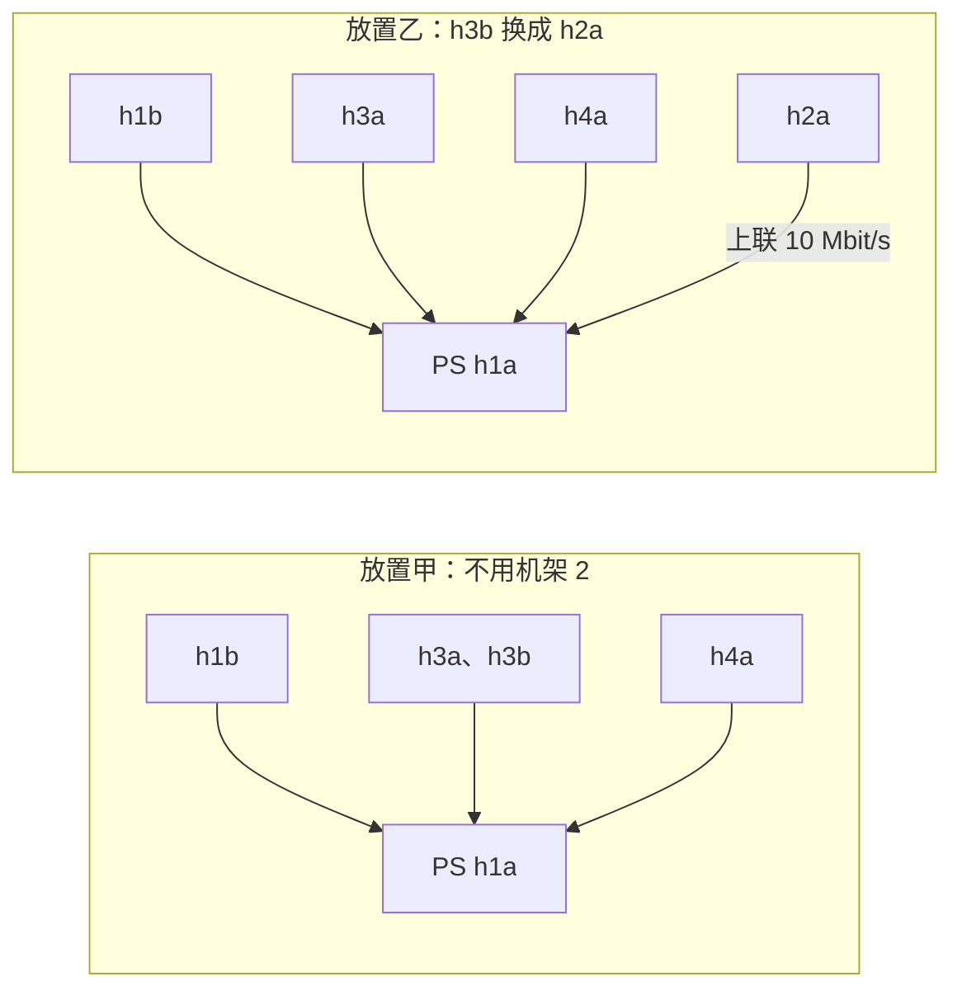
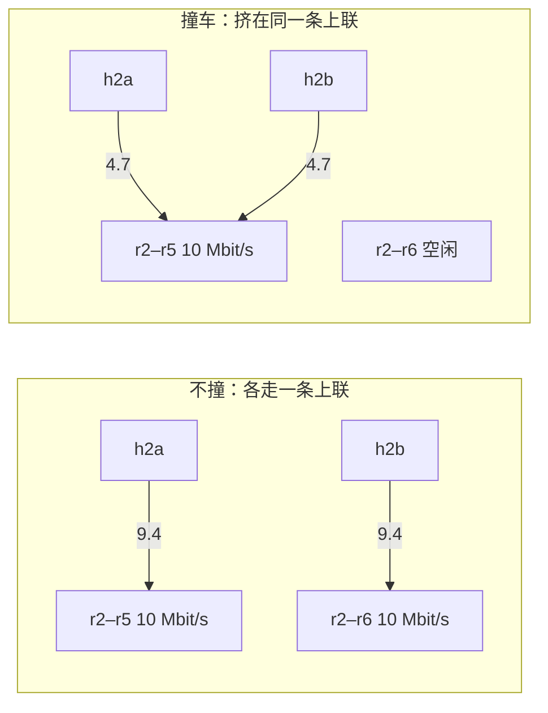

# 第 10 讲 拓扑感知调度：让计算“看见”网络

> **课程导读**：前两讲里，作业跑在哪几台机器上都是我们手工指定的。真实集群里，这件事由调度器决定，而调度器通常不知道网络现在是什么样子。本讲把同一个参数服务器作业放到不同的主机上：网络均匀时，换位置几乎没有影响；一个机架的上联变慢之后，**同样的作业、同样的计算量，只换其中一台 worker 的位置，作业完成时间从 8.9 秒变成 19 秒；按“同机架优先”去放，还会落到 27 秒或 36 秒。** 调度器要选对位置，得先看见网络。学完后，你应能读一张网络画像找出哪里慢，用一个三项的代价模型手算放置的完成时间并与实测对账，说清两两测量看不见什么，并在一个未知的网络里完成“画像、预测、放置、实测”的闭环。

---

## 学习目标

1. 说出一次放置决定了哪两件事，用实测说明网络均匀时放置无关紧要、不均匀时可以相差数倍。
2. 区分调度器可用的三类信息：什么都不看、拓扑标签、测量画像；读吞吐矩阵，判断慢的是一台主机还是一个机架的出口。
3. 用画像和代价模型 $T_{\text{round}} = T_c + T_{\text{up}} + T_{\text{down}}$ 手算一种放置的作业完成时间，并与实测对账。
4. 用“两条流撞上同一条上联”解释同一种放置的三档读数，说明两两测量的画像看不见共享瓶颈，拓扑知识补上了什么。
5. 数出放置的搜索空间，说明按规则放置与按打分放置各自的代价和适用条件，举出 HDFS、Spark、Kubernetes 中的对应机制。

| 时间 | 内容 | 课堂产出 |
| --- | --- | --- |
| 0–12 分钟 | 模块一：放置是一个决定 | 网络均匀与一个机架变慢时，各比较两种放置 |
| 12–30 分钟 | 模块二：调度器能看见什么 | 测一张画像，从矩阵里读出“哪里慢” |
| 30–50 分钟 | 模块三：把画像变成预测 | 手算三种放置的 JCT；找出模型看不见的共享瓶颈 |
| 50–60 分钟 | 模块四：策略与真实系统 | 数搜索空间；笔算画像的代价 |
| 60–87 分钟 | 模块五：综合动手——在未知网络里放一个作业 | 画像、预测表、三种策略的实测、后悔值 |
| 87–90 分钟 | 模块六：课后思考与拓展 | 三道短题；Lab 7 A 段说明 |

**课前准备（不计入上述 90 分钟）**：学生自行准备 Ubuntu Linux，工具与第 08 讲相同。不同小组各用独立主机或虚拟机，同一台机器由一人操作。本讲的脚本以压缩包分发，解压后得到 `lecture10_prep` 目录，完整实验床就是其中的 `lab4_topo.sh`，Lab 3 没有做完也不影响。本讲标为“实测样例”的输出来自 2026-11-14 的备课虚拟机（Ubuntu 26.04.1、Linux `7.0.0-43-generic`、x86_64、2 核 2.8 GB），单次读数以自己的测量为准。

```bash
# 1. 进入本讲目录（lecture10_prep 压缩包解压后的目录，路径换成你自己的）；本讲所有命令都在这里执行
cd ~/lecture10_prep

# 2. 清理第 05 讲课堂网络与 Lab 3 网络（节点重名，不能同时存在）
sudo bash lab3_classroom.sh down
sudo bash lab3_topo.sh down

# 3. 准备路由守护进程的 Python 环境
uv sync --frozen

# 4. 搭建完整实验床（默认加载 Lab 2 参考路由），并自检
sudo bash lab4_topo.sh up
sudo bash lab4_topo.sh check
```

准备完成应出现 `[OK] 8 条上联往返、8 台 host 网关可达、跨机架往返。`。本讲用到的脚本、Lab 2 参考路由和 Python 环境配置都在 `lecture10_prep` 目录里，脚本按自己所在的目录找其他文件，**以下所有命令都在这个目录里执行**（新开终端时先 `cd` 进去）。这些文件是 Lab 2–4 与 Lab 6 中相应文件的副本，有两处不同：**`netprof/` 是完整实现**，也就是 Lab 4 八个 TODO 的参考写法，没有做 Lab 4 的同学也能测画像；**`place.py` 只带两种不看画像的策略**，按画像打分的程序是 Lab 7 A 段的任务，课上先手算。本讲只用参数服务器作业，工具只用 Python 标准库，直接用系统 `python3` 运行。**中途不要拆拓扑；提前结束或中断时，执行 5.7 节的清理命令。**

---

## 模块一：放置是一个决定

### 1.1 一个作业要占几台机器

第 08 讲的参数服务器作业由 1 个参数服务器（PS）和 N 个 worker 组成。每一轮里，worker 先各自计算，再把梯度上传给 PS，PS 收齐后把新模型发回去。到现在为止，PS 一直在 h1a，worker 是我们在命令行里列出来的。

把一个作业的各个部分安排到具体的机器上，叫**放置（Placement）**。对这个作业，一次放置要定两件事：

- PS 放在哪一台主机；
- N 个 worker 用哪 N 台主机。

实验床有 8 台主机。本讲的作业固定为 **N=4、模型 1 MB、10 轮、每个 worker 每轮计算 200 ms**，这也是 `jobrun.py` 的默认值，所以命令里只需要写放置。作业本身、计算量、轮数都不变，本讲只改变放置。

衡量标准仍然是**作业完成时间（Job Completion Time，JCT）**：从第一个 worker 开始第一轮计算，到最后一个 worker 收齐最后一轮的模型。

### 1.2 短观察：网络均匀时，换位置有没有影响

**问题与预测**：实验床在基线状态，所有链路都是 100 Mbit/s。放置甲的 worker 是 h1b、h3a、h3b、h4a；放置乙把其中的 h3b 换成 h2a。PS 都在 h1a。两次的 JCT 会差多少？**运行前先写下你的预测。**

**工具与观察点**：`jobrun.py` 的 `--ps` 与 `--workers` 指定放置。`place.py report` 只读 `jobrun.py` 写下的结果文件，把每次作业的放置和结果排成一行：

| 列 | 含义 | 来源 |
| --- | --- | --- |
| JCT s | 作业完成时间 | worker 进程的时间戳 |
| 每轮ms | JCT ÷ 轮数 | 同上 |
| 最慢上传 | 平均每轮“算完 → PS 收齐这份梯度”最久的 worker 及其用时 | worker 与 PS 两侧的时间戳 |
| 最慢下发 | 平均每轮“barrier → 收齐模型”最久的 worker 及其用时 | 同上 |

```bash
# 1. 确认实验床在基线
sudo bash lab4_topo.sh status

# 2. 放置甲：PS 在 h1a，worker 是 h1b、h3a、h3b、h4a，约 9 秒
sudo python3 jobrun.py --label base-a --ps h1a --workers h1b,h3a,h3b,h4a

# 3. 放置乙：只把 h3b 换成 h2a
sudo python3 jobrun.py --label base-b --ps h1a --workers h1b,h2a,h3a,h4a

# 4. 排成表
python3 place.py report base-a base-b
```

**实测样例**：

```output
[档位] leaf–spine 100 Mbit/s；host 接入 100 Mbit/s。场景：无。
[基线] 32 个限速端口均为 HTB + fq，速率与 burst 为基线值。
[基线] r1–r4 没有额外策略路由（自然 ECMP）。
[base-a] ps N=4 模型 1 MB 10 轮 cubic：JCT = 8.668 s，结果 /tmp/lab06-results/base-a.json
[base-b] ps N=4 模型 1 MB 10 轮 cubic：JCT = 8.669 s，结果 /tmp/lab06-results/base-b.json
标签        PS   worker                   JCT s     每轮ms  最慢上传            最慢下发            
base-a      h1a  h1b,h3a,h3b,h4a          8.668    866.8  h4a 332.9 ms        h3a 333.8 ms
base-b      h1a  h1b,h2a,h3a,h4a          8.669    866.9  h4a 333.5 ms        h2a 333.3 ms
```

**读数据**：

1. **两种放置只差 1 ms**：8.668 s 与 8.669 s。
2. **每轮 867 ms 可以拆开**：计算 200 ms，上传约 333 ms，下发约 333 ms，合计 866 ms。
3. **333 ms 从哪来**：4 个 worker 同时向 h1a 上传，都要经过 h1a 的接入链路。第 06 讲测过，100 Mbit/s 的端口上 TCP 的应用层吞吐约 95 Mbit/s，4 条流平分，每条约 23.8 Mbit/s。1 MB 是 8 Mbit，$8 / 23.8 \approx 0.336$ 秒。下发方向同理。

瓶颈是 PS 的接入链路，这是第 08 讲的结论。worker 放在哪个机架，都要挤过这一条链路，所以网络均匀时，换 worker 的位置不改变结果。

**边界**：这个结论依赖“所有链路一样快”。它也只对参数服务器成立：第 09 讲的 Ring 没有汇聚点，环序不同，JCT 就不同。

### 1.3 短观察：一个机架的上联变慢之后

现在让网络不均匀。场景 `rack2-slow` 把机架 2 与两台 spine 之间的四个方向都降到 10 Mbit/s：机架 2 内部不受影响，但进出机架 2 的流量只剩两条 10 Mbit/s 的路。

**问题与预测**：再跑一遍同样的两种放置。放置甲没有用机架 2 的主机，放置乙用了 h2a。**先写下两个 JCT 的预测，再运行。** 提示：h2a 上传 1 MB，经过一条 10 Mbit/s 的上联，大约要多久？这一轮的其他 worker 要不要等它？



*图示说明：场景 `rack2-slow` 下的两种放置。两幅图的主机位置相同，PS 都在 h1a；机架 2 的两条上联（两个方向）限速 10 Mbit/s，其余链路 100 Mbit/s。放置甲的四个 worker 都不经过机架 2 的上联；放置乙的 h2a 每一轮的上传和下发都要经过其中一条。图中标出 PS、worker 的位置和限速的上联；每条流具体经过哪台 spine 由 ECMP 决定，没有画出，回程也省略。*

```bash
# 1. 加载场景：机架 2 的两条上联、两个方向都降到 10 Mbit/s
sudo bash lab4_topo.sh scenario rack2-slow

# 2. 放置甲，约 9 秒
sudo python3 jobrun.py --label slow-a --ps h1a --workers h1b,h3a,h3b,h4a

# 3. 放置乙，约 19 秒
sudo python3 jobrun.py --label slow-b --ps h1a --workers h1b,h2a,h3a,h4a

# 4. 四次作业排在一起
python3 place.py report base-a base-b slow-a slow-b
```

**实测样例**：

```output
[*] 场景 rack2-slow 已加载。结束后执行 lab4_topo.sh scenario clear，再用 lab4_topo.sh status 核对。
[slow-a] ps N=4 模型 1 MB 10 轮 cubic：JCT = 8.939 s，结果 /tmp/lab06-results/slow-a.json
[slow-b] ps N=4 模型 1 MB 10 轮 cubic：JCT = 19.033 s，结果 /tmp/lab06-results/slow-b.json
标签        PS   worker                   JCT s     每轮ms  最慢上传            最慢下发            
base-a      h1a  h1b,h3a,h3b,h4a          8.668    866.8  h4a 332.9 ms        h3a 333.8 ms
base-b      h1a  h1b,h2a,h3a,h4a          8.669    866.9  h4a 333.5 ms        h2a 333.3 ms
slow-a      h1a  h1b,h3a,h3b,h4a          8.939    893.9  h3a 358.1 ms        h3a 333.9 ms
slow-b      h1a  h1b,h2a,h3a,h4a         19.033   1903.3  h2a 850.3 ms        h2a 852.7 ms
```

**读数据**：

1. **放置甲几乎不受影响**：8.939 s，比基线多 0.27 s。它没有任何流量经过机架 2 的上联。
2. **放置乙慢了一倍多**：19.033 s，是放置甲的 2.1 倍。两种放置只差一台 worker。
3. **慢在 h2a**：“最慢上传”和“最慢下发”两列都指向 h2a，各约 850 ms。10 Mbit/s 的端口上应用层吞吐约 9.4 Mbit/s，$8 / 9.4 \approx 0.851$ 秒，与读数一致。
4. **其他 worker 被它拖住**：每轮 1903 ms = 计算 200 + 上传 850 + 下发 853。PS 要收齐 4 份梯度才能聚合（barrier），所以一轮的时间由最慢的 worker 决定。这是第 08 讲的 straggler，只不过这次慢的原因在网络。

**边界**：这里比较的是各运行一次的结果。放置乙只有一条流经过机架 2 的上联，不存在两条流抢同一条上联的情况，所以它的读数是稳定的；3.4 节会看到不稳定的情况。场景保持加载，模块二、三接着用。

现在可以把本讲的问题说清楚了：**放置只有在网络不均匀时才重要，而调度器要放对，就得知道网络哪里不均匀。**

---

## 模块二：调度器能看见什么

### 2.1 先启动一次画像

网络画像（Network Profile）是第 06 讲的体检单扩展到全部主机对：每一对主机之间的往返时间和吞吐各是多少。完整的测量要十几分钟，课上用缩短的参数，每对主机只测 1 次吞吐。**先把它跑起来，等待的两分半钟里读 2.2 节。**

```bash
# 1. 快速画像：28 个无序对各 20 个 ping；56 个有向对各测 1 次吞吐（开头忽略 1 秒，统计 1 秒）。约 2.5 分钟
sudo python3 checkup.py --tput-repeats 1 --tput-seconds 1 --tput-omit 1 --out /tmp/lab04-results/profile-rack2.json
```

`checkup.py` 是 Lab 4 的体检工具：往返时间用 `ping`，吞吐用 `iperf3`，一次只测一对主机，结果写成一个 JSON 文件，结束时打印两张矩阵。本目录的 `netprof/` 是它的完整实现。它不会覆盖已有的画像：需要重测时，把 `--out` 换成另一个文件名。

### 2.2 三类信息

调度器做放置时，手里的信息大致分三档：

| 调度器知道什么 | 信息从哪来 | 代价 | 能回答的问题 |
| --- | --- | --- | --- |
| 什么都不知道 | 无 | 无 | 哪些机器空着 |
| 拓扑标签（Topology Label） | 管理员登记：每台机器属于哪个机架、哪个机房 | 很低，几乎不变 | 哪些机器在同一个机架 |
| 测量画像 | 主动测量每对主机 | 高：要占用网络和时间，还会过期 | 这一对主机之间现在有多快 |

对应到本讲的工具：

- `place.py random` 什么都不看，随机抽 5 台主机，第一台作 PS。
- `place.py rack` 只看机架标签：先用与 PS 同机架的主机，再按机架号依次取。这是最朴素的“同机架优先”。
- 按画像打分：用测量结果预测每种放置的 JCT，选预测值最小的。课上手算，程序留给 Lab 7。

拓扑标签在真实系统里很常见。HDFS 让管理员用脚本把每台机器映射到机架；Kubernetes 给节点打上 `topology.kubernetes.io/zone` 这样的标签。标签描述的是**位置关系**，不是**当前的快慢**：它说 h2a 和 h2b 在同一个机架，但不会说机架 2 的上联今天只剩 10 Mbit/s。

### 2.3 读画像：慢的是谁

画像跑完后，终端最后是两张矩阵。往返时间那一张在这个场景下没有异常（全部在 0.09–0.16 ms 之间），这里只看吞吐。

**实测样例**（节选：省略了逐对的 `[RTT]` 行、大部分 `[吞吐]` 行和往返时间矩阵）：

```output
[计划] 56 个有向对；往返时间 28 个无序对 × 20 个探测；吞吐 56 对 × 1 次 × (-O 1 + -t 1) 秒
[计划] 预计约 3.0 分钟
[吞吐] h1a → h1b  95.8 Mbit/s（95.8–95.8，n=1）
[吞吐] h1a → h2a  9.4 Mbit/s（9.4–9.4，n=1）
[吞吐] h1a → h2b  9.4 Mbit/s（9.4–9.4，n=1）

吞吐中位数（Mbit/s）（行＝源，列＝目的）
             h1a     h1b     h2a     h2b     h3a     h3b     h4a     h4b
     h1a       ·    95.8     9.4     9.4    94.8    95.1    95.0    95.0
     h1b    95.4       ·     8.7     8.8    95.1    95.1    95.2    95.0
     h2a     9.4     8.8       ·    95.2     9.4     9.4     8.8     9.4
     h2b     9.4     9.4    95.3       ·     9.4     9.4     8.8     9.4
     h3a    94.4    95.1     9.4     9.4       ·    95.9    95.0    95.0
     h3b    95.0    95.3     9.4     9.4    95.3       ·    95.3    95.0
     h4a    94.8    95.2     8.8     9.4    95.2    95.7       ·    95.4
     h4b    95.3    95.3     9.4     8.8    96.0    95.1    95.2       ·

[标记] 无
[完成] 用时 2.4 分钟；画像 /tmp/lab04-results/profile-rack2.json；原始输出 /tmp/lab04-results/profile-rack2.raw/
```

**读数据**：矩阵的行是发送端，列是接收端。

1. **h2a、h2b 两行两列几乎都是 9 左右**：进出这两台主机的流量都慢。
2. **但 h2a → h2b 是 95.2，h2b → h2a 是 95.3**：这两台主机之间很快。所以慢的不是主机本身，也不是它们的接入链路。如果是 h2a 的网卡慢，h2a → h2b 也应该慢。
3. **结论**：慢的是机架 2 与外部之间的那一段，也就是 r2 的上联。矩阵里这表现为一个“十字”：机架 2 的两行两列是低值，行列交叉处（机架内部）是高值。
4. **其余 6 台主机之间都在 94–96 之间**：与基线一致。

把机架标签和这张矩阵放在一起看：标签告诉我们 h2a、h2b 同属一个机架，所以可以把“十字”读成“一个机架的出口慢”；没有标签，只能看到 8 台主机里有 2 台和别人之间慢。

**边界**：

- 每个数只测了 1 次、统计 1 秒，8.7 与 9.4 的差别属于单次读数的波动，不能当成两条路的差别。Lab 4 的默认参数是每对测 3 次。
- 画像是**一对一对、依次**测的，测 h1a → h2a 时网络里没有别的流量。它回答“这一对主机单独传时有多快”，不回答“几条流同时传时各有多快”。3.4 节会用到这一点。
- 画像只代表测量的那两分半钟。测完之后网络变了，画像不会跟着变。

### 2.4 两种不看画像的策略

```bash
# 1. 同机架优先：PS 默认在 h1a，worker 先取同机架的 h1b，再按机架号取
python3 place.py rack

# 2. 随机：种子相同，结果相同
python3 place.py random --seed 1
```

**实测样例**：

```output
--ps h1a --workers h1b,h2a,h2b,h3a
--ps h2a --workers h3a,h1a,h4b,h3b
```

两条命令都只打印一行，可以直接交给 `jobrun.py`。同机架优先选了 h1b、h2a、h2b、h3a，其中两台在机架 2。它的规则里没有任何一项能让它避开机架 2。种子为 1 的随机放置把 PS 放到了 h2a，情况更糟：所有 worker 的流量都要进出机架 2。

---

## 模块三：把画像变成预测

### 3.1 三项的代价模型

看见了网络，还要能回答“这种放置会跑多久”。把 1.2 节的拆法写成式子。每一轮分三段：

$$T_{\text{round}} = T_c + T_{\text{up}} + T_{\text{down}}$$

- $T_c$：每个 worker 的计算时间，本讲是 0.2 秒。
- $T_{\text{up}}$：最慢的一个 worker 上传完梯度的时间。
- $T_{\text{down}}$：最慢的一个 worker 收齐模型的时间。

设模型大小为 $S$（MB），即 $8S$ Mbit。worker $w$ 向 PS 上传时的速率 $r_w$ 受两处限制，取较小的一个：

$$r_w = \min\left(b_{w \to p},\ \frac{C_p}{N}\right), \qquad T_{\text{up}} = \max_w \frac{8S}{r_w}$$

- $b_{w \to p}$：画像里 $w$ 到 PS 的吞吐（Mbit/s），代表这一对主机之间的路有多快。
- $C_p / N$：PS 的接入链路被 N 条流平分。$C_p$ 取画像里“到 PS”这一列的最大值。

下发方向把 $b_{w \to p}$ 换成 $b_{p \to w}$，$C_p$ 取“从 PS 出发”这一行的最大值。作业共 $R$ 轮，$\text{JCT} \approx R \cdot T_{\text{round}}$。

这是第 08 讲 α-β 模型的简化：1 MB 的传输里，与数据量无关的固定开销 α 不到 1 ms，这里略去；每字节的时间 β 换成了画像里的吞吐。

### 3.2 动手算：三种放置（6 分钟）

用 2.3 节的矩阵，PS 都在 h1a。先查两个数：“到 h1a”一列的最大值是 95.4，$C_p / N = 95.4 / 4 = 23.85$；“从 h1a 出发”一行的最大值是 95.8，$95.8 / 4 = 23.95$。

**放置甲的算法写在这里，另外两行自己填，再往下看。**

| 放置 | worker | 上传最慢的 worker 与速率 | $T_{\text{up}}$ | $T_{\text{down}}$ | $T_{\text{round}}$ | 预测 JCT |
| --- | --- | --- | --- | --- | --- | --- |
| 甲 | h1b,h3a,h3b,h4a | 都是 $\min(95, 23.85) = 23.85$ | $8/23.85 = 0.335$ | $8/23.95 = 0.334$ | 0.869 | 8.69 |
| 乙 | h1b,h2a,h3a,h4a | | | | | |
| 同机架优先 | h1b,h2a,h2b,h3a | | | | | |

*思考提示：乙里最慢的是 h2a，$b_{\text{h2a} \to \text{h1a}} = 9.4$，比 23.85 小，所以 $r = 9.4$，$T_{\text{up}} = 8 / 9.4 = 0.851$ 秒；下发方向 $b_{\text{h1a} \to \text{h2a}} = 9.4$，也是 0.851 秒。$T_{\text{round}} = 0.2 + 0.851 + 0.851 = 1.902$ 秒，预测 19.02 秒。同机架优先里 h2a、h2b 的速率都是 9.4，最慢的仍是 0.851 秒，预测同样是 19.02 秒。*

与 1.3 节的实测对账：

| 放置 | 预测 JCT（s） | 实测 JCT（s） | 误差（预测相对实测） |
| --- | --- | --- | --- |
| 甲 | 8.69 | 8.939 | −2.8% |
| 乙 | 19.02 | 19.033 | −0.1% |

两个都对上了。按这个模型，同机架优先应该和乙一样，也是 19 秒左右。

### 3.3 短观察：同机架优先实际跑多久

**问题与预测**：模型说 19.02 秒。**先写下你认为实测会是多少，以及连跑几次会不会一样。**

```bash
# 1. 用同机架优先的放置运行，19 到 36 秒
sudo python3 jobrun.py --label slow-rack $(python3 place.py rack)

# 2. 与前两种放置排在一起
python3 place.py report slow-a slow-b slow-rack
```

**实测样例**：

```output
[slow-rack] ps N=4 模型 1 MB 10 轮 cubic：JCT = 35.951 s，结果 /tmp/lab06-results/slow-rack.json
标签        PS   worker                   JCT s     每轮ms  最慢上传            最慢下发            
slow-a      h1a  h1b,h3a,h3b,h4a          8.939    893.9  h3a 358.1 ms        h3a 333.9 ms
slow-b      h1a  h1b,h2a,h3a,h4a         19.033   1903.3  h2a 850.3 ms        h2a 852.7 ms
slow-rack   h1a  h1b,h2a,h2b,h3a         35.951   3595.1  h2a 1701.2 ms       h2b 1690.2 ms
```

这一次是 35.951 秒，几乎是预测值的两倍。备课时同一条命令连着又跑了四次，五次的结果是：

| 运行 | JCT（s） | 最慢上传（ms） | 最慢下发（ms） |
| --- | --- | --- | --- |
| 第 1 次 | 35.951 | 1701.2 | 1690.2 |
| 第 2 次 | 35.343 | 1669.4 | 1665.7 |
| 第 3 次 | 27.472 | 1685.5 | 860.8 |
| 第 4 次 | 27.436 | 852.5 | 1687.6 |
| 第 5 次 | 19.114 | 851.2 | 855.2 |

**读数据**：

1. **读数落在三档上**：约 19、27.5、36 秒，没有中间值。
2. **每个方向只有两种用时**：约 850 ms 或约 1690 ms，后者正好是前者的两倍。
3. **19 秒那一次与模型一致**：两个方向都是 850 ms。
4. **27.5 秒的两次各有一个方向翻倍**：一次是上传，一次是下发。$0.2 + 1.69 + 0.85 = 2.74$ 秒一轮。
5. **36 秒的两次两个方向都翻倍**：$0.2 + 1.69 + 1.69 = 3.58$ 秒一轮。

你的读数很可能和这里的第 1 次不同，落在三档中的哪一档都正常。**不要为了得到某个数字反复运行**，记下你的读数属于哪一档即可。

### 3.4 模型漏了什么：共享的上联

翻倍的原因是第 09 讲见过的 ECMP 撞车。机架 2 有两条上联，h2a 和 h2b 向 h1a 上传时，r2 按流的五元组哈希各选一条：



*图示说明：机架 2 的两个 worker 向机架外上传时的两种情况，数字是每条流的应用层吞吐（Mbit/s）。左：两条流被哈希到不同的上联，各得约 9.4，1 MB 用 0.85 秒。右：两条流被哈希到同一条上联，平分约 9.4，两份共 2 MB 要 1.70 秒才能传完，另一条上联空着。下发方向由 r1 为 h1a 发出的两条流各选一台 spine，情况相同。图中只画机架 2 的上联，省略了 spine 之后的路径和其他 worker。*

- **不撞**：两条流各占一条上联，每条约 9.4 Mbit/s，与画像一致，用时 $8 / 9.4 = 0.85$ 秒。
- **撞车**：两条流挤在同一条上联，两份共 16 Mbit 要 $16 / 9.4 = 1.70$ 秒才能传完，与读数 1.67–1.70 秒一致。

本实验床用四层哈希，作业每次运行都新建连接，所以每次的结果都可能不同。两条流、两条上联，如果哈希是均匀的，每个方向撞与不撞各占一半，于是两个方向都不撞、只撞一个方向、两个都撞这三种情况大致是 1 : 2 : 1，平均下来约 27.5 秒，比模型预测的 19 秒多出四成以上。

**画像为什么看不见**：画像是一对一对测的。测 h2a → h1a 时，网络里只有这一条流，测到 9.4；测 h2b → h1a 时也只有它自己，也是 9.4。两个数都是真的，但它们没有告诉我们“这两条流会不会用同一条链路”。**这类只有多条流同时出现才显现的限制，叫共享瓶颈（Shared Bottleneck）。**

要预测它，需要**拓扑知识**：h2a 和 h2b 在同一个机架，出机架只有两条上联，每条 10 Mbit/s。这正是“拓扑感知”在画像之外补上的东西：

| 信息 | 能看见 | 看不见 |
| --- | --- | --- |
| 只有拓扑标签 | 谁和谁共用机架出口 | 出口现在有多快 |
| 只有两两画像 | 每一对单独传时有多快 | 几条流会不会挤在一起 |
| 两者都有 | 单独的快慢，加上哪些流共用同一段 | 哈希这一次把流分到了哪条路 |

**边界**：即使两者都有，也只能算出“三档各有多大可能”，算不出这一次落在哪一档；那取决于这次连接的端口号。放置乙只有一条流经过机架 2 的上联，不存在这个问题，所以它既更快也更稳定。把 PS 放进机架 2 的放置更糟，3 个机架外的 worker 都要挤过那两条上联，备课时测到过 28.9 秒和 44.3 秒，这两种放置课上不跑。

### 3.5 恢复基线

```bash
# 1. 恢复基线并核对；模块五要换一个场景
sudo bash lab4_topo.sh scenario clear
sudo bash lab4_topo.sh status
```

**实测样例**：

```output
[*] 已恢复基线：全部端口 HTB + fq、档位不变，钉路已取消。
[档位] leaf–spine 100 Mbit/s；host 接入 100 Mbit/s。场景：无。
[基线] 32 个限速端口均为 HTB + fq，速率与 burst 为基线值。
[基线] r1–r4 没有额外策略路由（自然 ECMP）。
```

---

## 模块四：策略与真实系统

本模块只讲知识，不运行命令。

### 4.1 有多少种放法

把信息、模型和选择连起来，就是调度器做一次放置的过程：


*图示说明：一次放置的决策过程。作业的要求给出候选放置；调度器用手里的信息和代价模型为每个候选算一个预测值，选最小的去运行。运行后的实测 JCT 用来检查预测，偏差大时回头补充信息或修改模型（虚线）。只按规则放置的调度器没有“代价模型”这一步，直接从候选里按规则取一个。*

候选有多少个？8 台主机里选 1 台作 PS，剩下 7 台里选 4 台作 worker：

$$8 \times \binom{7}{4} = 8 \times 35 = 280$$

280 种可以全部算一遍。但主机数一多就不行了：1000 台主机里选 5 台并指定其中一台作 PS，是 $5 \times \binom{1000}{5} \approx 4.1 \times 10^{13}$ 种。即使每种只花 1 微秒，也要一年多。

所以真实的调度器不会穷举，常见的做法有两类。

### 4.2 按规则放置

规则只用拓扑标签，不做预测，决策极快。

- **HDFS 的机架感知**：副本数为 3 时，第一个副本放在写入者所在的机器（写入者不在数据节点上时，放在同机架的一台随机数据节点上），第二个副本放在另一个机架的一台机器上，第三个副本放在第二个副本同机架的另一台机器上。这样跨机架的写入流量只有一份，同时仍然能在一个机架整体故障时保住数据。
- **Spark 的本地性级别**：任务优先在数据所在的进程（`PROCESS_LOCAL`）或机器（`NODE_LOCAL`）上运行，其次是同机架（`RACK_LOCAL`），最后是任意位置（`ANY`）；数据没有位置偏好时是 `NO_PREF`。理想的位置暂时没有空闲时，调度器先等一会儿再退到下一级，等待时间由 `spark.locality.wait` 控制，默认 3 秒。这个“等一等”的办法叫延迟调度（Delay Scheduling）。
- **Slurm 的 `topology/tree` 插件**：管理员在 `topology.conf` 里写出交换机的层次，调度器尽量把一个作业放到同一台底层交换机下面的节点上。

规则的前提是“近的就是快的”。网络均匀、瓶颈在机架上联的收敛比时，这个前提成立，规则又快又好。本讲 1.3 节和 3.3 节就是它不成立的例子：机架 2 很近，但不快。

### 4.3 按打分放置

打分的做法是先筛掉不满足要求的机器，再给剩下的每台机器算一个分，取最高分。

- **Kubernetes 的调度框架**把一次调度分成过滤（Filter）和打分（Score）两个阶段，每个阶段由若干插件组成。拓扑标签在这里用来表达约束，例如用拓扑分布约束把同一个应用的副本分散到不同的可用区。默认的调度器并不测量节点之间的带宽；要让它“看见网络”，需要另外提供测量数据和打分插件。
- **研究系统**里有把整个放置问题建成图上的最小费用流来求解的（Quincy），也有专门利用网络状态选择数据写到哪里的（Sinbad）。

本讲模块三的手算就是一个打分过程：代价模型是打分函数，预测 JCT 越小，分越高。Lab 7 A 段要把它写成程序，并在 280 种放置里找出最好的一个。

### 4.4 笔算：画像贵不贵（3 分钟）

打分需要画像，而画像要花时间测。课上的快速画像中，每个有向对的吞吐测量约 2.5 秒（iperf3 忽略 1 秒、统计 1 秒，加上启动），8 台主机 56 个有向对用了 2.4 分钟。

**算一算**：（1）100 台主机有多少个有向对？按每对 2.5 秒、一次只测一对，要多久？（2）如果只按机架测，4 个机架之间有多少个有向的“机架对”？

*思考提示：（1）$100 \times 99 = 9900$ 对，$9900 \times 2.5 = 24750$ 秒，约 6.9 小时，测完时网络多半已经变了。（2）$4 \times 3 = 12$ 个机架对，再加 4 个机架内部，共 16 个数，而逐对测是 56 个数。用拓扑把主机归并成机架，测量量从“主机数的平方”降到“机架数的平方”；2.3 节的矩阵也确实只有这 16 种取值。这是拓扑知识的另一个用处：让画像测得起。*

### 4.5 小结

| 策略 | 用到的信息 | 决策代价 | 什么时候够用 |
| --- | --- | --- | --- |
| 随机 | 无 | 无 | 网络均匀、作业对位置不敏感 |
| 同机架优先等规则 | 拓扑标签 | 很低 | “近”和“快”一致时 |
| 按画像打分 | 测量画像，加代价模型 | 测量加搜索 | 网络不均匀，且画像没有过期 |
| 画像加拓扑 | 两者 | 更高 | 多条流共用链路时，仍只能给出可能的范围 |

---

## 模块五：综合动手——在未知网络里放一个作业

### 5.1 任务与条件

你是调度器。集群里的网络出了一些问题，没有人告诉你是什么问题。你要给一个作业选位置，并且用数据说明你的选择比两种不看画像的策略好多少。

| 项目 | 内容 |
| --- | --- |
| 输入 | 场景 `lecture10`：两项条件，**课上先不看定义** |
| 固定条件 | 作业：N=4、模型 1 MB、10 轮、每轮计算 200 ms、CUBIC；实验床 100 Mbit/s 档位 |
| 改变的因素 | 只有放置：PS 的位置和 4 个 worker 的位置 |
| 三种策略 | 同机架优先（`place.py rack`）；随机（`place.py random --seed 组号`）；你按画像选的 |
| 指标 | JCT；以及后悔值（Regret）：这种放置的 JCT 与三者中最好的 JCT 之比 |
| 产出 | 一张预测与实测对照表，一句选择依据 |

三种策略在同一个场景下各运行一次，场景在 5.2 节加载后保持到 5.6 节。**做完之前不要运行 `lab4_topo.sh status`，它会直接列出场景的定义。**

### 5.2 加载场景并画像（4 分钟）

```bash
# 1. 加载场景，先不看定义
sudo bash lab4_topo.sh scenario lecture10

# 2. 快速画像，约 2.5 分钟；等待时在纸上画好 5.3 节的表
sudo python3 checkup.py --tput-repeats 1 --tput-seconds 1 --tput-omit 1 --out /tmp/lab04-results/profile-l10.json
```

**实测样例**（节选：只保留吞吐矩阵和最后两行）：

```output
吞吐中位数（Mbit/s）（行＝源，列＝目的）
             h1a     h1b     h2a     h2b     h3a     h3b     h4a     h4b
     h1a       ·    18.3    18.9    18.8     9.4     8.8    18.8    18.8
     h1b    18.8       ·    95.8    95.4     8.8     9.4    95.0    94.9
     h2a    18.8    94.9       ·    95.3     8.8     9.4    95.8    95.0
     h2b    18.8    95.1    95.2       ·     9.4     9.4    95.0    95.3
     h3a     8.7     9.4     8.8     9.4       ·    95.2     9.4     9.4
     h3b     9.4     9.4     8.7     9.4    94.9       ·     8.8     8.8
     h4a    18.8    96.1    96.0    95.8     9.4     8.8       ·    95.2
     h4b    18.8    93.5    95.1    95.7     9.4     9.4    95.2       ·

[标记] 无
[完成] 用时 2.4 分钟；画像 /tmp/lab04-results/profile-l10.json；原始输出 /tmp/lab04-results/profile-l10.raw/
```

### 5.3 读画像，先填预测（8 分钟）

**第一步，读出哪里慢。** 用 2.3 节的方法回答：（1）哪些行和列是低值？（2）低值的主机之间互相快不快？（3）据此判断，慢的是一台主机、一条接入链路，还是一个机架的出口？有几处？

**第二步，查出两种不看画像的放置。**

```bash
# 1. 同机架优先
python3 place.py rack

# 2. 随机；把 3 换成你的组号
python3 place.py random --seed 3
```

**实测样例**：

```output
--ps h1a --workers h1b,h2a,h2b,h3a
--ps h2b --workers h3a,h4a,h1b,h2a
```

**第三步，选出你自己的放置，并为三种放置各算一个预测。** 用 3.1 节的模型和你自己测到的矩阵：

| 策略 | PS | worker | 上传最慢的 worker 与速率 | $T_{\text{up}}$ | $T_{\text{down}}$ | 预测 JCT |
| --- | --- | --- | --- | --- | --- | --- |
| 同机架优先 | | | | | | |
| 随机 | | | | | | |
| 我的选择 | | | | | | |

选的时候按这个顺序想：先定 PS（所有流量都经过它的接入链路，看哪一列、哪一行整体最高），再挑 worker（看它们与 PS 之间的两个数），最后检查有没有两个 worker 共用一段慢的链路。

*思考提示（用样例矩阵）：h1a 一行一列都在 18–19 左右，但 h1a 与机架 3 之间是 9，说明 h1a 自己的接入链路慢，约 19 Mbit/s。h3a、h3b 两行两列是 9，而它们之间是 95，是机架 3 的出口慢。所以要避开 h1a 和机架 3，剩下 h1b、h2a、h2b、h4a、h4b 正好 5 台，例如 PS 放 h2a，worker 是 h1b、h2b、h4a、h4b：$C_p/N \approx 95 / 4 = 23.8$，$T_{\text{round}} = 0.2 + 2 \times 8/23.8 = 0.87$，预测 8.7 秒。同机架优先把 PS 放在 h1a：到 h1a 一列最大 18.8，4 条流平分只有 4.7，$T_{\text{up}} = 8 / 4.7 = 1.70$，下发同理，$T_{\text{round}} = 3.6$，预测 36 秒。种子为 3 的随机放置 PS 在 h2b，worker 里有 h3a：$r = 9.4$，$T_{\text{round}} = 0.2 + 2 \times 0.851 = 1.90$，预测 19 秒。*

### 5.4 实测（4 分钟）

```bash
# 1. 同机架优先，约 36 秒
sudo python3 jobrun.py --label l10-rack $(python3 place.py rack)

# 2. 随机；种子与 5.3 节相同
sudo python3 jobrun.py --label l10-rand $(python3 place.py random --seed 3)

# 3. 你的选择；把 --ps 和 --workers 换成你自己的
sudo python3 jobrun.py --label l10-mine --ps h2a --workers h1b,h2b,h4a,h4b

# 4. 排成表
python3 place.py report l10-rack l10-rand l10-mine
```

**实测样例**：

```output
[l10-rack] ps N=4 模型 1 MB 10 轮 cubic：JCT = 35.430 s，结果 /tmp/lab06-results/l10-rack.json
[l10-rand] ps N=4 模型 1 MB 10 轮 cubic：JCT = 19.021 s，结果 /tmp/lab06-results/l10-rand.json
[l10-mine] ps N=4 模型 1 MB 10 轮 cubic：JCT = 8.668 s，结果 /tmp/lab06-results/l10-mine.json
标签        PS   worker                   JCT s     每轮ms  最慢上传            最慢下发            
l10-rack    h1a  h1b,h2a,h2b,h3a         35.430   3543.0  h2b 1672.0 ms       h3a 1690.4 ms
l10-rand    h2b  h3a,h4a,h1b,h2a         19.021   1902.1  h3a 851.2 ms        h3a 850.7 ms
l10-mine    h2a  h1b,h2b,h4a,h4b          8.668    866.8  h4b 332.3 ms        h1b 333.2 ms
```

### 5.5 读结果（5 分钟）

用样例数据填出的对照表：

| 策略 | 预测 JCT（s） | 实测 JCT（s） | 误差（预测相对实测） | 后悔值 |
| --- | --- | --- | --- | --- |
| 同机架优先 | 36.0 | 35.430 | +1.6% | 4.09 |
| 随机（种子 3） | 19.0 | 19.021 | −0.1% | 2.19 |
| 我的选择 | 8.7 | 8.668 | +0.4% | 1.00 |

1. **排序预测对了**：三种放置的预测与实测顺序一致，误差都在 2% 以内。对调度器来说，排序对比数值准更重要，它只需要知道哪个更好。
2. **同机架优先最差**：它把 PS 留在了 h1a，4 条流平分一条 19 Mbit/s 的接入链路，每轮上传和下发各要 1.7 秒。“最慢上传”和“最慢下发”都在 1.67–1.69 秒，与 $8 / 4.7 = 1.70$ 秒一致。
3. **随机放置碰巧避开了 h1a，但用了 h3a**：慢在机架 3 的出口，h3a 两个方向各 851 ms。
4. **按画像选的放置回到了基线水平**：8.668 秒，与 1.2 节均匀网络里的读数相同。网络坏了两处，但 8 台主机里还剩 5 台之间的路是好的，够放下这个作业。

**你的数据如果不同**：先核对三次运行的场景是否相同；再看“最慢上传”“最慢下发”指向的 worker 是否与你画像里的低值对应。随机放置因种子不同，结果从 8.7 秒到 40 多秒都有可能。如果你的放置里有两个 worker 共用一段慢的链路，读数可能落在 3.3 节那样的几档上。

### 5.6 小组交付（3 分钟）

写在纸上或文档里：

1. 你的对照表（5.5 节的格式，用你自己的数据）。
2. 一句话说明你选 PS 的依据，一句话说明你排除了哪些主机、依据矩阵里的哪些数。
3. 揭晓：现在运行下面的命令，核对你在 5.3 节第一步的判断。

```bash
# 1. 揭晓场景的定义
sudo bash lab4_topo.sh status
```

**实测样例**：

```output
[档位] leaf–spine 100 Mbit/s；host 接入 100 Mbit/s。场景：lecture10。
[偏离] h1a eth0：rate 20 / ceil 20 Mbit/s（基线 100）
[偏离] r1 r1-h1a：rate 20 / ceil 20 Mbit/s（基线 100）
[偏离] r3 r3-r5：rate 10 / ceil 10 Mbit/s（基线 100）
[偏离] r5 r5-r3：rate 10 / ceil 10 Mbit/s（基线 100）
[偏离] r3 r3-r6：rate 10 / ceil 10 Mbit/s（基线 100）
[偏离] r6 r6-r3：rate 10 / ceil 10 Mbit/s（基线 100）
[基线] r1–r4 没有额外策略路由（自然 ECMP）。
```

两项条件是：h1a 的接入链路两个方向降到 20 Mbit/s；机架 3 的两条上联、两个方向降到 10 Mbit/s。调度器并不需要知道这六行配置，它只需要那张矩阵。

### 5.7 恢复与清理（2 分钟）

```bash
# 1. 恢复基线并核对
sudo bash lab4_topo.sh scenario clear
sudo bash lab4_topo.sh status

# 2. 需要保留结果就先复制；同名标签再次运行会被覆盖
mkdir -p "$HOME/lecture10-results" && cp -r /tmp/lab06-results /tmp/lab04-results "$HOME/lecture10-results/"

# 3. 不接着做 Lab 7 的话，拆实验床（幂等）
sudo bash lab4_topo.sh down
```

**实测样例**：

```output
[*] 已恢复基线：全部端口 HTB + fq、档位不变，钉路已取消。
[档位] leaf–spine 100 Mbit/s；host 接入 100 Mbit/s。场景：无。
[基线] 32 个限速端口均为 HTB + fq，速率与 burst 为基线值。
[基线] r1–r4 没有额外策略路由（自然 ECMP）。
[*] 实验床已拆除；路由日志保留在 /tmp/lab04-results。
```

作业进程和测量进程运行完就退出，不留后台进程。如果中途异常退出，执行第 3 步即可，`lab4_topo.sh down` 会结束所有 namespace 里的进程。如果忘了恢复场景，第 1 步的 `status` 会列出偏离基线的端口。

### 5.8 从课堂走向 Lab 7

| 课上已经做到 | Lab 7 A 段要做 |
| --- | --- |
| 读画像矩阵，判断哪里慢 | 用程序读画像文件（`netprof/schema.py`） |
| 手算三种放置的预测 JCT | 把代价模型写成函数，给任意一种放置打分 |
| 凭观察挑出一种好的放置 | 在 280 种放置里找出预测最好的 |
| 看到两条流撞车时模型偏低 | 用机架信息给共享上联做修正，比较修正前后的排序 |
| 三种策略各测一次 | 多个场景、重复运行，用后悔值评价三种策略 |

Lab 7 B 段对应第 11 讲：主机的算力也不一样时，怎样把网络和算力放在一起决策。

---

## 模块六：课后思考与拓展

### 6.1 离堂检查（2 分钟）

1. 一次放置对参数服务器作业决定了哪两件事？
2. 吞吐矩阵里，一台主机的整行整列都是低值，另一种情况是同机架两台主机的行列是低值但它们之间是高值。两种情况各说明什么？
3. 同一种放置测出 19、27.5、36 秒三档读数，原因是什么？画像为什么没有反映出来？

### 6.2 思考题

1. **小模型看哪张矩阵**：如果模型只有 1 KB，每轮计算 20 ms，画像的两张矩阵里哪一张更重要？代价模型要怎么改？

   *思考提示：1 KB 的传输时间几乎全是固定开销，取决于往返时间而不是吞吐。回想第 08 讲的 $T = \alpha + \beta m$：$m$ 很小时 α 占主导。第 09 讲 5.4 节的小模型实验是同一个道理。*

2. **PS 放错与 worker 放错**：3.4 节末尾提到，把 PS 放进机架 2 时测到过 28.9 秒和 44.3 秒，比只放一个 worker 进去的 19 秒差得多。为什么 PS 的位置更要紧？

   *思考提示：数一数每种情况下有几条流经过机架 2 的上联。所有 worker 的流量都要经过 PS。*

3. **画像会过期**：画像测完之后，另一个作业开始在机架 4 里大量传数据。你的调度器按旧画像把新作业也放进了机架 4。怎样发现画像过期了？

   *思考提示：4.1 节的图里有一条虚线。实测 JCT 明显大于预测，就是一个信号。还可以想想：能不能不靠主动测量，只看正在运行的作业的传输速率来更新画像？*

4. **测量也是负载**：快速画像要让 56 对主机各跑 2 秒 iperf3。画像期间，集群里正在运行的作业会受什么影响？100 台主机时这个问题会变成什么样？

   *思考提示：第 06 讲 5.3 节讲过同时进行的测量会互相干扰，测量流量对正在运行的作业也是一样。结合 4.4 节的笔算，想想为什么真实系统更愿意用拓扑标签加少量测量。*

5. **大家都想要好位置**：如果每个作业都按画像挑最快的 5 台主机，同时提交的两个作业会选到同一批机器上。这会带来什么问题？

   *思考提示：两个作业的流量挤在同一批链路上，又是一个共享瓶颈，而画像是在没有作业时测的。调度器除了网络，还得知道机器上已经有什么在跑，这是第 11 讲的内容。*

### 6.3 拓展资料与 RFC 列表

| 资料 | 范围 | 用途 |
| --- | --- | --- |
| [Apache Hadoop：HDFS Architecture](https://hadoop.apache.org/docs/stable/hadoop-project-dist/hadoop-hdfs/HdfsDesign.html) | Data Replication 一节 | 机架感知的副本放置策略 |
| [Apache Spark：Tuning Spark](https://spark.apache.org/docs/latest/tuning.html) | Data Locality 一节 | 本地性级别 |
| [Apache Spark：Configuration](https://spark.apache.org/docs/latest/configuration.html) | `spark.locality.wait` | 等待时间的默认值 |
| [Zaharia et al.，Delay Scheduling（EuroSys 2010）](https://doi.org/10.1145/1755913.1755940) | §1–§3 | 延迟调度：等一小会儿换来本地性 |
| [Kubernetes：Scheduling Framework](https://kubernetes.io/docs/concepts/scheduling-eviction/scheduling-framework/) | 全文 | 过滤与打分两个阶段 |
| [Kubernetes：Pod Topology Spread Constraints](https://kubernetes.io/docs/concepts/scheduling-eviction/topology-spread-constraints/) | 全文 | 用拓扑标签表达分布约束 |
| [Kubernetes：Well-Known Labels, Annotations and Taints](https://kubernetes.io/docs/reference/labels-annotations-taints/) | `topology.kubernetes.io/zone` 等 | 拓扑标签的名称与含义 |
| [Slurm：Topology Guide](https://slurm.schedmd.com/topology.html) | Hierarchical Networks 一节 | `topology/tree` 插件 |
| [Isard et al.，Quincy: Fair Scheduling for Distributed Computing Clusters（SOSP 2009）](https://doi.org/10.1145/1629575.1629601) | §1–§4 | 把放置建成最小费用流 |
| [Chowdhury et al.，Leveraging Endpoint Flexibility in Data-Intensive Clusters（SIGCOMM 2013）](https://doi.org/10.1145/2486001.2486021) | §1–§4 | Sinbad：按网络状态选择写入位置 |

本讲没有新增 RFC。ECMP 的哈希选路见第 05 讲列出的 [RFC 2992](https://www.rfc-editor.org/rfc/rfc2992)。拓展阅读不作为本周必须实现的任务。

### 6.4 后续衔接实验

- 上游：[第 06 讲](network_measurement.md)的体检单与测量口径；[第 08 讲](communication_cost.md)的参数服务器、barrier 与 α-β 模型；[第 09 讲](collective_communication.md)的 ECMP 撞车；本讲目录的 `lab4_topo.sh` 与 `netprof/`。
- 本讲：[Lab 7 指导书](../experiments/07/README.md)的 A 段，把代价模型和搜索写成程序，在多个场景下比较三种策略。
- 下一讲：第 11 讲讨论算力网络与算网协同：机器的算力也不一样时，怎样把“离得近”和“算得快”放在一起决策。
